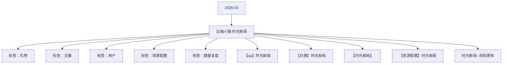

# 云端小镇  时光邮局 活动知识图谱

## 核心信息

- 月份：2026-03
- 活动时间：3.23-3.26
- 活动 Wiki：https://wiki.inkept.cn/pages/viewpage.action?pageId=483790252
- 活动页面 ID：483790252
- 关联资料数：5
- 标签：礼物、主播、用户、资源配置、数据复盘

## 优化总结

### 活动概览

- 二 活动目标：（来源：活动主页面）
- 活动目标：（来源：活动主页面）
- 目标完成度（来源：【日报】时光邮局）
- 消耗目标2400万钻，活动上线4天，消耗1803万钻，目标完成度75.14%。（来源：【日报】时光邮局）
- 消耗目标消耗钻石数目标完成度（来源：【日报】时光邮局）

### 活动时间

- 一、活动时间：（来源：活动主页面）
- 起始时间：2024-11-08 10:31:19（来源：活动主页面）
- 结束时间：2024-11-25 10:31:19（来源：活动主页面）
- 起始时间：2024-11-08 10:32:51（来源：活动主页面）
- 结束时间：2024-11-25 10:32:51（来源：活动主页面）
- 时间：3月23日00:00:00-3月27日23:59:59（来源：【时光邮局】）
- 时间：3月23日00:00:00-3月26日23:59:59（来源：【时光邮局】）
- 时间：3月23日00:00:00-3月24日23:59:59（来源：【时光邮局】）

### 玩法规则

- 五、玩法说明：（来源：活动主页面）
- 主播任务-主播玩法--共计三个场景（来源：活动主页面）
- 玩法逻辑：（来源：活动主页面）
- 活动期间，主播每收礼达21钻则获得1封信件，累计信件数量主播做升级任务拿奖励，共计三个场景（来源：活动主页面）
- 主播任务三个奖励奖励（来源：活动主页面）
- 关卡任务值资源类型资源名称资源id时长数量私信内容弹幕或公聊内容图片（来源：活动主页面）
- 【时光邮局】恭喜宝宝完成街边邮局任务一，获得街边邮局头像框*5天奖励，快去看看叭~（来源：活动主页面）
- 【时光邮局】恭喜宝宝完成街边邮局任务二，获得街边邮局公聊角标*5天奖励，快去看看叭~（来源：活动主页面）
- 【时光邮局】恭喜宝宝完成街边邮局任务三，获得街边邮局称号*5天奖励，快去看看叭~（来源：活动主页面）
- 【时光邮局】恭喜宝宝完成街边邮局任务四 ，获得街边邮局挂件*5天奖励，快去看看叭~（来源：活动主页面）
- 【时光邮局】恭喜宝宝完成街边邮局任务五，获得街边邮局浮屏*5天奖励，快去看看叭~（来源：活动主页面）
- 【时光邮局】恭喜宝宝完成海边邮局任务一，获得海边邮局头像框*5天奖励，快去看看叭~（来源：活动主页面）
- 【时光邮局】恭喜宝宝完成海边邮局任务二，获得海边邮局公聊角标*5天奖励，快去看看叭~（来源：活动主页面）
- 【时光邮局】恭喜宝宝完成海边邮局任务三，获得海边邮局称号*5天奖励，快去看看叭~（来源：活动主页面）
- 【时光邮局】恭喜宝宝完成海边邮局任务四，获得海边邮局挂件*5天奖励，快去看看叭~（来源：活动主页面）
- 【时光邮局】恭喜宝宝完成海边邮局任务五，获得海边邮局浮屏*5天奖励，快去看看叭~（来源：活动主页面）
- 【时光邮局】恭喜宝宝完成天空邮局任务一，获得头像框*5天奖励，快去看看叭~（来源：活动主页面）
- 【时光邮局】恭喜宝宝完成天空邮局任务二，获得天空邮局公聊角标*5天奖励，快去看看叭~（来源：活动主页面）

### 奖励与资源

- 名称价值礼物ID（来源：活动主页面）
- 派对（嘉宾收礼）：厅主及厅内嘉宾4人视频，6人视频，9人音频房间收礼的专属礼物收入，其余方式均不计入统计。谁收算谁的。（来源：活动主页面）
- 陪陪奖励（来源：活动主页面）
- 场景一：用户送礼满99钻，获得资源奖励1天，循环获得，每个奖励最多可获得15天（来源：活动主页面）
- 场景二：用户送礼每满99钻，获得资源奖励1天，循环获得，每个奖励最多可获得15天（来源：活动主页面）
- 场景三：用户送礼每满99钻，获得资源奖励1天，循环获得，每个奖励最多可获得15天（来源：活动主页面）
- 全部通关之后，则主播获得永久勋章，给该主播送礼达1000钻以上的用户，获得限时勋章奖励，用户每个人限制5次（来源：活动主页面）
- 主播勋章奖励（来源：活动主页面）
- 类型奖励名称私信（来源：活动主页面）
- 奖励与私信由研发实时下发（来源：活动主页面）
- 用户日榜奖励（来源：活动主页面）
- 单次赠送活动专属礼物，主播获得1映币（运营直接配置），然后再送给主播一个从奖励里出的奖励（来源：活动主页面）
- 产出的礼物会直接赠送给主薄（来源：活动主页面）
- 主播和用户获得奖励的公聊通知，仅2人可见（来源：活动主页面）
- 文案不对：【飞信传情】送了什么礼物（来源：活动主页面）
- 每次送礼可以点亮一个模块，5个模块都点亮，则可获得一个新的道具礼物下发用户的道具里（来源：活动主页面）
- 礼物价值分为10钻/200钻，10钻主播获得1 映币，200钻，主播获得5映币（来源：活动主页面）
- 礼物id名称价值映币描述（来源：活动主页面）

### 入口与链接

- 月23日-3月26日（来源：活动主页面）
- 活动期间日均消耗600w，活动消耗2400w（来源：活动主页面）
- 三、活动框架（来源：活动主页面）
- 原型图：https://modao.cc/proto/E8KZhNbtbbk4dzwSnHPLd/sharing?view_mode=read_only&screen=rbpVCncm7aEJnfWkp #时光邮局-分享（来源：活动主页面）
- 飞信传情1024268https://img.ikstatic.cn/MTc3MzkwNzEyNzYzOSMgNTUjcG5n.png（来源：活动主页面）
- 长相思7724275https://img.ikstatic.cn/MTcyMjg0MDA0MTE1NiM4OTgjcG5n.png（来源：活动主页面）
- 邮来心动20024269https://img.ikstatic.cn/MTc3MzkwNzE1NDQ4MiMgNjAjcG5n.png（来源：活动主页面）
- 梦游仙镜52024276https://img.ikstatic.cn/MTc0MzA2MjgzMTIwMCMgNDgjcG5n.png（来源：活动主页面）
- 灵蛇仙姬131424277https://img.ikstatic.cn/MTc0MTIyODE2Mjc0MSM0MjQjcG5n.png（来源：活动主页面）
- 潘多拉仙境520024278https://img.ikstatic.cn/MTc0Nzk5NTUxMzM3MCMxMzQjcG5n.png（来源：活动主页面）
- 耶耶日记1314024279https://img.ikstatic.cn/MTc1Mzc3MTAyNDc5NyMgMzUjcG5n.png（来源：活动主页面）
- 爪爪联萌3344024280https://img.ikstatic.cn/MTc1Mzc3MTE2MzQxNCMzNzYjcG5n.png（来源：活动主页面）

### 上线配置

- 《时光邮局》活动于3月23日0点-3月26日24点上线，现同步Day3数据情况：（来源：【日报】时光邮局）

### 数据与复盘

- Hi all（来源：【日报】时光邮局）
- ,000,00018,033,85975.14%（来源：【日报】时光邮局）
- ,217,78216,754,0375,582,1423,269,0922,313,05017.88%33.32%（来源：【日报】时光邮局）
- ,254,56917,499,6044,307,9763,008,4361,299,54013.36%24.62%（来源：【日报】时光邮局）
- ,172,31015,561,7464,426,6533,195,4831,231,17014.67%28.45%（来源：【日报】时光邮局）
- ,142,86013.04%26.27%（来源：【日报】时光邮局）
- 合计122,146,09863,962,77418,033,85912,047,2395,986,62014.76%28.19%（来源：【日报】时光邮局）
- 日均30,536,52515,990,6944,508,4653,011,8101,496,65514.76%28.19%（来源：【日报】时光邮局）
- 场景主播分布：（来源：【日报】时光邮局）
- 送礼场景送礼钻石数（来源：【日报】时光邮局）
- 派对1362231875.54%（来源：【日报】时光邮局）
- 秀场441154124.46%（来源：【日报】时光邮局）
- 总计18033859（来源：【日报】时光邮局）
- 各层级主播收礼数据（来源：【日报】时光邮局）
- 派对侧收礼的主播主要集中BCN层级，秀场侧收礼的主播主要集中在B层级。（来源：【日报】时光邮局）
- 主播61日动态层级派对占比秀场占比（来源：【日报】时光邮局）

### 其他关键信息

- 三个场景，分别为：升级完成之后开启新的场景，且这个场景里送礼达到最高等级之后，剩余的钻石数进入进入场景二（来源：【qa】时光邮局）
- 场景一：（来源：【qa】时光邮局）
- task_keyscore_totalprize_typeprize_name（来源：【qa】时光邮局）
- 头像框街边邮局头像框（来源：【qa】时光邮局）
- 公聊角标街边邮局公聊角标（来源：【qa】时光邮局）
- 称号街边邮局称号（来源：【qa】时光邮局）
- 挂件街边邮局挂件（来源：【qa】时光邮局）
- 浮屏街边邮局浮屏（来源：【qa】时光邮局）
- 头像框海边邮局头像框（来源：【qa】时光邮局）
- 公聊角标海边邮局公聊角标（来源：【qa】时光邮局）

## 资料关系图

## 资料来源

- [活动主页面](https://wiki.inkept.cn/pages/viewpage.action?pageId=483790252)
- [【qa】时光邮局](https://wiki.inkept.cn/pages/viewpage.action?pageId=488350647)
- [【日报】时光邮局](https://wiki.inkept.cn/pages/viewpage.action?pageId=488354300)
- [【时光邮局】](https://wiki.inkept.cn/pages/viewpage.action?pageId=488350187)
- [【资源配置】时光邮局](https://wiki.inkept.cn/pages/viewpage.action?pageId=488347360)
- [时光邮局--规则更改](https://wiki.inkept.cn/pages/viewpage.action?pageId=488350220)
