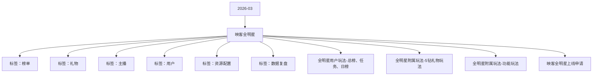

# 映客全明星 活动知识图谱

## 核心信息

- 月份：2026-03
- 活动时间：3.27-3.31
- 活动 Wiki：https://wiki.inkept.cn/pages/viewpage.action?pageId=483789319
- 活动页面 ID：483789319
- 关联资料数：4
- 标签：榜单、礼物、主播、用户、资源配置、数据复盘

## 优化总结

### 活动概览

- 一、活动简介（来源：活动主页面）
- 活动目标：日均1000w钻石消耗（来源：活动主页面）

### 活动时间

- 三、活动时间：（来源：活动主页面）
- 数据统计时间：（来源：活动主页面）
- 活动收礼数据统计时间：（来源：活动主页面）
- 页面展示时间：（来源：活动主页面）
- 当前赛段开启时，开启对应赛段规则详情。未到达开启时间时，该赛段规则锁住。（来源：活动主页面）
- 活动状态在不同时间段有区分：分为已完成、进行中、未开放3种状态（颜色及形状区分）。（来源：活动主页面）
- 赛段奖励，研发自动下发时间为赛段结束后进行奖励实时下发；（来源：活动主页面）
- 世界BOSS时间和非礼物玩法时间保持一致；（来源：活动主页面）

### 玩法规则

- 消耗任务奖励（来源：活动主页面）
- 陪陪：运营提供白名单，榜单以陪陪为单位，榜单仅统计白名单交友嘉宾在4/6人视频直播间、9人音频房间获得的专属礼物收入，其余方式均不计入统计；（来源：活动主页面）
- 礼物玩法产出渠道：不统计私信送礼渠道，其他渠道均正常产出（包括但不限于个人视频直播间、个人视频直播间上麦、个人电台、4人房、6人房、9人房、相恋，拍卖，团战，派对bar，一周cp3人房）（来源：活动主页面）
- 消耗总榜：活动期间用户累计充值大于10万元人民币且消耗活动专属礼物大于100万钻可进入榜单，充值不区分渠道（包含充值贵族币等）；（来源：活动主页面）
- 级专属礼物+活动专属礼物+活动非礼物玩法中出的活动专属礼物+积分卡+700级礼物+小映礼物（来源：活动主页面）
- 五、全程通用逻辑：（来源：活动主页面）
- 礼物统计维度：430级专属礼物+活动专属礼物+活动非礼物玩法中出的活动专属礼物+积分卡+700级礼物+小映礼物（来源：活动主页面）
- 各赛段结束后榜单结果需研发人员发送邮件，运营人员确认。（来源：活动主页面）
- 正赛各榜单，当积分相同时排名展示“根据主播的用户等级大小进行排名，等级越大排名越高。当用户等级大小相同，根据用户uid大小进行排名，uid越小排名越高，未收到专属礼物，积分均展示为0”（来源：活动主页面）
- 如果积分是小数点，省略小数点后面数字。（来源：活动主页面）
- 点击未开启赛段tab，触发弹窗提示，弹窗文案和首页赛段锁定的逻辑相同，详情请见原型图。（来源：活动主页面）
- 参赛主播及用户从在榜主播ICON中点进活动页面，默认展示该主播所在榜单及其个人信息，其余未参赛主播或用户进入活动页面默认展示娱乐明星榜单，不展示吸底。（适用于整个赛程）（来源：活动主页面）
- 各赛道榜单切换位置实时展示当前排名第一主播头像，详情请见原型图。（来源：活动主页面）
- 所有主播或用户进入用户玩法页面，均展示个人信息。（来源：活动主页面）
- 页面所展示所有主播信息，区分直播状态（陪陪榜单也要），可点击跳转；用户不做区分，且不可点击跳转。（来源：活动主页面）
- 刷新按钮——榜单页面悬浮存在，点击可刷新榜单。（来源：活动主页面）
- 各赛段吸底中安全区主播展示距上一名积分，文案为距上一名：，危险区主播展示距安全区最后一名主播积分，文案为距晋级还差：；（来源：活动主页面）
- 直播间icon不同面配置不同链接，具体详情见icon规则；（来源：活动主页面）

### 奖励与资源

- 二、活动奖励（来源：活动主页面）
- 主播侧--核心奖励（来源：活动主页面）
- 特权奖励（来源：活动主页面）
- ai定制礼物（来源：活动主页面）
- 曝光及特权资源--（来源：活动主页面）
- 常规线上奖励：站内流量曝光资源、稀有特权资源（来源：活动主页面）
- 用户侧核心奖励：（来源：活动主页面）
- 站内荣誉特权资源：荣誉座驾+永久勋章+专属稀有映宝（来源：活动主页面）
- 专属奖励（来源：活动主页面）
- AI定制礼物3月有效期，由用户提供关键词/照片/图片（来源：活动主页面）
- 专属特权资源--（来源：活动主页面）
- 站内特权资源奖励（来源：活动主页面）
- 礼物统计：（来源：活动主页面）
- 各赛段晋级奖励（除总决赛/半决赛外），均为研发实时下发（来源：活动主页面）
- 主播根据收到专属礼物的顺序依次进入所属赛区。（来源：活动主页面）
- 礼物统计范围（来源：活动主页面）
- 收礼每累计收礼达到 100 钻1无限制，按统计礼物钻石实时累计（来源：活动主页面）
- 称号娱乐巨星21【映客全明星】恭喜你成功晋级至突围赛！下一赛段即将开启，请继续加油，冲击更高荣耀，晋级奖励称号、头像框已下发。（来源：活动主页面）

### 入口与链接

- 活动名称：2026年映客全明星（来源：活动主页面）
- 年第一明星头像框、映客第一明星称号、超级短位靓号、巨无霸标签（来源：活动主页面）
- 明星主播冠亚季军（来源：活动主页面）
- 明星嘉宾冠亚季军（来源：活动主页面）
- 实物–专属稀有映宝6套组合（来源：活动主页面）
- 实物–专属稀有映宝（来源：活动主页面）
- 荣誉座驾、永久勋章、超级短位靓号（来源：活动主页面）
- 年3月27日00:00:00-3月31日23:59:59；（来源：活动主页面）
- 年3月27日00:00:00-待定（来源：活动主页面）
- 四、数据统计维度：（来源：活动主页面）
- 个人主播收礼（主播）：（来源：活动主页面）
- 仅统计普通视频直播间、公共直播间、PK送礼和友聊送礼渠道，其他送礼方式均不计入统计；（来源：活动主页面）

### 上线配置

- 标题：全明星（来源：映客全明星上线申请）
- 色值：linear-gradient(90deg, #a460ff 0%, #e084ff 100%)（来源：映客全明星上线申请）
- 位置：第一位、4月1日后移（来源：映客全明星上线申请）
- 二、icon--强挂（来源：映客全明星上线申请）
- 标题：映客全明星（来源：映客全明星上线申请）
- 类型：普通,电台交友,视频交友（来源：映客全明星上线申请）
- 位置：第一位、强挂（来源：映客全明星上线申请）
- 三、首页banner（来源：映客全明星上线申请）
- 预选赛：2026 年 3 月 27 日 00:00:00 - 2026 年 3 月 28 日 23:59:59（来源：映客全明星上线申请）
- 突围赛：2026 年 3 月 29 日 00:00:00 - 23:59:59（来源：映客全明星上线申请）
- 半决赛：2026 年 3 月 30 日 00:00:00 - 23:59:59（来源：映客全明星上线申请）
- 总决赛：2026 年 3 月 31 日 00:00:00 - 23:59:59（来源：映客全明星上线申请）
- 四、全站私信（来源：映客全明星上线申请）
- 五、金刚区（来源：映客全明星上线申请）

## 资料关系图

## 资料来源

- [活动主页面](https://wiki.inkept.cn/pages/viewpage.action?pageId=483789319)
- [全明星用户玩法-总榜、任务、日榜](https://wiki.inkept.cn/pages/viewpage.action?pageId=483795467)
- [全明星附属玩法-5钻礼物玩法](https://wiki.inkept.cn/pages/viewpage.action?pageId=483790731)
- [全明星附属玩法-功能玩法](https://wiki.inkept.cn/pages/viewpage.action?pageId=483790751)
- [映客全明星上线申请](https://wiki.inkept.cn/pages/viewpage.action?pageId=488352790)
