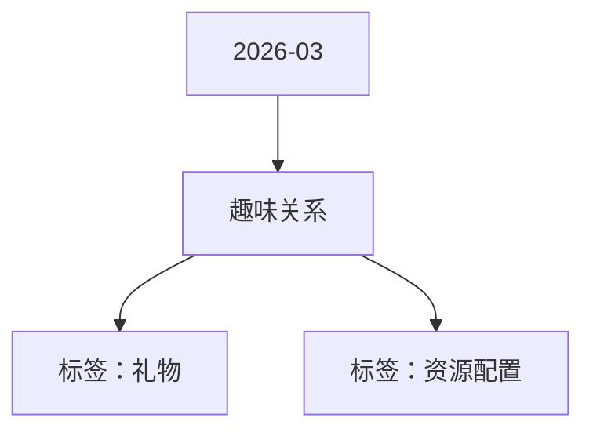

# 趣味关系 活动知识图谱

## 核心信息

- 月份：2026-03
- 活动时间：3.4-3.31
- 活动 Wiki：https://wiki.inkept.cn/pages/viewpage.action?pageId=483796187
- 活动页面 ID：483796187
- 关联资料数：0
- 标签：礼物、资源配置

## 优化总结

### 活动时间

- 时间上架时间：3月5日18​点下架时间：3月31日24点（来源：活动主页面）
- 时间：3月5日18​点-3月31日24点（来源：活动主页面）
- 时间：3月5日18:30:00（来源：活动主页面）

### 奖励与资源

- 活动【派对趣味关系-熬夜喵&早起鸟】于3月5日-3月31日上线，现申请对活动资源进行配置（来源：活动主页面）
- 辛苦 @灿灿 配置！（来源：活动主页面）
- 趣味关系配置：（来源：活动主页面）
- 趣味关系配置 ​​​​（来源：活动主页面）
- 相关配置资源（来源：活动主页面）

### 入口与链接

- Hi all，（来源：活动主页面）
- 辛苦 @叶导 审批（来源：活动主页面）
- ​ ​关系A名称熬夜喵关系B名称早起鸟（来源：活动主页面）
- 价格388钻​（来源：活动主页面）
- 有效期字体颜色#291200​按钮字色#ffffff（来源：活动主页面）
- 活动中心（来源：活动主页面）
- 文案：趣味关系（来源：活动主页面）
- 优先级：第三位（来源：活动主页面）
- 活动中心色值：linear-gradient(90deg, #fbcb26 0%, #fbcb26 100%)（来源：活动主页面）
- banner（来源：活动主页面）
- 全站私信（来源：活动主页面）
- 私信：【限定趣味关系】熬夜喵&早起鸟趣味关系限时上线啦！（来源：活动主页面）

## 资料关系图

## 资料来源

- [活动主页面](https://wiki.inkept.cn/pages/viewpage.action?pageId=483796187)
