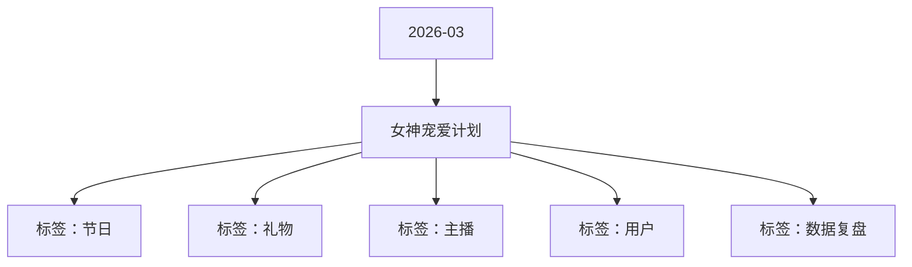

# 女神宠爱计划 活动知识图谱

## 核心信息

- 月份：2026-03
- 活动时间：3.4-3.8
- 活动 Wiki：https://wiki.inkept.cn/pages/viewpage.action?pageId=478982297
- 活动页面 ID：478982297
- 关联资料数：0
- 标签：节日、礼物、主播、用户、数据复盘

## 优化总结

### 活动概览

- 二 活动目标：（来源：活动主页面）
- 活动目标：（来源：活动主页面）

### 活动时间

- 一、活动时间：（来源：活动主页面）
- 玩法时间：3月4日00:00:00-3月8日23:59:59（来源：活动主页面）
- 统计时间：3月4日-3月8日 每日00:00:00-23:59:59（来源：活动主页面）
- 用户此送礼进度为每日00:00:00-23:59:59统计，在此时间段达到9999钻任务数值，奖励实时下发，有效期为自下发起至当日23:59:59，且完成后今日不在进行此任务的统计及奖励下发，称号天数叠加，活动结束后，公聊消息时间结束（来源：活动主页面）
- 注：女王专属进房通知：拥有女王身份的人，在奖励时间内（24小时）进入任何直播间均会触发一条进房公聊消息，该消息不限制次数，只限制奖励时长（来源：活动主页面）
- 活动时间：3.5-3.9（来源：活动主页面）
- 时间、礼物名称、礼物价格、消耗个数、消耗金额（来源：活动主页面）

### 玩法规则

- 五、玩法说明：（来源：活动主页面）
- 女主播任务-主播玩法--仅针对女性主播生效（来源：活动主页面）
- 玩法逻辑：（来源：活动主页面）
- 活动期间，每次收礼达到99钻石即可记为1次次数，累计次数达到对应阶段，解锁对应的曝光奖励，为日循环任务（来源：活动主页面）
- 任务阶段（来源：活动主页面）
- 活动设置主播被收礼人数日打卡任务，每日收集不同人数达到不同阶段，解锁对应奖励，日打卡解锁勋章奖励（打卡奖励任务区分主播/陪陪）（来源：活动主页面）
- 关卡任务值资源类型资源名称资源id时长数量私信内容（来源：活动主页面）
- 打卡任务，每日完成最后一关，即可认为解锁打卡成功（来源：活动主页面）
- 主页挂件星光女神主页浮屏51【宠爱女神计划】恭喜您累计 2 天完成被宠爱任务，已获得星光女神主页浮屏奖励 ×5 天，请注意查收。（来源：活动主页面）
- 勋章星光女神29871【宠爱女神计划】恭喜您累计 4 天完成被宠爱任务，已获得星光女神勋章奖励 ×永久，请注意查收。（来源：活动主页面）
- 发言波纹星光女神发言波纹973451【宠爱女神计划】恭喜您累计 2 天完成被宠爱任务，已获得星光女神发言波纹奖励 ×5 天，请注意查收。（来源：活动主页面）
- 超级宠爱-用户玩法--仅针对女性主播生效（来源：活动主页面）
- 用户送出活动专属礼物每达99钻石可宠爱主播1次，每日宠爱达到对应次数，可解锁特权奖励，任务为日循环任务，奖励完成实时下发。（来源：活动主页面）
- 公聊角标宠爱王者公聊角标974111【宠爱女神计划】恭喜您完成累计宠爱次数任务一阶段，已获得宠爱王者公聊角标 ×1 天，请注意查收。（来源：活动主页面）
- 麦序框宠爱王者麦序框972911【宠爱女神计划】恭喜您完成累计宠爱次数任务二阶段，已获得宠爱王者麦序框 ×1 天，请注意查收。（来源：活动主页面）
- 头像框宠爱王者头像框972311【宠爱女神计划】恭喜您完成累计宠爱次数任务三阶段，已获得宠爱王者头像框 ×1 天，请注意查收。（来源：活动主页面）
- 公聊皮肤宠爱王者公聊皮肤973911【宠爱女神计划】恭喜您完成累计宠爱次数任务四阶段，已获得宠爱王者公聊皮肤 ×1 天，请注意查收。（来源：活动主页面）
- 发言波纹宠爱王者发言波纹973511【宠爱女神计划】恭喜您完成累计宠爱次数任务五阶段，已获得宠爱王者发言波纹 ×1 天，请注意查收。（来源：活动主页面）

### 奖励与资源

- 派对（嘉宾收礼）：厅主及厅内嘉宾4人视频，6人视频，9人音频房间收礼的专属礼物收入，其余方式均不计入统计。谁收算谁的。（来源：活动主页面）
- 奖励H5飘屏（来源：活动主页面）
- 头像框星光女神头像框972221【宠爱女神计划】恭喜您今日累计收到 8 人的宠爱，已获得星光女神头像框奖励 ×2 天，请注意查收。（来源：活动主页面）
- 称号星光女神219421【宠爱女神计划】恭喜您今日累计收到 12 人的宠爱，已获得星光女神称号奖励 ×2 天，请注意查收。（来源：活动主页面）
- 主页挂件星光女神主页挂件21【宠爱女神计划】恭喜您今日累计收到 16 人的宠爱，已获得星光女神主页挂件奖励 ×2 天，请注意查收。（来源：活动主页面）
- 麦序框星光女神麦序框972821【宠爱女神计划】恭喜您今日累计收到 16 人的宠爱，已获得星光女神麦序框奖励 ×2 天，请注意查收。（来源：活动主页面）
- 称号星光女神219421【宠爱女神计划】恭喜您今日累计收到 20 人的宠爱，已获得星光女神称号奖励 ×2 天，请注意查收。（来源：活动主页面）
- 主页挂件星光女神主页挂件21【宠爱女神计划】恭喜您今日累计收到 24 人的宠爱，已获得星光女神主页挂件奖励 ×2 天，请注意查收。（来源：活动主页面）
- 送礼托盘宠爱王者送礼托盘973821【宠爱女神计划】恭喜您今日累计宠爱人数达 15 人，已获得宠爱王者送礼托盘奖励 ×2 天，请注意查收。（来源：活动主页面）
- 主页挂件宠爱王者主页挂件974921【宠爱女神计划】恭喜您今日累计宠爱人数达 20 人，已获得宠爱王者主页挂件奖励 ×2 天，请注意查收。（来源：活动主页面）
- 进房座驾弥漫蝴蝶进房座驾21【宠爱女神计划】恭喜您今日累计宠爱人数达 25 人，已获得弥漫蝴蝶进房座驾奖励 ×2 天，请注意查收。（来源：活动主页面）
- 观众席底纹宠爱王者观众席底纹973721【宠爱女神计划】恭喜您今日累计宠爱人数达 35 人，已获得宠爱王者观众席底纹奖励 ×2 天，请注意查收。（来源：活动主页面）
- 女性用户每日送礼达到9999钻（即可获得女王身份，解锁女王专属奖励，获得直播间专属特权），每日只发1次（来源：活动主页面）
- 奖励与私信研发实时下发（来源：活动主页面）
- 麦序框鎏金骑士麦序框973311【宠爱女神计划】恭喜您在用户昵称的帮助下成为鎏金骑士，获得鎏金骑士称号 ×1 天、鎏金骑士头像框 ×1 天、鎏金骑士麦序框 ×1 天奖励，请注意查收。（来源：活动主页面）
- 奖励与私信由研发实时下发（来源：活动主页面）
- 当红奖励（来源：活动主页面）
- 奖励私信（来源：活动主页面）

### 入口与链接

- 人数根据数据重新制定，和主播对称（来源：活动主页面）
- 月4日-3月8日（来源：活动主页面）
- 活动期间日均消耗900w，活动消耗4500w（来源：活动主页面）
- 三、活动框架（来源：活动主页面）
- 四、数据统计维度（来源：活动主页面）
- 数据统计维度（来源：活动主页面）
- 主播（主播礼）：仅统计普通视频直播间、公共直播间、PK送礼和友聊送礼渠道，其他送礼方式均不计入统计。（来源：活动主页面）
- 主播及用户的次数分开计算（来源：活动主页面）
- 累计次数9299520999（来源：活动主页面）
- 全站弹幕（来源：活动主页面）
- H5飘屏2（来源：活动主页面）
- 全站悬浮公聊（来源：活动主页面）

## 资料关系图

## 资料来源

- [活动主页面](https://wiki.inkept.cn/pages/viewpage.action?pageId=478982297)
