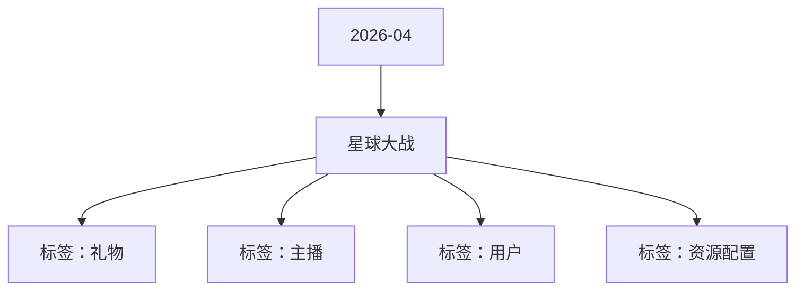

# 星球大战 活动知识图谱

## 核心信息

- 月份：2026-04
- 活动时间：4.16-4.21
- 活动 Wiki：https://wiki.inkept.cn/pages/viewpage.action?pageId=488341652
- 活动页面 ID：488341652
- 关联资料数：0
- 标签：礼物、主播、用户、资源配置

## 优化总结

### 活动概览

- 二、活动目标（来源：活动主页面）
- 三、活动简介（来源：活动主页面）

### 活动时间

- 起始时间：2026-04-08 19:26:13（来源：活动主页面）
- 结束时间：2027-04-08 19:26:13（来源：活动主页面）
- 一、活动时间（来源：活动主页面）

### 玩法规则

- 活动期间用户送出指定5钻礼物（GIF礼物/连送礼物）参与玩法，主播获得1映币作为玩法手续费（由后台配置，主播直接得到1映币），剩余钻石参与玩法。（来源：活动主页面）
- 活动设置“随机道具玩法”用户每送出10个礼物，可获得随机道具1个，用户送出随机道具解锁对应奖励。（来源：活动主页面）
- 该玩法不卡房间类型，任意房间类型均可参与。（来源：活动主页面）
- 星球大战524453送出该礼物主播获得1映币，剩余参与玩法，最高可获得520热力值GIF，连送，主播获得1映币https://img.ikstatic.cn/MTc3NTcyMDExNTI5NiM4MDYjcG5n.png（来源：活动主页面）
- 玩法产出按照以下数字随机产出（来源：活动主页面）
- 随机道具玩法产出按照以下产出（来源：活动主页面）

### 奖励与资源

- 您申请的操作对象为：映币，请把对应的soucetype提供给“主播运营组(礼物墙管理)”，用于配置背包礼物；（来源：活动主页面）
- 用户每次送礼均有机会用户获得10钻/21钻/52钻//520钻礼物送给直接送给主播。（来源：活动主页面）
- 触发520钻礼物时触发全站悬浮公聊：（来源：活动主页面）
- 【星球大战】用户昵称为主播昵称送出星球大战礼物，触发暴击，为主播送出礼物名称！快去围观～（来源：活动主页面）
- 触发不同礼物时触发直播间公聊 仅自己可见：（来源：活动主页面）
- 【星球大战】恭喜宝宝成功触发暴击，为主播昵称送出礼物名称！（来源：活动主页面）
- 礼物名称礼物价格礼物ID标注备注url（来源：活动主页面）
- 礼物名称礼物价格礼物ID备注URL（来源：活动主页面）
- 制造浪漫1024441直送礼物，和情人节5钻礼物产出一致https://img.ikstatic.cn/MTY3NTc1NTg4OTk4OCM0ODIjcG5n.png（来源：活动主页面）
- 火龙术2124442直送礼物，和情人节5钻礼物产出一致https://img.ikstatic.cn/MTYzMjQ2MTQ5NjkzOCM4NTYjcG5n.png（来源：活动主页面）
- 凤冠霞帔5224443直送礼物，和情人节5钻礼物产出一致https://img.ikstatic.cn/MTc1NTg1NTMyMDQ3NCMgNjgjcG5n.png（来源：活动主页面）
- 重力情诗52024444直送礼物，和情人节5钻礼物产出一致https://img.ikstatic.cn/MTc2NjU0NjIyMTMyOCMxNTAjcG5n.png（来源：活动主页面）
- 指定礼物价格10钻21钻52钻520钻（来源：活动主页面）
- 礼物名称制造浪漫火龙术凤冠霞帔重力情诗（来源：活动主页面）
- 礼物ID24441244422444324444（来源：活动主页面）
- 用户每日送出礼物达到10个即可解锁1个随机道具，道具下发至背包中，送出后，直接送给主播（来源：活动主页面）
- 道具有效期至活动结束后，活动结束后全部清空。（来源：活动主页面）
- 用户每送出10个礼物，触发公聊提醒：【随机道具】恭喜宝宝获得随机道具*x个，现已下发至背包中~（来源：活动主页面）

### 入口与链接

- 您申请的SourceType: [增加映币-赠送-平台运营组-星球大战-映币专用-2026-04-08] 已经审批完成（来源：活动主页面）
- SourceType:774（来源：活动主页面）
- APP账单记录文案：直播收入（来源：活动主页面）
- 是否计入送礼流水：是（来源：活动主页面）
- 是否计入基准流水：是（来源：活动主页面）
- 是否计入无背包基准映币：否（来源：活动主页面）
- 否计入实际映币收入：是（来源：活动主页面）
- 是否为赠送钻石：否（来源：活动主页面）
- SourceType Hash:c00d9ef863286c98156eb9aacdf0adaf（来源：活动主页面）
- HASH使用时请保持小写，请及时关注SourceType预警邮件。（来源：活动主页面）
- 月 16 日 - 4 月 21 日（来源：活动主页面）
- 活动期间日均消耗 120w（来源：活动主页面）

## 资料关系图

## 资料来源

- [活动主页面](https://wiki.inkept.cn/pages/viewpage.action?pageId=488341652)
