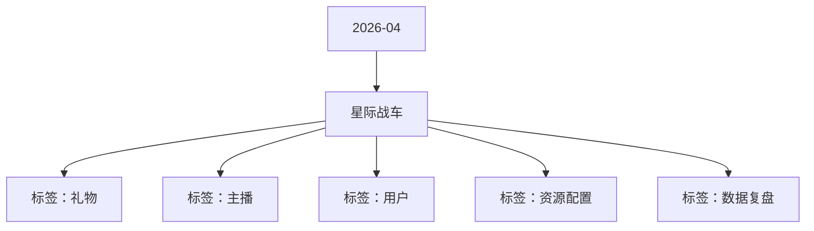

# 星际战车 活动知识图谱

## 核心信息

- 月份：2026-04
- 活动时间：4.16-4.21
- 活动 Wiki：https://wiki.inkept.cn/pages/viewpage.action?pageId=483798772
- 活动页面 ID：483798772
- 关联资料数：0
- 标签：礼物、主播、用户、资源配置、数据复盘

## 优化总结

### 活动概览

- 二、活动目标（来源：活动主页面）
- 三、活动简介（来源：活动主页面）

### 活动时间

- 起始时间：2026-04-08 19:21:37（来源：活动主页面）
- 结束时间：2027-04-08 19:21:37（来源：活动主页面）
- 起始时间：2026-04-08 19:19:12（来源：活动主页面）
- 结束时间：2027-04-08 19:19:12（来源：活动主页面）
- 起始时间：2026-04-08 19:20:37（来源：活动主页面）
- 结束时间：2027-04-08 19:20:37（来源：活动主页面）
- 一、活动时间（来源：活动主页面）
- 玩法时间：4 月 16 日 00:00:00 – 4 月 21 日 23:59:59统计时间：同玩法时间，数据统计以平台服务器时间为准，实时同步至前端展示（来源：活动主页面）

### 玩法规则

- 玩法简介：（来源：活动主页面）
- 玩法设置其他玩法，其中玩法总消耗设置为 50 钻石，其中98%进入玩法，2% 计入随机奖励（来源：活动主页面）
- 四、玩法详情（来源：活动主页面）
- 玩法一：星际战车玩法（来源：活动主页面）
- 玩法逻辑等于多档位的投壶（来源：活动主页面）
- 设置大盘与个人平衡逻辑（来源：活动主页面）
- 个人动态匹配规则（来源：活动主页面）
- 玩法二：随机奖励玩法（来源：活动主页面）
- 触发门槛：当随机奖励池累计≥1000 钻石后开始触发（不同星际战车对应门槛不同），奖励池＜对应门槛，此逻辑终止（来源：活动主页面）
- 逻辑为用户每参与1次A奖池，往玩法中注入X钻，三个奖池注入金额不一样（来源：活动主页面）
- 奖励规则：触发后，不同战车可以获得的奖励价值不同（来源：活动主页面）

### 奖励与资源

- 您申请的SourceType: [背包礼物-赠送-平台运营组-星际战车-下发专用-2026-04-08] 已经审批完成（来源：活动主页面）
- 您申请的操作对象为：背包礼物，请把对应的soucetype提供给“活动业务组”，用于下发背包礼物；（来源：活动主页面）
- 您申请的操作对象为：映币，请把对应的soucetype提供给“主播运营组(礼物墙管理)”，用于配置背包礼物；（来源：活动主页面）
- 每辆星际战车均有3条星轨可以选择行走，用户可自行选择要行走的星轨，不同星轨可获得的奖励不同。（来源：活动主页面）
- 用户每驱动 1 次，均有机会触发奖励，也有可能触发为空。每次驱动支持三种操作：驱动 1 次、驱动 10 次、驱动 30 次。（来源：活动主页面）
- 类型触发门槛大于下面值触发奖励价值（来源：活动主页面）
- A500钻33钻礼物（来源：活动主页面）
- B1000钻99钻礼物（来源：活动主页面）
- C2000钻299钻礼物（来源：活动主页面）
- 触发概率：用户每参与 1 次，均有5% 概率触发随机奖励（来源：活动主页面）

### 入口与链接

- SourceType:4369（来源：活动主页面）
- APP账单记录文案：直播收入（来源：活动主页面）
- 是否计入送礼流水：是（来源：活动主页面）
- 是否计入基准流水：是（来源：活动主页面）
- 是否计入无背包基准映币：否（来源：活动主页面）
- 否计入实际映币收入：是（来源：活动主页面）
- 是否为赠送钻石：否（来源：活动主页面）
- SourceType Hash:bf7a91acb64dc8d6da06955997e1950b（来源：活动主页面）
- HASH使用时请保持小写，请及时关注SourceType预警邮件。（来源：活动主页面）
- 您申请的SourceType: [减少钻石-消耗-平台运营组-星际战车-扣钻专用-2026-04-08] 已经审批完成（来源：活动主页面）
- SourceType:772（来源：活动主页面）
- SourceType Hash:8fb5909da2b634fc8ae050edb4e83443（来源：活动主页面）

## 资料关系图

## 资料来源

- [活动主页面](https://wiki.inkept.cn/pages/viewpage.action?pageId=483798772)
