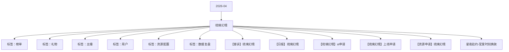

# 琉璃幻境 活动知识图谱

## 核心信息

- 月份：2026-04
- 活动时间：4.2-4.6
- 活动 Wiki：https://wiki.inkept.cn/pages/viewpage.action?pageId=488342117
- 活动页面 ID：488342117
- 关联资料数：6
- 标签：榜单、礼物、主播、用户、资源配置、数据复盘

## 优化总结

### 活动概览

- 二 活动目标：（来源：活动主页面）
- 活动目标：（来源：活动主页面）
- 目标完成度（来源：【日报】琉璃幻境）
- 消耗目标3750万钻，活动上线5天，消耗2982万钻，目标完成度79.53%。（来源：【日报】琉璃幻境）
- 消耗目标消耗钻石数目标完成度（来源：【日报】琉璃幻境）
- 一、活动目标：（来源：【琉璃幻境】st申请）

### 活动时间

- 一、活动时间：（来源：活动主页面）
- 玩法时间：4月2日00:00:00-4月6日23:59:59（来源：活动主页面）
- 起始时间：2026-03-27 18:21:10（来源：活动主页面）
- 结束时间：2027-03-27 18:21:10（来源：活动主页面）
- 起始时间：2026-03-27 18:18:20（来源：活动主页面）
- 结束时间：2027-03-27 18:18:20（来源：活动主页面）
- 起始时间：2026-03-27 18:37:24（来源：活动主页面）
- 结束时间：2027-03-27 18:37:24（来源：活动主页面）

### 玩法规则

- 小映玩法：https://betaboc.inke.cn/react/tools/page-config-pro/index.html?url=https://betaboc.inke.cn/react/banner/202603/glass-fantasy/glass/index.html（来源：活动主页面）
- 玩法说明：（来源：活动主页面）
- 主播任务（来源：活动主页面）
- 玩法逻辑：（来源：活动主页面）
- 活动期间，每次收礼达到21钻石数即可记为1次次数，累计次数达到对应阶段，解锁对应的曝光和资源奖励，为日循环任务（来源：活动主页面）
- 关卡任务值资源类型资源名称资源id时长数量私信内容弹幕或公聊内容图片（来源：活动主页面）
- 【琉璃幻境】恭喜宝宝完成收礼任务一，获得琉璃筑梦称号*2天，奖励已下发，快去看看叭~（来源：活动主页面）
- 【琉璃幻境】恭喜宝宝完成收礼任务二，获得琉璃筑梦主页浮屏*2天，奖励已下发，快去看看叭~（来源：活动主页面）
- 活动设置主播被收礼人数日打卡任务，每日收集不同人数达到不同阶段，解锁对应奖励，奖励区分主播和陪陪（来源：活动主页面）
- 陪陪人数任务（来源：活动主页面）
- 用户任务（来源：活动主页面）
- 用户送出活动专属礼物每日达到对应钻石，可解锁特权奖励，任务为日循环任务，奖励完成实时下发。（来源：活动主页面）
- 关卡任务值资源类型资源名称资源id时长数量私信内容（来源：活动主页面）
- 公聊角标星月梦幻公聊角标23972https://img.ikstatic.cn/MTYzNDI4ODI2Mjc0OSMyNjYjcG5n.png【琉璃幻境】恭喜您完成累计送礼任务一阶段，已获得星月梦幻公聊角标*2天，请注意查收。（来源：活动主页面）
- 麦序框幻境逐光麦序框100082https://img.ikstatic.cn/MTc3NDkzNzg3NTkwNSM3NzEjcG5n.png【琉璃幻境】恭喜您完成累计送礼任务二阶段，已获得幻境逐光麦序框*2天，请注意查收。（来源：活动主页面）
- 头像框幻境逐光头像框100112https://img.ikstatic.cn/MTc3NDkzNzk3NzI2NCMyMjIjcG5n.png【琉璃幻境】恭喜您完成累计送礼任务三阶段，已获得幻境逐光头像框*2天，请注意查收。（来源：活动主页面）
- 公聊皮肤幻境逐光公聊皮肤96862https://img.ikstatic.cn/MTc3MDI4Nzg5ODUwMCMgODMjcG5n.png【琉璃幻境】恭喜您完成累计送礼任务四阶段，已获得幻境逐光公聊皮肤*2天，请注意查收。（来源：活动主页面）
- 发言波纹幻境逐光发言波纹41022https://img.ikstatic.cn/MTY5MjY4ODE3NzMwNiM3MzkjcG5n.png【琉璃幻境】恭喜您完成累计送礼任务五阶段，已获得幻境逐光发言波纹*2天，请注意查收。（来源：活动主页面）

### 奖励与资源

- 派对（嘉宾收礼）：厅主及厅内嘉宾4人视频，6人视频，9人音频房间收礼的专属礼物收入，其余方式均不计入统计。谁收算谁的。（来源：活动主页面）
- 类型资源名称资源idurl备注（来源：活动主页面）
- 用户送出活动专属礼物可宠爱1个主播，按照送礼人数达到门槛获得奖励。（来源：活动主页面）
- 奖励与私信由研发实时下发（来源：活动主页面）
- 【琉璃幻境】恭喜宝宝获得当红主播日榜TOP1，获得幻境月主称号*5天、幻境月主主页挂件*5天、幻境月主主页浮屏*5天、幻境月主动态头像框*5天、热13推荐卡*3张奖励，奖励已下发，快去看看吧～（来源：活动主页面）
- 【琉璃幻境】恭喜宝宝获得当红主播日榜TOP5，获得幻境月主称号*3天、幻境月主主页挂件*3天、幻境月主动态头像框*3天、幻境月主主页浮屏*3天、热13推荐卡*1张奖励，奖励已下发，快去看看吧～（来源：活动主页面）
- 【琉璃幻境】恭喜宝宝获得当红主播日榜TOP10，获得幻境月主称号*2天、幻境月主主页挂件*2天、幻境月主动态头像框*2天奖励，奖励已下发，快去看看吧～（来源：活动主页面）
- 【琉璃幻境】恭喜宝宝获得新秀主播日榜TOP1，获得幻境月主称号*3天、幻境月主主页挂件*3天、幻境月主主页浮屏*3天、幻境月主动态头像框*3天、热13推荐卡*1张奖励，奖励已下发，快去看看吧～（来源：活动主页面）
- 【琉璃幻境】恭喜宝宝获得新秀主播日榜TOP5，获得幻境月主称号*2天、幻境月主主页挂件*2天、幻境月主主页浮屏*2天、幻境月主动态头像框*2天奖励，奖励已下发，快去看看吧～（来源：活动主页面）
- 【琉璃幻境】恭喜宝宝获得新秀主播日榜TOP10，获得幻境月主称号*1天、幻境月主主页挂件*1天、幻境月主动态头像框*1天奖励，奖励已下发，快去看看吧～（来源：活动主页面）
- 【琉璃幻境】恭喜宝宝获得心动嘉宾日榜TOP1，获得幻境月主称号*5天、幻境月主动态头像框*5天、幻境月主动态麦序框*5天、幻境月主页挂件*5天、幻境月主页浮屏*5天奖励，奖励已下发，快去看看吧～（来源：活动主页面）
- 【琉璃幻境】恭喜宝宝获得心动嘉宾日榜TOP5，获得幻境月主称号*3天、幻境月主动态麦序框*3天、幻境月主动态头像框*3天、幻境月主页挂件*3天、幻境月主页浮屏*3天奖励，奖励已下发，快去看看吧～（来源：活动主页面）
- 【琉璃幻境】恭喜宝宝获得心动嘉宾日榜TOP10，获得幻境月主称号*2天、幻境月主动态麦序框*2天、幻境月主动态头像框*2天奖励，奖励已下发，快去看看吧～（来源：活动主页面）
- 用户日榜奖励（来源：活动主页面）
- 【琉璃幻境】恭喜宝宝获得用户日榜TOP1，获得琉璃执星头像框*5天、琉璃执星称号*5天、琉璃执星浮屏*5天、资料卡浮屏*5天、琉璃执星挂件*5天奖励，奖励已下发，快去看看吧～（来源：活动主页面）
- 【琉璃幻境】恭喜宝宝获得用户日榜TOP5，获得琉璃执星头像框*3天、琉璃执星称号*3天、琉璃执星挂件*3天、琉璃执星浮屏*3天奖励，奖励已下发，快去看看吧～（来源：活动主页面）
- 【琉璃幻境】恭喜宝宝获得用户日榜TOP10，获得琉璃执星头像框*2天、琉璃执星称号*2天、琉璃执星挂件*2天奖励，奖励已下发，快去看看吧～（来源：活动主页面）
- 道具卡2张（来源：活动主页面）

### 入口与链接

- 名称价值id（来源：活动主页面）
- 金莲送福1024344https://img.ikstatic.cn/MTc3NDg2NTkxNzc4MCMxMjUjcG5n.png（来源：活动主页面）
- https://boc.inke.cn/react/banner/202603/valentines-day-inke/index.html?from=half&ik_halfdisplay=1&half_screen=1（来源：活动主页面）
- 梦幻蝶舞9924352https://img.ikstatic.cn/MTc0NzI5OTUxMDQyMCM5OTQjcG5n.png（来源：活动主页面）
- 永不凋零的爱52024353https://img.ikstatic.cn/MTczOTE4Mzg0NTcxNyMxNTAjcG5n.png（来源：活动主页面）
- 星夜赴约99924319https://img.ikstatic.cn/MTc3NDkzOTI0NjE5NyMxOTMjcG5n.png（来源：活动主页面）
- https://boc.inke.cn/react/banner/202603/glass-fantasy/glass/index.html?from=half&ik_halfdisplay=1&half_screen=1（来源：活动主页面）
- 星辰邂逅334424354https://img.ikstatic.cn/MTc0NzIwOTcxMjIyMiM4MDIjcG5n.png（来源：活动主页面）
- 鲸云星河1314024355https://img.ikstatic.cn/MTczOTQ0MjMxMzgzMyMgNTYjcG5n.png（来源：活动主页面）
- 烟海缠绵5200024356https://img.ikstatic.cn/MTczNDMzMDYyMDMzNCMxNDIjcG5n.png（来源：活动主页面）
- 沧澜绮梦9999924357https://img.ikstatic.cn/MTc0NTkwOTg3MTk0MSM1MDYjcG5n.png（来源：活动主页面）
- 莲花：https://betaboc.inke.cn/react/tools/page-config-pro/index.html?url=https://betaboc.inke.cn/react/banner/202603/valentines-day-inke/index.html（来源：活动主页面）

### 上线配置

- 《琉璃幻境》活动于4月2日0点-4月6日24点上线，现同步Day5数据情况：（来源：【日报】琉璃幻境）
- 详细需求如下：（来源：【琉璃幻境】st申请）
- 单日限额：本次设置单日限额10000000映币（含测试需求）；（来源：【琉璃幻境】st申请）
- 总限额：活动共计5日，则活动期间总限额为500000000映币；（含长期需求）（来源：【琉璃幻境】st申请）
- 四、后台申请需求：（来源：【琉璃幻境】st申请）
- Hi all，（来源：【琉璃幻境】上线申请）
- 长相思7724379（来源：【琉璃幻境】上线申请）
- 踏星而来131424380（来源：【琉璃幻境】上线申请）
- 凤凰之约520024381（来源：【琉璃幻境】上线申请）
- 爪爪联萌3344024382（来源：【琉璃幻境】上线申请）
- 标题：琉璃幻境（来源：【琉璃幻境】上线申请）
- 色值：linear-gradient(90deg, #6c57ce 0%, #301f7e 100%)（来源：【琉璃幻境】上线申请）
- 位置：第一位、6日后移（来源：【琉璃幻境】上线申请）
- 二、icon--强挂（来源：【琉璃幻境】上线申请）

### 数据与复盘

- 四、数据统计维度（来源：【客诉】琉璃幻境）
- 数据统计维度（来源：【客诉】琉璃幻境）
- 每日人数（来源：【客诉】琉璃幻境）
- Hi all（来源：【日报】琉璃幻境）
- ,500,00029,822,99479.53%（来源：【日报】琉璃幻境）
- ,889,83219,846,3057,408,1123,455,2173,952,89519.55%37.33%（来源：【日报】琉璃幻境）
- ,569,43419,806,1796,668,0844,467,6972,200,38715.66%33.67%（来源：【日报】琉璃幻境）
- ,221,92315,999,4445,809,4243,922,5281,886,89616.98%36.31%（来源：【日报】琉璃幻境）
- ,795,35815,853,3814,942,3883,434,9501,507,43815.54%31.18%（来源：【日报】琉璃幻境）
- ,403,16315,023,5874,994,9863,491,3231,503,66315.42%33.25%（来源：【日报】琉璃幻境）
- 合计178,879,71086,528,89629,822,99418,771,71511,051,27916.67%34.47%（来源：【日报】琉璃幻境）
- 场景主播分布：（来源：【日报】琉璃幻境）
- 送礼场景送礼钻石数占比（来源：【日报】琉璃幻境）
- 派对19,080,78863.98%（来源：【日报】琉璃幻境）
- 秀场10,742,20636.02%（来源：【日报】琉璃幻境）
- 总计29,822,994（来源：【日报】琉璃幻境）

### 其他关键信息

- task_keyscore_totalprize_typeprize_nameresource_iddurationnumprivate_msgcontentimg（来源：【客诉】琉璃幻境）
- 称号琉璃筑梦称号22292（来源：【客诉】琉璃幻境）
- https://img.ikstatic.cn/MTc3NDkzODcxMDc3NyM0NTEjcG5n.png（来源：【客诉】琉璃幻境）
- 浮屏琉璃筑梦主页浮屏84782（来源：【客诉】琉璃幻境）
- https://img.ikstatic.cn/MTcyNTI2MDAyODI2NSMzNTIjcG5n.png（来源：【客诉】琉璃幻境）
- 画面广播全站画面广播（来源：【客诉】琉璃幻境）
- task_keyscore_totalprize_typeprize_name（来源：【客诉】琉璃幻境）
- 头像框琉璃筑梦头像框（来源：【客诉】琉璃幻境）
- 公聊皮肤琉璃筑梦公聊皮肤（来源：【客诉】琉璃幻境）
- 挂件琉璃筑梦主页挂件（来源：【客诉】琉璃幻境）

## 资料关系图

## 资料来源

- [活动主页面](https://wiki.inkept.cn/pages/viewpage.action?pageId=488342117)
- [【客诉】琉璃幻境](https://wiki.inkept.cn/pages/viewpage.action?pageId=492702212)
- [【日报】琉璃幻境](https://wiki.inkept.cn/pages/viewpage.action?pageId=492712804)
- [【琉璃幻境】st申请](https://wiki.inkept.cn/pages/viewpage.action?pageId=488355608)
- [【琉璃幻境】上线申请](https://wiki.inkept.cn/pages/viewpage.action?pageId=492702025)
- [【资源申请】琉璃幻境](https://wiki.inkept.cn/pages/viewpage.action?pageId=492700813)
- [星夜赴约-宠爱时刻换肤](https://wiki.inkept.cn/pages/viewpage.action?pageId=488355418)
