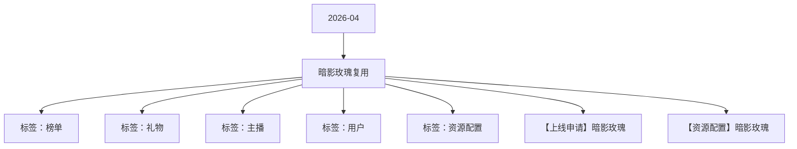

# 暗影玫瑰复用 活动知识图谱

## 核心信息

- 月份：2026-04
- 活动时间：4.20-4.23
- 活动 Wiki：https://wiki.inkept.cn/pages/viewpage.action?pageId=488351597
- 活动页面 ID：488351597
- 关联资料数：2
- 标签：榜单、礼物、主播、用户、资源配置

## 优化总结

### 活动概览

- 一、活动目标：（来源：活动主页面）
- 背包资源暗影玫瑰PK背景1703（来源：活动主页面）
- 【暗影玫瑰】恭喜宝宝完成主播任务一，获得暗影玫瑰PK背景*3天，奖励已下发，快去查看吧～（来源：活动主页面）
- 背包资源暗影玫瑰派对背景3813（来源：活动主页面）
- 【暗影玫瑰】恭喜宝宝完成派对嘉宾任务一，获得暗影玫瑰派对背景*3天，奖励已下发，快去查看吧～（来源：活动主页面）
- PK背景暗影玫瑰PK背景170（来源：【资源配置】暗影玫瑰）
- 派对背景暗影玫瑰派对背景381（来源：【资源配置】暗影玫瑰）

### 活动时间

- 二、活动时间（来源：活动主页面）
- 年4月20日00:00:00-4月23日23:59:59（所有玩法统计时间均为北京时间GMT+8:00）（来源：活动主页面）
- 镜中对决：晚上19点-2点，开启全站【暗影猎人】与【野玫瑰】的对决时刻，每小时根据全站双方送礼的积分，获胜方TOP3登上活动头图第一包厢位，TOP10页面轮播展示，获胜身份全体用户（改为TOP100）得称号等资源奖励（整体算出来，资源获得时间控制在15天内）。每轮对决积分清零。中途有用户更换角色，更换角色后积分不清零，为所在角色贡献的分不清零。（来源：活动主页面）
- 玩法统计时间：2025年3月25日00:00:00-3月28日23:59:59（来源：活动主页面）
- 活动时间：4.25-4.28（来源：活动主页面）
- 时间：4月20日00:00:00-4月24日23:59:59（来源：【上线申请】暗影玫瑰）
- 时间：4月20日00:00:00-4月23日23:59:59（来源：【上线申请】暗影玫瑰）
- 时间： 4月20日00:00:00-4月23日23:59:59（来源：【上线申请】暗影玫瑰）

### 玩法规则

- 改规则：（来源：活动主页面）
- 四、玩法详情：（来源：活动主页面）
- 用户玩法：（来源：活动主页面）
- 核心玩法：用户送出任一活动专属礼物即可解锁一个随机身份【暗影猎人】或【野玫瑰】，开启概率各有50%，即可开启对应角色的玩法。第一次解锁送礼的分也统计进入用户角色任务。（来源：活动主页面）
- 更换角色：用户需完成任一角色的任务五（收礼达到5200钻）才可获得更换角色的机会，更换角色后积分不清零，采取积分继承值。一旦收礼满5200钻，后续可以无条件无限次更换角色，不做限制。（来源：活动主页面）
- 从活动开始至活动最后一刻，累计为单个主播送礼达15w钻，触发全站画面广播。（1V1的送礼曝光任务）---更换角色后，曝光任务暂停，积分保留，进度暂停，直至换回该身份后，才可继续做。（来源：活动主页面）
- 每小时送礼最多的用户可带领其送礼最多的主播抢占icon双头像位（有保底 需大于1w钻，才能占领双头像1h）---更换角色后，曝光任务暂停，积分保留，进度暂停，直至换回该身份后，才可继续做。（来源：活动主页面）
- 关卡任务值资源类型资源名称资源id时长数量私信内容（来源：活动主页面）
- 排名资源类型资源名称资源id时长数量私信内容（来源：活动主页面）
- 主播玩法：（来源：活动主页面）
- 玩法逻辑：（来源：活动主页面）
- 注：在派对房间（4/6/9）奖励及统计与普通直播间进行区分，任务数值不进行混合统计，奖励也不同。（来源：活动主页面）
- 【暗影玫瑰】恭喜宝宝完成主播任务二，获得暗影玫瑰头像框*3天，奖励已下发，快去查看吧～（来源：活动主页面）
- 【暗影玫瑰】恭喜宝宝完成主播任务三，获得暗影玫瑰称号*3天，奖励已下发，快去查看吧～（来源：活动主页面）
- 【暗影玫瑰】恭喜宝宝完成主播任务四，获得暗影玫瑰主页挂件*1天，奖励已下发，快去查看吧～（来源：活动主页面）
- 【暗影玫瑰】恭喜宝宝完成主播任务五，获得暗影玫瑰主页浮屏*1天，奖励已下发，快去查看吧～（来源：活动主页面）
- 无尽任务100000（来源：活动主页面）
- 【暗影玫瑰】恭喜宝宝完成派对嘉宾任务二，获得暗影玫瑰麦序框*3天，奖励已下发，快去查看吧～（来源：活动主页面）

### 奖励与资源

- 礼物墙礼物礼物名价格（钻）礼物IDurl（来源：活动主页面）
- 嘉宾收礼：厅主及厅内嘉宾4人视频，6人视频，9人音频房间收礼的专属礼物收入，其余方式均不计入统计。谁收算谁的。（来源：活动主页面）
- 暗影的邀约：用户解锁暗影猎人身份后，累计送礼钻石数，获得对应阶段的资源奖励。奖励由研发实时下发。（来源：活动主页面）
- 野玫瑰的反击：用户解锁野玫瑰身份后，累计送礼钻石数，获得对应阶段的资源奖励。奖励由研发实时下发。（来源：活动主页面）
- 背包资源暗影猎人公聊皮肤71891（来源：活动主页面）
- 背包资源暗影猎人麦序框71811（来源：活动主页面）
- 背包资源暗影猎人头像框71771（来源：活动主页面）
- 背包资源暗影猎人主页挂件68551（来源：活动主页面）
- 背包资源暗影猎人主页浮屏68571（来源：活动主页面）
- 背包资源暗影猎人半屏座驾71861（来源：活动主页面）
- 背包资源野玫瑰公聊皮肤71881（来源：活动主页面）
- 背包资源野玫瑰麦序框71781（来源：活动主页面）
- 背包资源野玫瑰头像框71741（来源：活动主页面）
- 背包资源野玫瑰主页挂件68561（来源：活动主页面）
- 背包资源（来源：活动主页面）
- 背包资源野玫瑰资料卡浮屏71871（来源：活动主页面）
- _100背包资源镜中对决公聊皮肤68633600（来源：活动主页面）
- 【暗影玫瑰】恭喜宝宝在今晚的镜中对决中成为获胜方，获得镜中对决公聊皮肤*1H、镜中对决头像框*1H、镜中对决发言波纹*1H奖励，快去看看吧～（来源：活动主页面）

### 入口与链接

- https://betaboc.inke.cn/react/tools/page-config-pro/index.html?url=https://betaboc.inke.cn/react/banner/202504/shadow-rose/index.html（来源：活动主页面）
- 等你下课1024493https://img.ikstatic.cn/MTc1MTI2NjUzNTM1OCM5NjAjcG5n.png（来源：活动主页面）
- 萌喵之恋9924494https://img.ikstatic.cn/MTc2NTk0MTQ3NTM4NSMzOTYjcG5n.png（来源：活动主页面）
- 弦上青春52024495https://img.ikstatic.cn/MTc2MTAxNzk5ODQwMiM2ODQjcG5n.png（来源：活动主页面）
- 池畔情牵131424496https://img.ikstatic.cn/MTczNDMyOTczMTAyMCM1NzgjcG5n.png（来源：活动主页面）
- 泛舟湖上520024497https://img.ikstatic.cn/MTc0NTczNjU1MzQ0NSM0ODMjcG5n.png（来源：活动主页面）
- 游弋惊鸿1000024498https://img.ikstatic.cn/MTc0MjM2ODIxMTgwOSM2MzQjcG5n.png（来源：活动主页面）
- 烟海缠绵5200024499https://img.ikstatic.cn/MTczNDMzMDYyMDMzNCMxNDIjcG5n.png（来源：活动主页面）
- 时代传奇9999924500https://img.ikstatic.cn/MTc2NTk0MTc2NzM3NSMgMjYjcG5n.png（来源：活动主页面）
- 活动消耗达到4000万钻石（来源：活动主页面）
- 数据统计维度：（来源：活动主页面）
- 个人主播收礼（主播）：仅统计普通视频直播间、公共直播间、PK送礼和友聊送礼渠道，其他送礼方式均不计入统计。（来源：活动主页面）

### 上线配置

- hi，all（来源：【上线申请】暗影玫瑰）
- 辛苦 @叶导 审批，（来源：【上线申请】暗影玫瑰）
- 扑向你33324505（来源：【上线申请】暗影玫瑰）
- 藤萝织梦334424506（来源：【上线申请】暗影玫瑰）
- 窈窕佳人1314024507（来源：【上线申请】暗影玫瑰）
- 爪爪联萌3344024508（来源：【上线申请】暗影玫瑰）
- 以上，如有问题，随时沟通。（来源：【上线申请】暗影玫瑰）
- Dear all，（来源：【上线申请】暗影玫瑰）
- 标题：暗影玫瑰（来源：【上线申请】暗影玫瑰）
- 色值：linear-gradient(90deg, #090908 0%, #391d06 100%)（来源：【上线申请】暗影玫瑰）
- 位置：第一位，23日后移（来源：【上线申请】暗影玫瑰）
- 二、icon（来源：【上线申请】暗影玫瑰）
- 标题：暗影玫瑰（强挂）（来源：【上线申请】暗影玫瑰）
- 文案：带TA上电视和全站icon（来源：【上线申请】暗影玫瑰）

## 资料关系图

## 资料来源

- [活动主页面](https://wiki.inkept.cn/pages/viewpage.action?pageId=488351597)
- [【上线申请】暗影玫瑰](https://wiki.inkept.cn/pages/viewpage.action?pageId=492723666)
- [【资源配置】暗影玫瑰](https://wiki.inkept.cn/pages/viewpage.action?pageId=492718712)
