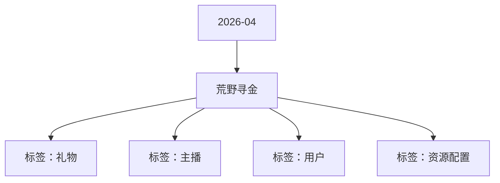

# 荒野寻金 活动知识图谱

## 核心信息

- 月份：2026-04
- 活动时间：4.24-4.29
- 活动 Wiki：https://wiki.inkept.cn/pages/viewpage.action?pageId=483798715
- 活动页面 ID：483798715
- 关联资料数：0
- 标签：礼物、主播、用户、资源配置

## 优化总结

### 活动概览

- 二、活动目标（来源：活动主页面）
- 三、活动简介（来源：活动主页面）

### 活动时间

- 起始时间：2026-04-15 16:06:28（来源：活动主页面）
- 结束时间：2027-04-15 16:06:28（来源：活动主页面）
- 起始时间：2026-04-15 16:04:45（来源：活动主页面）
- 结束时间：2027-04-15 16:04:45（来源：活动主页面）
- 一、活动时间（来源：活动主页面）
- 玩法时间：4 月 24 日 00:00:00 – 4 月 29 日 23:59:59统计时间：同玩法时间，数据统计以平台服务器时间为准，实时同步至前端展示（来源：活动主页面）
- 支持用户查看历史挖矿记录（含奖励类型、获得时间、礼物名称）。（来源：活动主页面）

### 玩法规则

- 玩法简介：（来源：活动主页面）
- 活动设置荒野寻金礼物，价值188 热力值。用户送出该礼物，主播获得1 热力值；剩余177 热力值参与玩法，最高可获得6666 热力值；10 热力值进入用户玩法。（来源：活动主页面）
- 用户每送出 1 次荒野寻金礼物，可随机获得奖励，同时为用户下发饼干（游戏点），用于活动用户玩法。（来源：活动主页面）
- 四、玩法详情（来源：活动主页面）
- 玩法一：礼物随机奖励玩法（来源：活动主页面）
- 整体匹配逻辑（来源：活动主页面）
- 即用户个人参与玩法≥1000钻后，则判断用户自身的返奖处于什么标准，依据标准为用户选择对应的池子，未满100钻正常按照常规期进行产出（来源：活动主页面）
- 用户送出该活动礼物后，触发随机玩法池的高级奖励（获得 6666 热力值及以上高档位奖励）时，触发全站悬浮公聊。广播文案（固定格式，替换对应昵称 / 礼物名称变量）：【荒野寻金】用户昵称 为 主播昵称 送出礼物名称，助力主播获得 礼物名称（来源：活动主页面）
- 该玩法采取个人奖池切换玩法（来源：活动主页面）
- 荒野寻金18824474送出该礼物主播获得1映币，剩余参与玩法，最高可获得6666热力值https://img.ikstatic.cn/MTc3NjMwNTIwNzA2NyM4MDMjcG5n.png（来源：活动主页面）
- 玩法二：饼干・矿工挖矿玩法（来源：活动主页面）
- 活动期间，用户每送出 1 次荒野寻金礼物，同时为送礼用户下发1 块饼干（无上限，多送多得），用于活动用户玩法。用户可以使用饼干驱动矿工挖矿，挖矿奖励按照全站次数进行产出。（来源：活动主页面）
- 饼干实时发放，并展示在用户活动页面的玩法点余额处，支持用户实时查看剩余数量。（来源：活动主页面）
- 用户点击挖矿按钮，驱动矿工挖矿一次，固定消耗 1 个饼干。玩法设置驱动 1 次、驱动 10 次、全部驱动三种操作，消耗后即时扣除，不可撤销、不可退回。（来源：活动主页面）
- 石头：无直接奖励，计入用户累计挖矿任务，页面展示「本轮获得石材，已计入个人累计任务，继续加油」（来源：活动主页面）
- 累计挖矿任务（来源：活动主页面）
- 公聊角标寻金大师公聊角标1017431【荒野寻金】恭喜您完成累计石头任务一阶段，已获得公聊角标 ×3 天，请注意查收。（来源：活动主页面）
- 麦序框寻金大师麦序框1017331【荒野寻金】恭喜您完成累计石头任务二阶段，已获得麦序框 ×3 天，请注意查收。（来源：活动主页面）

### 奖励与资源

- 您申请的SourceType: [背包礼物-赠送-平台运营组-荒野寻金-下发专用-2026-04-15] 已经审批完成（来源：活动主页面）
- 您申请的操作对象为：背包礼物，请把对应的soucetype提供给“活动业务组”，用于下发背包礼物；（来源：活动主页面）
- 您申请的操作对象为：映币，请把对应的soucetype提供给“主播运营组(礼物墙管理)”，用于配置背包礼物；（来源：活动主页面）
- 当大盘整体盈利小于99钻，不再产出最高的四款礼物，仅在最小的四款礼物进行随机产出（来源：活动主页面）
- 活动期间用户送出 188 热力值礼物荒野寻金，主播获得 1 热力值，同时随机获得其余奖励，奖励实时发放给到主播，最高可获得6666 热力值，奖励按照下发表格产出。（来源：活动主页面）
- 用户送出该活动礼物后，触发其他普通奖励时，触发普通直播间公聊：【荒野寻金】用户昵称 为 主播昵称 送出礼物名称，助力主播获得 礼物名称（来源：活动主页面）
- 礼物名称礼物价格礼物ID标注URL（来源：活动主页面）
- 序号资源类型资源名称背包ID时长数量价值权重全站广播H5跑马灯图片url（来源：活动主页面）
- 动画结束后展示此次挖矿结果，结果使用小弹窗展示：展示内容：矿石图片 + 文案：恭喜此次挖到 XXX 矿石，获得礼物名称（热力值）多次产出时，弹窗连续弹出（参考拼多多展现形式）。（来源：活动主页面）
- 奖励分为：（来源：活动主页面）
- 空：无任何奖励，页面展示「好遗憾！！本轮未能采集得到黄金，继续加油」（来源：活动主页面）
- 黄金奖励（倍数递增）：2 倍黄金、5 倍黄金、10 倍黄金、20 倍黄金、50 倍黄金、100 倍黄金（来源：活动主页面）
- 资源类型资源名称资源id时长数量私信内容（来源：活动主页面）
- 礼物ID0689268926893689368936893（来源：活动主页面）
- 礼物名称0爱你贴贴爱你贴贴旋转梦境旋转梦境旋转梦境旋转梦境（来源：活动主页面）

### 入口与链接

- SourceType:4370（来源：活动主页面）
- APP账单记录文案：直播收入（来源：活动主页面）
- 是否计入送礼流水：是（来源：活动主页面）
- 是否计入基准流水：是（来源：活动主页面）
- 是否计入无背包基准映币：否（来源：活动主页面）
- 否计入实际映币收入：是（来源：活动主页面）
- 是否为赠送钻石：否（来源：活动主页面）
- SourceType Hash:ecc14eabc83364ef2536cab81a26780a（来源：活动主页面）
- HASH使用时请保持小写，请及时关注SourceType预警邮件。（来源：活动主页面）
- 您申请的SourceType: [增加映币-赠送-平台运营组-荒野寻金-映币专用-2026-04-15] 已经审批完成（来源：活动主页面）
- SourceType:775（来源：活动主页面）
- SourceType Hash:69cb543fce80f9547140e2540a99597b（来源：活动主页面）

## 资料关系图

## 资料来源

- [活动主页面](https://wiki.inkept.cn/pages/viewpage.action?pageId=483798715)
