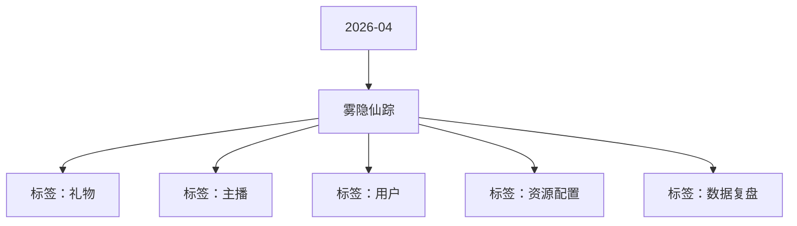

# 雾隐仙踪 活动知识图谱

## 核心信息

- 月份：2026-04
- 活动时间：4.24-4.29
- 活动 Wiki：https://wiki.inkept.cn/pages/viewpage.action?pageId=488347164
- 活动页面 ID：488347164
- 关联资料数：0
- 标签：礼物、主播、用户、资源配置、数据复盘

## 优化总结

### 活动概览

- 二、活动目标（来源：活动主页面）
- 三、活动背景（来源：活动主页面）

### 活动时间

- 活动时间：4 月 24 日 00:00:00 - 4 月 29 日 23:59:59（来源：活动主页面）
- 活动时间：4月24日00:00:00-4月29日23:59:59（来源：活动主页面）
- 统计时间：4月24日-4月29日 每日 00:00:00-23:59:59（来源：活动主页面）
- 活动时间：4月24日00:00:00-4月29日23:59:59--无玩法（来源：活动主页面）

### 玩法规则

- 在消耗下滑趋势下，设置玩法，维稳用户ARPPU，刺激消耗（来源：活动主页面）
- 玩法介绍：活动期间，用户通过累计送礼完成任务，完成身份进阶，身份依次为：知雾先知 → 宿命守护者，用户累计两日完成知雾先知任务阶段-5，即可升级宿命守护者任务（来源：活动主页面）
- 逻辑 1：本玩法为累计送礼任务玩法，用户累计送礼达到对应阶级数值，即可解锁对应身份，并获得对应阶段奖励，同时解锁该阶段道具奖励。（来源：活动主页面）
- 逻辑 2：所有奖励实时下发至用户账户，奖励有效期按照对应资源规则统一计算。（来源：活动主页面）
- 任务机制：本任务为知雾先知 日循环任务+进阶宿命守护者累计循环任务，用户完成一阶段知雾先知任务后，开启宿命守护者累计循环任务（用户累计两日完成知雾先知任务阶段-5，即可升级宿命守护者任务）（来源：活动主页面）
- 第二次完成阶段5任务时实时开启宿命守护者任务，超出分数不继承。（来源：活动主页面）
- 知雾先知任务（来源：活动主页面）
- 【雾隐仙踪】恭喜您完成知雾先知任务二阶段，已获得麦序框 ×1 天，请注意查收。（来源：活动主页面）
- 【雾隐仙踪】恭喜您完成知雾先知任务三阶段，已获得头像框 ×1 天，请注意查收。（来源：活动主页面）
- 【雾隐仙踪】恭喜您完成知雾先知任务五阶段，已获得「知雾先知」称号 ×1 天，请注意查收。（来源：活动主页面）
- 【雾隐仙踪】恭喜您完成知雾先知任务六阶段，已获得知雾先知主页挂件 ×1 个，请注意查收。（来源：活动主页面）
- 宿命守护者任务（来源：活动主页面）
- 【雾隐仙踪】恭喜您完成宿命守护者任务一阶段，已获得麦序框 ×1 天，请注意查收。（来源：活动主页面）
- 【雾隐仙踪】恭喜您完成宿命守护者任务二阶段，已获得头像框 ×1 天，请注意查收。（来源：活动主页面）
- 【雾隐仙踪】恭喜您完成宿命守护者任务三阶段，已获得公聊皮肤 ×1 天，请注意查收。（来源：活动主页面）
- 【雾隐仙踪】恭喜您完成宿命守护者任务五阶段，已获得「宿命守护者」称号 ×1 天，请注意查收。（来源：活动主页面）
- 【雾隐仙踪】恭喜您完成宿命守护者任务八阶段，已获得宿命守护者观众席底纹 ×1 个，请注意查收。（来源：活动主页面）
- 【雾隐仙踪】恭喜您完成宿命守护者任务十三阶段，已获得宿命守护者全屏座驾 ×1 个，请注意查收。（来源：活动主页面）

### 奖励与资源

- 礼物名称礼物价格礼物IDURL（来源：活动主页面）
- 日均礼物消耗达到800万钻石（来源：活动主页面）
- 用户为主播送出活动专属礼物，主播累计收礼达到对应阶段解锁奖励（来源：活动主页面）
- 头像框主页挂件972221【雾隐仙踪】恭喜您今日累计收到 10 人的礼物，已获得雾隐仙踪头像框奖励 ×2 天，请注意查收。（来源：活动主页面）
- 奖励与私信由研发实时下发（来源：活动主页面）
- 当红奖励（来源：活动主页面）
- 新秀奖励（来源：活动主页面）
- 嘉宾奖励（来源：活动主页面）

### 入口与链接

- 剑隐青竹13344（来源：活动主页面）
- 花礼初绽1024541https://img.ikstatic.cn/MTc0MjQzNzI3NTg3NyM4NjMjcG5n.png（来源：活动主页面）
- 舞动芭蕾9924542https://img.ikstatic.cn/MTc2MTAxNzk2NDg0NSM5NjQjcG5n.png（来源：活动主页面）
- 爱意定格52024543https://img.ikstatic.cn/MTc3MDM2MjA3ODEzNiM0NTAjcG5n.png（来源：活动主页面）
- 踏星而来131424544https://img.ikstatic.cn/MTc2NTk0MTU1ODI0NCM5NDEjcG5n.png（来源：活动主页面）
- 冰雪凤凰520024545https://img.ikstatic.cn/MTc2NjY1MjQ2ODQ1NyM0NTMjcG5n.png（来源：活动主页面）
- 星河女神3344024546https://img.ikstatic.cn/MTc0NzIxMTE2NTczNyMxMjgjcG5n.png（来源：活动主页面）
- 三生不负5200024547https://img.ikstatic.cn/MTc3NDM0NDIyOTU3NSM4MzQjcG5n.png（来源：活动主页面）
- 山海棋局9999924548https://img.ikstatic.cn/MTcwMzgzODc1OTc2MSMgNDYjcG5n.png（来源：活动主页面）
- 一、活动名称（来源：活动主页面）
- 雾隐仙踪（来源：活动主页面）
- 四、活动框架（来源：活动主页面）

## 资料关系图

## 资料来源

- [活动主页面](https://wiki.inkept.cn/pages/viewpage.action?pageId=488347164)
