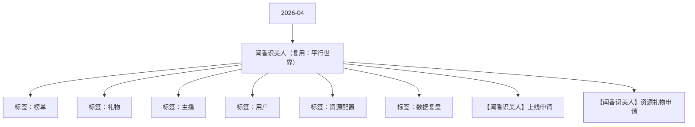

# 闻香识美人（复用：平行世界） 活动知识图谱

## 核心信息

- 月份：2026-04
- 活动时间：4.7-4.10
- 活动 Wiki：https://wiki.inkept.cn/pages/viewpage.action?pageId=488346218
- 活动页面 ID：488346218
- 关联资料数：2
- 标签：榜单、礼物、主播、用户、资源配置、数据复盘

## 优化总结

### 活动概览

- 一、活动目标：（来源：活动主页面）
- pK背景闻香识美人PK背景2082（来源：活动主页面）
- 【闻香识美人】恭喜宝宝完成主播任务二，获得闻香识美人PK背景*2天奖励，奖励已下发，快去看看吧～（来源：活动主页面）
- PK背景闻香识美人PK背景（来源：【闻香识美人】资源礼物申请）
- 派对背景闻香识美人派对背景（来源：【闻香识美人】资源礼物申请）

### 活动时间

- 活动时间更改（来源：活动主页面）
- 二、活动时间（来源：活动主页面）
- 年8月5日00:00:00-8月9日23:59:59（所有玩法统计时间均为北京时间GMT+8:00）（来源：活动主页面）
- 玩法统计时间：2025年8月5日-8月9日每日00:00:00-23:59:59（来源：活动主页面）
- 时间：8.6-8.10（来源：活动主页面）
- 时间： 4月7日00:00:00-4月11日23:59:59（来源：【闻香识美人】上线申请）
- 时间：4月7日00:00:00-4月10日23:59:59（来源：【闻香识美人】上线申请）
- 时间： 4月7日00:00:00-4月10日23:59:59（来源：【闻香识美人】上线申请）

### 玩法规则

- 活动资源奖励更改（整体逻辑不变）（来源：活动主页面）
- 五、玩法详情：（来源：活动主页面）
- 触发蒙面人剧情：则用户只获得不同的积分进入榜单，（来源：活动主页面）
- 序号剧情占比积分用户奖励id（来源：活动主页面）
- 榜单10积分18%榜单10积分/（来源：活动主页面）
- 榜单20积分18%榜单20积分/（来源：活动主页面）
- 榜单50积分15%榜单50积分/（来源：活动主页面）
- 榜单200积分10%榜单200积分/（来源：活动主页面）
- 榜单500积分5%榜单500积分/（来源：活动主页面）
- 限时送礼玩法（来源：活动主页面）
- 活动期间每日的20点-24点开始限时玩法，用户送活动专属礼物达到52000钻，可以获得直播间礼物画面+直播间飘屏，不用搞CP，送礼在52000的那个主播刚好获得，（来源：活动主页面）
- 每累计完成任务3次，下发全站的双头像礼物画面+全站飘屏，也就是第三次的时候（来源：活动主页面）
- 用户任务-日任务+循环任务（来源：活动主页面）
- 累计钻石积分，达到任务门槛获得资源奖励（来源：活动主页面）
- 关卡任务值资源类型资源名称资源id时长数量私信内容弹幕或公聊内容（来源：活动主页面）
- 【闻香识美人】恭喜宝宝完成用户任务一，获得摩登香影称号*2天奖励，奖励已下发，快去看看吧～（来源：活动主页面）
- 【闻香识美人】恭喜宝宝完成用户任务二，获得摩登香影发言波纹*2天奖励，奖励已下发，快去看看吧～（来源：活动主页面）
- 【闻香识美人】恭喜宝宝完成用户任务三，获得摩登香影上麦动效*2天奖励，奖励已下发，快去看看吧～（来源：活动主页面）

### 奖励与资源

- 嘉宾收礼：厅主及厅内嘉宾4人视频，6人视频，9人音频房间收礼专属礼物收入，其余方式均不计入统计。谁收算谁。（来源：活动主页面）
- 用户送活动专属礼物即可成为蒙面人，用户送活动专属礼物每达到33钻即可，在虚拟世界行走1次，每次行走即可触发不同的剧情（来源：活动主页面）
- 触发宝箱剧情：则触发对应的奖励&曝光（悬浮公聊/弹幕，最高可得半屏座驾)，奖励发放给用户（来源：活动主页面）
- 触发世界剧情：则触发实物奖励和曝光奖励，实物发放给用户（来源：活动主页面）
- 批量情况下，在私信/公聊/弹幕上以批量形式展示，仅展示1次，奖励批量下发---晓娜修改下，有点太多了。处理简便些（来源：活动主页面）
- 所有特权奖励单人最多获得X个（15天换算）为上限，超过不再下发对应奖励和私信，仅下发悬浮公聊及弹幕。（来源：活动主页面）
- 全站悬浮公聊：【平行世界】恭喜用户昵称获得实物奖励（映宝/潮玩），快去看看吧～（来源：活动主页面）
- 资源类型资源id（来源：活动主页面）
- 用户日榜top10获得日榜奖励（来源：活动主页面）
- 用户奖励（来源：活动主页面）
- 【闻香识美人】恭喜宝宝成为用户日榜TOP1，获得闻香旅人动态头像框*5天，闻香旅人动态麦序框*5天、闻香旅人称号*5天、闻香旅人资料卡浮屏*3天奖励，继续加油啊~（来源：活动主页面）
- 【闻香识美人】恭喜宝宝成为用户日榜TOP5，获得闻香旅人动态头像框*3天，闻香旅人动态麦序框*3天、闻香旅人称号*3天奖励，继续加油啊~（来源：活动主页面）
- 【闻香识美人】恭喜宝宝成为用户日榜TOP10，获得闻香旅人动态头像框*2天，闻香旅人动态麦序框*2天、闻香旅人称号*2天奖励，继续加油啊~（来源：活动主页面）
- 统计的是主播获得的映币数累积达到门槛，获得资源奖励，奖励实时下发，且下发私信通知。（来源：活动主页面）
- 大主播奖励（来源：活动主页面）
- 【闻香识美人】恭喜宝宝成为当红日榜TOP1，获得闻香识美人头像框*5天、闻香识美人称号*5天、热门推荐卡*3张、闻香识美人主页挂件*5天奖励，继续加油啊~（来源：活动主页面）
- 【闻香识美人】恭喜宝宝成为当红日榜TOP5，获得闻香识美人头像框*3天、闻香识美人称号*3天、热门推荐卡*1张、闻香识美人主页挂件*3天奖励，继续加油啊~（来源：活动主页面）
- 【闻香识美人】恭喜宝宝成为当红日榜TOP10，获得闻香识美人头像框*2天、闻香识美人称号*2天、闻香识美人主页挂件*2天奖励，继续加油啊~（来源：活动主页面）

### 入口与链接

- 更改点如下：（来源：活动主页面）
- 活动主题更改：设计换肤（来源：活动主页面）
- 活动消耗达到5500万钻石（来源：活动主页面）
- 三、数据统计维度：（来源：活动主页面）
- 个人主播收礼（主播）：仅统计普通视频直播间、公共直播间、PK送礼和友聊送礼渠道，其他送礼方式均不计入统计。（来源：活动主页面）
- 四、原型图：（来源：活动主页面）
- 原型图：https://modao.cc/app/pOfduqZ8sa9soeiuopLKJ0 #平行世界-分享（来源：活动主页面）
- 蒙面人剧情（来源：活动主页面）
- 分为蒙面人剧情、宝箱剧情、世界剧情（来源：活动主页面）
- 宝箱剧情10%（来源：活动主页面）
- 绯闻缪斯私聊皮肤9436（来源：活动主页面）
- 宝箱剧情6%（来源：活动主页面）

### 上线配置

- Dear all，（来源：【闻香识美人】上线申请）
- 辛苦 @叶导 审批，（来源：【闻香识美人】上线申请）
- 标题：闻香识美人（来源：【闻香识美人】上线申请）
- 色值： linear-gradient(90deg, #550200 0%, #310103 100%)（来源：【闻香识美人】上线申请）
- 位置：第一位，11日后移（来源：【闻香识美人】上线申请）
- 二、icon（来源：【闻香识美人】上线申请）
- 标题：闻香识美人（强挂）（来源：【闻香识美人】上线申请）
- 文案：香起全站 美人共鉴（来源：【闻香识美人】上线申请）
- 类型：普通，电台交友，视频交友（来源：【闻香识美人】上线申请）
- 位置：第一位（来源：【闻香识美人】上线申请）
- 三、首页banner（来源：【闻香识美人】上线申请）
- 四、全站私信（来源：【闻香识美人】上线申请）
- 月7日00:00:00（来源：【闻香识美人】上线申请）
- 月9日00:00:00（来源：【闻香识美人】上线申请）

## 资料关系图

## 资料来源

- [活动主页面](https://wiki.inkept.cn/pages/viewpage.action?pageId=488346218)
- [【闻香识美人】上线申请](https://wiki.inkept.cn/pages/viewpage.action?pageId=492712165)
- [【闻香识美人】资源礼物申请](https://wiki.inkept.cn/pages/viewpage.action?pageId=492702045)
