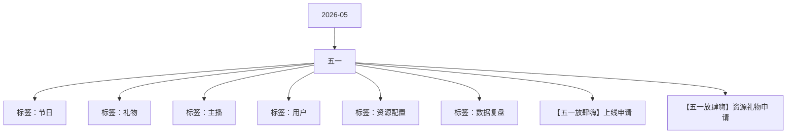

# 五一 活动知识图谱

## 核心信息

- 月份：2026-05
- 活动时间：4.29-5.5
- 活动 Wiki：https://wiki.inkept.cn/pages/viewpage.action?pageId=492718967
- 活动页面 ID：492718967
- 关联资料数：2
- 标签：节日、礼物、主播、用户、资源配置、数据复盘

## 优化总结

### 活动概览

- 一、活动目标：（来源：活动主页面）
- PK背景五一放肆嗨PK背景（来源：【五一放肆嗨】资源礼物申请）
- 派对背景五一放肆嗨派对背景（来源：【五一放肆嗨】资源礼物申请）

### 活动时间

- 二、活动时间（来源：活动主页面）
- 年4月29日00:00:00-5月5日23:59:59（所有玩法统计时间均为北京时间GMT+8:00）（来源：活动主页面）
- 任务每日循环，时间不需要反复，只需要送礼积分反复完成。（来源：活动主页面）
- 秀场循环玩法120（时间不需要循环）10000上红包位（来源：活动主页面）
- 玩法统计时间：2026年4月29日00:00:00-5月5日23:59:59（来源：活动主页面）
- 每个乐园送礼最多的用户及其送礼最多的主播成为乐园场主，得页面曝光展示。每1小时结算一次，累计活动时间在该乐园消耗最多的用户占领曝光位。（来源：活动主页面）
- 玩法统计时间：2026年5月3日00:00:00-5月5日23:59:59（来源：活动主页面）
- 时间：4月29日00:00:00-5月6日23:59:59（来源：【五一放肆嗨】上线申请）

### 玩法规则

- 四、玩法详情：（来源：活动主页面）
- 一、【秀场主播】开播收礼得兑换点任务：主播完成每日的开播时长+收礼任务，得对应挡位的兑换点。兑换点每个档位实时下发。任务每日不循环。（来源：活动主页面）
- 注：开播时长任务仅统计秀场视频直播。（来源：活动主页面）
- 二、完成最高阶的开播收礼任务还可以上H5页面红包位，用户点击跳转主播直播间，抢红包，红包里面是：【资源奖励+优酷会员卡】。任务每日循环。（来源：活动主页面）
- 玩法逻辑：（来源：活动主页面）
- 上H5页面红包位逻辑：主播完成任务后，上H5页面红包位。（来源：活动主页面）
- 三、兑换商城兑换逻辑：（来源：活动主页面）
- 四、【派对嘉宾】收礼得兑换点任务：嘉宾完成每日的收礼任务，得对应挡位的兑换点。兑换点每个档位实时下发。任务每日不循环。（来源：活动主页面）
- 完成最高阶的收礼任务还可以上H5页面红包位，用户点击跳转嘉宾所在直播间，抢红包，红包里面是：【资源奖励+优酷会员卡】。任务每日循环。（来源：活动主页面）
- 逻辑同秀场主播，区别：不统计直播时长；任务分值不同。（来源：活动主页面）
- 开播门槛（分钟）收礼金额曝光玩法（来源：活动主页面）
- 收礼金额（整个派对房间）曝光玩法（来源：活动主页面）
- 派对厅循环玩法50000上红包位（来源：活动主页面）
- 用户玩法：（来源：活动主页面）
- 一、基础任务：五一狂欢乐园（来源：活动主页面）
- 设置7日7场乐园主题，用户每日随机进入一个乐园，完成乐园累计任务得对应资源奖励。---每日随机进入一个乐园，乐园不可更换，7日进入7个不同乐园。（不同乐园的资源奖励不同）（来源：活动主页面）
- 用户完成7个乐园的任务五，得勋章（独一型）奖励。勋章id：3023（来源：活动主页面）
- 二、高光礼物使用权+上电视玩法（来源：活动主页面）

### 奖励与资源

- 嘉宾收礼：厅主及厅内嘉宾4人视频，6人视频，9人音频房间收礼的专属礼物收入，其余方式均不计入统计。谁收算谁的。（来源：活动主页面）
- 【条件】个人主播开播收礼：活动期间主播开播时长达20分钟为有效开播，计入开播时长，主播开播及收礼仅统计普通视频直播间、公共直播间，其他开播及收礼方式均不计入统计，收礼统计为活动专属礼物。（来源：活动主页面）
- 每个主播上到红包位后，都有20个资源奖励。在直播间下发公聊消息，用户发送公聊消息提示，直接抽资源奖励。（来源：活动主页面）
- 【五一放肆嗨】主播昵称为大家发放红包啦！发送“五一快乐”公聊消息即可有机会获得哦！先到先得，快来发送吧！（来源：活动主页面）
- 主播限制：20个资源奖励没有抽完，则主播一直展示在红包位。主播再次获得红包位奖励，则再增加20个资源奖励。（来源：活动主页面）
- 用户限制：用户每10分钟最多可抽取10个资源奖励。用户每分钟可以抽取1个资源奖励。（来源：活动主页面）
- 实物奖励每日限量1个、当日未兑换完则数量累计至第二日。资源奖励不限量。（春节兑换商城有bug，需修改）（来源：活动主页面）
- 实物奖励限制每人每日只能领取一个。（来源：活动主页面）
- 优酷会员卡限制同实物奖励限制一样，每人每日只能领取一个。主播兑换成功后，私信直接告诉主播兑换码是多少，兑换码不要重复下发，一人一码。（来源：活动主页面）
- 日期白名单id高光礼物1价格id送礼个数高光礼物2价格id送礼个数（来源：活动主页面）
- 【五一放肆嗨】活动将于4月29日00:00:00-5月5日23:59:59上线，现申请相关上线配置。（来源：【五一放肆嗨】上线申请）
- 辛苦 @灿灿 配置。（来源：【五一放肆嗨】上线申请）
- 具体需求如下（资源图钉钉提供）：（来源：【五一放肆嗨】上线申请）
- 文案：【五一放肆嗨】狂欢来袭！参与七日七个奇遇盲盒岛，解锁限定勋章；每日赠送专属特权高光礼物，带TA上电视~电量满格，快乐加载已达100%！（来源：【五一放肆嗨】上线申请）
- 话题介绍：警报！警报！五一嗨爆能量正在聚集——参与七日七个奇遇盲盒岛，解锁限定勋章；每日赠送专属特权高光礼物，带TA上电视~电量满格，快乐加载已达100%！（来源：【五一放肆嗨】上线申请）
- 八、礼物墙及上新气泡（来源：【五一放肆嗨】上线申请）
- 礼物配置礼物墙banner，以下为礼物墙礼物排序（来源：【五一放肆嗨】上线申请）
- 气泡：活动礼物（来源：【五一放肆嗨】上线申请）

### 入口与链接

- 参考去年五一及国庆期间趋势，日均有效开播人数环比活动前下降幅度控制在7%以内（来源：活动主页面）
- 数据统计维度：（来源：活动主页面）
- 个人主播收礼（主播）：仅统计普通视频直播间、公共直播间、PK送礼和友聊送礼渠道，其他送礼方式均不计入统计。（来源：活动主页面）
- 三、活动框架：（来源：活动主页面）
- 原型：https://modao.cc/proto/4yjWOOZctd9tswslRHC1R3/sharing?view_mode=read_only&screen=rbpUhrFrwnmRm1KUj #26年五一-分享（来源：活动主页面）
- 主播活跃：（来源：活动主页面）
- 公聊消息：（来源：活动主页面）
- 【五一放肆嗨】本次主播昵称的福利已下发完毕，主播昵称继续加油为粉丝宝宝们争取更多福利吧！（来源：活动主页面）
- 仅该用户可见的公聊消息：【五一放肆嗨】每分钟仅有1次领取红包福利的机会哦~宝宝休息一下再继续~（来源：活动主页面）
- 优酷会员卡：合计共有30份。活动期间，一个人只能领取一份、领取后，私信直接告诉用户兑换码是多少，兑换码不要重复下发，一人一码。（来源：活动主页面）
- 全站可见的公聊消息：【五一放肆嗨】恭喜用户昵称在主播昵称的直播间抽到了视频会员卡！（来源：活动主页面）
- 用户可见的供料消息：【五一放肆嗨】恭喜用户昵称在红包福利中获得了优酷会员月卡~快去私信领取你的会员兑换码吧！（来源：活动主页面）

### 上线配置

- Dear all，（来源：【五一放肆嗨】上线申请）
- 辛苦 @叶导 审批，（来源：【五一放肆嗨】上线申请）
- 标题：五一放肆嗨（来源：【五一放肆嗨】上线申请）
- 位置：第一位，6日后移（来源：【五一放肆嗨】上线申请）
- 二、icon（来源：【五一放肆嗨】上线申请）
- 标题：五一放肆嗨（强挂）（来源：【五一放肆嗨】上线申请）
- 文案：开播赢曝光抢实物（来源：【五一放肆嗨】上线申请）
- 类型：普通，电台交友，视频交友（来源：【五一放肆嗨】上线申请）
- 位置：第一位（来源：【五一放肆嗨】上线申请）
- 三、首页banner（来源：【五一放肆嗨】上线申请）
- 四、全站私信（来源：【五一放肆嗨】上线申请）
- 月29日00:30:00（来源：【五一放肆嗨】上线申请）
- 月1日00:30:00（来源：【五一放肆嗨】上线申请）
- 文案：待补充（来源：【五一放肆嗨】上线申请）

## 资料关系图

## 资料来源

- [活动主页面](https://wiki.inkept.cn/pages/viewpage.action?pageId=492718967)
- [【五一放肆嗨】上线申请](https://wiki.inkept.cn/pages/viewpage.action?pageId=497224198)
- [【五一放肆嗨】资源礼物申请](https://wiki.inkept.cn/pages/viewpage.action?pageId=497222848)
