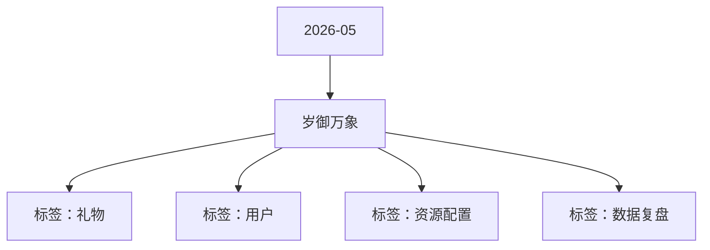

# 岁御万象 活动知识图谱

## 核心信息

- 月份：2026-05
- 活动时间：5.11-5.14
- 活动 Wiki：https://wiki.inkept.cn/pages/viewpage.action?pageId=492719910
- 活动页面 ID：492719910
- 关联资料数：0
- 标签：礼物、用户、资源配置、数据复盘

## 优化总结

### 活动概览

- 二、活动目标（来源：活动主页面）
- 三、活动背景（来源：活动主页面）

### 活动时间

- 活动时间：5 月 11 日 00:00:00 - 5 月 14 日 23:59:59（来源：活动主页面）
- 道具礼物全站悬浮公聊道具卡243741【白龙御空】恭喜您完成白龙御空任务十阶段，已获得全站悬浮公聊触发卡 ×1 张，使用有效期为活动时间内，请注意查收。（来源：活动主页面）
- 道具礼物全站画面广播道具卡243761【白龙御空】恭喜您完成白龙御空任务十一阶段，已获得全站画面广播道具卡 ×1 张，使用有效期为活动时间内，请注意查收。（来源：活动主页面）
- 道具礼物全站推荐道具卡243771【白龙御空】恭喜您完成白龙御空任务十二阶段，已获得全站画面 + 全站推荐道具卡 ×1 张，使用有效期为活动时间内，请注意查收。（来源：活动主页面）
- 活动时间内，用户送出以下任何指定礼物达到3个即可解锁勋章奖励（来源：活动主页面）

### 玩法规则

- 逻辑 1：本玩法为累计送礼任务玩法，用户累计送礼达到对应阶级数值，即可解锁对应身份，并获得对应阶段奖励，同时解锁该阶段道具奖励。（来源：活动主页面）
- 逻辑 2：所有奖励实时下发至用户账户，奖励有效期按照对应资源规则统一计算。（来源：活动主页面）
- 任务机制：本任务为循环任务，用户完成当前阶段任务后，可重新进入下一循环，继续完成任务并领取对应阶段奖励。（来源：活动主页面）
- 关卡任务值资源类型资源名称资源id时长数量私信内容（来源：活动主页面）
- 公聊角标白龙御空公聊角标1004131【白龙御空】恭喜您完成白龙御空任务一阶段，已获得公聊角标 ×3 天，请注意查收。（来源：活动主页面）
- 麦序框白龙御空麦序框1003931【白龙御空】恭喜您完成白龙御空任务二阶段，已获得麦序框 ×3 天，请注意查收。（来源：活动主页面）
- 头像框白龙御空头像框1003731【白龙御空】恭喜您完成白龙御空任务三阶段，已获得头像框 ×3 天，请注意查收。（来源：活动主页面）
- 公聊皮肤白龙御空公聊皮肤1004231【白龙御空】恭喜您完成白龙御空任务四阶段，已获得公聊皮肤 ×3 天，请注意查收。（来源：活动主页面）
- 称号潜龙在渊称号223731【白龙御空】恭喜您完成白龙御空任务五阶段，已获得「潜龙在渊」称号 ×3 天，请注意查收。（来源：活动主页面）
- 送礼托盘白龙御空送礼托盘1004431【白龙御空】恭喜您完成白龙御空任务六阶段，已获得白龙御空送礼托盘 ×3 天，请注意查收。（来源：活动主页面）
- 主页挂件白龙御空主页挂件浮屏1002531【白龙御空】恭喜您完成白龙御空任务七阶段，已获得白龙御空主页挂件 ×3 天，请注意查收。（来源：活动主页面）
- 观众席底纹白龙御空观众席底纹1004531【白龙御空】恭喜您完成白龙御空任务八阶段，已获得白龙御空观众席底纹 ×3 天，请注意查收。（来源：活动主页面）
- 称号云龙风虎称号223831【白龙御空】恭喜您完成白龙御空任务九阶段，已获得「云龙风虎」称号×3 天，请注意查收。（来源：活动主页面）
- 进房座驾白龙御空全屏座驾1002831【白龙御空】恭喜您完成白龙御空任务十三阶段，已获得全屏座驾 ×3 天，请注意查收。（来源：活动主页面）
- 各个道具卡使用逻辑如下：（来源：活动主页面）
- 主播收礼任务（来源：活动主页面）
- 【白龙御空】恭喜您完成白龙御使任务一阶段，已获得白龙御使头像框 ×1 天，请注意查收。（来源：活动主页面）
- 【白龙御空】恭喜您完成白龙御使任务二阶段，已获得「白龙御使」称号 ×1 天，请注意查收。（来源：活动主页面）

### 奖励与资源

- 日均礼物消耗达到500万钻石（来源：活动主页面）
- 道具礼物全站悬浮公聊道具卡24374（来源：活动主页面）
- 道具礼物全站画面广播道具卡24376（来源：活动主页面）
- 道具礼物全站推荐道具卡24377（来源：活动主页面）
- 直播间画面白龙御空双头像礼物画面6891（来源：活动主页面）
- 用户为主播送出活动专属礼物，主播累计收礼达到对应阶段解锁奖励（来源：活动主页面）
- 道具卡热门13推荐卡（来源：活动主页面）
- 活动期间内，主播收到以下任何指定礼物达到3个即可解锁勋章奖励（来源：活动主页面）

### 入口与链接

- 一、活动名称（来源：活动主页面）
- 岁御万象（来源：活动主页面）
- 在相对平稳阶段，设置活动，维稳大盘消耗（来源：活动主页面）
- 循环后进度条重置为 0，保留「循环次数」展示（如：已完成 X 轮）（来源：活动主页面）
- task_keyscore_totalprize_typeprize_nameresource_iddurationnumprivate_msg（来源：活动主页面）
- 全站悬浮公聊：用户使用后触发全站悬浮公聊并展示在活动页面中：【白龙御空】用户昵称向全站推荐主播昵称，御辰踏岁威震八方！（来源：活动主页面）
- 全站画面广播：用户使用后触发全站画面广播并展示在活动页面中：【白龙御空】用户昵称向全站推荐主播昵称，岁驭山河风华无双！（来源：活动主页面）
- 全站推荐卡：用户使用后可可触发全站推荐功能及画面并展示在活动页面中：【白龙御空】用户昵称向全站推荐主播昵称，十二辰尊傲视群雄！（来源：活动主页面）
- 头像框白龙御使头像框（来源：活动主页面）
- 称号白龙御使称号（来源：活动主页面）
- 主页挂件白龙御使主页挂件（来源：活动主页面）
- 主页浮屏白龙御使主页浮屏（来源：活动主页面）

## 资料关系图

## 资料来源

- [活动主页面](https://wiki.inkept.cn/pages/viewpage.action?pageId=492719910)
