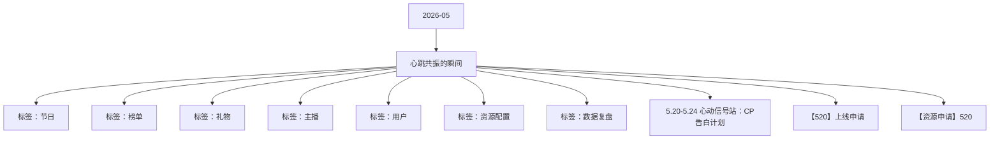

# 心跳共振的瞬间 活动知识图谱

## 核心信息

- 月份：2026-05
- 活动时间：5.19-5.21
- 活动 Wiki：https://wiki.inkept.cn/pages/viewpage.action?pageId=492731523
- 活动页面 ID：492731523
- 关联资料数：3
- 标签：节日、榜单、礼物、主播、用户、资源配置、数据复盘

## 优化总结

### 活动概览

- 一、活动目标：（来源：活动主页面）
- 一、活动目标：（来源：5.20-5.24 心动信号站：CP告白计划）
- 围绕520/情人节爱情节点，通过1V1 CP任务、告白曝光、CP勋章收集及榜单奖励，提升活动专属礼物消耗与主播/嘉宾收礼积极性。活动消耗目标建议：活动期累计消耗不低于3000万钻石，日均消耗600w钻。（来源：5.20-5.24 心动信号站：CP告白计划）
- 活动后两日强化CP持续付费目标。CP累计完成轮次达到对应档位时，双方自动升级CP守护等级，并延长部分已获得资源时长。（来源：5.20-5.24 心动信号站：CP告白计划）
- PK背景心跳共振的瞬间PK背景（来源：【资源申请】520）
- 派对背景心跳共振的瞬间派对背景（来源：【资源申请】520）

### 活动时间

- 二、活动时间（来源：活动主页面）
- 年5月19日00:00:00-5月21日23:59:59（所有玩法统计时间均为北京时间GMT+8:00）（来源：活动主页面）
- 玩法时间：5月19日00:00:00-5月21日23:59:59（来源：活动主页面）
- 玩法时间：5月19日00:00:00-5月19日23:59:59（来源：活动主页面）
- 玩法时间：5月20日00:00:00-5月20日23:59:59（来源：活动主页面）
- 玩法时间：5月21日00:00:00-5月21日23:59:59（来源：活动主页面）
- 玩法时间：5月20日00:00:00-5月21日23:59:59（来源：活动主页面）
- 玩法时间：5月19日00:00:00-5月21日23:59:59每日的00:00:00-23:59:59（来源：活动主页面）

### 玩法规则

- 五、玩法详情：（来源：活动主页面）
- 全程核心玩法--1V1的CP日循环任务（来源：活动主页面）
- 玩法逻辑：（来源：活动主页面）
- 用户为主播送任一活动专属礼物，两人即可组成1V1的CP，开启CP日循环任务。（来源：活动主页面）
- 送礼每满21钻，记为1次心跳共振。累计cp间心跳共振的的次数达到对应任务档位，cp获得对应任务档位的资源奖励。（来源：活动主页面）
- 该任务为1V1的cp日循环任务。（来源：活动主页面）
- 任务阶段阶段一阶段二阶段三阶段四阶段五（来源：活动主页面）
- 私信【520】恭喜宝宝与用户昵称完成心跳共振任务一，获得心跳共振点亮*1天奖励，继续加油呀~【520】恭喜宝宝与用户昵称完成心跳共振任务二，获得心跳共振贴纸*1天奖励，继续加油呀~【520】恭喜宝宝与用户昵称完成心跳共振任务三，获得心跳共振头像框*1天奖励，继续加油呀~【520】恭喜宝宝与用户昵称完成心跳共振任务四，获得心跳共振称号*1天奖励，继续加油呀~【520】恭喜宝宝与用户昵称完成心跳共振任务五，获得心跳共振主页挂件*1天奖励，...
- 私信【520】恭喜宝宝与主播昵称完成心跳共振任务一，获得心弦和鸣公聊角标*1天奖励，继续加油呀~【520】恭喜宝宝与主播昵称完成心跳共振任务二，获得心弦和鸣公聊皮肤*1天奖励，继续加油呀~【520】恭喜宝宝与主播昵称完成心跳共振任务三，获得心弦和鸣头像框*1天奖励，继续加油呀~【520】恭喜宝宝与主播昵称完成心跳共振任务四，获得心弦和鸣称号*1天奖励，继续加油呀~【520】恭喜宝宝与主播昵称完成心跳共振任务五，获得心弦和鸣主页挂件*1...
- 私信【520】恭喜宝宝与用户昵称完成心跳共振任务一，获得心跳共振上麦动效*1天奖励，继续加油呀~【520】恭喜宝宝与用户昵称完成心跳共振任务二，获得心跳共振麦序框*1天奖励，继续加油呀~【520】恭喜宝宝与用户昵称完成心跳共振任务三，获得心跳共振称号*1天奖励，继续加油呀~【520】恭喜宝宝与用户昵称完成心跳共振任务四，获得心跳共振发言波纹*1天奖励，继续加油呀~【520】恭喜宝宝与用户昵称完成心跳共振任务五，获得心跳共振主页挂件*1...
- 私信【520】恭喜宝宝与主播昵称完成心跳共振任务一，获得心弦和鸣上麦动效*1天奖励，继续加油呀~【520】恭喜宝宝与主播昵称完成心跳共振任务二，获得心弦和鸣麦序框*1天奖励，继续加油呀~【520】恭喜宝宝与主播昵称完成心跳共振任务三，获得心弦和鸣称号*1天奖励，继续加油呀~【520】恭喜宝宝与主播昵称完成心跳共振任务四，获得心弦和鸣发言波纹*1天奖励，继续加油呀~【520】恭喜宝宝与主播昵称完成心跳共振任务五，获得心弦和鸣主页挂件*1...
- 月19日玩法（来源：活动主页面）
- 单日循环任务：用户和主播的cp间，每完成3轮任务循环，双人可得cp资料卡浮屏*3天奖励。（来源：活动主页面）
- 【520】恭喜宝宝与用户昵称完成今日限定任务，获得CP限定心跳共振资料卡浮屏*3天奖励，快去佩戴吧~（来源：活动主页面）
- 【520】恭喜宝宝与主播昵称完成今日限定任务，获得CP限定心弦和鸣资料卡浮屏*3天奖励，快去佩戴吧~（来源：活动主页面）
- 月20日玩法（来源：活动主页面）
- 在全程玩法的基础上，增加曝光。（来源：活动主页面）
- 月21日玩法（来源：活动主页面）

### 奖励与资源

- 嘉宾收礼：厅主及厅内嘉宾4人视频，6人视频，9人音频房间收礼专属礼物收入，其余方式均不计入统计。谁收算谁。（来源：活动主页面）
- 秀场主播奖励心跳共振点亮*1天心跳共振贴纸*1天心跳共振头像框*1天心跳共振称号*1天心跳共振主页挂件*1天（来源：活动主页面）
- 用户奖励心弦和鸣公聊角标*1天心弦和鸣公聊皮肤*1天心弦和鸣头像框*1天心弦和鸣称号*1天心弦和鸣主页挂件*1天（来源：活动主页面）
- 嘉宾奖励心跳共振上麦动效*1天心跳共振麦序框*1天心跳共振称号*19天心跳共振发言波纹*1天心跳共振主页挂件*1天（来源：活动主页面）
- 用户奖励心弦和鸣上麦动效*1天心弦和鸣麦序框*1天心弦和鸣称号*1天心弦和鸣发言波纹*1天心弦和鸣主页挂件*1天（来源：活动主页面）
- 每日全站最高的主播及陪陪中最高的CP用户解锁CP靓号奖励：2026520&2026521、1314520&1314521、3344520&3344521（来源：活动主页面）
- 主播奖励用户奖励主播私信用户私信（来源：活动主页面）
- 一念心动头像框*5天、一念心动称号*5天、热门推荐卡*3张、一念心动主页挂件*5天、一念心动主页浮屏*5天两心相契头像框*5天、两心相契称号*5天、两心相契主页挂件*5天、两心相契主页浮屏*5天【520】恭喜宝宝与用户昵称成为当红CP日榜TOP1，获得一念心动头像框*5天、一念心动称号*5天、热门推荐卡*3张、一念心动主页挂件*5天、一念心动主页浮屏*5天奖励，继续加油啊~【520】恭喜宝宝与主播昵称成为当红CP日榜TOP1，获得两心...
- 一念心动头像框*3天、一念心动称号*3天、热门推荐卡*1张、一念心动主页挂件*3天、一念心动主页浮屏*3天两心相契头像框*3天、两心相契称号*3天、两心相契主页挂件*3天、两心相契主页浮屏*3天【520】恭喜宝宝与用户昵称成为当红CP日榜TOP5，获得一念心动头像框*3天、一念心动称号*3天、热门推荐卡*1张、一念心动主页挂件*3天、一念-心动主页浮屏*3天奖励，继续加油啊~【520】恭喜宝宝与主播昵称成为当红CP日榜TOP5，获得两...
- 一念心动头像框*2天、一念心动称号*2天、一念心动主页挂件*2天、一念心动主页浮屏*2天两心相契头像框*2天、两心相契称号*2天、两心相契主页挂件*2天、两心相契主页浮屏*2天【520】恭喜宝宝与用户昵称成为当红CP日榜TOP10，获得一念心动头像框*2天、一念心动称号*2天、一念心动主页挂件*2天、一念心动主页浮屏*2天奖励，继续加油啊~【520】恭喜宝宝与主播昵称成为当红CP日榜TOP10，获得两心相契头像框*2天、两心相契称号*...
- 一念心动头像框*3天、一念心动称号*3天、热门推荐卡*1张、一念心动主页挂件*3天、一念心动主页浮屏*3天两心相契头像框*3天、两心相契称号*3天、两心相契主页挂件*3天、两心相契主页浮屏*3天【520】恭喜宝宝与用户昵称成为新秀CP日榜TOP1，获得一念心动头像框*3天、一念心动称号*3天、热门推荐卡*1张、一念心动主页挂件*3天、一念心动主页浮屏*3天奖励，继续加油啊~【520】恭喜宝宝与主播昵称成为新秀CP日榜TOP1，获得两心...
- 一念心动头像框*2天、一念心动称号*2天、一念心动主页挂件*2天、一念心动主页浮屏*2天两心相契头像框*2天、两心相契称号*2天、两心相契主页挂件*2天、两心相契主页浮屏*2天【520】恭喜宝宝与用户昵称成为新秀CP日榜TOP5，获得一念心动头像框*2天、一念心动称号*2天、一念心动主页挂件*2天、一念心动主页浮屏*2天奖励，继续加油啊~【520】恭喜宝宝与主播昵称成为新秀CP日榜TOP5，获得两心相契头像框*2天、两心相契称号*2天...
- 一念心动头像框*1天、一念心动称号*1天、一念心动主页挂件*1天、一念心动主页浮屏*1天两心相契头像框*1天、两心相契称号*1天、两心相契主页挂件*1天、两心相契主页浮屏*1天【520】恭喜宝宝与用户昵称成为新秀CP日榜TOP10，获得一念心动头像框*1天、一念心动称号*1天、一念心动主页挂件*1天、一念心动主页浮屏*1天奖励，继续加油啊~【520】恭喜宝宝与主播昵称成为新秀CP日榜TOP10，获得两心相契头像框*1天、两心相契称号*...
- 嘉宾奖励用户奖励主播私信用户私信（来源：活动主页面）
- 一念心动麦序框*5天、一念心动称号*5天、一念心动主页挂件*5天、一念心动主页浮屏*5天、一念心动上麦动效*5天、一念心动发言波纹*5天两心相契麦序框*5天、两心相契称号*5天、两心相契主页挂件*5天、两心相契主页浮屏*5天、两心相契上麦动效*5天、两心相契发言波纹*5天【520】恭喜宝宝与用户昵称成为嘉宾CP日榜TOP1，获得一念心动麦序框*5天、一念心动称号*5天、一念心动主页挂件*5天、一念心动主页浮屏*5天、一念心动上麦动效*...
- 一念心动麦序框*3天、一念心动称号*3天、一念心动主页挂件*3天、一念心动主页浮屏*3天、一念心动上麦动效*3天、一念心动发言波纹*3天两心相契麦序框*3天、两心相契称号*3天、两心相契主页挂件*3天、两心相契主页浮屏*3天、两心相契上麦动效*3天、两心相契发言波纹*3天【520】恭喜宝宝与用户昵称成为嘉宾CP日榜TOP5，获得一念心动麦序框*3天、一念心动称号*3天、一念心动主页挂件*3天、一念心动主页浮屏*3天、一念心动上麦动效*...
- 一念心动麦序框*2天、一念心动称号*2天、一念心动主页挂件*2天、一念心动主页浮屏*2天、一念心动上麦动效*2天、一念心动发言波纹*2天两心相契麦序框*2天、两心相契称号*2天、两心相契主页挂件*2天、两心相契主页浮屏*2天、两心相契上麦动效*2天、两心相契发言波纹*2天【520】恭喜宝宝与用户昵称成为嘉宾CP日榜TOP10，获得一念心动麦序框*2天、一念心动称号*2天、一念心动主页挂件*2天、一念心动主页浮屏*2天、一念心动上麦动效...
- 小映礼物（来源：活动主页面）

### 入口与链接

- 活动消耗达到2400万钻石，日均消耗800w钻（来源：活动主页面）
- 三、数据统计维度：（来源：活动主页面）
- 个人主播收礼（主播）：仅统计普通视频直播间、公共直播间、PK送礼和友聊送礼渠道，其他送礼方式均不计入统计。（来源：活动主页面）
- 四、原型图：（来源：活动主页面）
- 原型图： https://modao.cc/proto/77sZ3Kutduexc1R6cpvU/sharing?view_mode=read_only&screen=rbpVHQV2688xBWfgm #520-分享（来源：活动主页面）
- 累计次数5226652013142666（来源：活动主页面）
- 称号心跳共振称号2297（来源：活动主页面）
- 点亮心跳共振点亮1068（来源：活动主页面）
- 发言波纹心跳共振发言波纹10384（来源：活动主页面）
- 麦序框心跳共振麦序框10378（来源：活动主页面）
- 上麦动效心跳共振上麦动效10382（来源：活动主页面）
- 头像框心跳共振头像框10374（来源：活动主页面）

### 上线配置

- Dear all，（来源：【520】上线申请）
- 辛苦 @叶导 审批，（来源：【520】上线申请）
- 标题：520（来源：【520】上线申请）
- 色值： linear-gradient(90deg, #ff91bb 0%, #ff4fae 100%)（来源：【520】上线申请）
- 位置：第一位，22日后移（来源：【520】上线申请）
- 二、icon（来源：【520】上线申请）
- 标题：520（强挂）（来源：【520】上线申请）
- 文案：心跳共振 响彻全站（来源：【520】上线申请）
- 类型：普通，电台交友，视频交友（来源：【520】上线申请）
- 位置：第一位（来源：【520】上线申请）
- 三、首页banner（来源：【520】上线申请）
- 四、全站私信（来源：【520】上线申请）
- 月19日00:00:00（来源：【520】上线申请）
- 月20日00:00:00（来源：【520】上线申请）

### 数据与复盘

- 四、数据统计维度：（来源：5.20-5.24 心动信号站：CP告白计划）

### 其他关键信息

- 心动信号站：CP告白计划（来源：5.20-5.24 心动信号站：CP告白计划）
- 三、活动范围（来源：5.20-5.24 心动信号站：CP告白计划）
- 五、原型图：（来源：5.20-5.24 心动信号站：CP告白计划）
- 原型图：待补充（来源：5.20-5.24 心动信号站：CP告白计划）
- 累计心动信号5226652013142666（来源：5.20-5.24 心动信号站：CP告白计划）
- 秀场主播私信：（来源：5.20-5.24 心动信号站：CP告白计划）
- 用户私信：（来源：5.20-5.24 心动信号站：CP告白计划）
- 嘉宾私信：（来源：5.20-5.24 心动信号站：CP告白计划）
- 全站弹幕：【520】用户昵称为主播昵称点亮专属告白，文案库随机短句~（来源：5.20-5.24 心动信号站：CP告白计划）
- 全站悬浮公聊：【520】用户昵称把偏爱写给主播昵称，文案库随机短句~（来源：5.20-5.24 心动信号站：CP告白计划）

## 资料关系图

## 资料来源

- [活动主页面](https://wiki.inkept.cn/pages/viewpage.action?pageId=492731523)
- [5.20-5.24 心动信号站：CP告白计划](https://wiki.inkept.cn/pages/viewpage.action?pageId=502073993)
- [【520】上线申请](https://wiki.inkept.cn/pages/viewpage.action?pageId=502071955)
- [【资源申请】520](https://wiki.inkept.cn/pages/viewpage.action?pageId=499523519)
