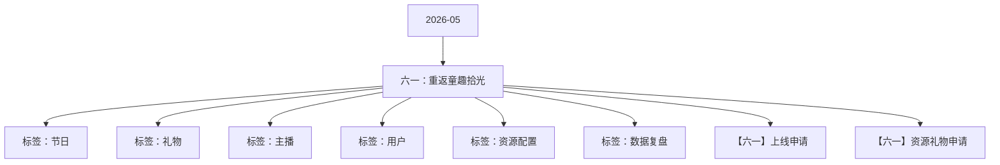

# 六一：重返童趣拾光 活动知识图谱

## 核心信息

- 月份：2026-05
- 活动时间：5.30-6.1
- 活动 Wiki：https://wiki.inkept.cn/pages/viewpage.action?pageId=499520103
- 活动页面 ID：499520103
- 关联资料数：2
- 标签：节日、礼物、主播、用户、资源配置、数据复盘

## 优化总结

### 活动概览

- 一、活动目标：（来源：活动主页面）
- 背包资源童趣一夏PK背景2133（来源：活动主页面）
- 【重返童趣拾光】恭喜宝宝完成主播任务一，获得童趣一夏PK背景*3天，奖励已下发，快去查看吧～（来源：活动主页面）
- 背包资源童趣一夏派对背景4453（来源：活动主页面）
- 【重返童趣拾光】恭喜宝宝完成主播任务一，获得童趣一夏派对背景*3天，奖励已下发，快去查看吧～（来源：活动主页面）
- PK背景童趣一夏PK背景（来源：【六一】资源礼物申请）
- 派对背景童趣一夏派对背景（来源：【六一】资源礼物申请）

### 活动时间

- 二、活动时间（来源：活动主页面）
- 年5月30日00:00:00-6月1日23:59:59（所有玩法统计时间均为北京时间GMT+8:00）（来源：活动主页面）
- 玩法统计时间：2026年5月30日00:00:00-6月1日23:59:59（来源：活动主页面）
- 玩法统计时间：2026年6月1日00:00:00-6月1日23:59:59（来源：活动主页面）
- 时间：5月30日00:00:00-6月2日23:59:59（来源：【六一】上线申请）
- 时间：5月30日00:00:00-6月1日23:59:59（来源：【六一】上线申请）
- 生效时间：5月30日00:00:00-6月1日23:59:59（来源：【六一】上线申请）

### 玩法规则

- 四、玩法详情：（来源：活动主页面）
- 一、用户主线的3日累计循环送礼任务（来源：活动主页面）
- 玩法逻辑：（来源：活动主页面）
- 累计有6个游乐园的阶梯循环任务。（来源：活动主页面）
- 用户送礼逐个进入游乐场游玩。每完成一关送礼任务可点亮一颗星，每集齐该特定乐园的星星，用户可获得该乐园的专属资源奖励+一张图鉴。（来源：活动主页面）
- 集齐全部图鉴，用户6.1日可开启时光杂货铺全新玩法。（来源：活动主页面）
- 已开启时光杂货铺的用户：继续做【游乐园任务】+同时做【时光杂货铺】任务（来源：活动主页面）
- 未开启时光杂货铺的用户：先完成【游乐园任务】，完成后随时开启同步做【时光杂货铺】任务（来源：活动主页面）
- 关卡--循环乐园点亮星星的个数任务值3关每点亮1颗星得id私信（来源：活动主页面）
- 过山车3100015002000重返童趣拾光头像框*12H10410【重返童趣拾光】恭喜宝宝点亮一颗过山车任务星，获得重返童趣拾光头像框*12H，奖励已下发，快去查看吧～（来源：活动主页面）
- 碰碰车3250030003500重返童趣拾光称号*1天2302【重返童趣拾光】恭喜宝宝点亮一颗碰碰车任务星，获得重返童趣拾光称号*1天，奖励已下发，快去查看吧～（来源：活动主页面）
- 海盗船3400050006000重返童趣拾光送礼托盘*12H10409【重返童趣拾光】恭喜宝宝点亮一颗海盗船任务星，获得重返童趣拾光送礼托盘*12H，奖励已下发，快去查看吧～（来源：活动主页面）
- 水滑梯3700080009000重返童趣拾光主页挂件*6H10406【重返童趣拾光】恭喜宝宝点亮一颗水滑梯任务星，获得重返童趣拾光主页挂件*6H，奖励已下发，快去查看吧～（来源：活动主页面）
- 摩天轮3100001100012000重返童趣拾光观众席底纹*6H10414【重返童趣拾光】恭喜宝宝点亮一颗摩天轮任务星，获得重返童趣拾光观众席底纹*6H，奖励已下发，快去查看吧～（来源：活动主页面）
- 旋转木马3130001400015000重返童趣拾光半屏座驾*6H10403【重返童趣拾光】恭喜宝宝点亮一颗旋转木马任务星，获得重返童趣拾光半屏座驾*6H，奖励已下发，快去查看吧～（来源：活动主页面）
- 二、6.1日玩法--时光杂货铺（来源：活动主页面）
- 用户集齐全部图鉴，在6.1即可限时解锁该玩法。（来源：活动主页面）
- 三、主播日任务（来源：活动主页面）

### 奖励与资源

- 嘉宾收礼：厅主及厅内嘉宾4人视频，6人视频，9人音频房间收礼的专属礼物收入，其余方式均不计入统计。谁收算谁的。（来源：活动主页面）
- 用户送活动专属礼物每满99钻，有机会随机解锁杂货铺上的1份随机童年商品，合计有5*4个商品，每解锁一排/列，得对应排/列的资源奖励。所有资源奖励最多可得15天。（来源：活动主页面）
- 累计主播每日收礼钻石数，达到不同阶段即可获得奖励，每日清空1次。（来源：活动主页面）
- 背包资源童趣一夏头像框52403（来源：活动主页面）
- 背包资源童趣一夏主页挂件32791（来源：活动主页面）
- 背包资源童趣一夏主页浮屏104131（来源：活动主页面）
- 背包资源童趣一夏麦序框77263（来源：活动主页面）
- 奖励与私信由研发实时下发（来源：活动主页面）
- 主播奖励私信（来源：活动主页面）
- 童心筑梦头像框*5天、童心筑梦称号*5天、热门推荐卡*3张、童心筑梦主页挂件*5天【重返童趣拾光】恭喜宝宝成为当红日榜TOP1，获得童心筑梦头像框*5天、童心筑梦称号*5天、热门推荐卡*3张、童心筑梦主页挂件*5天奖励，继续加油啊~（来源：活动主页面）
- 童心筑梦头像框*3天、童心筑梦称号*3天、热门推荐卡*1张、童心筑梦主页挂件*3天【重返童趣拾光】恭喜宝宝成为当红日榜TOP5，获得童心筑梦头像框*3天、童心筑梦称号*3天、热门推荐卡*1张、童心筑梦主页挂件*3天奖励，继续加油啊~（来源：活动主页面）
- 童心筑梦头像框*2天、童心筑梦称号*2天、童心筑梦主页挂件*2天【重返童趣拾光】恭喜宝宝成为当红日榜TOP10，获得童心筑梦头像框*2天、童心筑梦称号*2天、童心筑梦主页挂件*2天奖励，继续加油啊~（来源：活动主页面）
- 童心筑梦头像框*3天、童心筑梦称号*3天、热门推荐卡*1张、童心筑梦主页挂件*3天【重返童趣拾光】恭喜宝宝成为新秀日榜TOP1，获得童心筑梦头像框*3天、童心筑梦称号*3天、热门推荐卡*1张、童心筑梦主页挂件*3天奖励，继续加油啊~（来源：活动主页面）
- 童心筑梦头像框*2天、童心筑梦称号*2天、童心筑梦主页挂件*2天【重返童趣拾光】恭喜宝宝成为新秀日榜TOP5，获得童心筑梦头像框*2天、童心筑梦称号*2天、童心筑梦主页挂件*2天奖励，继续加油啊~（来源：活动主页面）
- 童心筑梦头像框*1天、童心筑梦称号*1天、童心筑梦主页挂件*1天【重返童趣拾光】恭喜宝宝成为新秀日榜TOP10，获得童心筑梦头像框*1天、童心筑梦称号*1天、童心筑梦主页挂件*1天奖励，继续加油啊~（来源：活动主页面）
- 童心筑梦麦序框*5天、童心筑梦称号*5天、童心筑梦主页挂件*5天、童心筑梦发言波纹*5天【重返童趣拾光】恭喜宝宝成为嘉宾日榜TOP1，获得童心筑梦麦序框*5天、童心筑梦称号*5天、童心筑梦主页挂件*5天、童心筑梦发言波纹*5天奖励，继续加油啊~（来源：活动主页面）
- 童心筑梦麦序框*3天、童心筑梦称号*3天、童心筑梦主页挂件*3天、童心筑梦发言波纹*3天【重返童趣拾光】恭喜宝宝成为嘉宾日榜TOP5，获得童心筑梦麦序框*3天、童心筑梦称号*3天、童心筑梦主页挂件*3天、童心筑梦发言波纹*3天奖励，继续加油啊~（来源：活动主页面）
- 童心筑梦麦序框*2天、童心筑梦称号*2天、童心筑梦主页挂件*2天【重返童趣拾光】恭喜宝宝成为嘉宾日榜TOP10，获得童心筑梦麦序框*2天、童心筑梦称号*2天、童心筑梦主页挂件*2天奖励，继续加油啊~（来源：活动主页面）

### 入口与链接

- 日均消耗700w钻石（来源：活动主页面）
- 数据统计维度：（来源：活动主页面）
- 个人主播收礼（主播）：仅统计普通视频直播间、公共直播间、PK送礼和友聊送礼渠道，其他送礼方式均不计入统计。（来源：活动主页面）
- 三、活动框架：（来源：活动主页面）
- 原型： https://modao.cc/proto/0dXIZsQItexb1h4SDqvn0B/sharing?view_mode=read_only&screen=rbpVJPIgOsBQtLBxU #六一-分享（来源：活动主页面）
- 全部解锁得勋章*永久。（来源：活动主页面）
- 勋章童心不泯勋章3053（来源：活动主页面）
- 解锁商品机会（来源：活动主页面）
- 空80%（来源：活动主页面）
- 剩余商品机会每个*20个1%*20个（来源：活动主页面）
- 童年商品编号（来源：活动主页面）
- 每完成当前行得（来源：活动主页面）

### 上线配置

- Dear all，（来源：【六一】上线申请）
- 辛苦 @叶导 审批，（来源：【六一】上线申请）
- 标题：六一（来源：【六一】上线申请）
- 色值：待补充（来源：【六一】上线申请）
- 位置：第一位，2日后移（来源：【六一】上线申请）
- 二、icon（来源：【六一】上线申请）
- 标题：六一（强挂）（来源：【六一】上线申请）
- 文案：长大暂停，童年上线（来源：【六一】上线申请）
- 类型：普通，电台交友，视频交友（来源：【六一】上线申请）
- 位置：第一位（来源：【六一】上线申请）
- 三、首页banner（来源：【六一】上线申请）
- 四、全站私信（来源：【六一】上线申请）
- 月30日00:00:00（来源：【六一】上线申请）
- 月1日00:00:00（来源：【六一】上线申请）

## 资料关系图

## 资料来源

- [活动主页面](https://wiki.inkept.cn/pages/viewpage.action?pageId=499520103)
- [【六一】上线申请](https://wiki.inkept.cn/pages/viewpage.action?pageId=504171958)
- [【六一】资源礼物申请](https://wiki.inkept.cn/pages/viewpage.action?pageId=504168849)
