# 2026年-527 活动知识图谱

## 核心信息

- 月份：2026-05
- 活动时间：未识别
- 活动 Wiki：https://wiki.inkept.cn/pages/viewpage.action?pageId=492700808
- 活动页面 ID：492700808
- 关联资料数：27
- 标签：节日、礼物、主播、用户、资源配置、数据复盘

## 优化总结

### 活动概览

- 一、活动目标（来源：2026年-527  宣讲文档）
- 活动目标总消耗达2.16e钻石（来源：2026年-527  宣讲文档）
- 一、活动目标（来源：2026年527年度正赛上线同步）
- 活动整体总消耗A目标位5.1亿钻石，B目标为4.6亿钻石（来源：2026年527年度正赛上线同步）
- 达成目的：提升中小用户活跃及付费能力（来源：2026年527年度正赛上线同步）
- 活动背景：（来源：【映客527】预算申请）
- 活动目标：（来源：【映客527】预算申请）
- 项目目的：为提升5月大盘消耗，5月上线527，以营收赛事为主体，涵盖多个维度多个赛道。（来源：2026-527上线申请）
- 目标：拉互动玩法消耗。（来源：2026-527功能玩法）
- 一、活动目标（来源：2026年527-宣讲）

### 活动时间

- 以近两年大盘数据走势情况来看，整体5月份，除赛点、节日节点外，新玩法活动上线对大盘存在提升作用，其余时间为长时间平稳消耗，分阶段玩法效果依旧有效，应继续沿用。（来源：2026年-527  宣讲文档）
- 其余时间属于正常平稳消耗，随对应节点、赛点而升高，使用常规玩法即可。（来源：2026年-527  宣讲文档）
- 六、详细时间节奏安排（来源：2026年-527  宣讲文档）
- 月19日，2024年520活动上线，消耗有所提升，2025年520活动未包含520活动，消耗有所下降–520活动需调整活动时间；24年在19日的降幅在5.4%，25年的19日的降幅在11.2%。（来源：2026年-527  宣讲文档）
- 活动框架、活动时间节奏安排（来源：2026年527年度正赛上线同步）
- 赛段时间：5月16日00:00:00-5月19日23:59:59（来源：2026年527年度正赛上线同步）
- 主播榜单统计时间：5月16日00:00:00-5月19日21:59:59（来源：2026年527年度正赛上线同步）
- 主播任务玩法时间：5月16日00:00:00-5月18日21:59:59（来源：2026年527年度正赛上线同步）

### 玩法规则

- 过往五一期间活动侧侧重主播活跃玩法+提升用户ARPPU玩法；最新数据发现假期期间除1号为自然高点外，2-4日大盘arppu、付费人数、消耗人数下降明显，今年需做好补充玩法。（来源：2026年-527  宣讲文档）
- 五一假期后的5月6日-5月12日期间，用户arppu值基本回归到4月均值水平，但人数回升较慢，至12日基本正常，今年需要增设快速拉升的玩法。（来源：2026年-527  宣讲文档）
- 五一假期期间，在主播活跃方向及用户ARPPU的方向上，做好假期期间用户付费人数、消耗人数预防下降的玩法，维稳五一期间大盘消耗及活跃稳定。（来源：2026年-527  宣讲文档）
- 赛事期间，调整节奏与520活动节点错开消耗高点，简化活动逻辑。（来源：2026年-527  宣讲文档）
- 节奏上分为五个阶段/方向，在不同阶段设置相应玩法及赛制解决相应的问题（来源：2026年-527  宣讲文档）
- 五一假期玩法：针对主播设置玩法刺激活跃；针对用户做玩法刺激消耗及人数维稳（来源：2026年-527  宣讲文档）
- 设置用户基础送礼打卡任务，核心解决中小用户的持续活跃/付费（来源：2026年-527  宣讲文档）
- 以小礼物玩法刺激付费人数（来源：2026年-527  宣讲文档）
- 提arppu：假期结束以提升全层级arppu为核心，同时设置带动付费人数玩法，刺激假期后消耗的同时刺激付费及消耗人数快速回升（来源：2026年-527  宣讲文档）
- 将整个阶段划分为2-3个小玩法，以特殊礼物+小映玩法+基础玩法相互配合，提升头部及大盘消耗（来源：2026年-527  宣讲文档）
- 设置补充玩法“一锤定金”，带动付费及消耗人数快速回升（来源：2026年-527  宣讲文档）
- 用户侧：基础任务+榜单+礼物玩法+活跃玩法（来源：2026年-527  宣讲文档）
- 内容玩法（来源：2026年-527  宣讲文档）
- 主播侧：设置内容产出玩法，参与才艺竞演，保证内容产出（来源：2026年-527  宣讲文档）
- 用户侧：设置活跃玩法，结合KA用户设置玩法，保证用户参与（来源：2026年-527  宣讲文档）
- 针对假期后付费人数快速回升及赛后人数下降的数据现状，设置玩法，维稳大盘（来源：2026年-527  宣讲文档）
- 针对对应的节日热点设置玩法，刺激大盘消耗（来源：2026年-527  宣讲文档）
- 本次活动共计29天，分为多条线，根据多玩法配合的手段，保证活动及大盘消耗。（来源：2026年-527  宣讲文档）

### 奖励与资源

- 以26年0301-0328送礼数据，分用户类型、直播间类型按照25年527相比25年0301-0328送礼钻石数提升比例和527活动期间活动礼物消耗占整体礼物消耗比例，预测26年527总钻石消耗为2.0亿钻石；同时近期活动功能消耗占比相比25年有显著上涨，考虑此因素的影响下，预测26年527总钻石消耗为2.16亿钻石（来源：2026年-527  宣讲文档）
- 主播侧：以实物+特权奖励为刺激，根据主播开播时长、基础收入给予兑换点的形式，维稳主播基础活跃（来源：2026年-527  宣讲文档）
- 利用核心曝光资源针对中高层级用户进行arppu提升（来源：2026年-527  宣讲文档）
- 五、核心奖励：（来源：2026年-527  宣讲文档）
- 主播侧--以电子产品-手机、Ai礼物定制、奖杯、实物映宝、市场合作高价值声卡、直播间灯光等作为核心，以站内曝光、特权奖励为辅。（来源：2026年-527  宣讲文档）
- 赛事以定制礼物、定制专属3D全屏座驾、定制专属勋章等站内特权为核心，其他特权奖励为辅。（来源：2026年-527  宣讲文档）
- 以背包礼物为噱头针对历史高充值用户进行召回及福利回馈，刺激赛事期间回归活跃。（来源：2026年-527  宣讲文档）
- 公会侧--以常规性站内外曝光资源，外加实物奖励。（来源：2026年-527  宣讲文档）
- 礼物消耗：2024年5月份同比4月份礼物消耗下降，主要是BDE层级的用户消耗在下降，日均礼物消耗分别下降23万/21万/18万，SC分别下降12万/9万。且2025年5月份环比4月份送礼金额差值，BD层级的用户从6日开始即有不同程度的下降，且未未回到4月份的消耗水平（来源：2026年-527  宣讲文档）
- （1）核心奖励（来源：2026年527年度正赛上线同步）
- 主播侧--核心奖励（来源：2026年527年度正赛上线同步）
- 利用“十周年典藏纪念版手办”，“ai礼物”、苹果17promax 2TB”等奖励噱头，调动主播参与积极性，提升营收。（来源：2026年527年度正赛上线同步）
- 奖励类型（来源：2026年527年度正赛上线同步）
- 奖励资源（来源：2026年527年度正赛上线同步）
- 超级奖励（来源：2026年527年度正赛上线同步）
- 核心噱头奖励---“专属定制小映摆件”、“ai礼物”、苹果17promax 2TB（来源：2026年527年度正赛上线同步）
- 专属奖励--盛典颁奖资格、冠军机酒（来源：2026年527年度正赛上线同步）
- 专属奖励（来源：2026年527年度正赛上线同步）

### 入口与链接

- 用户送礼统计维度：普通视频直播间、公共直播间、大乱斗送礼和友聊，4/6人视频直播间、9人音频房间等送礼渠道，其余方式均不计入统计；九五至尊（来源：2026年527年度正赛上线同步）
- 用户送礼统计维度：普通视频直播间、公共直播间、大乱斗送礼和友聊，4/6人视频直播间、9人音频房间等送礼渠道，其余方式均不计入统计；（来源：2026年527年度正赛上线同步）
- 一、活动中心（来源：2026-527上线申请）
- 类型：所有直播间（来源：2026-527上线申请）
- 十二、称号链接更换（来源：2026-527上线申请）
- 链接见下方（来源：2026-527上线申请）
- 链接如下：（来源：2026-527上线申请）
- 仅统计普通视频直播间、公共直播间、PK送礼和友聊送礼渠道，其他送礼方式均不计入统计；（来源：2026-527主播赛区）
- 送礼：仅统计普通视频直播间、公共直播间、PK送礼和友聊送礼渠道、4/6/9人派对直播间，其他送礼方式均不计入统计；（来源：2026-527主播赛区）
- 观看：仅统计普通视频直播间、公共直播间、6人视频直播间、PK送礼和友聊观看渠道，其他渠道均不统计；（来源：2026-527主播赛区）
- 任何人从派对厅点击icon进入活动陪陪页面--默认展示厅主信息/麦序第一位信息，可切换陪陪头像查看陪陪个人信息，在榜主播展示个人信息，未在榜主播不展示吸底；（来源：2026-527主播赛区）
- 返回主页按钮——点击返回的页面为当前赛段主页面。（来源：2026-527主播赛区）

### 上线配置

- 二、活动奖项设置（来源：2026年527年度正赛上线同步）
- 实物--奖杯、专属映宝（来源：2026年527年度正赛上线同步）
- 实物–专属映宝、专属纪念品（来源：2026年527年度正赛上线同步）
- 实物–奖杯、专属映宝（来源：2026年527年度正赛上线同步）
- 主播首次收礼触发广播（文字广播）（来源：2026年527年度正赛上线同步）
- a）近60天收礼金额大于1万映币且前一百个报名的主播触发全站文字广播，文案为：主播XXX已成功参与2025年映客527，快来为Ta助力吧！（来源：2026年527年度正赛上线同步）
- b）近60天收礼金额大于1万映币且报名末位数字为0的主播触发全站文字广播，文案为：幸运主播XXX已成功参与2025年映客527，快来为Ta助力吧！（来源：2026年527年度正赛上线同步）
- c）历史累计收礼大于5000万映币的主播报名即触发全站文字广播，文案为：明星主播XXX已成功参与2025年映客527，快来为Ta助力吧！（来源：2026年527年度正赛上线同步）
- d）5月16日00:00:00-5月19日21:59:59期间每小时前三个收礼的主播触发全站文字广播，文案为：主播XXX已成功参与2025年映客527，快来为Ta助力吧！（来源：2026年527年度正赛上线同步）
- 赛道赛区划分：（来源：2026年527年度正赛上线同步）
- 主播赛区/派对赛区（来源：2026年527年度正赛上线同步）
- 晋级名额：（来源：2026年527年度正赛上线同步）
- 风云主播赛区：N进X+10（来源：2026年527年度正赛上线同步）
- 星势力主播赛区：N进X+10（来源：2026年527年度正赛上线同步）

### 数据与复盘

- 二、数据结论：（来源：2026年-527  宣讲文档）
- 五一假期后，在以往高ARPPU有效手段沿用的基础上，匹配“一锤定金”，快速拉升付费人数、送礼人数的提升。（来源：2026年-527  宣讲文档）
- 赛事后，儿童节活动前置，维稳月末/周末/赛后的数据低点。（来源：2026年-527  宣讲文档）
- 正赛，前期快节奏的嘉宾赛事+慢节奏的主赛事保证赛事前期消耗，后期聚焦赛事本身强消耗。（来源：2026年-527  宣讲文档）
- 主播侧：前期快速打完嘉宾赛事提前期消耗，后期通过快节奏的定点淘汰及半决赛、总决赛保证后期消耗（来源：2026年-527  宣讲文档）
- 月6日00:00:00-5月14日23:59:59，10天，提升全层级arppu为主，刺激用户人数为辅，刺激假期后消耗（来源：2026年-527  宣讲文档）
- 附：数据详情：（来源：2026年-527  宣讲文档）
- 数据表现：（来源：2026年-527  宣讲文档）
- 大盘消耗：2025年5月份消耗环比4月份，整体属于下降的趋势，日均-256w（-5.68%），其中秀场-85w，派对-157w，受互动忠实用户影响。（来源：2026年-527  宣讲文档）
- 有效开播人数：2025年 5月份主播的有效开播人数环比4月份均有不同程度的下滑，截止到5月中旬跟4月份相比有小幅度下降（来源：2026年-527  宣讲文档）
- 用户数据：（来源：2026年-527  宣讲文档）
- 送礼人数：2025年 5月份送礼人数环比4月份均有不同程度的下滑，从5月4日开始回升。（来源：2026年-527  宣讲文档）
- 年4月送礼人数197041979719015188201856218940188021905419454194441908018951189281912819481189131894618797189942050120248189071866618486183371797517636181841765418058（来源：2026年-527  宣讲文档）
- 年5月送礼人数178331718217007173221824419117186041841818511182611746418434180321791818550184681789117579177191913018681176561751417266174271770417890168581661916599（来源：2026年-527  宣讲文档）
- 送礼钻石数：2025年 5月份送礼人数环比4月份均有不同程度的下滑，从5月4日开始回升。（来源：2026年-527  宣讲文档）
- arppu：2025年5月份送礼arppu环比4月份均相比整体幅度变化不大。其中1-3日、6日-8日的的arppu环比4月份同期有所下降，（来源：2026年-527  宣讲文档）

### 其他关键信息

- 减少主要原因为：26年0301-0328送礼金额相比25年日均减少1248W映币金额（秀减少400W，派对减少848W；有点甜用户减少475W，互动用户减少700W，直播用户减少73W）（来源：2026年-527  宣讲文档）
- 可能面临的问题及部分需要调整的部分：（来源：2026年-527  宣讲文档）
- 过往两年5月28日-5月29日送礼用户数、充值用户数在赛后出现下降，30日提升至正常水平，2026年月末和周末相撞，需重点关注。（来源：2026年-527  宣讲文档）
- 三、核心重点：（来源：2026年-527  宣讲文档）
- 配合赛事及527周年节点针对历史用户做福利回馈及召回。（来源：2026年-527  宣讲文档）
- 四、执行动作：（来源：2026年-527  宣讲文档）
- 第一阶段：4月29日00:00:00-5月5日23:59:59，7天（来源：2026年-527  宣讲文档）
- 用户侧：（来源：2026年-527  宣讲文档）
- 第二阶段：5月6日00:00:00-5月14日23:59:59，10天（来源：2026年-527  宣讲文档）
- 第三阶段：5月15日00:00:00-5月27日23:59:59，13天（来源：2026年-527  宣讲文档）

## 资料关系图

```mermaid
graph TD
m202605["2026-05"] --> n492700808["2026年-527"]
n492700808 --> tag节日["标签：节日"]
n492700808 --> tag礼物["标签：礼物"]
n492700808 --> tag主播["标签：主播"]
n492700808 --> tag用户["标签：用户"]
n492700808 --> tag资源配置["标签：资源配置"]
n492700808 --> tag数据复盘["标签：数据复盘"]
n492700808 --> n492718684["2026-527研发文档"]
n492700808 --> n492700810["2026年-527  宣讲文档"]
n492700808 --> n499520367["2026年527年度正赛上线同步"]
n492700808 --> n499518915["2026年527数据埋点"]
n492700808 --> n502077718["【映客527】预算申请"]
n492700808 --> n497224384["【资源配置】-2026年527资源申请-平台运营组-20260429"]
n492700808 --> n499519696["问题点"]
n492700808 --> n499520364["2026-527上线申请"]
n492700808 --> n492718007["2026-527主播赛区"]
n492700808 --> n492718690["2026-527人气赛区"]
n492700808 --> n492718705["2026-527公会赛区"]
n492700808 --> n492718688["2026-527功能玩法"]
n492700808 --> n502071947["2026-527日报"]
n492700808 --> n492718692["2026-527派对赛区"]
n492700808 --> n492718695["2026-527用户赛区"]
n492700808 --> n492718947["2026-527礼物玩法"]
n492700808 --> n492718697["2026-527陪陪赛区"]
n492700808 --> n499519094["2026年527规则"]
n492700808 --> n499520143["活动页面链接-2026-527"]
n492700808 --> n492701043["2026年527-宣讲"]
n492700808 --> n504168506["【映客527】数据日报DAY11-2026"]
n492700808 --> n504172884["【映客527】数据日报DAY13-2026"]
n492700808 --> n502071949["【映客527】数据日报DAY4-2026"]
n492700808 --> n502073980["【映客527】数据日报DAY6-2026"]
n492700808 --> n502077763["【映客527】数据日报DAY7-2026"]
n492700808 --> n504172890["【映客527】数据日报两年对比"]
n492700808 --> n497223784["功能ST申请"]
```

## 资料来源

- [活动主页面](https://wiki.inkept.cn/pages/viewpage.action?pageId=492700808)
- [2026-527研发文档](https://wiki.inkept.cn/pages/viewpage.action?pageId=492718684)
- [2026年-527  宣讲文档](https://wiki.inkept.cn/pages/viewpage.action?pageId=492700810)
- [2026年527年度正赛上线同步](https://wiki.inkept.cn/pages/viewpage.action?pageId=499520367)
- [2026年527数据埋点](https://wiki.inkept.cn/pages/viewpage.action?pageId=499518915)
- [【映客527】预算申请](https://wiki.inkept.cn/pages/viewpage.action?pageId=502077718)
- [【资源配置】-2026年527资源申请-平台运营组-20260429](https://wiki.inkept.cn/pages/viewpage.action?pageId=497224384)
- [问题点](https://wiki.inkept.cn/pages/viewpage.action?pageId=499519696)
- [2026-527上线申请](https://wiki.inkept.cn/pages/viewpage.action?pageId=499520364)
- [2026-527主播赛区](https://wiki.inkept.cn/pages/viewpage.action?pageId=492718007)
- [2026-527人气赛区](https://wiki.inkept.cn/pages/viewpage.action?pageId=492718690)
- [2026-527公会赛区](https://wiki.inkept.cn/pages/viewpage.action?pageId=492718705)
- [2026-527功能玩法](https://wiki.inkept.cn/pages/viewpage.action?pageId=492718688)
- [2026-527日报](https://wiki.inkept.cn/pages/viewpage.action?pageId=502071947)
- [2026-527派对赛区](https://wiki.inkept.cn/pages/viewpage.action?pageId=492718692)
- [2026-527用户赛区](https://wiki.inkept.cn/pages/viewpage.action?pageId=492718695)
- [2026-527礼物玩法](https://wiki.inkept.cn/pages/viewpage.action?pageId=492718947)
- [2026-527陪陪赛区](https://wiki.inkept.cn/pages/viewpage.action?pageId=492718697)
- [2026年527规则](https://wiki.inkept.cn/pages/viewpage.action?pageId=499519094)
- [活动页面链接-2026-527](https://wiki.inkept.cn/pages/viewpage.action?pageId=499520143)
- [2026年527-宣讲](https://wiki.inkept.cn/pages/viewpage.action?pageId=492701043)
- [【映客527】数据日报DAY11-2026](https://wiki.inkept.cn/pages/viewpage.action?pageId=504168506)
- [【映客527】数据日报DAY13-2026](https://wiki.inkept.cn/pages/viewpage.action?pageId=504172884)
- [【映客527】数据日报DAY4-2026](https://wiki.inkept.cn/pages/viewpage.action?pageId=502071949)
- [【映客527】数据日报DAY6-2026](https://wiki.inkept.cn/pages/viewpage.action?pageId=502073980)
- [【映客527】数据日报DAY7-2026](https://wiki.inkept.cn/pages/viewpage.action?pageId=502077763)
- [【映客527】数据日报两年对比](https://wiki.inkept.cn/pages/viewpage.action?pageId=504172890)
- [功能ST申请](https://wiki.inkept.cn/pages/viewpage.action?pageId=497223784)
