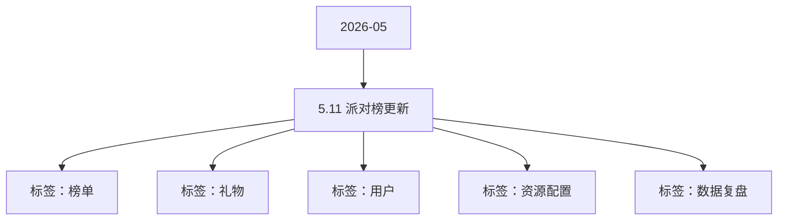

# 5.11   派对榜更新 活动知识图谱

## 核心信息

- 月份：2026-05
- 活动时间：未识别
- 活动 Wiki：https://wiki.inkept.cn/pages/viewpage.action?pageId=488343271
- 活动页面 ID：488343271
- 关联资料数：0
- 标签：榜单、礼物、用户、资源配置、数据复盘

## 优化总结

### 活动概览

- 二、活动目标（来源：活动主页面）
- 三、活动背景（来源：活动主页面）
- 派对之星榜单设置关系榜、最豪厅、最多金、最魅力、最热厅、最人气7个榜单，维度设置小时/日/周统计维度，核心奖励为麦序框、厅背景、直播间角标等，奖励覆盖周榜单TOP30，小时榜单日榜无奖励。（来源：活动主页面）
- 最豪厅派对厅榜，赠送免费礼物、公聊、送礼等互动行为累积积分背景、靓号、角标（来源：活动主页面）
- 最热厅派对厅榜，送礼人数累积积分，1个UID等于1分背景、靓号、角标（来源：活动主页面）

### 活动时间

- 一、活动时间（来源：活动主页面）
- 玩法时间：5 月 11 日 00:00:00 – 长期在线 统计时间：同玩法时间，数据统计以平台服务器时间为准，实时同步至前端展示（来源：活动主页面）
- 周期：活动设置为周榜，统计时间为每自然周 周一00:00:00-周日23:59:59（来源：活动主页面）
- 周期2：活动设置小时榜，统计时间为每自然天自然小时的统计，及H5榜单页面展示，不做奖励下发（来源：活动主页面）
- 热门有研发自动推，写好时间（来源：活动主页面）

### 玩法规则

- 在派对侧设置周榜单，稳定派对侧基础营收，同时完成对现有「派对之星」榜单的替换（来源：活动主页面）
- 当前派对侧榜单为2019年上线，至今已使用7年，逻辑及奖励已不适用于当前，进行更新优化（来源：活动主页面）
- 榜单类型统计逻辑及面临群体核心奖励（来源：活动主页面）
- 关系榜派对厅榜，未查询到统计逻辑及来源麦序框（来源：活动主页面）
- 最多金用户榜，赠送免费礼物、公聊、送礼等互动行为累积积分麦序框（来源：活动主页面）
- 最魅力陪陪榜，赠送免费礼物、公聊、送礼等互动行为累积积分麦序框（来源：活动主页面）
- 最人气陪陪榜，送礼人数累积积分，1个UID等于1分麦序框（来源：活动主页面）
- 缩减榜单维度，更聚焦在营收维度，更改奖励引起争夺（来源：活动主页面）
- 玩法介绍：设置派对厅榜单，派对区所有厅统计礼物收礼，依据排名周榜TOP3解锁对应奖励；设置派对陪陪榜单，派对区所有陪陪统计礼物收礼，依据排名周榜TOP3解锁对应奖励（来源：活动主页面）
- 展示逻辑：任何人通过任何渠道进入任何榜单均展示自身信息（来源：活动主页面）
- 榜单类型与统计规则如下：（来源：活动主页面）
- 需要调研直播间左上角–链接 逻辑 和运营对称（来源：活动主页面）
- 派对厅榜单-臻选派对（来源：活动主页面）
- 签约逻辑：需联动后台处理，签约后的厅实时纳入统计--同礼物展馆处理逻辑，由 鹤鹏 处理，需留出手动添加白名单的口子，及黑名单去除逻辑（来源：活动主页面）
- 统计逻辑：所有签约账号开厅（房主）即记为厅榜单，未开厅记为陪陪榜单，两者互斥，如果两个冲撞，以厅榜单优先。（来源：活动主页面）
- 行为类型换算逻辑每日积分上限备注（来源：活动主页面）
- 钻 = 10 积分无（来源：活动主页面）
- 钻 = 15 积分无需联动基础产品后台、项目归属为活动礼物的记为活动礼物（来源：活动主页面）

### 奖励与资源

- 资源类型资源名称资源IDURL（来源：活动主页面）
- 贵宾卡进房礼物画面（来源：活动主页面）
- 明星卡进房礼物画面（来源：活动主页面）
- 统计维度：全站礼物、活动礼物、免费小映、直播间参与公聊人数（来源：活动主页面）
- 全站礼物（来源：活动主页面）
- 活动礼物（来源：活动主页面）
- 【派对榜】恭喜您成为臻选派对周榜TOP-1，获得臻选派对封面边框*7天、周一/周二/周三连续3日每晚21:00-21:30派对热二、指定房间靓号-88888奖励，请注意查收，PS:房间靓号需开播状态下可下发成功，若未收到靓号，请联系运营！（来源：活动主页面）
- TOP2臻选派对封面边框*5天、周一/周二连续2日每晚20:30-20:45派对热二、指定房间靓号-66666【派对榜】恭喜您成为臻选派对周榜TOP-2，获得臻选派对封面边框*5天、周一/周二连续2日每晚20:30-20:45派对热二、指定房间靓号-66666奖励，请注意查收，PS:房间靓号需开播状态下可下发成功，若未收到靓号，请联系运营！（来源：活动主页面）
- TOP3臻选派对封面边框*3天、周一晚20:15-20:30派对热二、指定房间靓号-55555【派对榜】恭喜您成为臻选派对周榜TOP-3，获得臻选派对封面边框*3天、周一晚20:15-20:30派对热二、指定房间靓号-55555奖励，请注意查收，PS:房间靓号需开播状态下可下发成功，若未收到靓号，请联系运营！（来源：活动主页面）
- TOP4-10臻选派对直播间标签*3天【派对榜】恭喜您成为臻选派对周榜TOP-10，获得臻选派对直播间标签*3天奖励，请注意查收（来源：活动主页面）
- 统计维度：全站礼物、活动礼物、免费小映、上麦时长（来源：活动主页面）
- TOP1闪耀明星麦序框*7天、闪耀明星称号*7天、闪耀明星发言波纹*7天【派对榜】恭喜您成为闪耀明星周榜TOP-1，获得闪耀明星麦序框*7天、闪耀明星称号*7天、闪耀明星发言波纹*7天奖励，请注意查收（来源：活动主页面）
- TOP2闪耀明星麦序框*5天、闪耀明星称号*5天、闪耀明星发言波纹*5天【派对榜】恭喜您成为闪耀明星周榜TOP-2，获得闪耀明星麦序框*5天、闪耀明星称号*5天、闪耀明星发言波纹*5天奖励，请注意查收（来源：活动主页面）
- TOP3闪耀明星麦序框*3天、闪耀明星称号*3天、闪耀明星发言波纹*3天【派对榜】恭喜您成为闪耀明星周榜TOP-3，获得闪耀明星麦序框*3天、闪耀明星称号*3天、闪耀明星发言波纹*3天奖励，请注意查收（来源：活动主页面）
- TOP4-10闪耀明星麦序框*1天、闪耀明星称号*1天【派对榜】恭喜您成为闪耀明星周榜TOP-10，获得闪耀明星麦序框*1天、闪耀明星称号*1天奖励，请注意查收（来源：活动主页面）
- 统计维度：全站礼物、活动礼物、免费小映（来源：活动主页面）
- TOP1顶流玩家麦序框*7天、顶流玩家头像框*7天、顶流玩家称号*7天【派对榜】恭喜您成为顶流玩家周榜TOP-1，获得顶流玩家麦序框*7天、顶流玩家头像框*7天、顶流玩家称号*7天奖励，请注意查收（来源：活动主页面）
- TOP2顶流玩家麦序框*5天、顶流玩家头像框*5天、顶流玩家称号*5天【派对榜】恭喜您成为顶流玩家周榜TOP-2，获得顶流玩家麦序框*5天、顶流玩家头像框*5天、顶流玩家称号*5天奖励，请注意查收（来源：活动主页面）

### 入口与链接

- 当前展示区域房间左上角、派对首页金刚区、活动中心（来源：活动主页面）
- 封面边框臻选派对封面边框18206https://img.ikstatic.cn/MTc4MDM4ODI3MzczMSM2NDYjcG5n.png（来源：活动主页面）
- 直播间标签臻选派对直播间标签18207https://img.ikstatic.cn/MTc4MDM4ODMyNDM2OCM0MjMjcG5n.png（来源：活动主页面）
- 称号闪耀明星2307https://img.ikstatic.cn/MTc4MDM4ODQxMTI0MSM4MjIjcG5n.png（来源：活动主页面）
- 称号顶流玩家2308https://img.ikstatic.cn/MTc4MDM4ODUwMjc3MiM3MDkjcG5n.png（来源：活动主页面）
- 麦序框闪耀明星麦序框10418https://img.ikstatic.cn/MTc4MDM4ODUzOTg3MiMgNzkjcG5n.png（来源：活动主页面）
- 麦序框顶流玩家麦序框10419https://img.ikstatic.cn/MTc4MDM4ODU1MjI5OCM0ODMjcG5n.png（来源：活动主页面）
- 头像框顶流玩家头像框10420https://img.ikstatic.cn/MTc4MDM4ODU2NTU2MyM2ODYjcG5n.png（来源：活动主页面）
- 发言波纹闪耀明星发言波纹10421https://img.ikstatic.cn/MTc4MDM4ODg0NTA3NiMzMDAjcG5n.png（来源：活动主页面）
- 派对热门二key（来源：活动主页面）
- T48Q（来源：活动主页面）
- 长期在线（来源：活动主页面）

## 资料关系图

## 资料来源

- [活动主页面](https://wiki.inkept.cn/pages/viewpage.action?pageId=488343271)
