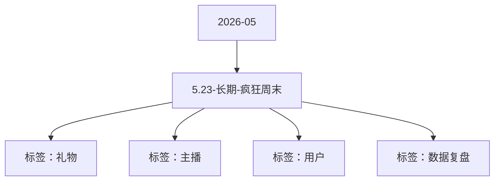

# 5.23-长期-疯狂周末 活动知识图谱

## 核心信息

- 月份：2026-05
- 活动时间：未识别
- 活动 Wiki：https://wiki.inkept.cn/pages/viewpage.action?pageId=492731518
- 活动页面 ID：492731518
- 关联资料数：0
- 标签：礼物、主播、用户、数据复盘

## 优化总结

### 活动概览

- 二、活动背景（来源：活动主页面）
- 三、活动目标（来源：活动主页面）

### 活动时间

- 活动时间：同整体活动时间，每周末限时开启（以服务器时间为准）（来源：活动主页面）
- 活动时间：同整体活动时间（以平台服务器时间为准）（来源：活动主页面）

### 玩法规则

- 针对周末消耗较低，且消耗不够连续的情况，设置玩法（来源：活动主页面）
- 活动设置价值188钻专属玩法礼物，用户送出后：（来源：活动主页面）
- 主播直接获得 1 钻石，剩余182钻石进入玩法中（来源：活动主页面）
- 双倍触发规则（来源：活动主页面）
- 触发条件：活动开启后，用户送出该玩法礼物累计达到 5 次（来源：活动主页面）
- 页面展示逻辑（来源：活动主页面）
- 玩法设置专属活动 Banner，Banner 内展示内容：（来源：活动主页面）
- 玩法设置专属页面展示，页面内展示内容：（来源：活动主页面）
- 玩法介绍（来源：活动主页面）
- 用户每送出 1 次该玩法礼物，即可获得1 块幸运石并实时寄存至页面中用于参与玩法二-幸运石，每周日 23:59:59 准时对未使用的幸运石进行清零，不结转、不补发。（来源：活动主页面）
- 拥有幸运石的用户可进入活动专属页面参与玩法（来源：活动主页面）
- 玩法形式为：用户可在9款礼物中任选1款进行选择，可接受多选，每款奖品单次最多可投入20 个幸运石，用户选择好礼物中，可直接在玩法页面内送出该玩法礼物，参与整体玩法。（来源：活动主页面）
- 无送礼行为则无法使用幸运石，且在玩法页面内送礼正常获得幸运石。（来源：活动主页面）
- 大盘调控规则（来源：活动主页面）
- 活动整体产出需结合玩法 1、玩法 2 的实际消耗与产出情况综合设定。若活动大盘整体产出大于消耗 ，需进行对玩法一的重新随机，确保活动可控（来源：活动主页面）

### 奖励与资源

- 日均礼物消耗达到150万钻石（来源：活动主页面）
- 系统根据用户当前状态进行随机奖励，奖励直接下发至主播账户，若为普通情况，则根据奖励-1进行随机，若为双倍情况，则根据奖励-2进行随机。（来源：活动主页面）
- 若处于双倍期间：开出指定双倍奖励时，主播获得 1 份，用户同步获得 1 份（来源：活动主页面）
- 所有奖励均实时下发，数据以平台服务端统计为准（来源：活动主页面）
- B面（触发双倍后）：活动双倍视觉、“开出指定礼物双倍获得”宣发文案 ；用户当前拥有幸运石数量：10 块（来源：活动主页面）
- 活动下方展示活动随机礼物介绍，分为普通情况、双倍情况展示，其中双倍情况做特殊展示。（来源：活动主页面）
- 若用户使用幸运石选择的奖品被随机中，则判断用户选择成功，成功后依据用户投入的数量将对应奖励发放给用户，奖励实时下发。（来源：活动主页面）
- 展示 9 款奖品列表及可投入幸运石数量入口（来源：活动主页面）
- 依据用户当前所处的奖励情况进行底层页面的展示，处于奖励-1就展示奖励-1（来源：活动主页面）
- 价值产出倍数产出礼物价格（来源：活动主页面）

### 入口与链接

- 一、活动名称（来源：活动主页面）
- 疯狂周末（来源：活动主页面）
- 四、活动详情（来源：活动主页面）
- 生效范围：解锁后在整个活动周期内生效，以每周末为一个周期节点（来源：活动主页面）
- 周期重置：每周周期结束后，双倍资格需重新累计触发（来源：活动主页面）
- A面（未触发双倍）：活动主视觉、用户当前送礼进度：0/5 ；用户当前拥有幸运石数量：10 块（来源：活动主页面）
- AB面依据用户所处状态进行切换（来源：活动主页面）
- 送礼次数、幸运石数量、双倍状态均实时同步展示（来源：活动主页面）
- 活动页面上方展示个人模块信息：未触发双倍时展示活动主视觉、用户当前送礼进度：0/5 ；用户当前拥有幸运石数量：10 块 ；触发双倍后展示活动双倍标签、用户当前拥有幸运石数量：10 块（来源：活动主页面）
- 普通情况（来源：活动主页面）
- 价值机会产出权重（来源：活动主页面）
- %12.584242（来源：活动主页面）

## 资料关系图

## 资料来源

- [活动主页面](https://wiki.inkept.cn/pages/viewpage.action?pageId=492731518)
