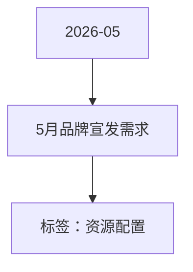

# 5月品牌宣发需求 活动知识图谱

## 核心信息

- 月份：2026-05
- 活动时间：未识别
- 活动 Wiki：https://wiki.inkept.cn/pages/viewpage.action?pageId=492731394
- 活动页面 ID：492731394
- 关联资料数：0
- 标签：资源配置

## 优化总结

### 奖励与资源

- 支持配置悬浮公聊皮肤（来源：活动主页面）

### 入口与链接

- 通过后台可调用全站广播、全站悬浮公聊、全站弹幕，可运营自行输入文案，点击触发（来源：活动主页面）
- 支持灰度自己验收查看，再发布全站（来源：活动主页面）

## 资料关系图

## 资料来源

- [活动主页面](https://wiki.inkept.cn/pages/viewpage.action?pageId=492731394)
