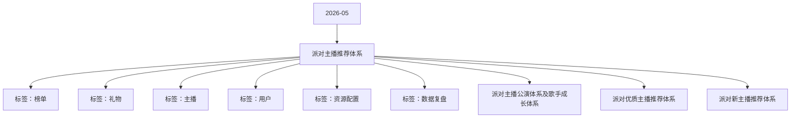

# 派对主播推荐体系 活动知识图谱

## 核心信息

- 月份：2026-05
- 活动时间：未识别
- 活动 Wiki：https://wiki.inkept.cn/pages/viewpage.action?pageId=488355586
- 活动页面 ID：488355586
- 关联资料数：3
- 标签：榜单、礼物、主播、用户、资源配置、数据复盘

## 优化总结

### 活动概览

- 一、方案目标（来源：派对主播公演体系及歌手成长体系）

### 玩法规则

- 公演参与规则（来源：派对主播公演体系及歌手成长体系）
- 三、定级规则与维度（来源：派对主播公演体系及歌手成长体系）
- 降级规则：（来源：派对主播公演体系及歌手成长体系）
- 参赛资格：S 级 / A 级歌手，按季度综合评级排名入选（来源：派对主播公演体系及歌手成长体系）

### 奖励与资源

- 参与限制：每位认证歌手每月最多参与 3 场公演，避免资源过度集中（来源：派对主播公演体系及歌手成长体系）
- 四、分级权益与激励（来源：派对主播公演体系及歌手成长体系）
- 等级流量资源（来源：派对主播公演体系及歌手成长体系）
- 身份与功能权益（来源：派对主播公演体系及歌手成长体系）
- A 级歌手：可申请开通「粉丝包月充电」权益，解锁专属内容变现通道（来源：派对主播公演体系及歌手成长体系）
- 奖励：现金大奖、年度签约机会、全平台流量包、线下演唱会直通资格（来源：派对主播公演体系及歌手成长体系）

### 入口与链接

- S 级「明星歌手」专属标识，全平台展示定制直播间特效、连麦优先级提升、粉丝专属点歌通道（来源：派对主播公演体系及歌手成长体系）

### 上线配置

- 入选机制：平台根据历史评级、内容匹配度、档期筛选报名主播，优先保障高等级歌手场次排期（来源：派对主播公演体系及歌手成长体系）
- A 级公演场次优先排期、分类页推荐（单月≥20 万曝光），专属直播封面模板（来源：派对主播公演体系及歌手成长体系）

### 数据与复盘

- 建立「公演参与 - 数据评级 - 流量激励 - 长期成长」的闭环体系，筛选并培养优质歌手主播，打造派对区音乐内容生态，提升主播留存与用户付费意愿。（来源：派对主播公演体系及歌手成长体系）
- 公演数据60%单场观看人数、互动率（弹幕 / 点赞 / 送礼）、留存率、新增粉丝数（来源：派对主播公演体系及歌手成长体系）
- S 级≥90 分数据与专业评分均优异，每月至少参与 1 场公演，无违规记录（来源：派对主播公演体系及歌手成长体系）
- 优质主播--凭收入、时长评级，拿更多曝光，以周数据维度配合日开播收礼行为+人工标签进行动态推荐（来源：派对优质主播推荐体系）
- 新主播--依据新入驻主播，通过基础数据筛选+人工干预+重点推荐的思路，给新主播曝光输出（来源：派对新主播推荐体系）

### 其他关键信息

- 二、核心准入流程（来源：派对主播公演体系及歌手成长体系）
- 报名与认证（来源：派对主播公演体系及歌手成长体系）
- 报名条件：（来源：派对主播公演体系及歌手成长体系）
- 账号完成实名认证，近 30 天无违规记录（来源：派对主播公演体系及歌手成长体系）
- 累计有效开播时长≥30 小时 / 月（来源：派对主播公演体系及歌手成长体系）
- 提交 3 首以上演唱作品片段（音频 / 视频）（来源：派对主播公演体系及歌手成长体系）
- 考核维度：唱功稳定性、音准节奏、舞台表现力、粉丝互动度（来源：派对主播公演体系及歌手成长体系）
- 认证结果：考核通过后获得「平台认证歌手」基础身份，解锁公演参与资格（来源：派对主播公演体系及歌手成长体系）
- 公演定义：平台定期举办的主题性歌手专场直播（如 “周末金曲夜”“国风专场”），单场时长 60–120 分钟，多位认证歌手轮流出演（来源：派对主播公演体系及歌手成长体系）
- 评级核心维度（总分 100 分）（来源：派对主播公演体系及歌手成长体系）

## 资料关系图

## 资料来源

- [活动主页面](https://wiki.inkept.cn/pages/viewpage.action?pageId=488355586)
- [派对主播公演体系及歌手成长体系](https://wiki.inkept.cn/pages/viewpage.action?pageId=488347342)
- [派对优质主播推荐体系](https://wiki.inkept.cn/pages/viewpage.action?pageId=488347345)
- [派对新主播推荐体系](https://wiki.inkept.cn/pages/viewpage.action?pageId=488347347)
