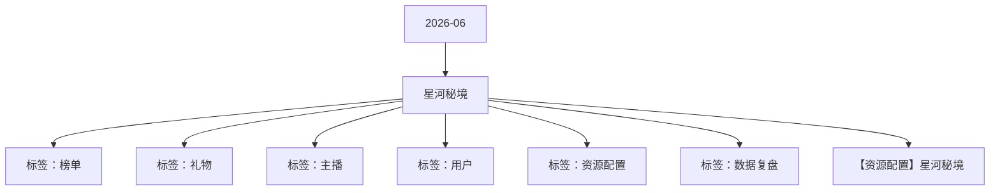

# 星河秘境 活动知识图谱

## 核心信息

- 月份：2026-06
- 活动时间：6.12-6.15
- 活动 Wiki：https://wiki.inkept.cn/pages/viewpage.action?pageId=504173145
- 活动页面 ID：504173145
- 关联资料数：1
- 标签：榜单、礼物、主播、用户、资源配置、数据复盘

## 优化总结

### 活动概览

- 二 活动目标：（来源：活动主页面）
- 活动目标：（来源：活动主页面）

### 活动时间

- 一、活动时间：（来源：活动主页面）
- 玩法时间：6月12日00:00:00-6月15日23:59:59（来源：活动主页面）
- 起始时间：2026-03-27 18:21:10（来源：活动主页面）
- 结束时间：2027-03-27 18:21:10（来源：活动主页面）
- 起始时间：2026-03-27 18:18:20（来源：活动主页面）
- 结束时间：2027-03-27 18:18:20（来源：活动主页面）
- 起始时间：2026-03-27 18:37:24（来源：活动主页面）
- 结束时间：2027-03-27 18:37:24（来源：活动主页面）

### 玩法规则

- 玩法说明：（来源：活动主页面）
- 主播任务（来源：活动主页面）
- 玩法逻辑：（来源：活动主页面）
- 活动期间，每次收礼达到21钻石数即可记为1次次数，累计次数达到对应阶段，解锁对应的曝光和资源奖励，为日循环任务（来源：活动主页面）
- 关卡任务值资源类型资源名称资源id时长数量私信内容弹幕或公聊内容图片（来源：活动主页面）
- 【琉璃幻境】恭喜宝宝完成收礼任务一，获得琉璃筑梦称号*2天，奖励已下发，快去看看叭~（来源：活动主页面）
- 【琉璃幻境】恭喜宝宝完成收礼任务二，获得琉璃筑梦主页浮屏*2天，奖励已下发，快去看看叭~（来源：活动主页面）
- 活动设置主播被收礼人数日打卡任务，每日收集不同人数达到不同阶段，解锁对应奖励，奖励区分主播和陪陪（来源：活动主页面）
- 陪陪人数任务（来源：活动主页面）
- 用户任务（来源：活动主页面）
- 用户送出活动专属礼物每日达到对应钻石，可解锁特权奖励，任务为日循环任务，奖励完成实时下发。（来源：活动主页面）
- 关卡任务值资源类型资源名称资源id时长数量私信内容（来源：活动主页面）
- 公聊角标星月梦幻公聊角标23972https://img.ikstatic.cn/MTYzNDI4ODI2Mjc0OSMyNjYjcG5n.png【琉璃幻境】恭喜您完成累计送礼任务一阶段，已获得星月梦幻公聊角标*2天，请注意查收。（来源：活动主页面）
- 【琉璃幻境】恭喜您完成累计送礼任务二阶段，已获得辰星同行麦序框*2天，请注意查收。（来源：活动主页面）
- 【琉璃幻境】恭喜您完成累计送礼任务三阶段，已获得辰星同行头像框*2天，请注意查收。（来源：活动主页面）
- 公聊皮肤辰星同行公聊皮肤96862https://img.ikstatic.cn/MTc3MDI4Nzg5ODUwMCMgODMjcG5n.png【琉璃幻境】恭喜您完成累计送礼任务四阶段，已获得辰星同行公聊皮肤*2天，请注意查收。（来源：活动主页面）
- 发言波纹辰星同行发言波纹41022https://img.ikstatic.cn/MTY5MjY4ODE3NzMwNiM3MzkjcG5n.png【琉璃幻境】恭喜您完成累计送礼任务五阶段，已获得辰星同行发言波纹*2天，请注意查收。（来源：活动主页面）
- 【琉璃幻境】恭喜您完成累计送礼任务六阶段，已获得辰星同行称号*2天，请注意查收。（来源：活动主页面）

### 奖励与资源

- 派对（嘉宾收礼）：厅主及厅内嘉宾4人视频，6人视频，9人音频房间收礼的专属礼物收入，其余方式均不计入统计。谁收算谁的。（来源：活动主页面）
- 类型资源名称资源idurl备注（来源：活动主页面）
- 用户送出活动专属礼物可宠爱1个主播，按照送礼人数达到门槛获得奖励。（来源：活动主页面）
- 奖励与私信由研发实时下发（来源：活动主页面）
- 【琉璃幻境】恭喜宝宝获得当红主播日榜TOP1，获得星途领曜称号*5天、星途领曜主页挂件*5天、星途领曜主页浮屏*5天、星途领曜动态头像框*5天、热13推荐卡*3张奖励，奖励已下发，快去看看吧～（来源：活动主页面）
- 【琉璃幻境】恭喜宝宝获得当红主播日榜TOP5，获得星途领曜称号*3天、星途领曜主页挂件*3天、星途领曜动态头像框*3天、星途领曜主页浮屏*3天、热13推荐卡*1张奖励，奖励已下发，快去看看吧～（来源：活动主页面）
- 【琉璃幻境】恭喜宝宝获得当红主播日榜TOP10，获得星途领曜称号*2天、星途领曜主页挂件*2天、星途领曜动态头像框*2天奖励，奖励已下发，快去看看吧～（来源：活动主页面）
- 【琉璃幻境】恭喜宝宝获得新秀主播日榜TOP1，获得星途领曜称号*3天、星途领曜主页挂件*3天、星途领曜主页浮屏*3天、星途领曜动态头像框*3天、热13推荐卡*1张奖励，奖励已下发，快去看看吧～（来源：活动主页面）
- 【琉璃幻境】恭喜宝宝获得新秀主播日榜TOP5，获得星途领曜称号*2天、星途领曜主页挂件*2天、星途领曜主页浮屏*2天、星途领曜动态头像框*2天奖励，奖励已下发，快去看看吧～（来源：活动主页面）
- 【琉璃幻境】恭喜宝宝获得新秀主播日榜TOP10，获得星途领曜称号*1天、星途领曜主页挂件*1天、星途领曜动态头像框*1天奖励，奖励已下发，快去看看吧～（来源：活动主页面）
- 【琉璃幻境】恭喜宝宝获得心动嘉宾日榜TOP1，获得星途领曜称号*5天、星途领曜动态头像框*5天、星途领曜动态麦序框*5天、星途领曜页挂件*5天、星途领曜页浮屏*5天奖励，奖励已下发，快去看看吧～（来源：活动主页面）
- 【琉璃幻境】恭喜宝宝获得心动嘉宾日榜TOP5，获得星途领曜称号*3天、星途领曜动态麦序框*3天、星途领曜动态头像框*3天、星途领曜页挂件*3天、星途领曜页浮屏*3天奖励，奖励已下发，快去看看吧～（来源：活动主页面）
- 【琉璃幻境】恭喜宝宝获得心动嘉宾日榜TOP10，获得星途领曜称号*2天、星途领曜动态麦序框*2天、星途领曜动态头像框*2天奖励，奖励已下发，快去看看吧～（来源：活动主页面）
- 用户日榜奖励（来源：活动主页面）
- 【琉璃幻境】恭喜宝宝获得用户日榜TOP1，获得秘境主宰头像框*5天、秘境主宰称号*5天、秘境主宰浮屏*5天、资料卡浮屏*5天、秘境主宰挂件*5天奖励，奖励已下发，快去看看吧～（来源：活动主页面）
- 【琉璃幻境】恭喜宝宝获得用户日榜TOP5，获得秘境主宰头像框*3天、秘境主宰称号*3天、秘境主宰挂件*3天、秘境主宰浮屏*3天奖励，奖励已下发，快去看看吧～（来源：活动主页面）
- 【琉璃幻境】恭喜宝宝获得用户日榜TOP10，获得秘境主宰头像框*2天、秘境主宰称号*2天、秘境主宰挂件*2天奖励，奖励已下发，快去看看吧～（来源：活动主页面）
- 道具卡2张（来源：活动主页面）

### 入口与链接

- 月12日-6月15日琉璃幻境换肤（来源：活动主页面）
- 活动期间消耗900w（来源：活动主页面）
- 三、活动框架（来源：活动主页面）
- 原型图：https://modao.cc/proto/gIe1nkCtboi6qW9zWmU3p/sharing?view_mode=read_only&screen=rbpVDSwSbu1VfzKSI #琉璃幻境-分享（来源：活动主页面）
- 宠爱时刻；https://betaboc.inke.cn/react/banner/202602/women-inke/index.html（来源：活动主页面）
- 星河玫瑰：https://boc.inke.cn/react/banner/202601/valentines-day-inke/index.html?uid=22030647&sid=1&publisher=22030648（来源：活动主页面）
- 四、数据统计维度（来源：活动主页面）
- 数据统计维度（来源：活动主页面）
- 主播（主播礼）：仅统计普通视频直播间、公共直播间、PK送礼和友聊送礼渠道，其他送礼方式均不计入统计。（来源：活动主页面）
- task_keyscore_totalprize_typeprize_nameresource_iddurationnumprivate_msgcontentimg（来源：活动主页面）
- 称号浪漫星河称号（来源：活动主页面）
- 浮屏浪漫星河主页浮屏9750（来源：活动主页面）

## 资料关系图

## 资料来源

- [活动主页面](https://wiki.inkept.cn/pages/viewpage.action?pageId=504173145)
- [【资源配置】星河秘境](https://wiki.inkept.cn/pages/viewpage.action?pageId=504173241)
