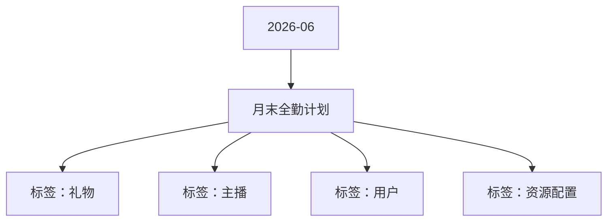

# 月末全勤计划 活动知识图谱

## 核心信息

- 月份：2026-06
- 活动时间：6.21-6.30
- 活动 Wiki：https://wiki.inkept.cn/pages/viewpage.action?pageId=504173152
- 活动页面 ID：504173152
- 关联资料数：0
- 标签：礼物、主播、用户、资源配置

## 优化总结

### 活动概览

- 活动目的：维稳中腰部主播活跃（来源：活动主页面）
- 活动目标（来源：活动主页面）
- 活跃目标：目标主播月末活跃较以往月份提升 5%（来源：活动主页面）

### 活动时间

- 活动时间（来源：活动主页面）
- 活动开始时间：2026-06-21 00:00:00（来源：活动主页面）
- 活动结束时间：2026-06-30 23:59:59（来源：活动主页面）
- 全勤统计时间：2026-06-21 00:00:00 - 2026-06-30 23:59:59（来源：活动主页面）
- 积分兑换时间：2026-06-21 00:00:00 - 2026-06-30 23:59:59（来源：活动主页面）
- 所有玩法统计时间：北京时间GMT+8（来源：活动主页面）

### 玩法规则

- 活动主线：自我超越任务+打卡+积分兑换+全勤奖励（来源：活动主页面）
- 三、通用逻辑与统计口径（来源：活动主页面）
- 主播收礼：按1映币 = 1积分（来源：活动主页面）
- 用户展示逻辑（来源：活动主页面）
- 主播展示逻辑（来源：活动主页面）
- 一、【秀场主播】开播收礼得兑换点任务：主播完成每日的开播时长+收礼任务，得对应挡位的兑换点。兑换点每个档位实时下发。任务每日不循环。（来源：活动主页面）
- 注：开播时长任务仅统计秀场视频直播。（来源：活动主页面）
- 二、主播完成最高阶的开播收礼任务算作打卡1天，连续十天完成可获得映宝*1个（来源：活动主页面）
- 三、兑换商城兑换逻辑：（来源：活动主页面）

### 奖励与资源

- 【条件】个人主播开播收礼：活动期间主播开播时长达20分钟为有效开播，计入开播时长，主播开播及收礼仅统计普通视频直播间、公共直播间，其他开播及收礼方式均不计入统计，收礼统计为活动专属礼物。（来源：活动主页面）
- 实物特殊奖励每日限量20个、当日未兑换完则数量累计至第二日。资源奖励不限量。（来源：活动主页面）
- 优酷会员卡限制同实物奖励限制一样，每人每日只能领取一个。主播兑换成功后，私信直接告诉主播兑换码是多少，兑换码不要重复下发，一人一码。（来源：活动主页面）

### 入口与链接

- wiki：https://modao.cc/app/gie9wZwNtfztpnIoUhibzx #月末全勤计划-分享（来源：活动主页面）
- 一、活动基础信息（来源：活动主页面）
- 活动定位（来源：活动主页面）
- 活动类型：活跃活动（来源：活动主页面）
- 二、活动框架（来源：活动主页面）
- 活动链路说明：（来源：活动主页面）
- 基础统计口径（来源：活动主页面）
- 主播开播：仅统计有效开播≧20分钟（来源：活动主页面）
- 用户从任意活动入口进入活动页，默认展示用户自身数据（来源：活动主页面）
- 主播进度独立统计（来源：活动主页面）
- 四、活动详情（来源：活动主页面）
- 私信：【月末全勤计划】恭喜宝宝消耗了520兑换点兑换了优酷月会员卡*1张，兑换码为：，请在一个月内兑换完毕避免错过有效期哦~（来源：活动主页面）

## 资料关系图

## 资料来源

- [活动主页面](https://wiki.inkept.cn/pages/viewpage.action?pageId=504173152)
