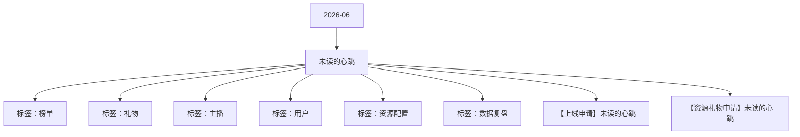

# 未读的心跳 活动知识图谱

## 核心信息

- 月份：2026-06
- 活动时间：6.22-6.26
- 活动 Wiki：https://wiki.inkept.cn/pages/viewpage.action?pageId=504173655
- 活动页面 ID：504173655
- 关联资料数：2
- 标签：榜单、礼物、主播、用户、资源配置、数据复盘

## 优化总结

### 活动概览

- 二、活动目标：（来源：活动主页面）
- PK背景永夜焚星PK背景2023（来源：活动主页面）
- 【花火大会】恭喜宝宝完成主播任务一，获得永夜焚星PK背景*3天，奖励已下发，快去查看吧～（来源：活动主页面）
- 派对背景永夜焚星派对背景4353（来源：活动主页面）
- 【花火大会】恭喜宝宝完成派对嘉宾任务一，获得永夜焚星派对背景*3天，奖励已下发，快去查看吧～（来源：活动主页面）
- PK背景永夜焚星PK背景（来源：【资源礼物申请】未读的心跳）
- 派对背景永夜焚星派对背景（来源：【资源礼物申请】未读的心跳）

### 活动时间

- 一、活动时间（来源：活动主页面）
- 玩法统计时间：2026年1月27日00:00:00-1月31日23:59:59（来源：活动主页面）
- 活动时间：1.27-1.31（来源：活动主页面）
- 小时榜：每小时用户榜单数据--日期、时间段、用户层级（来源：活动主页面）
- 时间：1月27日00:00:00-2月1日23:59:59（来源：【上线申请】未读的心跳）
- 时间：1月27日00:00:00-1月31日23:59:59（来源：【上线申请】未读的心跳）
- 时间： 1月27日00:00:00-1月31日23:59:59（来源：【上线申请】未读的心跳）

### 玩法规则

- 四、活动玩法（来源：活动主页面）
- 用户玩法：（来源：活动主页面）
- 玩法逻辑：（来源：活动主页面）
- 累计用户绽放小烟花的数量达对应的任务数值，用户获得对应的奖励和曝光，并参与对应档位流光大会的机会。（来源：活动主页面）
- 该任务为用户循环任务。（来源：活动主页面）
- 关卡任务值资源类型资源名称资源id时长数量私信内容弹幕或公聊内容（来源：活动主页面）
- 排名资源类型资源名称资源id时长数量私信内容（来源：活动主页面）
- 页面付费：用户花费【99钻石/999钻石】在页面与手动选定主播签订契约，可开启与该主播的cp任务，同时主播内部收礼该用户送出的【52钻/520钻】，即只有主播开播状态下才能与主播签订契约。（来源：活动主页面）
- 每日任务打卡：契约内容为每日送礼积分达【5200钻/52000钻】，每日打卡完成获得当日奖励，奖励发给用户主播双方，奖励由研发自动下发。连续完成5日cp任务，可得【双人动态头像使用权/自定义文案的cp勋章奖励】总奖励，奖励由研发自动下发。（来源：活动主页面）
- 一键补卡：最后一日开启一键补卡。用户点击【一键补签】后，无需选具体的任务天，累计积分自动补。补卡时，非当日打卡的当日奖励不下发，只下发总奖励。（来源：活动主页面）
- ①用户需在页面手动点击选择后才能签订契约，并开启契约任务；（开启契约这一刻，开始统计送礼积分。（来源：活动主页面）
- ②用户需花费额外一笔专门的钻石数签订契约，给主播分成的【52钻/520钻】也计入活动任务榜单积分统计；（来源：活动主页面）
- ④若当日用户已经开启契约，则开始计入契约任务数值，再开启另外一个契约，当日分数同步更新，过往分数需补卡。（来源：活动主页面）
- 契约开启花费钻石数（钻）其中给主播分成钻石数（钻）每日需送礼积分（1钻=1积分）连续完成5日后的奖励（来源：活动主页面）
- 关卡任务值资源类型资源名称资源id时长数量私信内容（来源：活动主页面）
- 【花火大会】恭喜用户昵称与主播昵称第一日的高级誓约任务已完成，双方均获得流光誓约半屏座驾*1天奖励，完成连续5日高级誓约任务双方均得动态头像使用权*3天，继续加油呀~（来源：活动主页面）
- 【花火大会】恭喜用户昵称与主播昵称第二日的高级誓约任务已完成，双方均获得流光誓约头像框*1天奖励，完成连续5日高级誓约任务双方均得动态头像使用权*3天，继续加油呀~（来源：活动主页面）
- 【花火大会】恭喜用户昵称与主播昵称第三日的高级誓约任务已完成，双方均获得流光誓约弹幕边框*1天奖励，完成连续5日高级誓约任务双方均得动态头像使用权*3天，继续加油呀~（来源：活动主页面）

### 奖励与资源

- 所有礼物统计id：23840,23829,23830,23831,23832,23833,23834,23835,23836,23837,23838,23839,23827,23828（来源：活动主页面）
- 后台看板实时消耗礼物统计id：23840,23829,23830,23831,23832,23833,23834,23835,23836,23837,23838,23839（来源：活动主页面）
- 礼物墙礼物礼物名价格（钻）礼物IDurl备注（来源：活动主页面）
- 花火小映礼物B资源名称价值资源 idurl备注（来源：活动主页面）
- 内部送礼，0钻特殊礼物礼物名价格（钻）礼物ID资源id备注（来源：活动主页面）
- 钻戒52238271690钻特殊礼物（来源：活动主页面）
- 重力情诗5202382866770钻特殊礼物（来源：活动主页面）
- 活动期间，用户送礼每满21钻，有机会在主播直播间绽放一朵小烟花，并获得随机资源奖励，资源奖励给用户。（来源：活动主页面）
- 所有奖励最多可获得15天，超过不再下发对应奖励和私信，仅下发悬浮公聊及弹幕。（来源：活动主页面）
- 序号占比用户奖励小烟花用户私信悬浮公聊H5弹幕+页面弹幕（来源：活动主页面）
- %小烟花公聊角标*1H绽放*1次【花火大会】恭喜宝宝获得小烟花公聊角标*1H*N，奖励已发放，快去看看~（来源：活动主页面）
- %小烟花头像框*1H绽放*1次【花火大会】恭喜宝宝获得小烟花头像框*1H*N，奖励已发放，快去看看~（来源：活动主页面）
- %小烟花麦序框*1H绽放*1次【花火大会】恭喜宝宝获得小烟花麦序框*1H*N，奖励已发放，快去看看~直播间悬浮公聊：【花火大会】用户昵称为主播昵称绽放小烟花*N次！（来源：活动主页面）
- %小烟花公聊皮肤*1H绽放*1次【花火大会】恭喜宝宝获得小烟花公聊皮肤*1H*N，奖励已发放，快去看看~直播间悬浮公聊：【花火大会】用户昵称为主播昵称绽放小烟花*N次！（来源：活动主页面）
- %小烟花座驾*1H绽放*1次【花火大会】恭喜宝宝获得小烟花座驾*1H*N，奖励已发放，快去看看~全站悬浮公聊：【花火大会】用户昵称为主播昵称绽放小烟花*N次！（来源：活动主页面）
- 序号资源类型资源名称背包ID时长数量价值权重全站广播H5跑马灯用户上限全站每日上限图片url（来源：活动主页面）
- 空无奖励1（来源：活动主页面）
- 空无奖励2（来源：活动主页面）

### 入口与链接

- 月22日-6月26日（来源：活动主页面）
- 活动期间消耗达3500万钻；（来源：活动主页面）
- 三、活动框架（来源：活动主页面）
- 原型图：https://modao.cc/proto/U7mXRqZvt7pycsKSMOEqKM/sharing?view_mode=read_only&screen=rbpUSn4xWlfB7zri9 #花火大会-分享（来源：活动主页面）
- 花火小映188823840（来源：活动主页面）
- 流光谒夜1023829（来源：活动主页面）
- 桃花书笺5223830（来源：活动主页面）
- 扑向你33323831（来源：活动主页面）
- 缚心之吻52023832（来源：活动主页面）
- 林深见鹿131423833（来源：活动主页面）
- 人鱼泪光334423834（来源：活动主页面）
- 冰雪凤凰520023835（来源：活动主页面）

### 上线配置

- Dear all，（来源：【上线申请】未读的心跳）
- 辛苦 @叶导 审批，（来源：【上线申请】未读的心跳）
- 标题：花火大会（来源：【上线申请】未读的心跳）
- 色值： linear-gradient(90deg, #1c1e33 0%, #2f0505 100%)（来源：【上线申请】未读的心跳）
- 位置：第一位，1日后移（来源：【上线申请】未读的心跳）
- 二、icon（来源：【上线申请】未读的心跳）
- 标题：花火大会（强挂）（来源：【上线申请】未读的心跳）
- 文案：缔结花火誓约得珍稀特权（来源：【上线申请】未读的心跳）
- 类型：普通，电台交友，视频交友（来源：【上线申请】未读的心跳）
- 位置：第一位（来源：【上线申请】未读的心跳）
- 三、首页banner（来源：【上线申请】未读的心跳）
- 四、全站私信（来源：【上线申请】未读的心跳）
- 月27日00:00:00（来源：【上线申请】未读的心跳）
- 月31日00:00:00（来源：【上线申请】未读的心跳）

## 资料关系图

## 资料来源

- [活动主页面](https://wiki.inkept.cn/pages/viewpage.action?pageId=504173655)
- [【上线申请】未读的心跳](https://wiki.inkept.cn/pages/viewpage.action?pageId=504173658)
- [【资源礼物申请】未读的心跳](https://wiki.inkept.cn/pages/viewpage.action?pageId=504173659)
