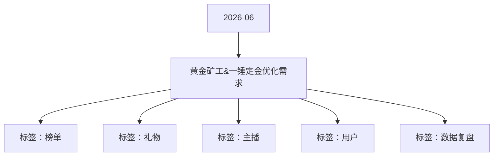

# 黄金矿工&一锤定金优化需求 活动知识图谱

## 核心信息

- 月份：2026-06
- 活动时间：6.26-6.30
- 活动 Wiki：https://wiki.inkept.cn/pages/viewpage.action?pageId=504172887
- 活动页面 ID：504172887
- 关联资料数：0
- 标签：榜单、礼物、主播、用户、数据复盘

## 优化总结

### 活动时间

- 二、活动时间：（来源：活动主页面）
- 数据统计时间： 长期（来源：活动主页面）
- 页面展示时间： 长期（来源：活动主页面）
- 活动期间，触发50倍/100倍暴击的用户展示在活动页面中，逻辑为按照时间顺序罗列展示。榜单展示暴击倍率（100倍、50倍），获奖用户的头像和昵称（用户头像不可点击，无开播和关注状态，可隐榜），以及用户触发暴击的直播间（主播头像+昵称）（显示主播当前开播状态和关注状态）；（来源：活动主页面）

### 玩法规则

- 四、活动逻辑（来源：活动主页面）
- 暴击礼物玩法：（来源：活动主页面）
- 暴击礼物逻辑-按照比例爆出（来源：活动主页面）
- 整体匹配逻辑（来源：活动主页面）
- 即用户个人参与玩法≥100钻后，则判断用户自身的返奖处于什么标准，依据标准为用户选择对应的池子，未满100钻正常按照常规期进行产出（来源：活动主页面）

### 奖励与资源

- 三、数据统计维度： 统计直播间维度： 各类型直播间均计入统计，不进行区分； 用户送礼统计维度： 仅统计用户在直播间内送出礼物（普通视频、公共直播间、游戏、电台、四六八九多人直播间、PK、友聊、私密），私信渠道不计入；（来源：活动主页面）
- 用户在主播直播间送出暴击礼物，礼物价值5映币，主播收到1映币，另外4映币进入奖池，用户在送出暴击礼物的同时有获得额外钻石奖 励，钻石奖励以背包礼物的形式直接下发至用户背包中；用户触发暴击时：（来源：活动主页面）
- 下发私信：【黄金矿工】恭喜宝宝触发XX礼物（N钻）%S（倍数）暴击，暴击奖励%S（示意：背包礼物棒棒糖（1钻）*4）已下发至我的背包中，请至背包中查看具体信息。（来源：活动主页面）
- 触发直播间仅用户可见公聊---用户和主播可见：【黄金矿工】恭喜宝宝触发XX礼物（N钻）%S（倍数）暴击，暴击奖励%S已下发至我的背包中，请至背包中查看具体信息。（来源：活动主页面）
- 触发活动页面飘屏（活动开始时设置假数据；）：恭喜%S（用户昵称）触发%S（倍数）暴击，获得%S奖励内容。（来源：活动主页面）
- 特殊处理点1：---2钻百倍触发频率调整（10分钟/20分钟首次）、文案展示做区分、文案展示出对应礼物和获得的背包价值、活动页面区分展示样式（同文案）（来源：活动主页面）
- 用户在主播直播间触发50倍暴击，在该主播直播间下发弹幕（120948下发），文案为：【黄金矿工】恭喜XXX（用户昵称）触发XX礼物（N钻）%S（倍数）礼物暴击，获得暴击奖励%S（示意：背包礼物棒棒糖（1钻）*4）！！（来源：活动主页面）
- 用户在主播直播间触发100倍暴击，触发全站悬浮公聊（公聊点击拉起礼物墙），文案为：【黄金矿工】恭喜XXX（用户昵称）在XXX（主播）直播间触发50倍/100倍礼物暴击，获得暴击奖励%S！（来源：活动主页面）
- 钻礼物100倍公聊触发频率调整为10分钟1次。（来源：活动主页面）
- 活动期间，每日前10个触发20倍/前20个触发五十倍暴击的下发（30分钟1次），触发全站悬浮公聊（公聊点击吊起礼物墙），文案为：【黄金矿工】恭喜XXX（用户昵称）在XXX（主播）直播间触发20倍/50倍礼物暴击，获得暴击奖励%S！（来源：活动主页面）
- 钻礼物20倍触发限5条，5钻礼物50倍触发限10条（来源：活动主页面）
- 活动期间用户首次获得暴击奖励，后台直接下发“公聊角标”，有效期自下发起5天，同时下发私信及触发直播间仅用户可见公聊：【黄金矿工】恭喜宝宝首次触 发礼物暴击，获得“暴击大神公聊角标”奖励，可至我的背包中切换使用！；（来源：活动主页面）
- 活动期间每日每个礼物触发首个暴击奖励的用户触发全站悬浮公聊（公聊点击吊起礼物墙），文案为：【黄金矿工】恭喜XXX（用户昵称）在XXX（主播）直播间触发礼物暴击，获得暴击奖励%S！（来源：活动主页面）
- 全平台用户送出暴击礼物，每500次为一个循环，按照对应比例对应产出，要求500次循环内，百倍奖励必须产出！（来源：活动主页面）
- 当大盘整体盈利小于99钻，不再产出最高的四款礼物，仅在最小的四款礼物进行随机产出（来源：活动主页面）
- 礼物价格礼物倍数预计价值礼物ID背包ID礼物名称礼物价格总数量下发个数触发次数触发比例触发机会（来源：活动主页面）
- 全平台用户送出暴击礼物，每1000次为一个循环，按照对应比例对应产出，要求1000次循环内，百倍奖励必须产出！（来源：活动主页面）
- 礼物价格礼物倍数预计价值礼物ID背包ID礼物名称礼物价格下发个数触发次数触发比例触发机会（来源：活动主页面）

### 入口与链接

- 一、活动名称：黄金矿工（来源：活动主页面）
- 特殊处理点2：（来源：活动主页面）
- 以大盘实时状态为基础，先根据大盘的情况确认对应的产出类型，再根据用户个人实时盈亏情况进行二次匹配，最终确定用户所使用的池子。（来源：活动主页面）
- 基础产出类型（（来源：活动主页面）
- 实时判断依据公式进行判断（XXXX等于大盘投入乘以99%减去大盘产出）判断实时数值与大盘设定的值进行比较，若大于等于则启动，若小于则不启动（来源：活动主页面）
- 放水期：当大盘盈利大于等于1000值（来源：活动主页面）
- 常规期：当大盘盈利小于1000值，大于200值（来源：活动主页面）
- 收水期：当大盘盈利小于200值（来源：活动主页面）
- 先判定大盘对应的产出类型，再根据用户个人盈亏，在当前大盘状态下，匹配用户最终使用的池子（来源：活动主页面）
- 所有判定实时生效，奖池随大盘及个人盈亏变化动态切换（来源：活动主页面）
- 个人判定/系统判定（来源：活动主页面）
- 当大盘盈利小于200值（来源：活动主页面）

## 资料关系图

## 资料来源

- [活动主页面](https://wiki.inkept.cn/pages/viewpage.action?pageId=504172887)
