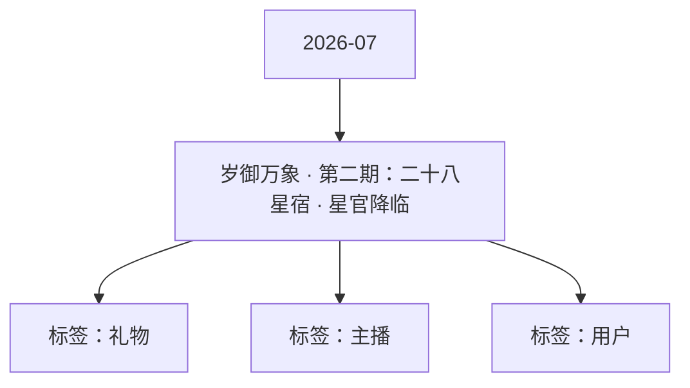

# 岁御万象 · 第二期：二十八星宿 · 星官降临 活动知识图谱

## 核心信息

- 月份：2026-07
- 活动时间：未识别
- 活动 Wiki：https://wiki.inkept.cn/pages/viewpage.action?pageId=504173517
- 活动页面 ID：504173517
- 关联资料数：0
- 标签：礼物、主播、用户

## 优化总结

### 活动概览

- 星宿勋章（静态）28个方形/圆形，带星芒背景，PNG+PSD（来源：活动主页面）

### 活动时间

- 关联第一期十二生肖（地支/时间线）（来源：活动主页面）
- 象征地支、时间、年天象、方位、守护（来源：活动主页面）
- 冷却时间：每日1次（来源：活动主页面）
- 活动名称时间规则奖励（来源：活动主页面）
- 勋章获得记录用户、星宿、获得时间、来源（送/收）（来源：活动主页面）
- markdown# 岁御万象 · 第二期：二十八星宿 · 星官降临## 文档信息| 项目 | 内容 ||------|------|| 文档版本 | V1.0 || 所属IP | 岁御万象 || 主题期数 | 第二期 || 主题名称 | 二十八星宿 · 星官降临 || 适用场景 | 直播间礼物、勋章系统、特权体系 || 关联第一期 | 十二生肖（地支/时间线） |---## 一、主题定位### 1.1 与第一期的关系| 维度 | 第一...

### 玩法规则

- 定位入门收集线进阶收集线（来源：活动主页面）
- 玩法驱动：与“送/收满3个得勋章”机制完全兼容（来源：活动主页面）
- 三、玩法体系（来源：活动主页面）
- 核心规则总览（来源：活动主页面）
- 玩法类型名称触发条件产出（来源：活动主页面）
- 支线星宿勋章收集同一星宿礼物送/收满3个对应星宿勋章×1（来源：活动主页面）
- 支线玩法：星宿勋章收集（来源：活动主页面）
- 规则描述：（来源：活动主页面）
- 主线玩法：星官之路（来源：活动主页面）
- 联动玩法：岁御真君（来源：活动主页面）
- 枚（全收集）称号“岁御真君”及全部特权（来源：活动主页面）
- 活动名称规则奖励（来源：活动主页面）
- 活动名称频率规则奖励（来源：活动主页面）
- 星宿周每周轮换当周指定一象（如“青龙周”），送该象礼物额外赠送同象随机小礼物1个加速收集（来源：活动主页面）
- 联动检测系统检测生肖+星宿全收集，发放终极特权（来源：活动主页面）
- 终极十二生肖全收集星官之主+岁御真君（联动）（来源：活动主页面）
- 预计用户完成率高（易收集）中高（有挑战）（来源：活动主页面）
- 已集齐生肖的用户有动力继续收集星宿（解锁“岁御真君”终极特权）（来源：活动主页面）

### 奖励与资源

- 适用场景直播间礼物、勋章系统、特权体系（来源：活动主页面）
- 视觉为王：每个星宿有独特视觉记忆点，适合礼物动画与勋章展示（来源：活动主页面）
- 星宿名五行动物勋章视觉方向礼物名称送礼动效简述（来源：活动主页面）
- 主线星官之路累计获得星宿勋章达到指定数量特权奖励（见3.3）（来源：活动主页面）
- 用户对任意主播，送或收同一星宿礼物累计达到3个，即可获得该星宿勋章1枚。（来源：活动主页面）
- 计数范围同一星宿礼物，送和收混合计算（送2+收1=3）（来源：活动主页面）
- 激励类型条件奖励（来源：活动主页面）
- 累计勋章数（生肖+星宿）解锁奖励（来源：活动主页面）
- 四、礼物定价与礼包（来源：活动主页面）
- 单个礼物定价（来源：活动主页面）
- 礼物类型价格（钻）折合人民币说明（来源：活动主页面）
- 星宿·基础版99钻~14元单星宿标准礼物，全屏小动效（来源：活动主页面）
- 星宿周卡每日领99钻+随机星宿礼物×1299——（来源：活动主页面）
- 首周双倍计数送/收1个星宿礼物算2个进度加速勋章获取（来源：活动主页面）
- 首周折扣所有星宿礼物8折促进消费（来源：活动主页面）
- 满赠活动每月送满7个不同星宿礼物额外赠送随机星宿勋章1枚（来源：活动主页面）
- 星宿冲刺每月最后3天累计获得勋章达指定数量额外赠送钻/礼物（来源：活动主页面）
- 星官之主年度赛每年12月统计全年星宿礼物消费TOP10用户实物奖励+全站荣誉（来源：活动主页面）

### 入口与链接

- 岁御万象 · 第二期：二十八星宿 · 星官降临（来源：活动主页面）
- 文档信息（来源：活动主页面）
- 项目内容（来源：活动主页面）
- 文档版本V1.0（来源：活动主页面）
- 所属IP岁御万象（来源：活动主页面）
- 主题期数第二期（来源：活动主页面）
- 主题名称二十八星宿 · 星官降临（来源：活动主页面）
- 一、主题定位（来源：活动主页面）
- 与第一期的关系（来源：活动主页面）
- 维度第一期·十二生肖第二期·二十八星宿（来源：活动主页面）
- 数量12个28个（来源：活动主页面）
- 难度易中高（来源：活动主页面）

## 资料关系图

## 资料来源

- [活动主页面](https://wiki.inkept.cn/pages/viewpage.action?pageId=504173517)
