# act202601_game_bump 活动项目知识库

## 一图知识图谱

```mermaid
flowchart LR
  n2e427c26["Backend"]
  nbf5666a4["DrawBag"]
  n0316eaf3["DrawConf"]
  n263be4c2["DrawStyleConf"]
  nc00e2a7b["HTTP 接口"]
  n05ebd5bf["HTTP 接口/Handler"]
  ndf08f38f["KeyDrawOrder: draw_order"]
  ne071a757["KeyDrawOrderInfo: draw_order_info:order_id:%s"]
  n4b682b98["KeyDrawOrderLock: draw_order_lock"]
  nd3e38e3d["ModuleName: act202601_game_bump"]
  n82bfbb57["PrizeInfo"]
  n2102196f["Redis/状态 Key"]
  ne69ecd46["ReqBuyDrawBag"]
  n77d7556d["ReqDrawLog"]
  n0874d5b2["ReqUserDraw"]
  n16eb613f["act202601"]
  n3a9d8cb4["act202601_game_bump"]
  n7d7ea8b2["git.inke.cn/BackendPlatform/golang/logging"]
  n7bacf918["git.inke.cn/inkelogic/daenerys/http/server"]
  n7643d9c0["git.inke.cn/opd/activitys/inke.activity.service/act"]
  n2eb4e126["git.inke.cn/opd/activitys/inke.activity.service/api/code"]
  n05487b5c["git.inke.cn/opd/activitys/inke.activity.service/dao"]
  n04a9e5ed["git.inke.cn/opd/activitys/inke.activity.service/model"]
  na3bdde25["git.inke.cn/opd/activitys/inke.activity.service/utils"]
  n0306c622["git.inke.cn/opd/activitys/inke.activity.service/utils/big_log"]
  n3460d96f["handler: drawBuyBag"]
  n3effda51["handler: drawPrize"]
  n3c3e2b72["handler: drawPrizeLog"]
  n42e3a961["handler: drawPrizeNotice"]
  n49e9897f["handler: drawUserConf"]
  n7de075e4["handler: drawWebBroadcast"]
  n74b902b4["handler: gameTest"]
  nc2d5a20f["handler: interfaceConf"]
  n9d4de674["service: allPrizePool"]
  n461e98ee["service: drawPrize"]
  n7cbd76cf["service: formatMsgContent"]
  n18e456b6["service: formatPrize"]
  nad682fbc["service: getDrawConf"]
  n0656f185["service: getGameNums"]
  n3eef7067["service: getNextNumOk"]
  n2d34f7e5["service: getPosNumIdx"]
  n099e1afb["业务能力信号"]
  n95b52d26["奖励发放/领奖"]
  n4a731954["排行榜"]
  n33557018["日志/埋点"]
  nde2f9a1b["模型/响应结构"]
  n50239d91["活动公共依赖"]
  nd99a3a80["活动基础信息"]
  n5c886211["活动服务逻辑"]
  ndbf77fd8["用户初始化/身份"]
  n1b9349a8["类型: 任务/活跃"]
  n2bdbab4b["类型: 榜单冲榜"]
  nda238ed0["类型: 游戏玩法"]
  n57367205["类型: 用户侧活动"]
  n716e776e["缓存/Redis"]
  ndc861ff4["配置 JSON"]
  n05ebd5bf --> n3460d96f
  n05ebd5bf --> n3effda51
  n05ebd5bf --> n3c3e2b72
  n05ebd5bf --> n42e3a961
  n05ebd5bf --> n49e9897f
  n05ebd5bf --> n7de075e4
  n05ebd5bf --> n74b902b4
  n05ebd5bf --> nc2d5a20f
  n2102196f --> ndf08f38f
  n2102196f --> ne071a757
  n2102196f --> n4b682b98
  n3a9d8cb4 -- "exposes" --> n05ebd5bf
  n3a9d8cb4 -- "module" --> nd3e38e3d
  n3a9d8cb4 -- "state" --> n2102196f
  n3a9d8cb4 -- "month" --> n16eb613f
  n3a9d8cb4 -- "uses" --> n099e1afb
  n3a9d8cb4 -- "defines" --> nde2f9a1b
  n3a9d8cb4 -- "imports" --> n50239d91
  n3a9d8cb4 -- "core" --> n5c886211
  n3a9d8cb4 -- "type" --> n1b9349a8
  n3a9d8cb4 -- "type" --> n2bdbab4b
  n3a9d8cb4 -- "type" --> nda238ed0
  n3a9d8cb4 -- "type" --> n57367205
  n099e1afb --> nc00e2a7b
  n099e1afb --> n95b52d26
  n099e1afb --> n4a731954
  n099e1afb --> n33557018
  n099e1afb --> nd99a3a80
  n099e1afb --> ndbf77fd8
  n099e1afb --> n716e776e
  n099e1afb --> ndc861ff4
  nde2f9a1b --> n2e427c26
  nde2f9a1b --> nbf5666a4
  nde2f9a1b --> n0316eaf3
  nde2f9a1b --> n263be4c2
  nde2f9a1b --> n82bfbb57
  nde2f9a1b --> ne69ecd46
  nde2f9a1b --> n77d7556d
  nde2f9a1b --> n0874d5b2
  n50239d91 --> n7d7ea8b2
  n50239d91 --> n7bacf918
  n50239d91 --> n7643d9c0
  n50239d91 --> n2eb4e126
  n50239d91 --> n05487b5c
  n50239d91 --> n04a9e5ed
  n50239d91 --> na3bdde25
  n50239d91 --> n0306c622
  n5c886211 --> n9d4de674
  n5c886211 --> n461e98ee
  n5c886211 --> n7cbd76cf
  n5c886211 --> n18e456b6
  n5c886211 --> nad682fbc
  n5c886211 --> n0656f185
  n5c886211 --> n3eef7067
  n5c886211 --> n2d34f7e5
```


## 项目定位
- 源码路径：`/Users/dds/go/src/git.inke.cn/opd/activitys/inke.activity.service/act/2026/act202601/act202601_game_bump`
- 所属月份：`act202601`
- 活动类型判断：游戏玩法, 榜单冲榜, 任务/活跃, 用户侧活动
- ModuleName：`act202601_game_bump`
- README 摘要：无标题

```text
未发现 README 或 README 内容为空
```

## 静态结构画像
- 文本/代码文件数：6
- Go 文件数：6
- 文件类型分布：.go(6)

## 入口与接口
### 路由线索
- 未发现显式路由字符串，需结合活动总路由注册确认

### Handler 函数
- `drawUserConf`
- `drawBuyBag`
- `drawPrize`
- `drawPrizeNotice`
- `drawWebBroadcast`
- `drawPrizeLog`
- `gameTest`
- `interfaceConf`
- `iTestWeb`
- `iRecoverData`
- `iCronJob`
- `iBaseScore`

## 核心业务逻辑
### service 方法
- `formatMsgContent`
- `formatPrize`
- `getDrawConf`
- `drawPrize`
- `allPrizePool`
- `getGameNums`
- `getPosNumIdx`
- `getNextNumOk`
- `getLastNum`
- `jobSendGameRes`

### 业务能力信号
- 奖励发放/领奖: 128 处信号
- 日志/埋点: 55 处信号
- 缓存/Redis: 23 处信号
- 排行榜: 22 处信号
- 活动基础信息: 13 处信号
- 配置 JSON: 13 处信号
- HTTP 接口: 12 处信号
- 用户初始化/身份: 2 处信号
- 任务系统: 2 处信号

## 状态与缓存 Key
- `KeyDrawOrder` = `draw_order`
- `KeyDrawOrderInfo` = `draw_order_info:order_id:%s`
- `KeyDrawOrderLock` = `draw_order_lock`

## 模型与导出 API
- 导出结构体：ReqDrawLog, Backend, DrawConf, DrawBag, DrawStyleConf, PrizeInfo, ReqUserDraw, ReqBuyDrawBag, ResDrawPrizeLog, ResDrawPrize, ResDrawLog, OrderInfo
- 导出函数/方法：InitRoute, Cron

## 文件分层
- 任务逻辑: 5 个文件，示例：`server.go`, `service.go`, `internal.go`, `route.go`, `cron.go`
- 模型结构: 5 个文件，示例：`server.go`, `service.go`, `internal.go`, `cron.go`, `model.go`
- 配置/常量: 5 个文件，示例：`server.go`, `service.go`, `internal.go`, `route.go`, `model.go`
- 工具辅助: 3 个文件，示例：`server.go`, `service.go`, `internal.go`
- 接口处理: 2 个文件，示例：`server.go`, `internal.go`
- 服务逻辑: 1 个文件，示例：`service.go`
- 入口/路由: 1 个文件，示例：`route.go`

## 内部依赖
- `git.inke.cn/opd/activitys/inke.activity.service/act`: 5
- `git.inke.cn/opd/activitys/inke.activity.service/model`: 4
- `git.inke.cn/BackendPlatform/golang/logging`: 3
- `git.inke.cn/inkelogic/daenerys/http/server`: 3
- `git.inke.cn/opd/activitys/inke.activity.service/api/code`: 3
- `git.inke.cn/opd/activitys/inke.activity.service/dao`: 3
- `git.inke.cn/opd/activitys/inke.activity.service/utils`: 3
- `git.inke.cn/opd/activitys/inke.activity.service/utils/big_log`: 2
- `git.inke.cn/BackendPlatform/golang/trace`: 1
- `git.inke.cn/opd/activitys/inke.activity.service/conf`: 1
- `git.inke.cn/opd/activitys/inke.activity.service/model/modelRoom`: 1
- `git.inke.cn/BackendPlatform/golang/safego`: 1
- `git.inke.cn/opd/activitys/inke.activity.service/model/modelRank`: 1

## 第三方 import 概览
- github.com(2), bufio(1), os(1)

## 文件清单摘录
- `server.go`
- `service.go`
- `internal.go`
- `route.go`
- `cron.go`
- `model.go`

## 阅读路径建议
- 先确认 `ModuleName` 与活动配置，活动时间、入口 URL、奖励配置通常通过 `act.Srv.GetActInfoByte` 或 `act.Srv.GetActBaseInfo` 获取。
- 再读 Handler 列表，按页面接口、榜单接口、任务接口、领奖接口拆分主流程。
- 重点跟踪 `Key*` 常量和 `act.Dao.GetKey`，它们通常对应 Redis 状态、榜单 ZSet、领奖锁和任务进度。
- 看到 `Claim`、`Prize`、`Reward`、`SendGift`、`AddBag` 相关代码时，优先核对幂等锁、活动时间校验和奖励次数限制。
