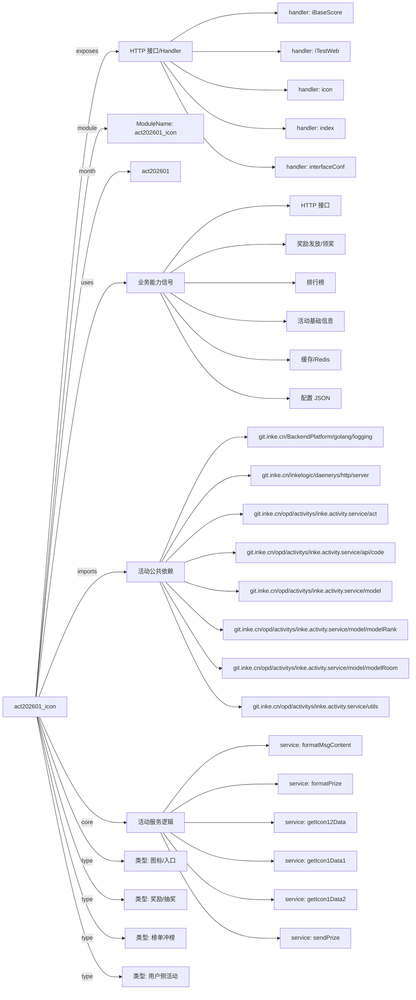

# act202601_icon 活动项目知识库

## 一图知识图谱


## 项目定位
- 源码路径：`/Users/dds/go/src/git.inke.cn/opd/activitys/inke.activity.service/act/2026/act202601/act202601_icon`
- 所属月份：`act202601`
- 活动类型判断：榜单冲榜, 用户侧活动, 图标/入口, 奖励/抽奖
- ModuleName：`act202601_icon`
- README 摘要：无标题

```text
未发现 README 或 README 内容为空
```

## 静态结构画像
- 文本/代码文件数：6
- Go 文件数：6
- 文件类型分布：.go(6)

## 入口与接口
### 路由线索
- 未发现显式路由字符串，需结合活动总路由注册确认

### Handler 函数
- `index`
- `interfaceConf`
- `iTestWeb`
- `iBaseScore`
- `icon`

## 核心业务逻辑
### service 方法
- `sendPrize`
- `formatMsgContent`
- `formatPrize`
- `getIcon1Data1`
- `getIcon1Data2`
- `getIcon12Data`

### 业务能力信号
- 排行榜: 35 处信号
- 奖励发放/领奖: 12 处信号
- 活动基础信息: 7 处信号
- 配置 JSON: 6 处信号
- HTTP 接口: 5 处信号
- 缓存/Redis: 1 处信号

## 状态与缓存 Key
- 未发现 `Key*` 常量

## 模型与导出 API
- 导出结构体：未发现导出结构体
- 导出函数/方法：InitRoute

## 文件分层
- 配置/常量: 5 个文件，示例：`service.go`, `internal.go`, `route.go`, `server_icon.go`, `model.go`
- 模型结构: 4 个文件，示例：`service.go`, `internal.go`, `server_icon.go`, `model.go`
- 接口处理: 3 个文件，示例：`server.go`, `internal.go`, `server_icon.go`
- 工具辅助: 2 个文件，示例：`server.go`, `service.go`
- 服务逻辑: 2 个文件，示例：`service.go`, `server_icon.go`
- 入口/路由: 1 个文件，示例：`route.go`

## 内部依赖
- `git.inke.cn/opd/activitys/inke.activity.service/act`: 5
- `git.inke.cn/inkelogic/daenerys/http/server`: 4
- `git.inke.cn/opd/activitys/inke.activity.service/model`: 3
- `git.inke.cn/opd/activitys/inke.activity.service/utils`: 2
- `git.inke.cn/opd/activitys/inke.activity.service/api/code`: 2
- `git.inke.cn/opd/activitys/inke.activity.service/model/modelRoom`: 1
- `git.inke.cn/BackendPlatform/golang/logging`: 1
- `git.inke.cn/opd/activitys/inke.activity.service/model/modelRank`: 1
- `git.inke.cn/opd/activitys/inke.activity.service/dao`: 1
- `git.inke.cn/opd/activitys/inke.activity.service/model/modelIcon`: 1

## 第三方 import 概览
- github.com(1)

## 文件清单摘录
- `server.go`
- `service.go`
- `internal.go`
- `route.go`
- `server_icon.go`
- `model.go`

## 阅读路径建议
- 先确认 `ModuleName` 与活动配置，活动时间、入口 URL、奖励配置通常通过 `act.Srv.GetActInfoByte` 或 `act.Srv.GetActBaseInfo` 获取。
- 再读 Handler 列表，按页面接口、榜单接口、任务接口、领奖接口拆分主流程。
- 重点跟踪 `Key*` 常量和 `act.Dao.GetKey`，它们通常对应 Redis 状态、榜单 ZSet、领奖锁和任务进度。
- 看到 `Claim`、`Prize`、`Reward`、`SendGift`、`AddBag` 相关代码时，优先核对幂等锁、活动时间校验和奖励次数限制。
