# act202601_ka_super_bingxue 活动项目知识库

## 一图知识图谱

```mermaid
flowchart LR
  nbf5666a4["DrawBag"]
  n0316eaf3["DrawConf"]
  n263be4c2["DrawStyleConf"]
  nc00e2a7b["HTTP 接口"]
  n05ebd5bf["HTTP 接口/Handler"]
  nf9ec604f["KeyBuyShopGoodsId: buy_shop_goods_user:goods_id:%s"]
  ndc3e1dab["KeyBuyShopGoodsUser: buy_shop_goods_user:uid:%d"]
  n8fcc4545["KeyDayPrize: KeyDayPrize:date_%s"]
  n4fdce9a3["KeyUsedTicket: KeyUsedTicket"]
  n4f653631["KeyUserDayPayScore: user_day_pay_score:date:%s"]
  nf47cab19["KeyUserDayRank: user_day_rank:date:%s"]
  n2d46d03c["KeyUserRank: user_rank"]
  n65702610["KeyUserSignTotal: user_sign_total"]
  n3c1dbc07["ModuleName: act202601_ka_super_bingxue"]
  n82bfbb57["PrizeInfo"]
  n2102196f["Redis/状态 Key"]
  ne69ecd46["ReqBuyDrawBag"]
  n0874d5b2["ReqUserDraw"]
  n7ebf1f48["ResDrawPrize"]
  n2c47d69d["ResDrawPrizeLog"]
  n16eb613f["act202601"]
  n3e806424["act202601_ka_super_bingxue"]
  n7d7ea8b2["git.inke.cn/BackendPlatform/golang/logging"]
  n7bacf918["git.inke.cn/inkelogic/daenerys/http/server"]
  n7643d9c0["git.inke.cn/opd/activitys/inke.activity.service/act"]
  n2eb4e126["git.inke.cn/opd/activitys/inke.activity.service/api/code"]
  n05487b5c["git.inke.cn/opd/activitys/inke.activity.service/dao"]
  n04a9e5ed["git.inke.cn/opd/activitys/inke.activity.service/model"]
  na3bdde25["git.inke.cn/opd/activitys/inke.activity.service/utils"]
  n0306c622["git.inke.cn/opd/activitys/inke.activity.service/utils/big_log"]
  naa696be4["handler: getPrize"]
  n68cbe357["handler: index"]
  n1789328c["handler: repSign"]
  na2f269c0["handler: sharePrize"]
  n9fed0fa1["handler: shareUserRank"]
  n4693c645["handler: userDayRank"]
  n407ebf5f["handler: userRank"]
  nbe4c9f5a["handler: userTask"]
  n7cbd76cf["service: formatMsgContent"]
  n18e456b6["service: formatPrize"]
  n78295049["service: jobUserAllRankPrize"]
  nab3e3c59["service: jobUserDayTopRank"]
  nfed57101["service: jobUserEndRankTop"]
  na455f0b2["service: sendPrize"]
  ne7df0f70["service: setUserLoopTask"]
  n75c2b4ba["service: setUserSignTask"]
  n099e1afb["业务能力信号"]
  n88de2679["任务系统"]
  n95b52d26["奖励发放/领奖"]
  n4a731954["排行榜"]
  n33557018["日志/埋点"]
  nde2f9a1b["模型/响应结构"]
  n50239d91["活动公共依赖"]
  nd99a3a80["活动基础信息"]
  n5c886211["活动服务逻辑"]
  n5cbc9d99["类型: KA/SVIP 活动"]
  n1b9349a8["类型: 任务/活跃"]
  n2bdbab4b["类型: 榜单冲榜"]
  n57367205["类型: 用户侧活动"]
  n716e776e["缓存/Redis"]
  ndc861ff4["配置 JSON"]
  n05ebd5bf --> naa696be4
  n05ebd5bf --> n68cbe357
  n05ebd5bf --> n1789328c
  n05ebd5bf --> na2f269c0
  n05ebd5bf --> n9fed0fa1
  n05ebd5bf --> n4693c645
  n05ebd5bf --> n407ebf5f
  n05ebd5bf --> nbe4c9f5a
  n2102196f --> nf9ec604f
  n2102196f --> ndc3e1dab
  n2102196f --> n8fcc4545
  n2102196f --> n4fdce9a3
  n2102196f --> n4f653631
  n2102196f --> nf47cab19
  n2102196f --> n2d46d03c
  n2102196f --> n65702610
  n3e806424 -- "exposes" --> n05ebd5bf
  n3e806424 -- "module" --> n3c1dbc07
  n3e806424 -- "state" --> n2102196f
  n3e806424 -- "month" --> n16eb613f
  n3e806424 -- "uses" --> n099e1afb
  n3e806424 -- "defines" --> nde2f9a1b
  n3e806424 -- "imports" --> n50239d91
  n3e806424 -- "core" --> n5c886211
  n3e806424 -- "type" --> n5cbc9d99
  n3e806424 -- "type" --> n1b9349a8
  n3e806424 -- "type" --> n2bdbab4b
  n3e806424 -- "type" --> n57367205
  n099e1afb --> nc00e2a7b
  n099e1afb --> n88de2679
  n099e1afb --> n95b52d26
  n099e1afb --> n4a731954
  n099e1afb --> n33557018
  n099e1afb --> nd99a3a80
  n099e1afb --> n716e776e
  n099e1afb --> ndc861ff4
  nde2f9a1b --> nbf5666a4
  nde2f9a1b --> n0316eaf3
  nde2f9a1b --> n263be4c2
  nde2f9a1b --> n82bfbb57
  nde2f9a1b --> ne69ecd46
  nde2f9a1b --> n0874d5b2
  nde2f9a1b --> n7ebf1f48
  nde2f9a1b --> n2c47d69d
  n50239d91 --> n7d7ea8b2
  n50239d91 --> n7bacf918
  n50239d91 --> n7643d9c0
  n50239d91 --> n2eb4e126
  n50239d91 --> n05487b5c
  n50239d91 --> n04a9e5ed
  n50239d91 --> na3bdde25
  n50239d91 --> n0306c622
  n5c886211 --> n7cbd76cf
  n5c886211 --> n18e456b6
  n5c886211 --> n78295049
  n5c886211 --> nab3e3c59
  n5c886211 --> nfed57101
  n5c886211 --> na455f0b2
  n5c886211 --> ne7df0f70
  n5c886211 --> n75c2b4ba
```


## 项目定位
- 源码路径：`/Users/dds/go/src/git.inke.cn/opd/activitys/inke.activity.service/act/2026/act202601/act202601_ka_super_bingxue`
- 所属月份：`act202601`
- 活动类型判断：KA/SVIP 活动, 榜单冲榜, 任务/活跃, 用户侧活动
- ModuleName：`act202601_ka_super_bingxue`
- README 摘要：无标题

```text
未发现 README 或 README 内容为空
```

## 静态结构画像
- 文本/代码文件数：10
- Go 文件数：9
- 文件类型分布：.go(9), .json(1)

## 入口与接口
### 路由线索
- 未发现显式路由字符串，需结合活动总路由注册确认

### Handler 函数
- `index`
- `getPrize`
- `sharePrize`
- `userTask`
- `shareUserRank`
- `userDayRank`
- `userRank`
- `repSign`
- `userDataLog`
- `interfaceConf`
- `iTestWeb`
- `iRecoverData`
- `iCronJob`
- `iBaseScore`
- `iSign`
- `drawUserConf`
- `drawBuyBag`
- `drawPrizeOld`
- `drawPrize`
- `drawWebBroadcast`
- `drawPrizeLog`
- `goodsList`
- `buyGoods`
- `userGoodsLog`

## 核心业务逻辑
### service 方法
- `sendPrize`
- `formatMsgContent`
- `formatPrize`
- `setUserLoopTask`
- `setUserSignTask`
- `jobUserDayTopRank`
- `jobUserEndRankTop`
- `jobUserAllRankPrize`
- `getDrawConf`
- `drawPrize`
- `systemDrawPrize`
- `systemDrawPrizeOld`
- `drawPrizeOld`
- `drawListPrize`
- `allPrizePool`
- `shopGoodsList`
- `shopGoodsInfo`
- `userBuyGoods`

### 业务能力信号
- 奖励发放/领奖: 324 处信号
- 排行榜: 152 处信号
- 日志/埋点: 139 处信号
- 任务系统: 95 处信号
- 缓存/Redis: 54 处信号
- 活动基础信息: 53 处信号
- 配置 JSON: 34 处信号
- HTTP 接口: 24 处信号
- 用户初始化/身份: 2 处信号

## 状态与缓存 Key
- `KeyBuyShopGoodsUser` = `buy_shop_goods_user:uid:%d`
- `KeyBuyShopGoodsId` = `buy_shop_goods_user:goods_id:%s`
- `KeyUserDayRank` = `user_day_rank:date:%s`
- `KeyUserRank` = `user_rank`
- `KeyDayPrize` = `KeyDayPrize:date_%s`
- `KeyUserDayPayScore` = `user_day_pay_score:date:%s`
- `KeyUsedTicket` = `KeyUsedTicket`
- `KeyUserSignTotal` = `user_sign_total`
- `KeyUserSignDate` = `user_sign:date:%s`
- `KeyUserSignUser` = `user_sign:user:%d`
- `KeyUserDayTop` = `user_day_top_prize`

## 模型与导出 API
- 导出结构体：DrawConf, DrawBag, DrawStyleConf, PrizeInfo, ReqUserDraw, ReqBuyDrawBag, ResDrawPrizeLog, ResDrawPrize, ResDrawLog, ReqDrawLog, ShopGoods, ShopGoodsLog, Backend, UserDataLog
- 导出函数/方法：InitRoute, Cron, RechargeHandle

## 文件分层
- 任务逻辑: 9 个文件，示例：`server.go`, `service.go`, `internal.go`, `route.go`, `server_draw.go`, `cron.go`
- 配置/常量: 8 个文件，示例：`server.go`, `service.go`, `internal.go`, `route.go`, `server_draw.go`, `server_shop.go`
- 工具辅助: 7 个文件，示例：`server.go`, `service.go`, `internal.go`, `server_draw.go`, `cron.go`, `server_shop.go`
- 模型结构: 7 个文件，示例：`server.go`, `service.go`, `internal.go`, `server_draw.go`, `server_shop.go`, `kafka.go`
- 接口处理: 4 个文件，示例：`server.go`, `internal.go`, `server_draw.go`, `server_shop.go`
- 服务逻辑: 3 个文件，示例：`service.go`, `server_draw.go`, `server_shop.go`
- 入口/路由: 1 个文件，示例：`route.go`

## 内部依赖
- `git.inke.cn/opd/activitys/inke.activity.service/act`: 8
- `git.inke.cn/opd/activitys/inke.activity.service/utils`: 7
- `git.inke.cn/opd/activitys/inke.activity.service/dao`: 6
- `git.inke.cn/opd/activitys/inke.activity.service/model`: 6
- `git.inke.cn/BackendPlatform/golang/logging`: 5
- `git.inke.cn/inkelogic/daenerys/http/server`: 5
- `git.inke.cn/opd/activitys/inke.activity.service/api/code`: 4
- `git.inke.cn/opd/activitys/inke.activity.service/utils/big_log`: 4
- `git.inke.cn/opd/activitys/inke.activity.service/model/modelRoom`: 1
- `git.inke.cn/BackendPlatform/golang/safego`: 1
- `git.inke.cn/opd/activitys/inke.activity.service/model/modelRank`: 1
- `git.inke.cn/opd/activitys/inke.activity.service/conf`: 1

## 第三方 import 概览
- github.com(2), bufio(1), os(1)

## 文件清单摘录
- `server.go`
- `service.go`
- `ka_demo.json`
- `internal.go`
- `route.go`
- `server_draw.go`
- `cron.go`
- `server_shop.go`
- `kafka.go`
- `model.go`

## 阅读路径建议
- 先确认 `ModuleName` 与活动配置，活动时间、入口 URL、奖励配置通常通过 `act.Srv.GetActInfoByte` 或 `act.Srv.GetActBaseInfo` 获取。
- 再读 Handler 列表，按页面接口、榜单接口、任务接口、领奖接口拆分主流程。
- 重点跟踪 `Key*` 常量和 `act.Dao.GetKey`，它们通常对应 Redis 状态、榜单 ZSet、领奖锁和任务进度。
- 看到 `Claim`、`Prize`、`Reward`、`SendGift`、`AddBag` 相关代码时，优先核对幂等锁、活动时间校验和奖励次数限制。
