# act202601_linhaixuezong 活动项目知识库

## 一图知识图谱

```mermaid
flowchart LR
  n2e427c26["Backend"]
  n80cf274b["ConsumerGiftQueueData"]
  nc00e2a7b["HTTP 接口"]
  n05ebd5bf["HTTP 接口/Handler"]
  nd324d0dd["KeyAnchorDayRank: anchor_day_rank:tab:%d:date:%s"]
  ndb0cc0a6["KeyAnchorTask: anchor_task_%d"]
  nb3e23381["KeyAnchorTaskScore: anchor_task_score"]
  nf47cab19["KeyUserDayRank: user_day_rank:date:%s"]
  n9512f3a6["KeyUserEagerScore: KeyUserEagerScore"]
  n81af3a89["KeyUserHourRank: KeyUserHourRank:hour:%s"]
  nd725c0ff["KeyUserHourScore: KeyUserHourScore:hour:%s"]
  n2d46d03c["KeyUserRank: user_rank"]
  nd92ee6f1["ModuleName: act202601_linhaixuezong"]
  n2102196f["Redis/状态 Key"]
  n1248ba8a["TaskInfo"]
  n3d396cea["TaskPrizeInfo"]
  n16eb613f["act202601"]
  n0af5dd49["act202601_linhaixuezong"]
  n7d7ea8b2["git.inke.cn/BackendPlatform/golang/logging"]
  n7bacf918["git.inke.cn/inkelogic/daenerys/http/server"]
  n7643d9c0["git.inke.cn/opd/activitys/inke.activity.service/act"]
  n2eb4e126["git.inke.cn/opd/activitys/inke.activity.service/api/code"]
  n05487b5c["git.inke.cn/opd/activitys/inke.activity.service/dao"]
  n04a9e5ed["git.inke.cn/opd/activitys/inke.activity.service/model"]
  na3bdde25["git.inke.cn/opd/activitys/inke.activity.service/utils"]
  n0306c622["git.inke.cn/opd/activitys/inke.activity.service/utils/big_log"]
  nb2f14d27["handler: anchorDayRank"]
  n66f93a4a["handler: change"]
  n68cbe357["handler: index"]
  na2f269c0["handler: sharePrize"]
  n9fed0fa1["handler: shareUserRank"]
  n34d25fd4["handler: userDayHourRank"]
  n4693c645["handler: userDayRank"]
  n407ebf5f["handler: userRank"]
  n98d01bb2["service: getAnchorTab"]
  n7a2e36b4["service: getAnchorTaskTab"]
  n773372d6["service: getUserGender"]
  nccce7c24["service: getUserRound"]
  nc6e2c493["service: jobSendGift"]
  n378633c4["service: jobUserDayHourTopRank"]
  nab3e3c59["service: jobUserDayTopRank"]
  na455f0b2["service: sendPrize"]
  n099e1afb["业务能力信号"]
  n88de2679["任务系统"]
  n95b52d26["奖励发放/领奖"]
  n4a731954["排行榜"]
  n33557018["日志/埋点"]
  nde2f9a1b["模型/响应结构"]
  n50239d91["活动公共依赖"]
  nd99a3a80["活动基础信息"]
  n5c886211["活动服务逻辑"]
  n5cbc9d99["类型: KA/SVIP 活动"]
  n1b9349a8["类型: 任务/活跃"]
  n2bdbab4b["类型: 榜单冲榜"]
  n57367205["类型: 用户侧活动"]
  n716e776e["缓存/Redis"]
  ndc861ff4["配置 JSON"]
  n05ebd5bf --> nb2f14d27
  n05ebd5bf --> n66f93a4a
  n05ebd5bf --> n68cbe357
  n05ebd5bf --> na2f269c0
  n05ebd5bf --> n9fed0fa1
  n05ebd5bf --> n34d25fd4
  n05ebd5bf --> n4693c645
  n05ebd5bf --> n407ebf5f
  n2102196f --> nd324d0dd
  n2102196f --> ndb0cc0a6
  n2102196f --> nb3e23381
  n2102196f --> nf47cab19
  n2102196f --> n9512f3a6
  n2102196f --> n81af3a89
  n2102196f --> nd725c0ff
  n2102196f --> n2d46d03c
  n0af5dd49 -- "exposes" --> n05ebd5bf
  n0af5dd49 -- "module" --> nd92ee6f1
  n0af5dd49 -- "state" --> n2102196f
  n0af5dd49 -- "month" --> n16eb613f
  n0af5dd49 -- "uses" --> n099e1afb
  n0af5dd49 -- "defines" --> nde2f9a1b
  n0af5dd49 -- "imports" --> n50239d91
  n0af5dd49 -- "core" --> n5c886211
  n0af5dd49 -- "type" --> n5cbc9d99
  n0af5dd49 -- "type" --> n1b9349a8
  n0af5dd49 -- "type" --> n2bdbab4b
  n0af5dd49 -- "type" --> n57367205
  n099e1afb --> nc00e2a7b
  n099e1afb --> n88de2679
  n099e1afb --> n95b52d26
  n099e1afb --> n4a731954
  n099e1afb --> n33557018
  n099e1afb --> nd99a3a80
  n099e1afb --> n716e776e
  n099e1afb --> ndc861ff4
  nde2f9a1b --> n2e427c26
  nde2f9a1b --> n80cf274b
  nde2f9a1b --> n1248ba8a
  nde2f9a1b --> n3d396cea
  n50239d91 --> n7d7ea8b2
  n50239d91 --> n7bacf918
  n50239d91 --> n7643d9c0
  n50239d91 --> n2eb4e126
  n50239d91 --> n05487b5c
  n50239d91 --> n04a9e5ed
  n50239d91 --> na3bdde25
  n50239d91 --> n0306c622
  n5c886211 --> n98d01bb2
  n5c886211 --> n7a2e36b4
  n5c886211 --> n773372d6
  n5c886211 --> nccce7c24
  n5c886211 --> nc6e2c493
  n5c886211 --> n378633c4
  n5c886211 --> nab3e3c59
  n5c886211 --> na455f0b2
```


## 项目定位
- 源码路径：`/Users/dds/go/src/git.inke.cn/opd/activitys/inke.activity.service/act/2026/act202601/act202601_linhaixuezong`
- 所属月份：`act202601`
- 活动类型判断：KA/SVIP 活动, 榜单冲榜, 任务/活跃, 用户侧活动
- ModuleName：`act202601_linhaixuezong`
- README 摘要：无标题

```text
未发现 README 或 README 内容为空
```

## 静态结构画像
- 文本/代码文件数：10
- Go 文件数：10
- 文件类型分布：.go(10)

## 入口与接口
### 路由线索
- 未发现显式路由字符串，需结合活动总路由注册确认

### Handler 函数
- `index`
- `change`
- `sharePrize`
- `userDayRank`
- `userDayHourRank`
- `shareUserRank`
- `userRank`
- `anchorDayRank`
- `interfaceConf`
- `iGender`
- `innerLevelTask`
- `innerShare`
- `userLevelList`
- `iTestWeb`
- `iRecoverData`
- `iSendPrize`
- `iBaseScore`
- `anchorTask`
- `icon`
- `userTask`
- `userActiveTask`

## 核心业务逻辑
### service 方法
- `jobSendGift`
- `getUserGender`
- `sendPrize`
- `getAnchorTab`
- `getAnchorTaskTab`
- `getUserRound`
- `jobUserDayHourTopRank`
- `jobUserDayTopRank`
- `jobAnchorDayTopRank`
- `jobUserEndRankTop`
- `getNick`
- `sendStructPrize`
- `setAnchorTaskScore`
- `getAnchorTaskScore`
- `setAnchorTask`
- `setAnchorRoundTask`
- `getIcon1Data`
- `getIcon12DataA`
- `getIcon12DataB`
- `getIcon7Data`
- `getUserTaskScore`
- `setUserTaskScore`
- `setUserTask`
- `setUserTask2`
- `getTaskConf`
- `setUserRoundTask`
- `setUserLoopTask`
- `setUserActiveTask`
- `userFirstPrize`

### 业务能力信号
- 任务系统: 362 处信号
- 排行榜: 296 处信号
- 奖励发放/领奖: 165 处信号
- 日志/埋点: 110 处信号
- 缓存/Redis: 80 处信号
- 活动基础信息: 47 处信号
- 配置 JSON: 30 处信号
- HTTP 接口: 21 处信号
- 用户初始化/身份: 6 处信号

## 状态与缓存 Key
- `KeyAnchorTask` = `anchor_task_%d`
- `KeyAnchorTaskScore` = `anchor_task_score`
- `KeyUserDayRank` = `user_day_rank:date:%s`
- `KeyUserHourScore` = `KeyUserHourScore:hour:%s`
- `KeyUserHourRank` = `KeyUserHourRank:hour:%s`
- `KeyUserRank` = `user_rank`
- `KeyAnchorDayRank` = `anchor_day_rank:tab:%d:date:%s`
- `KeyUserEagerScore` = `KeyUserEagerScore`
- `KeyUserHourTop` = `user_hour_top_prize`
- `KeyUserDayTop` = `user_day_top_prize`
- `KeyAnchorDayTop` = `anchor_day_top_prize_%d`
- `KeyUserTaskScore` = `user_task_score`
- `KeyUserDayActiveTaskRound` = `user_active_task:task_key:%s:date:%s`

## 模型与导出 API
- 导出结构体：Backend, ConsumerGiftQueueData, TaskInfo, TaskPrizeInfo
- 导出函数/方法：InitRoute, Cron, GiftHandle, RoomInOutHandle

## 文件分层
- 任务逻辑: 10 个文件，示例：`server.go`, `service.go`, `internal.go`, `server_anchor_task.go`, `route.go`, `cron.go`
- 配置/常量: 9 个文件，示例：`server.go`, `service.go`, `internal.go`, `server_anchor_task.go`, `route.go`, `kafka.go`
- 工具辅助: 8 个文件，示例：`server.go`, `service.go`, `internal.go`, `server_anchor_task.go`, `cron.go`, `kafka.go`
- 模型结构: 8 个文件，示例：`server.go`, `service.go`, `internal.go`, `server_anchor_task.go`, `kafka.go`, `server_icon.go`
- 接口处理: 5 个文件，示例：`server.go`, `internal.go`, `server_anchor_task.go`, `server_icon.go`, `server_user_task.go`
- 服务逻辑: 4 个文件，示例：`service.go`, `server_anchor_task.go`, `server_icon.go`, `server_user_task.go`
- 入口/路由: 1 个文件，示例：`route.go`

## 内部依赖
- `git.inke.cn/opd/activitys/inke.activity.service/act`: 9
- `git.inke.cn/opd/activitys/inke.activity.service/dao`: 8
- `git.inke.cn/opd/activitys/inke.activity.service/utils`: 8
- `git.inke.cn/opd/activitys/inke.activity.service/model`: 7
- `git.inke.cn/BackendPlatform/golang/logging`: 6
- `git.inke.cn/inkelogic/daenerys/http/server`: 6
- `git.inke.cn/opd/activitys/inke.activity.service/utils/big_log`: 4
- `git.inke.cn/opd/activitys/inke.activity.service/api/code`: 3
- `git.inke.cn/BackendPlatform/golang/safego`: 1
- `git.inke.cn/opd/activitys/inke.activity.service/model/modelRank`: 1
- `git.inke.cn/opd/activitys/inke.activity.service/model/modelIcon`: 1

## 第三方 import 概览
- github.com(2), crypto(1), bufio(1), os(1)

## 文件清单摘录
- `server.go`
- `service.go`
- `internal.go`
- `server_anchor_task.go`
- `route.go`
- `cron.go`
- `kafka.go`
- `server_icon.go`
- `model.go`
- `server_user_task.go`

## 阅读路径建议
- 先确认 `ModuleName` 与活动配置，活动时间、入口 URL、奖励配置通常通过 `act.Srv.GetActInfoByte` 或 `act.Srv.GetActBaseInfo` 获取。
- 再读 Handler 列表，按页面接口、榜单接口、任务接口、领奖接口拆分主流程。
- 重点跟踪 `Key*` 常量和 `act.Dao.GetKey`，它们通常对应 Redis 状态、榜单 ZSet、领奖锁和任务进度。
- 看到 `Claim`、`Prize`、`Reward`、`SendGift`、`AddBag` 相关代码时，优先核对幂等锁、活动时间校验和奖励次数限制。
