# act202602_chunjie 活动项目知识库

## 一图知识图谱

```mermaid
flowchart LR
  nbf5666a4["DrawBag"]
  n0316eaf3["DrawConf"]
  n263be4c2["DrawStyleConf"]
  nc00e2a7b["HTTP 接口"]
  n05ebd5bf["HTTP 接口/Handler"]
  nfa24e9c0["KeyBuyShopGoodsDate: buy_shop_goods_user:shop_tab:%s:date:%s"]
  n04ededcb["KeyBuyShopGoodsId: buy_shop_goods_user:shop_tab:%s:goods_id"]
  ndc3e1dab["KeyBuyShopGoodsUser: buy_shop_goods_user:uid:%d"]
  n6edf3b3b["KeyRedPacketAll: red_packet_all_total"]
  na25e6e18["KeyShopLog: shop_log:shop_tab:%s:uid:%d"]
  n317eecc2["KeyShopTotalDate: shop_total:shop_tab:%s:date:%s"]
  n2d46d03c["KeyUserRank: user_rank"]
  nc033a68b["KeyUserRedPacketTotal: red_packet_user_total:red_packet_sn:%s"]
  n0a9f9f91["ModuleName: act202602_chunjie"]
  n82bfbb57["PrizeInfo"]
  n2102196f["Redis/状态 Key"]
  ne69ecd46["ReqBuyDrawBag"]
  n0874d5b2["ReqUserDraw"]
  n7ebf1f48["ResDrawPrize"]
  n2c47d69d["ResDrawPrizeLog"]
  n542270ac["act202602"]
  n9e6f6ace["act202602_chunjie"]
  n7d7ea8b2["git.inke.cn/BackendPlatform/golang/logging"]
  n7bacf918["git.inke.cn/inkelogic/daenerys/http/server"]
  n7643d9c0["git.inke.cn/opd/activitys/inke.activity.service/act"]
  n2eb4e126["git.inke.cn/opd/activitys/inke.activity.service/api/code"]
  n05487b5c["git.inke.cn/opd/activitys/inke.activity.service/dao"]
  n04a9e5ed["git.inke.cn/opd/activitys/inke.activity.service/model"]
  na3bdde25["git.inke.cn/opd/activitys/inke.activity.service/utils"]
  n0306c622["git.inke.cn/opd/activitys/inke.activity.service/utils/big_log"]
  n68cbe357["handler: index"]
  n0fff38e6["handler: part1AnchorGold"]
  nff539753["handler: part1AnchorGoldList"]
  n4897599c["handler: part1AnchorTask"]
  n838a7abd["handler: part1SignList"]
  n32e8ee2f["handler: part2AnchorGold"]
  nfb39f5ee["handler: part2AnchorGoldList"]
  na931aa4b["handler: part2AnchorTask"]
  n7cbd76cf["service: formatMsgContent"]
  n18e456b6["service: formatPrize"]
  n448b4bd0["service: getAnchorJinKuUnlockScore"]
  n98d01bb2["service: getAnchorTab"]
  n13f526f0["service: getPart1AnchorGoldList"]
  n6e22d8cb["service: getPart2AnchorGoldList"]
  nfa91e802["service: getPart2JinKuUnlockScore"]
  na455f0b2["service: sendPrize"]
  n099e1afb["业务能力信号"]
  n88de2679["任务系统"]
  n95b52d26["奖励发放/领奖"]
  n4a731954["排行榜"]
  n33557018["日志/埋点"]
  nde2f9a1b["模型/响应结构"]
  n50239d91["活动公共依赖"]
  nd99a3a80["活动基础信息"]
  n5c886211["活动服务逻辑"]
  n5cbc9d99["类型: KA/SVIP 活动"]
  n1b9349a8["类型: 任务/活跃"]
  n2bdbab4b["类型: 榜单冲榜"]
  n538ab97d["类型: 节日/节点活动"]
  n716e776e["缓存/Redis"]
  ndc861ff4["配置 JSON"]
  n05ebd5bf --> n68cbe357
  n05ebd5bf --> n0fff38e6
  n05ebd5bf --> nff539753
  n05ebd5bf --> n4897599c
  n05ebd5bf --> n838a7abd
  n05ebd5bf --> n32e8ee2f
  n05ebd5bf --> nfb39f5ee
  n05ebd5bf --> na931aa4b
  n2102196f --> nfa24e9c0
  n2102196f --> n04ededcb
  n2102196f --> ndc3e1dab
  n2102196f --> n6edf3b3b
  n2102196f --> na25e6e18
  n2102196f --> n317eecc2
  n2102196f --> n2d46d03c
  n2102196f --> nc033a68b
  n9e6f6ace -- "exposes" --> n05ebd5bf
  n9e6f6ace -- "module" --> n0a9f9f91
  n9e6f6ace -- "state" --> n2102196f
  n9e6f6ace -- "month" --> n542270ac
  n9e6f6ace -- "uses" --> n099e1afb
  n9e6f6ace -- "defines" --> nde2f9a1b
  n9e6f6ace -- "imports" --> n50239d91
  n9e6f6ace -- "core" --> n5c886211
  n9e6f6ace -- "type" --> n5cbc9d99
  n9e6f6ace -- "type" --> n1b9349a8
  n9e6f6ace -- "type" --> n2bdbab4b
  n9e6f6ace -- "type" --> n538ab97d
  n099e1afb --> nc00e2a7b
  n099e1afb --> n88de2679
  n099e1afb --> n95b52d26
  n099e1afb --> n4a731954
  n099e1afb --> n33557018
  n099e1afb --> nd99a3a80
  n099e1afb --> n716e776e
  n099e1afb --> ndc861ff4
  nde2f9a1b --> nbf5666a4
  nde2f9a1b --> n0316eaf3
  nde2f9a1b --> n263be4c2
  nde2f9a1b --> n82bfbb57
  nde2f9a1b --> ne69ecd46
  nde2f9a1b --> n0874d5b2
  nde2f9a1b --> n7ebf1f48
  nde2f9a1b --> n2c47d69d
  n50239d91 --> n7d7ea8b2
  n50239d91 --> n7bacf918
  n50239d91 --> n7643d9c0
  n50239d91 --> n2eb4e126
  n50239d91 --> n05487b5c
  n50239d91 --> n04a9e5ed
  n50239d91 --> na3bdde25
  n50239d91 --> n0306c622
  n5c886211 --> n7cbd76cf
  n5c886211 --> n18e456b6
  n5c886211 --> n448b4bd0
  n5c886211 --> n98d01bb2
  n5c886211 --> n13f526f0
  n5c886211 --> n6e22d8cb
  n5c886211 --> nfa91e802
  n5c886211 --> na455f0b2
```


## 项目定位
- 源码路径：`/Users/dds/go/src/git.inke.cn/opd/activitys/inke.activity.service/act/2026/act202602/act202602_chunjie`
- 所属月份：`act202602`
- 活动类型判断：KA/SVIP 活动, 榜单冲榜, 任务/活跃, 节日/节点活动
- ModuleName：`act202602_chunjie`
- README 摘要：无标题

```text
未发现 README 或 README 内容为空
```

## 静态结构画像
- 文本/代码文件数：16
- Go 文件数：16
- 文件类型分布：.go(16)

## 入口与接口
### 路由线索
- 未发现显式路由字符串，需结合活动总路由注册确认

### Handler 函数
- `index`
- `part1AnchorGold`
- `part1AnchorGoldList`
- `part1SignList`
- `part2AnchorGold`
- `part2AnchorGoldList`
- `part1AnchorTask`
- `part2AnchorTask`
- `part2SignList`
- `anchorTab3DayRank`
- `anchorTab3DayTOP1`
- `anchorTab31Task`
- `anchorTab31DaKaTask`
- `partySignList`
- `anchorTab32Task`
- `anchorTab32DaKaTask`
- `interfaceConf`
- `iTestWeb`
- `iShop`
- `iRecoverData`
- `iCronJob`
- `iBaseScore`
- `iPart1AnchorGold`
- `iPart2AnchorGold`
- `iPart3AnchorGold`
- `iUserPayTicket`
- `drawUserConf`
- `drawBuyBag`
- `drawPrize`
- `drawWebBroadcast`
- `drawPrizeLog`
- `getRedPacket`
- `goodsList`
- `buyGoods`
- `userGoodsLog`
- `icon`
- `userTicket`
- `userSendTask`
- `userNumTask`
- `userTask`
- `userActiveTask`

## 核心业务逻辑
### service 方法
- `getPart1AnchorGoldList`
- `getPart2AnchorGoldList`
- `getAnchorJinKuUnlockScore`
- `getPart2JinKuUnlockScore`
- `sendPrize`
- `formatMsgContent`
- `formatPrize`
- `getAnchorTab`
- `getAnchorDN`
- `jobAnchorDayRankTop`
- `jobUserDayRankTop`
- `jobUserEndRankTop`
- `jobUserAllRankPrize`
- `GetGiftLiveTaskLevelInfoByScore`
- `GetTaskInfoByTaskKey`
- `GetLastTaskConf`
- `daKaDayInfoList`
- `getUserDayActiveTaskInfo`
- `drawTypePrizeTotal`
- `part2Tab1DaKaTotal`
- `part1NowTotalDay`
- `jobPart1AnchorDateGold`
- `GetGiftLiveTaskConf`
- `GetGiftLiveTaskInfoByScoreOk`
- `setPart1AnchorGiftGold`
- `setPart1AnchorTask`
- `getPart1DaKaConf`
- `updatePart1AnchorGoldTotal`
- `setAnchorTaskScore`
- `getAnchorTaskScore`
- `setAnchorTask`
- `setAnchorLoopTask`
- `getDrawConf`
- `drawPrize`
- `systemDrawPrize`
- `systemDrawPrizeOld`
- `drawPrizeOld`
- `drawListPrize`
- `allPrizePool`
- `sendRedPacket`
- `shopGoodsList`
- `shopGoodsInfo`
- `userBuyGoods`
- `updateShopDateTotal`
- `getIcon1Data`
- `getIcon14DataPart1Tab3`
- `getIcon14DataPart1Tab1`
- `getIcon14DataPart1Tab1_2`
- `getIcon14DataPart2Tab1_1`
- `getIcon14DataPart2Tab1_2`
- `formatLargeNumber`
- `getIcon12DataA`
- `getIcon12DataB`
- `Part2NowTotalDay`
- `getPart2GiftLiveConfKey`
- `jobPart2AnchorDateGold`
- `setPart2AnchorGiftGold`
- `setPart2AnchorTask`
- `getPart2DaKaConf`
- `updatePart2AnchorGoldTotal`
- `payTicketMap`
- `sendRadioNotice`
- `getRadioNoticeType`
- `sendRadioRole`
- `getRadioRole`
- `getRadioAnyPrize`
- `sendAnyPrize`
- `getUserTaskScore`
- `setUserTaskScore`
- `setUserTask`
- `setUserTask2`
- `setUserRoundTask`
- `setUserLoopTask`
- `getScoreDiffRound`
- `getUserDayDaKaInfo`
- `setUserDaKaTask`
- `part3NowTotalDay`
- `getPart3GiftLiveConfKey`
- `jobPart3AnchorDateGold`
- `setPart3AnchorGiftGold`

### 业务能力信号
- 任务系统: 806 处信号
- 奖励发放/领奖: 501 处信号
- 排行榜: 415 处信号
- 日志/埋点: 216 处信号
- 缓存/Redis: 178 处信号
- 活动基础信息: 138 处信号
- 配置 JSON: 102 处信号
- HTTP 接口: 41 处信号
- 用户初始化/身份: 2 处信号

## 状态与缓存 Key
- `KeyRedPacketAll` = `red_packet_all_total`
- `KeyUserRedPacketTotal` = `red_packet_user_total:red_packet_sn:%s`
- `KeyBuyShopGoodsUser` = `buy_shop_goods_user:uid:%d`
- `KeyBuyShopGoodsDate` = `buy_shop_goods_user:shop_tab:%s:date:%s`
- `KeyBuyShopGoodsId` = `buy_shop_goods_user:shop_tab:%s:goods_id:%s`
- `KeyShopTotalDate` = `shop_total:shop_tab:%s:date:%s`
- `KeyShopLog` = `shop_log:shop_tab:%s:uid:%d`
- `KeyUserRank` = `user_rank`
- `KeyUserDayRank` = `user_day_rank:date:%s`
- `KeyUserDayWatch` = `user_day_watch:date:%s`
- `KeyUserTaskScore` = `user_task_score`
- `KeyUserDaKaDay` = `user_da_ka_day:uid:%d`
- `KeyUserDayActiveTaskRound` = `user_active_task:task_key:%s:date:%s`
- `KeyAnchorRank` = `anchor_rank:tab:%d`
- `KeyAnchorDayRank` = `anchor_day_rank:tab:%d:date:%s`
- `KeyAnchorTab3AllDayTop1` = `anchor_tab3_all_day_top1`
- `KeyAnchorDayLiveTime` = `anchor_day_live_time:date:%s`
- `KeyAnchorDateGold` = `anchor_date_gold:date:%s`
- `KeyAnchorPartGold` = `anchor_gold:part:%d:aid:%d`
- `KeyAnchorPartGold20` = `KeyAnchorPartGold20:date:%s`
- `KeyAnchorPart2DateGold20` = `KeyAnchorPart2DateGold20:date:%s`
- `KeyAnchorPart1Gold20` = `anchor_gold_part1_20:aid:%d`
- `KeyAnchorPart2Gold20` = `anchor_gold_part2_20:aid:%d`
- `KeyAnchorPart3Gold20` = `anchor_gold_part3_20:aid:%d`
- `KeyAnchorGoldTotal` = `anchor_gold_total:part:%d`
- `KeyAnchorPart1GoldTotal` = `anchor_gold_total:part1`
- `KeyAnchorPart2GoldTotal` = `anchor_gold_total:part2`
- `KeyAnchorPart3GoldTotal` = `anchor_gold_total:part3`
- `KeyAnchorYanGuangChat` = `anchor_yang_guang:date:%s:uid:%d`
- `KeyAnchorTask` = `anchor_task:part:%d:tab:%d`
- `KeyAnchorTaskRep` = `anchor_task_rep`
- `KeyAnchorDaKaDate` = `anchor_da_ka:part:%d:aid:%d`
- `KeyAnchorTab3DaKaDay` = `anchor_tab3_da_ka_day:aid:%d`
- `KeyTab3DaKaTask` = `tab3_daka_task`
- `KeyTab31DaKaTask` = `KeyTab31DaKaTask`
- `KeyTab32DaKaTask` = `KeyTab32DaKaTask`
- `KeyUserRole` = `KeyUserRole:uid_%d`
- `KeyConfessId` = `KeyConfessId`
- `KeyConfessUserNum` = `KeyConfessUserNum:uid_%d`
- `KeyUserLoopTask` = `user_loop_task`
- `KeyUserTask` = `user_task`
- `KeyAnchorLoopTask` = `anchor_loop_task`
- `KeyUserDayTopPrize` = `user_day_top_prize`
- `KeyUserEndTopPrize` = `user_end_top_prize`
- `KeyAnchorDayTopPrize` = `anchor_day_top_prize_%d`
- `KeyAnchorEndTopPrize` = `anchor_end_top_prize_%d`

## 模型与导出 API
- 导出结构体：DrawConf, DrawBag, DrawStyleConf, PrizeInfo, ReqUserDraw, ReqBuyDrawBag, ResDrawPrizeLog, ResDrawPrize, ResDrawLog, ReqDrawLog, ShopGoods, ShopGoodsLog, Backend, TPayConf, RadioPrize, RadioAnyPrize, DnConf, TDateGiftGold, DateSignList, TGiftLiveTaskInfo, TDaKa, TUserDayTask
- 导出函数/方法：GetGiftLiveTaskLevelInfoByScore, GetTaskInfoByTaskKey, GetLastTaskConf, GetGiftLiveTaskConf, GetGiftLiveTaskInfoByScoreOk, InitRoute, Cron, LiveDuration, GiftHandle, RechargeHandle, Part2NowTotalDay

## 文件分层
- 任务逻辑: 16 个文件，示例：`server.go`, `service.go`, `internal.go`, `part1.go`, `server_anchor_task.go`, `route.go`
- 配置/常量: 16 个文件，示例：`server.go`, `service.go`, `internal.go`, `part1.go`, `server_anchor_task.go`, `route.go`
- 工具辅助: 14 个文件，示例：`server.go`, `service.go`, `internal.go`, `part1.go`, `server_anchor_task.go`, `server_draw.go`
- 服务逻辑: 10 个文件，示例：`service.go`, `part1.go`, `server_anchor_task.go`, `server_draw.go`, `server_red_packet.go`, `server_shop.go`
- 模型结构: 10 个文件，示例：`service.go`, `internal.go`, `server_anchor_task.go`, `server_draw.go`, `server_red_packet.go`, `server_shop.go`
- 接口处理: 7 个文件，示例：`server.go`, `internal.go`, `server_draw.go`, `server_red_packet.go`, `server_shop.go`, `server_icon.go`
- 入口/路由: 1 个文件，示例：`route.go`

## 内部依赖
- `git.inke.cn/opd/activitys/inke.activity.service/act`: 15
- `git.inke.cn/opd/activitys/inke.activity.service/utils`: 14
- `git.inke.cn/opd/activitys/inke.activity.service/dao`: 13
- `git.inke.cn/opd/activitys/inke.activity.service/model`: 10
- `git.inke.cn/BackendPlatform/golang/logging`: 9
- `git.inke.cn/opd/activitys/inke.activity.service/utils/big_log`: 9
- `git.inke.cn/inkelogic/daenerys/http/server`: 8
- `git.inke.cn/opd/activitys/inke.activity.service/api/code`: 5
- `git.inke.cn/opd/activitys/inke.activity.service/model/modelRoom`: 1
- `git.inke.cn/opd/activitys/inke.activity.service/model/modelTask`: 1
- `git.inke.cn/BackendPlatform/golang/safego`: 1
- `git.inke.cn/opd/activitys/inke.activity.service/model/modelRank`: 1
- `git.inke.cn/opd/activitys/inke.activity.service/conf`: 1
- `git.inke.cn/BackendPlatform/golang/trace`: 1
- `git.inke.cn/opd/activitys/inke.activity.service/model/modelIcon`: 1

## 第三方 import 概览
- github.com(2), bufio(1), os(1)

## 文件清单摘录
- `server.go`
- `service.go`
- `internal.go`
- `part1.go`
- `server_anchor_task.go`
- `route.go`
- `server_draw.go`
- `cron.go`
- `server_red_packet.go`
- `server_shop.go`
- `kafka.go`
- `server_icon.go`
- `model.go`
- `part2.go`
- `server_user_task.go`
- `part3.go`

## 阅读路径建议
- 先确认 `ModuleName` 与活动配置，活动时间、入口 URL、奖励配置通常通过 `act.Srv.GetActInfoByte` 或 `act.Srv.GetActBaseInfo` 获取。
- 再读 Handler 列表，按页面接口、榜单接口、任务接口、领奖接口拆分主流程。
- 重点跟踪 `Key*` 常量和 `act.Dao.GetKey`，它们通常对应 Redis 状态、榜单 ZSet、领奖锁和任务进度。
- 看到 `Claim`、`Prize`、`Reward`、`SendGift`、`AddBag` 相关代码时，优先核对幂等锁、活动时间校验和奖励次数限制。
