# act202604_game_meigui 活动项目知识库

## 一图知识图谱

```mermaid
flowchart LR
  nbf5666a4["DrawBag"]
  n0316eaf3["DrawConf"]
  n263be4c2["DrawStyleConf"]
  nc00e2a7b["HTTP 接口"]
  n05ebd5bf["HTTP 接口/Handler"]
  n7599cfed["KeyBroadcast50100: broadcast_50_100"]
  nbe960d8a["KeyBroadcast: broadcast"]
  ndf7600d4["KeyGiftNum: gift_num"]
  naa12e58f["KeyGiftShouRu: gift_shou_ru"]
  n0bb1f0a1["KeyGiftTotal: gift_total"]
  n1eec25f1["KeyGiftZhiChu: gift_zhi_chu"]
  n183d456e["KeyMinIncome: min_income"]
  n236100b1["KeyUserLoss: user_loss:draw_type:%s"]
  na0ad8a42["ModuleName: act202604_game_meigui"]
  n82bfbb57["PrizeInfo"]
  n2102196f["Redis/状态 Key"]
  ne69ecd46["ReqBuyDrawBag"]
  n0874d5b2["ReqUserDraw"]
  n7ebf1f48["ResDrawPrize"]
  n2c47d69d["ResDrawPrizeLog"]
  nb3e96168["act202604"]
  ne1666273["act202604_game_meigui"]
  n7d7ea8b2["git.inke.cn/BackendPlatform/golang/logging"]
  n7bacf918["git.inke.cn/inkelogic/daenerys/http/server"]
  n7643d9c0["git.inke.cn/opd/activitys/inke.activity.service/act"]
  n2eb4e126["git.inke.cn/opd/activitys/inke.activity.service/api/code"]
  n05487b5c["git.inke.cn/opd/activitys/inke.activity.service/dao"]
  n04a9e5ed["git.inke.cn/opd/activitys/inke.activity.service/model"]
  na3bdde25["git.inke.cn/opd/activitys/inke.activity.service/utils"]
  n0306c622["git.inke.cn/opd/activitys/inke.activity.service/utils/big_log"]
  nb2f14d27["handler: anchorDayRank"]
  nfdb09576["handler: iRepRank"]
  nf534b047["handler: iTestWeb"]
  n68cbe357["handler: index"]
  nc2d5a20f["handler: interfaceConf"]
  n40f5b6c8["handler: userGiftDayRank"]
  n29a50c2f["handler: webBroadcast"]
  nac7fbc05["handler: webBroadcast50100"]
  n7cbd76cf["service: formatMsgContent"]
  n18e456b6["service: formatPrize"]
  n98d01bb2["service: getAnchorTab"]
  nd9d6ff8e["service: getGiftIdNo"]
  n08eb062a["service: giftPoolList"]
  n9523d09f["service: jobAnchorDayTopRank"]
  nab3e3c59["service: jobUserDayTopRank"]
  na455f0b2["service: sendPrize"]
  n099e1afb["业务能力信号"]
  n88de2679["任务系统"]
  n95b52d26["奖励发放/领奖"]
  n4a731954["排行榜"]
  n33557018["日志/埋点"]
  nde2f9a1b["模型/响应结构"]
  n50239d91["活动公共依赖"]
  nd99a3a80["活动基础信息"]
  n5c886211["活动服务逻辑"]
  n5cbc9d99["类型: KA/SVIP 活动"]
  n1b9349a8["类型: 任务/活跃"]
  n2bdbab4b["类型: 榜单冲榜"]
  nda238ed0["类型: 游戏玩法"]
  n716e776e["缓存/Redis"]
  ndc861ff4["配置 JSON"]
  n05ebd5bf --> nb2f14d27
  n05ebd5bf --> nfdb09576
  n05ebd5bf --> nf534b047
  n05ebd5bf --> n68cbe357
  n05ebd5bf --> nc2d5a20f
  n05ebd5bf --> n40f5b6c8
  n05ebd5bf --> n29a50c2f
  n05ebd5bf --> nac7fbc05
  n2102196f --> n7599cfed
  n2102196f --> nbe960d8a
  n2102196f --> ndf7600d4
  n2102196f --> naa12e58f
  n2102196f --> n0bb1f0a1
  n2102196f --> n1eec25f1
  n2102196f --> n183d456e
  n2102196f --> n236100b1
  ne1666273 -- "exposes" --> n05ebd5bf
  ne1666273 -- "module" --> na0ad8a42
  ne1666273 -- "state" --> n2102196f
  ne1666273 -- "month" --> nb3e96168
  ne1666273 -- "uses" --> n099e1afb
  ne1666273 -- "defines" --> nde2f9a1b
  ne1666273 -- "imports" --> n50239d91
  ne1666273 -- "core" --> n5c886211
  ne1666273 -- "type" --> n5cbc9d99
  ne1666273 -- "type" --> n1b9349a8
  ne1666273 -- "type" --> n2bdbab4b
  ne1666273 -- "type" --> nda238ed0
  n099e1afb --> nc00e2a7b
  n099e1afb --> n88de2679
  n099e1afb --> n95b52d26
  n099e1afb --> n4a731954
  n099e1afb --> n33557018
  n099e1afb --> nd99a3a80
  n099e1afb --> n716e776e
  n099e1afb --> ndc861ff4
  nde2f9a1b --> nbf5666a4
  nde2f9a1b --> n0316eaf3
  nde2f9a1b --> n263be4c2
  nde2f9a1b --> n82bfbb57
  nde2f9a1b --> ne69ecd46
  nde2f9a1b --> n0874d5b2
  nde2f9a1b --> n7ebf1f48
  nde2f9a1b --> n2c47d69d
  n50239d91 --> n7d7ea8b2
  n50239d91 --> n7bacf918
  n50239d91 --> n7643d9c0
  n50239d91 --> n2eb4e126
  n50239d91 --> n05487b5c
  n50239d91 --> n04a9e5ed
  n50239d91 --> na3bdde25
  n50239d91 --> n0306c622
  n5c886211 --> n7cbd76cf
  n5c886211 --> n18e456b6
  n5c886211 --> n98d01bb2
  n5c886211 --> nd9d6ff8e
  n5c886211 --> n08eb062a
  n5c886211 --> n9523d09f
  n5c886211 --> nab3e3c59
  n5c886211 --> na455f0b2
```


## 项目定位
- 源码路径：`/Users/dds/go/src/git.inke.cn/opd/activitys/inke.activity.service/act/2026/act202604/act202604_game_meigui`
- 所属月份：`act202604`
- 活动类型判断：KA/SVIP 活动, 游戏玩法, 榜单冲榜, 任务/活跃
- ModuleName：`act202604_game_meigui`
- README 摘要：无标题

```text
未发现 README 或 README 内容为空
```

## 静态结构画像
- 文本/代码文件数：7
- Go 文件数：7
- 文件类型分布：.go(7)

## 入口与接口
### 路由线索
- 未发现显式路由字符串，需结合活动总路由注册确认

### Handler 函数
- `index`
- `webBroadcast`
- `webBroadcast50100`
- `userGiftDayRank`
- `anchorDayRank`
- `iRepRank`
- `interfaceConf`
- `iTestWeb`
- `iRecoverData`
- `iSendPrize`
- `iBaseScore`
- `iShouRu`
- `drawUserConf`
- `drawBuyBag`
- `drawPrize`
- `drawWebBroadcast`
- `drawPrizeLog`

## 核心业务逻辑
### service 方法
- `sendPrize`
- `formatMsgContent`
- `formatPrize`
- `getAnchorTab`
- `jobUserDayTopRank`
- `jobAnchorDayTopRank`
- `getGiftIdNo`
- `giftPoolList`
- `giftIdNumPoolInfo`
- `iRepRank`
- `setUserLoopTask`
- `getMinIncome`
- `getDrawConf`
- `drawPrize`
- `systemDrawPrize`
- `allPrizePool`

### 业务能力信号
- 奖励发放/领奖: 212 处信号
- 排行榜: 105 处信号
- 日志/埋点: 80 处信号
- 任务系统: 34 处信号
- 配置 JSON: 32 处信号
- 活动基础信息: 26 处信号
- 缓存/Redis: 23 处信号
- HTTP 接口: 17 处信号
- 用户初始化/身份: 2 处信号

## 状态与缓存 Key
- `KeyGiftTotal` = `gift_total`
- `KeyBroadcast` = `broadcast`
- `KeyBroadcast50100` = `broadcast_50_100`
- `KeyGiftNum` = `gift_num`
- `KeyMinIncome` = `min_income`
- `KeyGiftZhiChu` = `gift_zhi_chu`
- `KeyGiftShouRu` = `gift_shou_ru`
- `KeyUserLoss` = `user_loss:draw_type:%s`
- `KeyUserGiftDayRank` = `user_gift_rank:gift_id:%s:day:%s`
- `KeyAnchorDayRank` = `anchor_day_rank:tab_%d:day:%s`
- `KeyUserDayTop` = `user_day_top_prize`
- `KeyAnchorDayTop` = `anchor_day_top_prize_%d`

## 模型与导出 API
- 导出结构体：DrawConf, DrawBag, DrawStyleConf, PrizeInfo, ReqUserDraw, ReqBuyDrawBag, ResDrawPrizeLog, ResDrawPrize, ResDrawLog, ReqDrawLog, Backend, GiftIdPoolConf
- 导出函数/方法：InitRoute, GiftHandle

## 文件分层
- 配置/常量: 7 个文件，示例：`server.go`, `service.go`, `internal.go`, `route.go`, `server_draw.go`, `kafka.go`
- 工具辅助: 5 个文件，示例：`server.go`, `service.go`, `internal.go`, `server_draw.go`, `kafka.go`
- 模型结构: 5 个文件，示例：`service.go`, `internal.go`, `server_draw.go`, `kafka.go`, `model.go`
- 接口处理: 3 个文件，示例：`server.go`, `internal.go`, `server_draw.go`
- 任务逻辑: 3 个文件，示例：`service.go`, `server_draw.go`, `kafka.go`
- 服务逻辑: 2 个文件，示例：`service.go`, `server_draw.go`
- 入口/路由: 1 个文件，示例：`route.go`

## 内部依赖
- `git.inke.cn/opd/activitys/inke.activity.service/act`: 6
- `git.inke.cn/opd/activitys/inke.activity.service/dao`: 5
- `git.inke.cn/opd/activitys/inke.activity.service/utils`: 5
- `git.inke.cn/opd/activitys/inke.activity.service/model`: 5
- `git.inke.cn/inkelogic/daenerys/http/server`: 4
- `git.inke.cn/BackendPlatform/golang/logging`: 4
- `git.inke.cn/opd/activitys/inke.activity.service/api/code`: 3
- `git.inke.cn/opd/activitys/inke.activity.service/utils/big_log`: 3
- `git.inke.cn/BackendPlatform/golang/safego`: 2
- `git.inke.cn/opd/activitys/inke.activity.service/model/modelRoom`: 1
- `git.inke.cn/opd/activitys/inke.activity.service/model/modelRank`: 1
- `git.inke.cn/opd/activitys/inke.activity.service/conf`: 1
- `git.inke.cn/BackendPlatform/golang/trace`: 1

## 第三方 import 概览
- github.com(1), bufio(1), os(1)

## 文件清单摘录
- `server.go`
- `service.go`
- `internal.go`
- `route.go`
- `server_draw.go`
- `kafka.go`
- `model.go`

## 阅读路径建议
- 先确认 `ModuleName` 与活动配置，活动时间、入口 URL、奖励配置通常通过 `act.Srv.GetActInfoByte` 或 `act.Srv.GetActBaseInfo` 获取。
- 再读 Handler 列表，按页面接口、榜单接口、任务接口、领奖接口拆分主流程。
- 重点跟踪 `Key*` 常量和 `act.Dao.GetKey`，它们通常对应 Redis 状态、榜单 ZSet、领奖锁和任务进度。
- 看到 `Claim`、`Prize`、`Reward`、`SendGift`、`AddBag` 相关代码时，优先核对幂等锁、活动时间校验和奖励次数限制。
