# act202604_wen_xiang 活动项目知识库

## 一图知识图谱

```mermaid
flowchart LR
  nbf5666a4["DrawBag"]
  n0316eaf3["DrawConf"]
  n263be4c2["DrawStyleConf"]
  nc00e2a7b["HTTP 接口"]
  n05ebd5bf["HTTP 接口/Handler"]
  nd324d0dd["KeyAnchorDayRank: anchor_day_rank:tab:%d:date:%s"]
  n83aee5e5["KeyAnchorRank: anchor_rank:tab:%d"]
  ndb0cc0a6["KeyAnchorTask: anchor_task_%d"]
  nb3e23381["KeyAnchorTaskScore: anchor_task_score"]
  nf55d0b9a["KeyGiftNum: gift_num_uid:%d"]
  ncb6d61c0["KeyUserDayGiftScore: user_day_gift_score:date:%s"]
  nf47cab19["KeyUserDayRank: user_day_rank:date:%s"]
  n2d46d03c["KeyUserRank: user_rank"]
  na31fdf5f["ModuleName: act202604_wen_xiang"]
  n82bfbb57["PrizeInfo"]
  n2102196f["Redis/状态 Key"]
  ne69ecd46["ReqBuyDrawBag"]
  n0874d5b2["ReqUserDraw"]
  n7ebf1f48["ResDrawPrize"]
  n2c47d69d["ResDrawPrizeLog"]
  nb3e96168["act202604"]
  nda64630f["act202604_wen_xiang"]
  n7d7ea8b2["git.inke.cn/BackendPlatform/golang/logging"]
  n7bacf918["git.inke.cn/inkelogic/daenerys/http/server"]
  n7643d9c0["git.inke.cn/opd/activitys/inke.activity.service/act"]
  n2eb4e126["git.inke.cn/opd/activitys/inke.activity.service/api/code"]
  n05487b5c["git.inke.cn/opd/activitys/inke.activity.service/dao"]
  n04a9e5ed["git.inke.cn/opd/activitys/inke.activity.service/model"]
  na3bdde25["git.inke.cn/opd/activitys/inke.activity.service/utils"]
  n0306c622["git.inke.cn/opd/activitys/inke.activity.service/utils/big_log"]
  nb2f14d27["handler: anchorDayRank"]
  n2df798ce["handler: giftNum"]
  n6bb23849["handler: iCronJob"]
  n4abc26ec["handler: iRecoverData"]
  nf534b047["handler: iTestWeb"]
  n68cbe357["handler: index"]
  nc2d5a20f["handler: interfaceConf"]
  n4693c645["handler: userDayRank"]
  n7cbd76cf["service: formatMsgContent"]
  n18e456b6["service: formatPrize"]
  n98d01bb2["service: getAnchorTab"]
  n7a2e36b4["service: getAnchorTaskTab"]
  nb3f11d03["service: jobAnchorDayRankTop"]
  n78f33ee1["service: jobAnchorEndRankTop"]
  nbd86d42c["service: jobUserDayRankTop"]
  na455f0b2["service: sendPrize"]
  n099e1afb["业务能力信号"]
  n88de2679["任务系统"]
  n95b52d26["奖励发放/领奖"]
  n4a731954["排行榜"]
  n33557018["日志/埋点"]
  nde2f9a1b["模型/响应结构"]
  n50239d91["活动公共依赖"]
  nd99a3a80["活动基础信息"]
  n5c886211["活动服务逻辑"]
  n5cbc9d99["类型: KA/SVIP 活动"]
  n1b9349a8["类型: 任务/活跃"]
  n2bdbab4b["类型: 榜单冲榜"]
  nda238ed0["类型: 游戏玩法"]
  n716e776e["缓存/Redis"]
  ndc861ff4["配置 JSON"]
  n05ebd5bf --> nb2f14d27
  n05ebd5bf --> n2df798ce
  n05ebd5bf --> n6bb23849
  n05ebd5bf --> n4abc26ec
  n05ebd5bf --> nf534b047
  n05ebd5bf --> n68cbe357
  n05ebd5bf --> nc2d5a20f
  n05ebd5bf --> n4693c645
  n2102196f --> nd324d0dd
  n2102196f --> n83aee5e5
  n2102196f --> ndb0cc0a6
  n2102196f --> nb3e23381
  n2102196f --> nf55d0b9a
  n2102196f --> ncb6d61c0
  n2102196f --> nf47cab19
  n2102196f --> n2d46d03c
  nda64630f -- "exposes" --> n05ebd5bf
  nda64630f -- "module" --> na31fdf5f
  nda64630f -- "state" --> n2102196f
  nda64630f -- "month" --> nb3e96168
  nda64630f -- "uses" --> n099e1afb
  nda64630f -- "defines" --> nde2f9a1b
  nda64630f -- "imports" --> n50239d91
  nda64630f -- "core" --> n5c886211
  nda64630f -- "type" --> n5cbc9d99
  nda64630f -- "type" --> n1b9349a8
  nda64630f -- "type" --> n2bdbab4b
  nda64630f -- "type" --> nda238ed0
  n099e1afb --> nc00e2a7b
  n099e1afb --> n88de2679
  n099e1afb --> n95b52d26
  n099e1afb --> n4a731954
  n099e1afb --> n33557018
  n099e1afb --> nd99a3a80
  n099e1afb --> n716e776e
  n099e1afb --> ndc861ff4
  nde2f9a1b --> nbf5666a4
  nde2f9a1b --> n0316eaf3
  nde2f9a1b --> n263be4c2
  nde2f9a1b --> n82bfbb57
  nde2f9a1b --> ne69ecd46
  nde2f9a1b --> n0874d5b2
  nde2f9a1b --> n7ebf1f48
  nde2f9a1b --> n2c47d69d
  n50239d91 --> n7d7ea8b2
  n50239d91 --> n7bacf918
  n50239d91 --> n7643d9c0
  n50239d91 --> n2eb4e126
  n50239d91 --> n05487b5c
  n50239d91 --> n04a9e5ed
  n50239d91 --> na3bdde25
  n50239d91 --> n0306c622
  n5c886211 --> n7cbd76cf
  n5c886211 --> n18e456b6
  n5c886211 --> n98d01bb2
  n5c886211 --> n7a2e36b4
  n5c886211 --> nb3f11d03
  n5c886211 --> n78f33ee1
  n5c886211 --> nbd86d42c
  n5c886211 --> na455f0b2
```


## 项目定位
- 源码路径：`/Users/dds/go/src/git.inke.cn/opd/activitys/inke.activity.service/act/2026/act202604/act202604_wen_xiang`
- 所属月份：`act202604`
- 活动类型判断：KA/SVIP 活动, 游戏玩法, 榜单冲榜, 任务/活跃
- ModuleName：`act202604_wen_xiang`
- README 摘要：无标题

```text
未发现 README 或 README 内容为空
```

## 静态结构画像
- 文本/代码文件数：11
- Go 文件数：11
- 文件类型分布：.go(11)

## 入口与接口
### 路由线索
- 未发现显式路由字符串，需结合活动总路由注册确认

### Handler 函数
- `index`
- `giftNum`
- `userDayRank`
- `anchorDayRank`
- `interfaceConf`
- `iTestWeb`
- `iRecoverData`
- `iCronJob`
- `iBaseScore`
- `iDrawIncome`
- `anchorTask`
- `drawUserConf`
- `drawBuyBag`
- `drawPrizeOld`
- `drawPrize`
- `drawWebBroadcast`
- `drawPrizeLog`
- `icon`
- `userTask`

## 核心业务逻辑
### service 方法
- `sendPrize`
- `formatMsgContent`
- `formatPrize`
- `getAnchorTab`
- `getAnchorTaskTab`
- `jobAnchorDayRankTop`
- `jobAnchorEndRankTop`
- `jobUserDayRankTop`
- `jobUserEndRankTop`
- `jobUserAllRankPrize`
- `giftDraw`
- `luckyGiftDraw`
- `drawPoolIncome`
- `getMinIncome`
- `setAnchorTaskScore`
- `getAnchorTaskScore`
- `setAnchorTask`
- `setAnchorRoundTask`
- `getDrawConf`
- `drawPrize`
- `systemDrawPrize`
- `systemDrawPrizeOld`
- `drawPrizeOld`
- `drawListPrize`
- `allPrizePool`
- `getIcon1Data`
- `getIcon12DataA`
- `getIcon12DataB`
- `getUserTaskScore`
- `setUserTaskScore`
- `setUserRoundTask`
- `setUserLoopTask`
- `getScoreDiffRound`

### 业务能力信号
- 奖励发放/领奖: 353 处信号
- 任务系统: 204 处信号
- 排行榜: 181 处信号
- 日志/埋点: 135 处信号
- 活动基础信息: 43 处信号
- 缓存/Redis: 41 处信号
- 配置 JSON: 40 处信号
- HTTP 接口: 19 处信号
- 用户初始化/身份: 2 处信号

## 状态与缓存 Key
- `KeyAnchorTask` = `anchor_task_%d`
- `KeyAnchorTaskScore` = `anchor_task_score`
- `KeyUserDayRank` = `user_day_rank:date:%s`
- `KeyUserDayGiftScore` = `user_day_gift_score:date:%s`
- `KeyUserRank` = `user_rank`
- `KeyAnchorDayRank` = `anchor_day_rank:tab:%d:date:%s`
- `KeyAnchorRank` = `anchor_rank:tab:%d`
- `KeyGiftNum` = `gift_num_uid:%d`
- `KeyLuckyDrawGoldTotal` = `lucky_draw_gold_total`
- `KeyMinIncome` = `min_income`
- `KeyUserDayTopPrize` = `user_day_top_prize`
- `KeyUserEndTopPrize` = `user_end_top_prize`
- `KeyAnchorDayTopPrize` = `anchor_day_top_prize_%d`
- `KeyAnchorEndTopPrize` = `anchor_end_top_prize_%d`
- `KeyUserTaskScore` = `user_task_score:date:%s`
- `KeyUserDayActiveTaskRound` = `user_active_task:task_key:%s:date:%s`

## 模型与导出 API
- 导出结构体：DrawConf, DrawBag, DrawStyleConf, PrizeInfo, ReqUserDraw, ReqBuyDrawBag, ResDrawPrizeLog, ResDrawPrize, ResDrawLog, ReqDrawLog, Backend
- 导出函数/方法：InitRoute, Cron, GiftHandle

## 文件分层
- 配置/常量: 10 个文件，示例：`server.go`, `service.go`, `internal.go`, `server_anchor_task.go`, `route.go`, `server_draw.go`
- 工具辅助: 9 个文件，示例：`server.go`, `service.go`, `internal.go`, `server_anchor_task.go`, `server_draw.go`, `cron.go`
- 任务逻辑: 9 个文件，示例：`service.go`, `internal.go`, `server_anchor_task.go`, `route.go`, `server_draw.go`, `cron.go`
- 模型结构: 7 个文件，示例：`service.go`, `internal.go`, `server_draw.go`, `kafka.go`, `server_icon.go`, `model.go`
- 接口处理: 6 个文件，示例：`server.go`, `internal.go`, `server_anchor_task.go`, `server_draw.go`, `server_icon.go`, `server_user_task.go`
- 服务逻辑: 5 个文件，示例：`service.go`, `server_anchor_task.go`, `server_draw.go`, `server_icon.go`, `server_user_task.go`
- 入口/路由: 1 个文件，示例：`route.go`

## 内部依赖
- `git.inke.cn/opd/activitys/inke.activity.service/act`: 10
- `git.inke.cn/opd/activitys/inke.activity.service/utils`: 9
- `git.inke.cn/inkelogic/daenerys/http/server`: 7
- `git.inke.cn/opd/activitys/inke.activity.service/dao`: 7
- `git.inke.cn/BackendPlatform/golang/logging`: 6
- `git.inke.cn/opd/activitys/inke.activity.service/model`: 6
- `git.inke.cn/opd/activitys/inke.activity.service/utils/big_log`: 4
- `git.inke.cn/opd/activitys/inke.activity.service/api/code`: 3
- `git.inke.cn/opd/activitys/inke.activity.service/model/modelRoom`: 1
- `git.inke.cn/BackendPlatform/golang/safego`: 1
- `git.inke.cn/opd/activitys/inke.activity.service/model/modelRank`: 1
- `git.inke.cn/opd/activitys/inke.activity.service/conf`: 1
- `git.inke.cn/BackendPlatform/golang/trace`: 1
- `git.inke.cn/opd/activitys/inke.activity.service/model/modelIcon`: 1

## 第三方 import 概览
- github.com(2), bufio(1), os(1)

## 文件清单摘录
- `server.go`
- `service.go`
- `internal.go`
- `server_anchor_task.go`
- `route.go`
- `server_draw.go`
- `cron.go`
- `kafka.go`
- `server_icon.go`
- `model.go`
- `server_user_task.go`

## 阅读路径建议
- 先确认 `ModuleName` 与活动配置，活动时间、入口 URL、奖励配置通常通过 `act.Srv.GetActInfoByte` 或 `act.Srv.GetActBaseInfo` 获取。
- 再读 Handler 列表，按页面接口、榜单接口、任务接口、领奖接口拆分主流程。
- 重点跟踪 `Key*` 常量和 `act.Dao.GetKey`，它们通常对应 Redis 状态、榜单 ZSet、领奖锁和任务进度。
- 看到 `Claim`、`Prize`、`Reward`、`SendGift`、`AddBag` 相关代码时，优先核对幂等锁、活动时间校验和奖励次数限制。
