# act202604_xingqiu_dazhan 活动项目知识库

## 一图知识图谱

```mermaid
flowchart LR
  n2e427c26["Backend"]
  nc6cadb98["GiftIdPoolConf"]
  nc00e2a7b["HTTP 接口"]
  n05ebd5bf["HTTP 接口/Handler"]
  n7599cfed["KeyBroadcast50100: broadcast_50_100"]
  nbe960d8a["KeyBroadcast: broadcast"]
  ndf7600d4["KeyGiftNum: gift_num"]
  naa12e58f["KeyGiftShouRu: gift_shou_ru"]
  n0bb1f0a1["KeyGiftTotal: gift_total"]
  n1eec25f1["KeyGiftZhiChu: gift_zhi_chu"]
  n183d456e["KeyMinIncome: min_income"]
  na54dd296["ModuleName: act202604_xingqiu_dazhan"]
  n2102196f["Redis/状态 Key"]
  nb3e96168["act202604"]
  n60cff13f["act202604_xingqiu_dazhan"]
  n7d7ea8b2["git.inke.cn/BackendPlatform/golang/logging"]
  n7bacf918["git.inke.cn/inkelogic/daenerys/http/server"]
  n7643d9c0["git.inke.cn/opd/activitys/inke.activity.service/act"]
  n2eb4e126["git.inke.cn/opd/activitys/inke.activity.service/api/code"]
  n04a9e5ed["git.inke.cn/opd/activitys/inke.activity.service/model"]
  ncd038f67["git.inke.cn/opd/activitys/inke.activity.service/model/modelRoom"]
  na3bdde25["git.inke.cn/opd/activitys/inke.activity.service/utils"]
  n0306c622["git.inke.cn/opd/activitys/inke.activity.service/utils/big_log"]
  na404601c["handler: iBaseScore"]
  n6bb23849["handler: iCronJob"]
  n4abc26ec["handler: iRecoverData"]
  n79f3eb8c["handler: iShouRu"]
  nf534b047["handler: iTestWeb"]
  n68cbe357["handler: index"]
  nc2d5a20f["handler: interfaceConf"]
  n7cbd76cf["service: formatMsgContent"]
  n18e456b6["service: formatPrize"]
  n6b8529ad["service: formatPrizeText"]
  n438575a2["service: game1"]
  n98d01bb2["service: getAnchorTab"]
  n7a2e36b4["service: getAnchorTaskTab"]
  nd9d6ff8e["service: getGiftIdNo"]
  na455f0b2["service: sendPrize"]
  n099e1afb["业务能力信号"]
  n88de2679["任务系统"]
  n95b52d26["奖励发放/领奖"]
  n4a731954["排行榜"]
  n33557018["日志/埋点"]
  nde2f9a1b["模型/响应结构"]
  n50239d91["活动公共依赖"]
  nd99a3a80["活动基础信息"]
  n5c886211["活动服务逻辑"]
  n5cbc9d99["类型: KA/SVIP 活动"]
  n1b9349a8["类型: 任务/活跃"]
  n2bdbab4b["类型: 榜单冲榜"]
  nda238ed0["类型: 游戏玩法"]
  n716e776e["缓存/Redis"]
  ndc861ff4["配置 JSON"]
  n05ebd5bf --> na404601c
  n05ebd5bf --> n6bb23849
  n05ebd5bf --> n4abc26ec
  n05ebd5bf --> n79f3eb8c
  n05ebd5bf --> nf534b047
  n05ebd5bf --> n68cbe357
  n05ebd5bf --> nc2d5a20f
  n2102196f --> n7599cfed
  n2102196f --> nbe960d8a
  n2102196f --> ndf7600d4
  n2102196f --> naa12e58f
  n2102196f --> n0bb1f0a1
  n2102196f --> n1eec25f1
  n2102196f --> n183d456e
  n60cff13f -- "exposes" --> n05ebd5bf
  n60cff13f -- "module" --> na54dd296
  n60cff13f -- "state" --> n2102196f
  n60cff13f -- "month" --> nb3e96168
  n60cff13f -- "uses" --> n099e1afb
  n60cff13f -- "defines" --> nde2f9a1b
  n60cff13f -- "imports" --> n50239d91
  n60cff13f -- "core" --> n5c886211
  n60cff13f -- "type" --> n5cbc9d99
  n60cff13f -- "type" --> n1b9349a8
  n60cff13f -- "type" --> n2bdbab4b
  n60cff13f -- "type" --> nda238ed0
  n099e1afb --> nc00e2a7b
  n099e1afb --> n88de2679
  n099e1afb --> n95b52d26
  n099e1afb --> n4a731954
  n099e1afb --> n33557018
  n099e1afb --> nd99a3a80
  n099e1afb --> n716e776e
  n099e1afb --> ndc861ff4
  nde2f9a1b --> n2e427c26
  nde2f9a1b --> nc6cadb98
  n50239d91 --> n7d7ea8b2
  n50239d91 --> n7bacf918
  n50239d91 --> n7643d9c0
  n50239d91 --> n2eb4e126
  n50239d91 --> n04a9e5ed
  n50239d91 --> ncd038f67
  n50239d91 --> na3bdde25
  n50239d91 --> n0306c622
  n5c886211 --> n7cbd76cf
  n5c886211 --> n18e456b6
  n5c886211 --> n6b8529ad
  n5c886211 --> n438575a2
  n5c886211 --> n98d01bb2
  n5c886211 --> n7a2e36b4
  n5c886211 --> nd9d6ff8e
  n5c886211 --> na455f0b2
```


## 项目定位
- 源码路径：`/Users/dds/go/src/git.inke.cn/opd/activitys/inke.activity.service/act/2026/act202604/act202604_xingqiu_dazhan`
- 所属月份：`act202604`
- 活动类型判断：KA/SVIP 活动, 游戏玩法, 榜单冲榜, 任务/活跃
- ModuleName：`act202604_xingqiu_dazhan`
- README 摘要：无标题

```text
未发现 README 或 README 内容为空
```

## 静态结构画像
- 文本/代码文件数：6
- Go 文件数：6
- 文件类型分布：.go(6)

## 入口与接口
### 路由线索
- 未发现显式路由字符串，需结合活动总路由注册确认

### Handler 函数
- `index`
- `interfaceConf`
- `iTestWeb`
- `iRecoverData`
- `iCronJob`
- `iBaseScore`
- `iShouRu`

## 核心业务逻辑
### service 方法
- `sendPrize`
- `formatMsgContent`
- `formatPrize`
- `getAnchorTab`
- `getAnchorTaskTab`
- `game1`
- `formatPrizeText`
- `getGiftIdNo`
- `giftPoolList`
- `giftIdNumPoolInfo`
- `setUserLoopTask`
- `systemDrawPrize`

### 业务能力信号
- 奖励发放/领奖: 67 处信号
- 任务系统: 32 处信号
- 日志/埋点: 29 处信号
- 排行榜: 25 处信号
- 配置 JSON: 19 处信号
- 活动基础信息: 16 处信号
- 缓存/Redis: 13 处信号
- HTTP 接口: 7 处信号

## 状态与缓存 Key
- `KeyGiftTotal` = `gift_total`
- `KeyBroadcast` = `broadcast`
- `KeyBroadcast50100` = `broadcast_50_100`
- `KeyGiftNum` = `gift_num`
- `KeyMinIncome` = `min_income`
- `KeyGiftZhiChu` = `gift_zhi_chu`
- `KeyGiftShouRu` = `gift_shou_ru`

## 模型与导出 API
- 导出结构体：Backend, GiftIdPoolConf
- 导出函数/方法：InitRoute, GiftHandle, PropsGiftHandle

## 文件分层
- 配置/常量: 5 个文件，示例：`service.go`, `internal.go`, `route.go`, `kafka.go`, `model.go`
- 工具辅助: 4 个文件，示例：`server.go`, `service.go`, `internal.go`, `kafka.go`
- 模型结构: 4 个文件，示例：`service.go`, `internal.go`, `kafka.go`, `model.go`
- 任务逻辑: 3 个文件，示例：`service.go`, `internal.go`, `route.go`
- 接口处理: 2 个文件，示例：`server.go`, `internal.go`
- 服务逻辑: 1 个文件，示例：`service.go`
- 入口/路由: 1 个文件，示例：`route.go`

## 内部依赖
- `git.inke.cn/opd/activitys/inke.activity.service/act`: 5
- `git.inke.cn/opd/activitys/inke.activity.service/utils`: 4
- `git.inke.cn/opd/activitys/inke.activity.service/model`: 4
- `git.inke.cn/inkelogic/daenerys/http/server`: 3
- `git.inke.cn/BackendPlatform/golang/logging`: 3
- `git.inke.cn/opd/activitys/inke.activity.service/api/code`: 2
- `git.inke.cn/opd/activitys/inke.activity.service/model/modelRoom`: 1
- `git.inke.cn/opd/activitys/inke.activity.service/utils/big_log`: 1
- `git.inke.cn/BackendPlatform/golang/safego`: 1
- `git.inke.cn/opd/activitys/inke.activity.service/dao`: 1
- `git.inke.cn/opd/activitys/inke.activity.service/model/modelRank`: 1
- `git.inke.cn/BackendPlatform/golang/trace`: 1

## 第三方 import 概览
- github.com(1), bufio(1), os(1)

## 文件清单摘录
- `server.go`
- `service.go`
- `internal.go`
- `route.go`
- `kafka.go`
- `model.go`

## 阅读路径建议
- 先确认 `ModuleName` 与活动配置，活动时间、入口 URL、奖励配置通常通过 `act.Srv.GetActInfoByte` 或 `act.Srv.GetActBaseInfo` 获取。
- 再读 Handler 列表，按页面接口、榜单接口、任务接口、领奖接口拆分主流程。
- 重点跟踪 `Key*` 常量和 `act.Dao.GetKey`，它们通常对应 Redis 状态、榜单 ZSet、领奖锁和任务进度。
- 看到 `Claim`、`Prize`、`Reward`、`SendGift`、`AddBag` 相关代码时，优先核对幂等锁、活动时间校验和奖励次数限制。
