# act202605_fengkuang_zhoumo 活动项目知识库

## 一图知识图谱

```mermaid
flowchart LR
  nbf5666a4["DrawBag"]
  n0316eaf3["DrawConf"]
  n263be4c2["DrawStyleConf"]
  nc00e2a7b["HTTP 接口"]
  n05ebd5bf["HTTP 接口/Handler"]
  n49739d73["KeyUserDayActiveTaskRound: user_active_task:task_key:%s:date:%s"]
  n9c3a32eb["KeyUserTaskScore: user_task_score"]
  n712aaa40["KeyUserWeekGiftTotal: user_week_gift_total:week:%s"]
  n013ddbb0["ModuleName: act202605_fengkuang_zhoumo"]
  n82bfbb57["PrizeInfo"]
  n2102196f["Redis/状态 Key"]
  ne69ecd46["ReqBuyDrawBag"]
  n0874d5b2["ReqUserDraw"]
  n7ebf1f48["ResDrawPrize"]
  n2c47d69d["ResDrawPrizeLog"]
  n77b2b14c["act202605"]
  nb5d0eab3["act202605_fengkuang_zhoumo"]
  n7d7ea8b2["git.inke.cn/BackendPlatform/golang/logging"]
  n7bacf918["git.inke.cn/inkelogic/daenerys/http/server"]
  n7643d9c0["git.inke.cn/opd/activitys/inke.activity.service/act"]
  n2eb4e126["git.inke.cn/opd/activitys/inke.activity.service/api/code"]
  n05487b5c["git.inke.cn/opd/activitys/inke.activity.service/dao"]
  n04a9e5ed["git.inke.cn/opd/activitys/inke.activity.service/model"]
  na3bdde25["git.inke.cn/opd/activitys/inke.activity.service/utils"]
  n0306c622["git.inke.cn/opd/activitys/inke.activity.service/utils/big_log"]
  n3460d96f["handler: drawBuyBag"]
  n49e9897f["handler: drawUserConf"]
  na404601c["handler: iBaseScore"]
  n6bb23849["handler: iCronJob"]
  n4abc26ec["handler: iRecoverData"]
  nf534b047["handler: iTestWeb"]
  n68cbe357["handler: index"]
  nc2d5a20f["handler: interfaceConf"]
  n461e98ee["service: drawPrize"]
  n7cbd76cf["service: formatMsgContent"]
  n18e456b6["service: formatPrize"]
  nc3c79c3e["service: game"]
  nad682fbc["service: getDrawConf"]
  na455f0b2["service: sendPrize"]
  nae6403ea["service: systemDrawPrize"]
  nac1233fa["service: systemDrawPrizeOld"]
  n099e1afb["业务能力信号"]
  n88de2679["任务系统"]
  n95b52d26["奖励发放/领奖"]
  n4a731954["排行榜"]
  n33557018["日志/埋点"]
  nde2f9a1b["模型/响应结构"]
  n50239d91["活动公共依赖"]
  nd99a3a80["活动基础信息"]
  n5c886211["活动服务逻辑"]
  n5cbc9d99["类型: KA/SVIP 活动"]
  n1b9349a8["类型: 任务/活跃"]
  n2bdbab4b["类型: 榜单冲榜"]
  nda238ed0["类型: 游戏玩法"]
  n716e776e["缓存/Redis"]
  ndc861ff4["配置 JSON"]
  n05ebd5bf --> n3460d96f
  n05ebd5bf --> n49e9897f
  n05ebd5bf --> na404601c
  n05ebd5bf --> n6bb23849
  n05ebd5bf --> n4abc26ec
  n05ebd5bf --> nf534b047
  n05ebd5bf --> n68cbe357
  n05ebd5bf --> nc2d5a20f
  n2102196f --> n49739d73
  n2102196f --> n9c3a32eb
  n2102196f --> n712aaa40
  nb5d0eab3 -- "exposes" --> n05ebd5bf
  nb5d0eab3 -- "module" --> n013ddbb0
  nb5d0eab3 -- "state" --> n2102196f
  nb5d0eab3 -- "month" --> n77b2b14c
  nb5d0eab3 -- "uses" --> n099e1afb
  nb5d0eab3 -- "defines" --> nde2f9a1b
  nb5d0eab3 -- "imports" --> n50239d91
  nb5d0eab3 -- "core" --> n5c886211
  nb5d0eab3 -- "type" --> n5cbc9d99
  nb5d0eab3 -- "type" --> n1b9349a8
  nb5d0eab3 -- "type" --> n2bdbab4b
  nb5d0eab3 -- "type" --> nda238ed0
  n099e1afb --> nc00e2a7b
  n099e1afb --> n88de2679
  n099e1afb --> n95b52d26
  n099e1afb --> n4a731954
  n099e1afb --> n33557018
  n099e1afb --> nd99a3a80
  n099e1afb --> n716e776e
  n099e1afb --> ndc861ff4
  nde2f9a1b --> nbf5666a4
  nde2f9a1b --> n0316eaf3
  nde2f9a1b --> n263be4c2
  nde2f9a1b --> n82bfbb57
  nde2f9a1b --> ne69ecd46
  nde2f9a1b --> n0874d5b2
  nde2f9a1b --> n7ebf1f48
  nde2f9a1b --> n2c47d69d
  n50239d91 --> n7d7ea8b2
  n50239d91 --> n7bacf918
  n50239d91 --> n7643d9c0
  n50239d91 --> n2eb4e126
  n50239d91 --> n05487b5c
  n50239d91 --> n04a9e5ed
  n50239d91 --> na3bdde25
  n50239d91 --> n0306c622
  n5c886211 --> n461e98ee
  n5c886211 --> n7cbd76cf
  n5c886211 --> n18e456b6
  n5c886211 --> nc3c79c3e
  n5c886211 --> nad682fbc
  n5c886211 --> na455f0b2
  n5c886211 --> nae6403ea
  n5c886211 --> nac1233fa
```


## 项目定位
- 源码路径：`/Users/dds/go/src/git.inke.cn/opd/activitys/inke.activity.service/act/2026/act202605/act202605_fengkuang_zhoumo`
- 所属月份：`act202605`
- 活动类型判断：KA/SVIP 活动, 游戏玩法, 榜单冲榜, 任务/活跃
- ModuleName：`act202605_fengkuang_zhoumo`
- README 摘要：act202605\_fengkuang\_zhoumo — 疯狂周末

```text
# act202605\_fengkuang\_zhoumo — 疯狂周末
> 活动模块：2026年5月 疯狂周末（互动抽奖 + 用户任务 + 送礼玩法）
***
## 一、目录结构
```
act202605_fengkuang_zhoumo/
├── internal.go        # 对内接口：测试工具、配置面板、数据修复、Cron脚本、基础查询
├── kafka.go           # Kafka 消费入口：收送礼事件处理
├── model.go           # 模块常量与 Redis Key 定义
├── route.go           # HTTP 路由注册（对外 + 对内）
├── server.go          # 对外接口：首页配置（index）
├── server_draw.go     # 对外接口 + Service：互动抽奖核心逻辑
├── server_user_task.go # 对外接口 + Service：用户任务体系
└── service.go         # Service 公共层：奖励下发、消息格式化、小游戏逻辑
```
***
```

## 静态结构画像
- 文本/代码文件数：9
- Go 文件数：8
- 文件类型分布：.go(8), .md(1)

## 入口与接口
### 路由线索
- 未发现显式路由字符串，需结合活动总路由注册确认

### Handler 函数
- `index`
- `interfaceConf`
- `iTestWeb`
- `iRecoverData`
- `iCronJob`
- `iBaseScore`
- `drawUserConf`
- `drawBuyBag`
- `drawPrize`
- `drawWebBroadcast`
- `drawPrizeLog`
- `userTask`
- `userActiveTask`

## 核心业务逻辑
### service 方法
- `sendPrize`
- `formatMsgContent`
- `formatPrize`
- `game`
- `getDrawConf`
- `drawPrize`
- `systemDrawPrize`
- `systemDrawPrizeOld`
- `drawPrizeOld`
- `drawListPrize`
- `allPrizePool`
- `getUserTaskScore`
- `setUserTaskScore`
- `setUserTask`
- `setUserTask2`
- `setUserRoundTask`
- `setUserLoopTask`
- `getScoreDiffRound`
- `setUserActiveTask`

### 业务能力信号
- 奖励发放/领奖: 302 处信号
- 任务系统: 184 处信号
- 日志/埋点: 125 处信号
- 活动基础信息: 29 处信号
- 排行榜: 25 处信号
- 配置 JSON: 20 处信号
- 缓存/Redis: 17 处信号
- HTTP 接口: 13 处信号
- 用户初始化/身份: 2 处信号

## 状态与缓存 Key
- `KeyUserWeekGiftTotal` = `user_week_gift_total:week:%s`
- `KeyUserTaskScore` = `user_task_score`
- `KeyUserDayActiveTaskRound` = `user_active_task:task_key:%s:date:%s`

## 模型与导出 API
- 导出结构体：DrawConf, DrawBag, DrawStyleConf, PrizeInfo, ReqUserDraw, ReqBuyDrawBag, ResDrawPrizeLog, ResDrawPrize, ResDrawLog, ReqDrawLog, Backend
- 导出函数/方法：InitRoute, GiftHandle

## 文件分层
- 配置/常量: 8 个文件，示例：`server.go`, `service.go`, `internal.go`, `route.go`, `server_draw.go`, `kafka.go`
- 工具辅助: 6 个文件，示例：`server.go`, `service.go`, `internal.go`, `server_draw.go`, `kafka.go`, `server_user_task.go`
- 模型结构: 6 个文件，示例：`service.go`, `internal.go`, `server_draw.go`, `kafka.go`, `model.go`, `server_user_task.go`
- 接口处理: 4 个文件，示例：`server.go`, `internal.go`, `server_draw.go`, `server_user_task.go`
- 任务逻辑: 4 个文件，示例：`internal.go`, `route.go`, `server_draw.go`, `server_user_task.go`
- 服务逻辑: 3 个文件，示例：`service.go`, `server_draw.go`, `server_user_task.go`
- 入口/路由: 1 个文件，示例：`route.go`

## 内部依赖
- `git.inke.cn/opd/activitys/inke.activity.service/act`: 7
- `git.inke.cn/opd/activitys/inke.activity.service/utils`: 6
- `git.inke.cn/inkelogic/daenerys/http/server`: 5
- `git.inke.cn/BackendPlatform/golang/logging`: 5
- `git.inke.cn/opd/activitys/inke.activity.service/model`: 5
- `git.inke.cn/opd/activitys/inke.activity.service/dao`: 3
- `git.inke.cn/opd/activitys/inke.activity.service/api/code`: 2
- `git.inke.cn/opd/activitys/inke.activity.service/utils/big_log`: 2
- `git.inke.cn/opd/activitys/inke.activity.service/model/modelRoom`: 1
- `git.inke.cn/BackendPlatform/golang/safego`: 1
- `git.inke.cn/opd/activitys/inke.activity.service/model/modelRank`: 1
- `git.inke.cn/opd/activitys/inke.activity.service/conf`: 1
- `git.inke.cn/BackendPlatform/golang/trace`: 1

## 第三方 import 概览
- github.com(1), bufio(1), os(1)

## 文件清单摘录
- `server.go`
- `service.go`
- `internal.go`
- `route.go`
- `server_draw.go`
- `README.md`
- `kafka.go`
- `model.go`
- `server_user_task.go`

## 阅读路径建议
- 先确认 `ModuleName` 与活动配置，活动时间、入口 URL、奖励配置通常通过 `act.Srv.GetActInfoByte` 或 `act.Srv.GetActBaseInfo` 获取。
- 再读 Handler 列表，按页面接口、榜单接口、任务接口、领奖接口拆分主流程。
- 重点跟踪 `Key*` 常量和 `act.Dao.GetKey`，它们通常对应 Redis 状态、榜单 ZSet、领奖锁和任务进度。
- 看到 `Claim`、`Prize`、`Reward`、`SendGift`、`AddBag` 相关代码时，优先核对幂等锁、活动时间校验和奖励次数限制。
