# act202605_inke_527 活动项目知识库

## 一图知识图谱

```mermaid
flowchart LR
  n2e427c26["Backend"]
  n49e245be["DoubleGift"]
  neefefcbe["EmailStruct"]
  n0452179d["GuildInfo"]
  nc00e2a7b["HTTP 接口"]
  n05ebd5bf["HTTP 接口/Handler"]
  n3d4e82ab["InitPartUser"]
  n9f93c80b["IntegralCardTask"]
  n91546990["KeyAnchorDayAcceptGifts: anchor_day_accept_gifts:date:%s"]
  nec9329fb["KeyAnchorDayLiveTime: anchor_day_live_time:date:%s"]
  n83aee5e5["KeyAnchorRank: anchor_rank:tab:%d"]
  n04c071b7["KeyAnchorTab: anchor_tab"]
  ndb0cc0a6["KeyAnchorTask: anchor_task_%d"]
  nb3e23381["KeyAnchorTaskScore: anchor_task_score"]
  n26a30c2b["KeyAnchorTrack: anchor_track"]
  ndb8dbc84["KeySignTotalNum: sign_total_num"]
  n50316745["ModuleName: act202605_inke_527"]
  n2102196f["Redis/状态 Key"]
  ne2a80e15["SetZSetScoreRequest"]
  n8e82c0a3["TRedouble"]
  n77b2b14c["act202605"]
  n38bcdc43["act202605_inke_527"]
  n7d7ea8b2["git.inke.cn/BackendPlatform/golang/logging"]
  n7bacf918["git.inke.cn/inkelogic/daenerys/http/server"]
  n7643d9c0["git.inke.cn/opd/activitys/inke.activity.service/act"]
  n05487b5c["git.inke.cn/opd/activitys/inke.activity.service/dao"]
  n04a9e5ed["git.inke.cn/opd/activitys/inke.activity.service/model"]
  nf98059d1["git.inke.cn/opd/activitys/inke.activity.service/model/modelRank"]
  na3bdde25["git.inke.cn/opd/activitys/inke.activity.service/utils"]
  n0306c622["git.inke.cn/opd/activitys/inke.activity.service/utils/big_log"]
  nc22bb01e["handler: iImplodeGuild"]
  n16de8d32["handler: iSendEff"]
  necf05687["handler: iSendNotice"]
  n68cbe357["handler: index"]
  nc2d5a20f["handler: interfaceConf"]
  n939bd774["handler: liveSmallRank"]
  neda6a3a6["handler: liveTestRank"]
  n70e1afc2["handler: part1promote"]
  n259215d3["service: firstGift"]
  n28ff7b74["service: getRankScoreRedouble"]
  n8994839f["service: getTabScoreRedouble"]
  n4f4db5c6["service: iSelectOpt"]
  ne35f6609["service: part1SignTask"]
  nb93f99c8["service: sendEmail"]
  na455f0b2["service: sendPrize"]
  n68f7e35f["service: setAnchorLoopTask"]
  n099e1afb["业务能力信号"]
  n88de2679["任务系统"]
  n95b52d26["奖励发放/领奖"]
  n4a731954["排行榜"]
  n33557018["日志/埋点"]
  nde2f9a1b["模型/响应结构"]
  n50239d91["活动公共依赖"]
  nd99a3a80["活动基础信息"]
  n5c886211["活动服务逻辑"]
  n1b9349a8["类型: 任务/活跃"]
  n2bdbab4b["类型: 榜单冲榜"]
  nda238ed0["类型: 游戏玩法"]
  n538ab97d["类型: 节日/节点活动"]
  n716e776e["缓存/Redis"]
  ndc861ff4["配置 JSON"]
  n05ebd5bf --> nc22bb01e
  n05ebd5bf --> n16de8d32
  n05ebd5bf --> necf05687
  n05ebd5bf --> n68cbe357
  n05ebd5bf --> nc2d5a20f
  n05ebd5bf --> n939bd774
  n05ebd5bf --> neda6a3a6
  n05ebd5bf --> n70e1afc2
  n2102196f --> n91546990
  n2102196f --> nec9329fb
  n2102196f --> n83aee5e5
  n2102196f --> n04c071b7
  n2102196f --> ndb0cc0a6
  n2102196f --> nb3e23381
  n2102196f --> n26a30c2b
  n2102196f --> ndb8dbc84
  n38bcdc43 -- "exposes" --> n05ebd5bf
  n38bcdc43 -- "module" --> n50316745
  n38bcdc43 -- "state" --> n2102196f
  n38bcdc43 -- "month" --> n77b2b14c
  n38bcdc43 -- "uses" --> n099e1afb
  n38bcdc43 -- "defines" --> nde2f9a1b
  n38bcdc43 -- "imports" --> n50239d91
  n38bcdc43 -- "core" --> n5c886211
  n38bcdc43 -- "type" --> n1b9349a8
  n38bcdc43 -- "type" --> n2bdbab4b
  n38bcdc43 -- "type" --> nda238ed0
  n38bcdc43 -- "type" --> n538ab97d
  n099e1afb --> nc00e2a7b
  n099e1afb --> n88de2679
  n099e1afb --> n95b52d26
  n099e1afb --> n4a731954
  n099e1afb --> n33557018
  n099e1afb --> nd99a3a80
  n099e1afb --> n716e776e
  n099e1afb --> ndc861ff4
  nde2f9a1b --> n2e427c26
  nde2f9a1b --> n49e245be
  nde2f9a1b --> neefefcbe
  nde2f9a1b --> n0452179d
  nde2f9a1b --> n3d4e82ab
  nde2f9a1b --> n9f93c80b
  nde2f9a1b --> ne2a80e15
  nde2f9a1b --> n8e82c0a3
  n50239d91 --> n7d7ea8b2
  n50239d91 --> n7bacf918
  n50239d91 --> n7643d9c0
  n50239d91 --> n05487b5c
  n50239d91 --> n04a9e5ed
  n50239d91 --> nf98059d1
  n50239d91 --> na3bdde25
  n50239d91 --> n0306c622
  n5c886211 --> n259215d3
  n5c886211 --> n28ff7b74
  n5c886211 --> n8994839f
  n5c886211 --> n4f4db5c6
  n5c886211 --> ne35f6609
  n5c886211 --> nb93f99c8
  n5c886211 --> na455f0b2
  n5c886211 --> n68f7e35f
```


## 项目定位
- 源码路径：`/Users/dds/go/src/git.inke.cn/opd/activitys/inke.activity.service/act/2026/act202605/act202605_inke_527`
- 所属月份：`act202605`
- 活动类型判断：游戏玩法, 榜单冲榜, 任务/活跃, 节日/节点活动
- ModuleName：`act202605_inke_527`
- README 摘要：无标题

```text
未发现 README 或 README 内容为空
```

## 静态结构画像
- 文本/代码文件数：15
- Go 文件数：15
- 文件类型分布：.go(15)

## 入口与接口
### 路由线索
- 未发现显式路由字符串，需结合活动总路由注册确认

### Handler 函数
- `index`
- `liveSmallRank`
- `liveTestRank`
- `iImplodeGuild`
- `part1promote`
- `interfaceConf`
- `iSendEff`
- `iSendNotice`
- `iImplodeUserList`
- `iTestWeb`
- `iRecoverData`
- `iSendPrize`
- `iBaseScore`
- `iChangeAnchorTab`
- `iMainPartRankScore`
- `iOutClear`
- `iPartyClear`
- `guestTask`
- `guestPart1Task`
- `guestReviveTask`
- `guestPartConf`
- `guestPartRank`
- `guestTaskInfo`
- `anchorTask`
- `mainReviveTask`
- `mainPartConf`
- `mainPartRank`
- `mainTaskInfo`
- `icon`
- `partyReviveTask`
- `partyPartConf`
- `partyPartRank`
- `part1TaskInfo`

## 核心业务逻辑
### service 方法
- `sendPrize`
- `firstGift`
- `part1SignTask`
- `setAnchorLoopTask`
- `getRankScoreRedouble`
- `getTabScoreRedouble`
- `sendEmail`
- `iSelectOpt`
- `getBaseAnchorTab`
- `getTabMap`
- `getMainTabMap`
- `getPartTabMap`
- `getGuestTabMap`
- `getTrackMap`
- `getGuestTrackMap`
- `setAnchorTab`
- `getAnchorTab`
- `indexGetAnchorTab`
- `setAnchorTrack`
- `getAnchorTrack`
- `setDieOutPartRankMap`
- `setDieOutPartRank`
- `getDieOutPartRankMap`
- `getDieOutPartRankList`
- `getDieOutPartRank`
- `checkMoveUp`
- `checkDieOut`
- `GetTopRankPrize`
- `GetNextPartPrize`
- `roomActRankInfo`
- `getLiveSmallRankData`
- `geTestRankData`
- `joinRoomPrize`
- `sendDingDing`
- `getHiddenRankList`
- `hiddenRankHandle`
- `getDoubleGiftScore`
- `anchorGuildInfo`
- `getGuildIdInfo`
- `getAnchorRankTimesList`
- `useIntegralCardAddRankTimes`
- `addAnchorRankTimesRecord`
- `setMainDayLoopTask`
- `setGuestDayLoopTask`
- `addGuestRankTimes`
- `sendGuestNoticePrize`
- `guestCheckRankRiseProgress`
- `guestRankList`
- `setGuestNextPart1`
- `setGuestNextPart1Inner`
- `setGuestPartRank`
- `GuestAnchorPartNext`
- `setGuestActivityTask`
- `setAnchorTaskScore`
- `getAnchorTaskScore`
- `setAnchorTask`
- `setAnchorRoundTask`
- `setGodMedalLoopTask`
- `popularRankList`
- `popularRankListDetail`
- `gloryDayRankList`
- `popularRankPromotionPrize`
- `popularRankPromotionPrizeLogic`
- `popularRankPromotion`
- `popularRankPromotionLogic`
- `anchorDayTop`
- `setMainActivityTask`
- `mainCheckRankRiseProgress`
- `mainRankList`
- `setMainPartRank`
- `setMainNextPart1`
- `setMainNextPart1Inner`
- `setMainPart5Task`
- `getWildCardConf`
- `setNextSubRedouble`
- `getPartRedouble`
- `setNextPart5Task`
- `MainAnchorPartNext`
- `mainAnchorIcon`
- `partyAnchorIcon`

### 业务能力信号
- 排行榜: 1338 处信号
- 任务系统: 1256 处信号
- 缓存/Redis: 416 处信号
- 日志/埋点: 246 处信号
- 奖励发放/领奖: 224 处信号
- 活动基础信息: 125 处信号
- 配置 JSON: 96 处信号
- HTTP 接口: 33 处信号
- 用户初始化/身份: 15 处信号

## 状态与缓存 Key
- `KeyAnchorTask` = `anchor_task_%d`
- `KeyAnchorTaskScore` = `anchor_task_score`
- `KeyAnchorDayLiveTime` = `anchor_day_live_time:date:%s`
- `KeyAnchorDayAcceptGifts` = `anchor_day_accept_gifts:date:%s`
- `KeySignTotalNum` = `sign_total_num`
- `KeyAnchorRank` = `anchor_rank:tab:%d`
- `KeyAnchorTab` = `anchor_tab`
- `KeyAnchorTrack` = `anchor_track`
- `KeyMainPartRank` = `main_part_rank:part:%d:sub:%d:tab:%d:track:%d`
- `KeyMainPartRankTmp` = `main_part_rank_tmp:part:%d:sub:%d:tab:%d:track:%d`
- `KeyMainPartTmpRank` = `KeyMainPartTmpRank:part:%d:sub:%d:tab:%d:track:%d`
- `KeyMainPartTaskScore` = `KeyMainPartTaskScore:part:%d:sub:%d:tab:%d:track:%d`
- `KeyPartBaseScore` = `part_base_score:part:%d:sub:%d`
- `KeyPartPropScore` = `KeyPartPropScore:part:%d:sub:%d`
- `KeyPartLiveScore` = `KeyPartLiveScore:part:%d:sub:%d`
- `KeyRankRadio` = `KeyRankRadio`
- `KeyPartFirstGiftScore` = `KeyPartFirstGiftScore:part:%d:sub:%d`
- `KeyBroadcast` = `broadcast:part:%d:track:%d:tab:%d`
- `KeyMoveUpTaskScore` = `KeyMoveUpTaskScore:tab:%d:track:%d:aid:%d`
- `KeyMoveUp` = `move_up:part:%d:tab:%d:track:%d`
- `KeyMoveUpTotal` = `move_up_total:part:%d:tab:%d:track:%d`
- `KeyLoveGroup` = `love_group:tab:%d`
- `KeyLoveGroupLog` = `love_group_log:aid:%d`
- `KeyOpenGuard` = `open_guard:tab:%d`
- `KeyRelationHandle` = `relation_handle:tab:%d`
- `KeyAnchorPartTask` = `anchor_part_task:part:%d:tab:%d`
- `KeyPartTaskType` = `part_task_type:part:%d:tab:%d`
- `KeyDieOutHash` = `die_out_map:part:%d:tab:%d:track:%d`
- `KeyDieOut` = `die_out:part:%d:tab:%d:track:%d`
- `KeyTaskUpRank` = `KeyTaskUpRank`
- `KeyAnchorGuildId` = `anchor_guild_id`
- `KeyGuildListInfo` = `guild_list_info`

## 模型与导出 API
- 导出结构体：TRedouble, SetZSetScoreRequest, Backend, EmailStruct, InitPartUser, GuildInfo, DoubleGift, IntegralCardTask, IntegralCardUse, ActiveCardList, PopularRankConf, PopularRankingConf, PopularRankingScoreConf, MainTopPrizeInfo, SubTaskInfo, BaseAnchorInfo
- 导出函数/方法：GetTopRankPrize, GetNextPartPrize, GuestAnchorPartNext, InitRoute, Cron, LiveDuration, MainAnchorPartNext, GiftHandle, PropsGiftHandle, RoomInOutHandle, FansJoinHandle, PrivilegeGuardNotify, RelationHandle, PartyAnchorPartNext

## 文件分层
- 配置/常量: 15 个文件，示例：`server.go`, `service.go`, `internal.go`, `server_tab4.go`, `server_anchor_task.go`, `service_popular_rank.go`
- 工具辅助: 12 个文件，示例：`server.go`, `service.go`, `internal.go`, `server_tab4.go`, `server_anchor_task.go`, `service_popular_rank.go`
- 模型结构: 12 个文件，示例：`server.go`, `service.go`, `internal.go`, `server_tab4.go`, `service_popular_rank.go`, `service_popular_script.go`
- 任务逻辑: 11 个文件，示例：`service.go`, `internal.go`, `server_tab4.go`, `server_anchor_task.go`, `route.go`, `cron.go`
- 服务逻辑: 9 个文件，示例：`service.go`, `server_tab4.go`, `server_anchor_task.go`, `service_popular_rank.go`, `service_popular_script.go`, `server_tab1_2.go`
- 接口处理: 8 个文件，示例：`server.go`, `service.go`, `internal.go`, `server_tab4.go`, `server_anchor_task.go`, `server_tab1_2.go`
- 入口/路由: 1 个文件，示例：`route.go`

## 内部依赖
- `git.inke.cn/opd/activitys/inke.activity.service/act`: 14
- `git.inke.cn/opd/activitys/inke.activity.service/utils`: 12
- `git.inke.cn/opd/activitys/inke.activity.service/dao`: 12
- `git.inke.cn/BackendPlatform/golang/logging`: 10
- `git.inke.cn/opd/activitys/inke.activity.service/model`: 10
- `git.inke.cn/inkelogic/daenerys/http/server`: 9
- `git.inke.cn/opd/activitys/inke.activity.service/model/modelRank`: 6
- `git.inke.cn/opd/activitys/inke.activity.service/utils/big_log`: 6
- `git.inke.cn/opd/activitys/inke.activity.service/api/code`: 3
- `git.inke.cn/opd/activitys/inke.activity.service/model/modelRoom`: 2
- `git.inke.cn/BackendPlatform/golang/safego`: 2
- `git.inke.cn/opd/activitys/inke.activity.service/dao/db_activityh`: 1
- `git.inke.cn/opd/activitys/inke.activity.service/manager`: 1
- `git.inke.cn/opd/activitys/inke.activity.service/model/modelRoomActRank`: 1
- `git.inke.cn/opd/activitys/inke.activity.service/act/act_base`: 1
- `git.inke.cn/BackendPlatform/golang/trace`: 1
- `git.inke.cn/opd/activitys/inke.activity.service/act/2026`: 1
- `git.inke.cn/opd/activitys/inke.activity.service/model/modelIcon`: 1

## 第三方 import 概览
- github.com(2), bufio(1), os(1)

## 文件清单摘录
- `server.go`
- `service.go`
- `internal.go`
- `server_tab4.go`
- `server_anchor_task.go`
- `service_popular_rank.go`
- `service_popular_script.go`
- `route.go`
- `cron.go`
- `server_tab1_2.go`
- `kafka.go`
- `server_icon.go`
- `model.go`
- `server_tab3.go`
- `service_popular.go`

## 阅读路径建议
- 先确认 `ModuleName` 与活动配置，活动时间、入口 URL、奖励配置通常通过 `act.Srv.GetActInfoByte` 或 `act.Srv.GetActBaseInfo` 获取。
- 再读 Handler 列表，按页面接口、榜单接口、任务接口、领奖接口拆分主流程。
- 重点跟踪 `Key*` 常量和 `act.Dao.GetKey`，它们通常对应 Redis 状态、榜单 ZSet、领奖锁和任务进度。
- 看到 `Claim`、`Prize`、`Reward`、`SendGift`、`AddBag` 相关代码时，优先核对幂等锁、活动时间校验和奖励次数限制。
