# act202605_inke_user_527 活动项目知识库

## 一图知识图谱

```mermaid
flowchart LR
  n2e427c26["Backend"]
  n0452179d["GuildInfo"]
  nc00e2a7b["HTTP 接口"]
  n05ebd5bf["HTTP 接口/Handler"]
  n3d4e82ab["InitPartUser"]
  nd728c11a["KeyAnchorGuildId: anchor_guild_id"]
  n384f57a5["KeyGuildListInfo: guild_list_info"]
  n52f951ab["KeyGuildPart1TaskTotal: guild_part1_task_total:part_%d:tab:%d"]
  nf6e3b1cb["KeyGuildPartRankScore: guild_part_score:part:%d:sub:%d:tab:%d:t"]
  n6623346f["KeyGuildPartRankScoreTmp: guild_part_score_tmp:part:%d:sub:%d:tab:"]
  n586675a9["KeyShowPartAnchorBaseDone: show_part_anchor_base_done:part:%d"]
  nf6b92689["KeyShowPartAnchorGiftCoin: show_part_anchor_gift_coin:part:%d"]
  n7c71b957["KeyShowPartAnchorLiveMin: show_part_anchor_live_min:part:%d"]
  n50316745["ModuleName: act202605_inke_527"]
  n6408ba15["ModuleName: act202605_inke_user_527"]
  n0da38ad5["PrizeShow"]
  n2102196f["Redis/状态 Key"]
  nc02cda4e["TaskConfig"]
  n623385ea["TaskConfigAll"]
  n8d1ba68e["TaskInfoConf"]
  neb317b1a["UserTask"]
  n77b2b14c["act202605"]
  n13887352["act202605_inke_user_527"]
  n7d7ea8b2["git.inke.cn/BackendPlatform/golang/logging"]
  n7bacf918["git.inke.cn/inkelogic/daenerys/http/server"]
  n7643d9c0["git.inke.cn/opd/activitys/inke.activity.service/act"]
  n05487b5c["git.inke.cn/opd/activitys/inke.activity.service/dao"]
  n04a9e5ed["git.inke.cn/opd/activitys/inke.activity.service/model"]
  nf98059d1["git.inke.cn/opd/activitys/inke.activity.service/model/modelRank"]
  na3bdde25["git.inke.cn/opd/activitys/inke.activity.service/utils"]
  n0306c622["git.inke.cn/opd/activitys/inke.activity.service/utils/big_log"]
  n34c41227["handler: activeTask"]
  nb2f14d27["handler: anchorDayRank"]
  ndcdb65c2["handler: everyDayTop"]
  n17ce1ab9["handler: getVote"]
  n68cbe357["handler: index"]
  nc2d5a20f["handler: interfaceConf"]
  n4693c645["handler: userDayRank"]
  n407ebf5f["handler: userRank"]
  n7cbd76cf["service: formatMsgContent"]
  n18e456b6["service: formatPrize"]
  n98d01bb2["service: getAnchorTab"]
  n7a2e36b4["service: getAnchorTaskTab"]
  n524e59b9["service: getKaUser"]
  nae255810["service: giftDispersion"]
  na455f0b2["service: sendPrize"]
  ne254e767["service: setPropTask"]
  n099e1afb["业务能力信号"]
  n88de2679["任务系统"]
  n95b52d26["奖励发放/领奖"]
  n4a731954["排行榜"]
  n33557018["日志/埋点"]
  nde2f9a1b["模型/响应结构"]
  n50239d91["活动公共依赖"]
  nd99a3a80["活动基础信息"]
  n5c886211["活动服务逻辑"]
  n5cbc9d99["类型: KA/SVIP 活动"]
  n1b9349a8["类型: 任务/活跃"]
  n2bdbab4b["类型: 榜单冲榜"]
  n538ab97d["类型: 节日/节点活动"]
  n716e776e["缓存/Redis"]
  ndc861ff4["配置 JSON"]
  n05ebd5bf --> n34c41227
  n05ebd5bf --> nb2f14d27
  n05ebd5bf --> ndcdb65c2
  n05ebd5bf --> n17ce1ab9
  n05ebd5bf --> n68cbe357
  n05ebd5bf --> nc2d5a20f
  n05ebd5bf --> n4693c645
  n05ebd5bf --> n407ebf5f
  n2102196f --> nd728c11a
  n2102196f --> n384f57a5
  n2102196f --> n52f951ab
  n2102196f --> nf6e3b1cb
  n2102196f --> n6623346f
  n2102196f --> n586675a9
  n2102196f --> nf6b92689
  n2102196f --> n7c71b957
  n13887352 -- "exposes" --> n05ebd5bf
  n13887352 -- "module" --> n50316745
  n13887352 -- "module" --> n6408ba15
  n13887352 -- "state" --> n2102196f
  n13887352 -- "month" --> n77b2b14c
  n13887352 -- "uses" --> n099e1afb
  n13887352 -- "defines" --> nde2f9a1b
  n13887352 -- "imports" --> n50239d91
  n13887352 -- "core" --> n5c886211
  n13887352 -- "type" --> n5cbc9d99
  n13887352 -- "type" --> n1b9349a8
  n13887352 -- "type" --> n2bdbab4b
  n13887352 -- "type" --> n538ab97d
  n099e1afb --> nc00e2a7b
  n099e1afb --> n88de2679
  n099e1afb --> n95b52d26
  n099e1afb --> n4a731954
  n099e1afb --> n33557018
  n099e1afb --> nd99a3a80
  n099e1afb --> n716e776e
  n099e1afb --> ndc861ff4
  nde2f9a1b --> n2e427c26
  nde2f9a1b --> n0452179d
  nde2f9a1b --> n3d4e82ab
  nde2f9a1b --> n0da38ad5
  nde2f9a1b --> nc02cda4e
  nde2f9a1b --> n623385ea
  nde2f9a1b --> n8d1ba68e
  nde2f9a1b --> neb317b1a
  n50239d91 --> n7d7ea8b2
  n50239d91 --> n7bacf918
  n50239d91 --> n7643d9c0
  n50239d91 --> n05487b5c
  n50239d91 --> n04a9e5ed
  n50239d91 --> nf98059d1
  n50239d91 --> na3bdde25
  n50239d91 --> n0306c622
  n5c886211 --> n7cbd76cf
  n5c886211 --> n18e456b6
  n5c886211 --> n98d01bb2
  n5c886211 --> n7a2e36b4
  n5c886211 --> n524e59b9
  n5c886211 --> nae255810
  n5c886211 --> na455f0b2
  n5c886211 --> ne254e767
```


## 项目定位
- 源码路径：`/Users/dds/go/src/git.inke.cn/opd/activitys/inke.activity.service/act/2026/act202605/act202605_inke_user_527`
- 所属月份：`act202605`
- 活动类型判断：KA/SVIP 活动, 榜单冲榜, 任务/活跃, 节日/节点活动
- ModuleName：`act202605_inke_527`, `act202605_inke_user_527`
- README 摘要：无标题

```text
未发现 README 或 README 内容为空
```

## 静态结构画像
- 文本/代码文件数：12
- Go 文件数：12
- 文件类型分布：.go(12)

## 入口与接口
### 路由线索
- 未发现显式路由字符串，需结合活动总路由注册确认

### Handler 函数
- `index`
- `userRank`
- `userDayRank`
- `activeTask`
- `getVote`
- `anchorDayRank`
- `everyDayTop`
- `interfaceConf`
- `iTestWeb`
- `iRecoverData`
- `iCronJob`
- `iBaseScore`
- `iPropPartRankScore`
- `iAnchorPartRankScore`
- `iSuperKa`
- `guildPartConf`
- `guildPartRank`
- `guildAnchorTaskOld`
- `guildAnchorTask`
- `iGuildPartRankScore`
- `iAnchorGuild`
- `iImplodeGuild`
- `propPartConf`
- `propPartRank`
- `userTask`
- `userActiveTask`
- `anchorPartConf`
- `anchorPartRank`

## 核心业务逻辑
### service 方法
- `giftDispersion`
- `setPropTask`
- `sendPrize`
- `formatPrize`
- `formatMsgContent`
- `getAnchorTab`
- `getKaUser`
- `getAnchorTaskTab`
- `getNickAndPortrait`
- `jobUserDayTopRank`
- `jobUserStageTopRank`
- `jobAnchorPartTopRank`
- `jobAnchorDayTopRank`
- `jobUserEndRankTop`
- `jobSuperRFirst`
- `activeTask`
- `getUserActiveTaskInfo`
- `riskVerify`
- `getActiveTaskConf`
- `getActiveTaskList`
- `getUserTaskConf`
- `iSelectOpt`
- `guildPartRank`
- `setGuildRank`
- `anchorGuildInfo`
- `getGuildIdInfo`
- `GetGuildAll`
- `GuildPartNext`
- `setGuildTask`
- `setGuildLoopTask`
- `HandleShowGiftEvent`
- `HandleShowLiveMinuteEvent`
- `tryCompleteShowBaseTaskByPart`
- `setGuildPointsAwardedScore`
- `getPropTab`
- `setPropTab`
- `firstPropGiftSetTab`
- `initPropPartRank1`
- `propPartRank`
- `setPropPartRank`
- `PropAnchorPartNext`
- `getUserTaskScore`
- `setUserTaskScore`
- `setUserTask`
- `setUserTask2`
- `setUserRoundTask`
- `setUserLoopTask`
- `getScoreDiffRound`
- `setUserActiveTask`
- `setAnhorPartRank`
- `anchorPartRank`
- `getBaseAnchorTab`
- `getPropTabMap`
- `getGuildTabMap`
- `getTrackMap`
- `sendEmail`
- `setAnchorDayLoopTask`

### 业务能力信号
- 任务系统: 595 处信号
- 排行榜: 583 处信号
- 缓存/Redis: 181 处信号
- 奖励发放/领奖: 156 处信号
- 日志/埋点: 148 处信号
- 活动基础信息: 88 处信号
- 配置 JSON: 54 处信号
- HTTP 接口: 28 处信号
- 用户初始化/身份: 9 处信号

## 状态与缓存 Key
- `KeyGuildListInfo` = `guild_list_info`
- `KeyAnchorGuildId` = `anchor_guild_id`
- `KeyGuildPartRankScore` = `guild_part_score:part:%d:sub:%d:tab:%d:track:%d`
- `KeyGuildPart1TaskTotal` = `guild_part1_task_total:part_%d:tab:%d`
- `KeyGuildPartRankScoreTmp` = `guild_part_score_tmp:part:%d:sub:%d:tab:%d:track:%d`
- `KeyShowPartAnchorLiveMin` = `show_part_anchor_live_min:part:%d`
- `KeyShowPartAnchorGiftCoin` = `show_part_anchor_gift_coin:part:%d`
- `KeyShowPartAnchorBaseDone` = `show_part_anchor_base_done:part:%d`
- `KeyShowPartAnchorBaseDoneLiveTime` = `show_part_anchor_base_done_live_snap:part:%d`
- `KeyShowPartGuildBaseDoneCnt` = `show_part_guild_base_done_cnt:part:%d:tab:%d:gid:%d`
- `KeyShowPartGuildPointsAwarded` = `show_part_guild_points_awarded:part:%d:tab:%d`
- `KeyPropAnchorRank` = `prop_anchor_rank:part:%d:sub:%d:tab:%d:track:%d`
- `KeyPropAnchorRankTmp` = `prop_anchor_rank_tmp:part:%d:sub:%d:tab:%d:track:%d`
- `KeyPropAnchorTab` = `prop_anchor_tab`
- `KeyPropFailPartRankMap` = `prop_fail_part_rank_map:part:%d:tab:%d:track:%d`
- `KeyPropFailPartRank` = `prop_fail_part_rank:part:%d:tab:%d:track:%d`
- `KeyAnchorDayLiveTime` = `anchor_day_live_time:date:%s`
- `KeyUserDayRank` = `user_day_rank:date:%s`
- `KeyUserDrawNum` = `KeyUserDrawNum:date_%s:type_%s`
- `KeyUserRoleMap` = `KeyUserRoleMap:date_%s:type_%s:uid_%d:round_%d`
- `KeyUserRank` = `user_rank`
- `KeyUserStageRank` = `user_stage_rank`
- `KeyUserRankTmp` = `user_rank_tmp`
- `KeyAnchorDayRank` = `anchor_day_rank_new:tab:%d:date:%s`
- `KeyUserPropListAll` = `KeyUserPropListAll:uid_%d`
- `KeyUserPropList` = `KeyUserPropList:uid_%d`
- `KeyAnchorRank` = `anchor_rank:tab:%d`
- `KeyUserDayTop` = `user_day_top_prize`
- `KeyAnchorDayTop` = `anchor_day_top_prize_%d`
- `KeyAnchorPartTop` = `anchor_part_top_prize_%d`
- `KeyHourCardNumber` = `KeyHourCardNumber:hour_%s`
- `KeyUserHourCardNumber` = `KeyUserHourCardNumber:hour_%s:uid_%d`
- `KeyOwnerHourCardNumber` = `KeyOwnerHourCardNumber:hour_%s:uid_%d`
- `KeyConfessId` = `KeyConfessId`
- `KeyCardId` = `KeyCardId`
- `KeyCardNotice` = `KeyCardNotice`
- `KeyWebBroadcast` = `web_broadcast`
- `KeyUserWebBroadcast` = `user_web_broadcast:uid_%d`
- `KeyUserTaskScore` = `user_task_score`
- `KeyUserDayActiveTaskRound` = `user_active_task:task_key:%s:date:%s`
- `KeyPartAnchorRank` = `KeyPartAnchorRank:part:%d:sub:%d:tab:%d`
- `KeyPartAnchorRankTmp` = `KeyPartAnchorRankTmp:part:%d:sub:%d:tab:%d:track:%d`
- `KeyPartAnchorTab` = `KeyPartAnchorTab`

## 模型与导出 API
- 导出结构体：GuildInfo, InitPartUser, Backend, UserTask, TaskInfoConf, TaskConfigAll, PrizeShow, TaskConfig, ActiveTaskConf, EmailStruct, EveryDayTopData
- 导出函数/方法：GetGuildMap, GetGuildAll, GuildPartNext, InitRoute, Cron, LiveDuration, HandleShowGiftEvent, HandleShowLiveMinuteEvent, PropIcon, PropAnchorPartNext, GiftHandle, PropsGiftHandle, RechargeHandle, RoomInOutHandle, ChatHandle, RelationHandle, PrivilegeGuardNotify

## 文件分层
- 任务逻辑: 12 个文件，示例：`server.go`, `service.go`, `internal.go`, `service_guild.go`, `route.go`, `cron.go`
- 配置/常量: 12 个文件，示例：`server.go`, `service.go`, `internal.go`, `service_guild.go`, `route.go`, `cron.go`
- 工具辅助: 9 个文件，示例：`server.go`, `service.go`, `internal.go`, `service_guild.go`, `cron.go`, `server_prop_anchor.go`
- 模型结构: 9 个文件，示例：`server.go`, `service.go`, `internal.go`, `service_guild.go`, `server_prop_anchor.go`, `kafka.go`
- 接口处理: 6 个文件，示例：`server.go`, `internal.go`, `service_guild.go`, `server_prop_anchor.go`, `server_user_task.go`, `service_anchor_part.go`
- 服务逻辑: 6 个文件，示例：`service.go`, `service_guild.go`, `service_show_guild_task.go`, `server_prop_anchor.go`, `server_user_task.go`, `service_anchor_part.go`
- 入口/路由: 1 个文件，示例：`route.go`

## 内部依赖
- `git.inke.cn/opd/activitys/inke.activity.service/act`: 11
- `git.inke.cn/opd/activitys/inke.activity.service/dao`: 10
- `git.inke.cn/opd/activitys/inke.activity.service/utils`: 9
- `git.inke.cn/opd/activitys/inke.activity.service/model`: 8
- `git.inke.cn/inkelogic/daenerys/http/server`: 7
- `git.inke.cn/BackendPlatform/golang/logging`: 7
- `git.inke.cn/opd/activitys/inke.activity.service/model/modelRank`: 5
- `git.inke.cn/opd/activitys/inke.activity.service/utils/big_log`: 5
- `git.inke.cn/opd/activitys/inke.activity.service/api/code`: 3
- `git.inke.cn/BackendPlatform/golang/safego`: 2
- `git.inke.cn/opd/activitys/inke.activity.service/model/modelRoom`: 1
- `git.inke.cn/opd/activitys/inke.activity.service/model/modelIcon`: 1
- `git.inke.cn/BackendPlatform/golang/trace`: 1
- `git.inke.cn/opd/activitys/inke.activity.service/manager`: 1

## 第三方 import 概览
- github.com(3), bufio(1), os(1)

## 文件清单摘录
- `server.go`
- `service.go`
- `internal.go`
- `service_guild.go`
- `route.go`
- `cron.go`
- `service_show_guild_task.go`
- `server_prop_anchor.go`
- `kafka.go`
- `model.go`
- `server_user_task.go`
- `service_anchor_part.go`

## 阅读路径建议
- 先确认 `ModuleName` 与活动配置，活动时间、入口 URL、奖励配置通常通过 `act.Srv.GetActInfoByte` 或 `act.Srv.GetActBaseInfo` 获取。
- 再读 Handler 列表，按页面接口、榜单接口、任务接口、领奖接口拆分主流程。
- 重点跟踪 `Key*` 常量和 `act.Dao.GetKey`，它们通常对应 Redis 状态、榜单 ZSet、领奖锁和任务进度。
- 看到 `Claim`、`Prize`、`Reward`、`SendGift`、`AddBag` 相关代码时，优先核对幂等锁、活动时间校验和奖励次数限制。
