# act202605_ka_svip_day 活动项目知识库

## 一图知识图谱

```mermaid
flowchart LR
  n2e427c26["Backend"]
  n2b70248f["DayPrizeConf"]
  nc00e2a7b["HTTP 接口"]
  n05ebd5bf["HTTP 接口/Handler"]
  n42d9ff51["KeyGetPrize: get_prize"]
  n3481412f["KeyOpenPrize: KeyOpenPrize"]
  nbbb7863a["KeyUserAllPay: user_all_pay"]
  na7b549f8["KeyUserDataLog: user_data_log:uid:%d"]
  n8d3e76d1["KeyUserDayPay: user_day_pay:date:%s"]
  neaad9150["KeyUserSignDate: user_sign:date:%s"]
  n65702610["KeyUserSignTotal: user_sign_total"]
  n0473ec29["KeyUserSignUser: user_sign:user:%d"]
  n1c7708d4["ModuleName: act202605_ka_svip_day"]
  nb555c8b1["PartyStageRepairResult"]
  n63302338["PartyTaskConf"]
  ncbe24722["PartyTaskItem"]
  n1445f32f["PartyTaskShowInfo"]
  n0da38ad5["PrizeShow"]
  n2102196f["Redis/状态 Key"]
  n581dac73["UserDataLog"]
  n77b2b14c["act202605"]
  ne8a81ffd["act202605_ka_svip_day"]
  n7d7ea8b2["git.inke.cn/BackendPlatform/golang/logging"]
  n7bacf918["git.inke.cn/inkelogic/daenerys/http/server"]
  n7643d9c0["git.inke.cn/opd/activitys/inke.activity.service/act"]
  n2eb4e126["git.inke.cn/opd/activitys/inke.activity.service/api/code"]
  n05487b5c["git.inke.cn/opd/activitys/inke.activity.service/dao"]
  n04a9e5ed["git.inke.cn/opd/activitys/inke.activity.service/model"]
  na3bdde25["git.inke.cn/opd/activitys/inke.activity.service/utils"]
  n0306c622["git.inke.cn/opd/activitys/inke.activity.service/utils/big_log"]
  naa696be4["handler: getPrize"]
  n05a7ed6c["handler: getVipPrize"]
  nf534b047["handler: iTestWeb"]
  n68cbe357["handler: index"]
  nc2d5a20f["handler: interfaceConf"]
  nd70808a9["handler: prizeList"]
  ne5445ba9["handler: userDataLog"]
  n407ebf5f["handler: userRank"]
  n7cbd76cf["service: formatMsgContent"]
  n8f65c25f["service: formatNumberCarPrize"]
  n18e456b6["service: formatPrize"]
  n98d01bb2["service: getAnchorTab"]
  n7a2e36b4["service: getAnchorTaskTab"]
  n94765e18["service: getUserNumberCarNo"]
  nfed57101["service: jobUserEndRankTop"]
  na455f0b2["service: sendPrize"]
  n099e1afb["业务能力信号"]
  n88de2679["任务系统"]
  n95b52d26["奖励发放/领奖"]
  n4a731954["排行榜"]
  n33557018["日志/埋点"]
  nde2f9a1b["模型/响应结构"]
  n50239d91["活动公共依赖"]
  nd99a3a80["活动基础信息"]
  n5c886211["活动服务逻辑"]
  n5cbc9d99["类型: KA/SVIP 活动"]
  n1b9349a8["类型: 任务/活跃"]
  n2bdbab4b["类型: 榜单冲榜"]
  n57367205["类型: 用户侧活动"]
  n716e776e["缓存/Redis"]
  ndc861ff4["配置 JSON"]
  n05ebd5bf --> naa696be4
  n05ebd5bf --> n05a7ed6c
  n05ebd5bf --> nf534b047
  n05ebd5bf --> n68cbe357
  n05ebd5bf --> nc2d5a20f
  n05ebd5bf --> nd70808a9
  n05ebd5bf --> ne5445ba9
  n05ebd5bf --> n407ebf5f
  n2102196f --> n42d9ff51
  n2102196f --> n3481412f
  n2102196f --> nbbb7863a
  n2102196f --> na7b549f8
  n2102196f --> n8d3e76d1
  n2102196f --> neaad9150
  n2102196f --> n65702610
  n2102196f --> n0473ec29
  ne8a81ffd -- "exposes" --> n05ebd5bf
  ne8a81ffd -- "module" --> n1c7708d4
  ne8a81ffd -- "state" --> n2102196f
  ne8a81ffd -- "month" --> n77b2b14c
  ne8a81ffd -- "uses" --> n099e1afb
  ne8a81ffd -- "defines" --> nde2f9a1b
  ne8a81ffd -- "imports" --> n50239d91
  ne8a81ffd -- "core" --> n5c886211
  ne8a81ffd -- "type" --> n5cbc9d99
  ne8a81ffd -- "type" --> n1b9349a8
  ne8a81ffd -- "type" --> n2bdbab4b
  ne8a81ffd -- "type" --> n57367205
  n099e1afb --> nc00e2a7b
  n099e1afb --> n88de2679
  n099e1afb --> n95b52d26
  n099e1afb --> n4a731954
  n099e1afb --> n33557018
  n099e1afb --> nd99a3a80
  n099e1afb --> n716e776e
  n099e1afb --> ndc861ff4
  nde2f9a1b --> n2e427c26
  nde2f9a1b --> n2b70248f
  nde2f9a1b --> nb555c8b1
  nde2f9a1b --> n63302338
  nde2f9a1b --> ncbe24722
  nde2f9a1b --> n1445f32f
  nde2f9a1b --> n0da38ad5
  nde2f9a1b --> n581dac73
  n50239d91 --> n7d7ea8b2
  n50239d91 --> n7bacf918
  n50239d91 --> n7643d9c0
  n50239d91 --> n2eb4e126
  n50239d91 --> n05487b5c
  n50239d91 --> n04a9e5ed
  n50239d91 --> na3bdde25
  n50239d91 --> n0306c622
  n5c886211 --> n7cbd76cf
  n5c886211 --> n8f65c25f
  n5c886211 --> n18e456b6
  n5c886211 --> n98d01bb2
  n5c886211 --> n7a2e36b4
  n5c886211 --> n94765e18
  n5c886211 --> nfed57101
  n5c886211 --> na455f0b2
```


## 项目定位
- 源码路径：`/Users/dds/go/src/git.inke.cn/opd/activitys/inke.activity.service/act/2026/act202605/act202605_ka_svip_day`
- 所属月份：`act202605`
- 活动类型判断：KA/SVIP 活动, 榜单冲榜, 任务/活跃, 用户侧活动
- ModuleName：`act202605_ka_svip_day`
- README 摘要：无标题

```text
未发现 README 或 README 内容为空
```

## 静态结构画像
- 文本/代码文件数：9
- Go 文件数：9
- 文件类型分布：.go(9)

## 入口与接口
### 路由线索
- 未发现显式路由字符串，需结合活动总路由注册确认

### Handler 函数
- `index`
- `userRank`
- `userDataLog`
- `prizeList`
- `getVipPrize`
- `getPrize`
- `interfaceConf`
- `iTestWeb`
- `iRecoverData`
- `iCronJob`
- `iBaseScore`
- `iNumberCar`
- `iPartyPropTask`
- `iPartyChatTask`
- `iPartyStagePrizeRepair`
- `iTicket`
- `partyTaskInfo`
- `userTask`
- `getUserPayFirstPrize`
- `userActiveTask`

## 核心业务逻辑
### service 方法
- `getUserNumberCarNo`
- `formatNumberCarPrize`
- `sendPrize`
- `formatMsgContent`
- `formatPrize`
- `getAnchorTab`
- `getAnchorTaskTab`
- `jobUserEndRankTop`
- `jobUserAllRankPrize`
- `setPartyStageRepairResult`
- `getPartyStageRepairResult`
- `getPartyTaskConf`
- `getPartyTaskItem`
- `getPartyChatContent`
- `getPartySignupStage`
- `finishPartyTask`
- `setPartyStageTask`
- `sendPartyStagePrize`
- `repairPartyStagePrize`
- `sendPartyStageBroadcast`
- `getUserTaskScore`
- `setUserTaskScore`
- `setUserTask`
- `setUserTask2`
- `setUserRoundTask`
- `setUserLoopTask`
- `getScoreDiffRound`
- `setUserActiveTask`

### 业务能力信号
- 任务系统: 415 处信号
- 奖励发放/领奖: 219 处信号
- 排行榜: 165 处信号
- 日志/埋点: 103 处信号
- 缓存/Redis: 80 处信号
- 配置 JSON: 46 处信号
- 活动基础信息: 40 处信号
- HTTP 接口: 21 处信号

## 状态与缓存 Key
- `KeyGetPrize` = `get_prize`
- `KeyUserDayPay` = `user_day_pay:date:%s`
- `KeyUserAllPay` = `user_all_pay`
- `KeyUserSignTotal` = `user_sign_total`
- `KeyUserSignDate` = `user_sign:date:%s`
- `KeyUserSignUser` = `user_sign:user:%d`
- `KeyOpenPrize` = `KeyOpenPrize`
- `KeyUserDataLog` = `user_data_log:uid:%d`
- `KeyUserRank` = `user_rank:tab:%d`
- `KeyUserDayRank` = `user_day_rank:date:%s`
- `KeyGetUserPayFirstPrize` = `get_user_pay_first_prize`
- `KeyNumberCarSeq` = `number_car_seq`
- `KeyUserNumberCar` = `user_number_car`
- `KeyUserEndTopPrize` = `user_end_top_prize_%d`
- `KeyUserPartyTask` = `user_party_task:task:%s:date:%s`
- `KeyPartyHappyScore` = `party_happy_score`
- `KeyPartyStageUser` = `party_stage_user:stage:%d`
- `KeyPartyStagePrize` = `party_stage_prize:stage:%d`
- `KeyPartyStageBroadcast` = `party_stage_broadcast`
- `KeyPartyStageRepair` = `party_stage_repair:stage:%d`
- `KeyUserTaskScore` = `user_task_score`
- `KeyUserDayActiveTaskRound` = `user_active_task:task_key:%s:date:%s`

## 模型与导出 API
- 导出结构体：Backend, DayPrizeConf, PrizeShow, UserDataLog, PartyTaskConf, PartyTaskItem, PartyStageRepairResult, PartyTaskShowInfo
- 导出函数/方法：InitRoute, Cron, RechargeHandle, ChatHandle, PropsGiftHandle

## 文件分层
- 任务逻辑: 9 个文件，示例：`server.go`, `service.go`, `internal.go`, `route.go`, `cron.go`, `kafka.go`
- 配置/常量: 8 个文件，示例：`server.go`, `service.go`, `internal.go`, `route.go`, `kafka.go`, `model.go`
- 工具辅助: 7 个文件，示例：`server.go`, `service.go`, `internal.go`, `cron.go`, `kafka.go`, `server_party_task.go`
- 模型结构: 7 个文件，示例：`server.go`, `service.go`, `internal.go`, `kafka.go`, `model.go`, `server_party_task.go`
- 接口处理: 4 个文件，示例：`server.go`, `internal.go`, `server_party_task.go`, `server_user_task.go`
- 服务逻辑: 4 个文件，示例：`service.go`, `internal.go`, `server_party_task.go`, `server_user_task.go`
- 入口/路由: 1 个文件，示例：`route.go`

## 内部依赖
- `git.inke.cn/opd/activitys/inke.activity.service/act`: 8
- `git.inke.cn/opd/activitys/inke.activity.service/dao`: 7
- `git.inke.cn/opd/activitys/inke.activity.service/utils`: 7
- `git.inke.cn/opd/activitys/inke.activity.service/model`: 6
- `git.inke.cn/BackendPlatform/golang/logging`: 5
- `git.inke.cn/inkelogic/daenerys/http/server`: 5
- `git.inke.cn/opd/activitys/inke.activity.service/api/code`: 3
- `git.inke.cn/opd/activitys/inke.activity.service/utils/big_log`: 3
- `git.inke.cn/opd/activitys/inke.activity.service/model/modelRoom`: 1
- `git.inke.cn/BackendPlatform/golang/safego`: 1
- `git.inke.cn/opd/activitys/inke.activity.service/model/modelRank`: 1
- `git.inke.cn/opd/activitys/inke.activity.service/model/modelTask`: 1

## 第三方 import 概览
- github.com(2), bufio(1), os(1)

## 文件清单摘录
- `server.go`
- `service.go`
- `internal.go`
- `route.go`
- `cron.go`
- `kafka.go`
- `model.go`
- `server_party_task.go`
- `server_user_task.go`

## 阅读路径建议
- 先确认 `ModuleName` 与活动配置，活动时间、入口 URL、奖励配置通常通过 `act.Srv.GetActInfoByte` 或 `act.Srv.GetActBaseInfo` 获取。
- 再读 Handler 列表，按页面接口、榜单接口、任务接口、领奖接口拆分主流程。
- 重点跟踪 `Key*` 常量和 `act.Dao.GetKey`，它们通常对应 Redis 状态、榜单 ZSet、领奖锁和任务进度。
- 看到 `Claim`、`Prize`、`Reward`、`SendGift`、`AddBag` 相关代码时，优先核对幂等锁、活动时间校验和奖励次数限制。
