# act202605_paiduibang 活动项目知识库

## 一图知识图谱

```mermaid
flowchart LR
  n2e427c26["Backend"]
  n5b98b283["BaseRankSort"]
  nc00e2a7b["HTTP 接口"]
  n05ebd5bf["HTTP 接口/Handler"]
  n605d8ce8["KeyAnchorDayRank: anchor_day_rank:date:%s"]
  nc7923f47["KeyGuestDayRank: KeyGuestDayRank:date:%s"]
  ndc3effb9["KeyPartyDayRank: KeyPartyDayRank:date:%s"]
  n8232ebec["KeyPartyWeekRank: KeyPartyWeekRank:week:%s"]
  nf47cab19["KeyUserDayRank: user_day_rank:date:%s"]
  n81af3a89["KeyUserHourRank: KeyUserHourRank:hour:%s"]
  n2d46d03c["KeyUserRank: user_rank"]
  n46f72238["KeyUserWeekRank: KeyUserWeekRank:week:%s"]
  nd6cd6df2["ModuleName: act202605_paiduibang"]
  n4b96da26["PartyHourHotTwoConf"]
  n890625f2["PartyWeekHotTwoConf"]
  n9db8433c["PartyWeekHotTwoPlanData"]
  n6a13c978["PartyWeekHotTwoRecordData"]
  n296e361d["PartyWeekRoomNumberConf"]
  n9188f098["RankInfo"]
  n2102196f["Redis/状态 Key"]
  n77b2b14c["act202605"]
  n849ce65a["act202605_paiduibang"]
  n7d7ea8b2["git.inke.cn/BackendPlatform/golang/logging"]
  n7bacf918["git.inke.cn/inkelogic/daenerys/http/server"]
  n7643d9c0["git.inke.cn/opd/activitys/inke.activity.service/act"]
  n2eb4e126["git.inke.cn/opd/activitys/inke.activity.service/api/code"]
  n05487b5c["git.inke.cn/opd/activitys/inke.activity.service/dao"]
  n04a9e5ed["git.inke.cn/opd/activitys/inke.activity.service/model"]
  nf98059d1["git.inke.cn/opd/activitys/inke.activity.service/model/modelRank"]
  na3bdde25["git.inke.cn/opd/activitys/inke.activity.service/utils"]
  nb39f57c0["handler: guestHourRank"]
  n875a8ac1["handler: guestWeekRank"]
  n68cbe357["handler: index"]
  n6c0171a6["handler: partyHourRank"]
  nb34b2eb1["handler: partyWeekRank"]
  n4693c645["handler: userDayRank"]
  n4a7592b5["handler: userHourRank"]
  n407ebf5f["handler: userRank"]
  n41644a2a["service: checkCustomWhiteBlackList"]
  nf49df95f["service: checkGuest"]
  nd821c8d1["service: checkGuestWhiteCache"]
  na56dc6cc["service: checkParty"]
  ne888311a["service: checkPartyWhiteCache"]
  n6a663d4a["service: setGuestRankScore"]
  naf886c78["service: setPartyRankScore"]
  n7c1eff3d["service: setUserRankScore"]
  n099e1afb["业务能力信号"]
  n88de2679["任务系统"]
  n95b52d26["奖励发放/领奖"]
  n4a731954["排行榜"]
  n33557018["日志/埋点"]
  nde2f9a1b["模型/响应结构"]
  n50239d91["活动公共依赖"]
  nd99a3a80["活动基础信息"]
  n5c886211["活动服务逻辑"]
  n1b9349a8["类型: 任务/活跃"]
  n26749c48["类型: 图标/入口"]
  n2bdbab4b["类型: 榜单冲榜"]
  n57367205["类型: 用户侧活动"]
  n716e776e["缓存/Redis"]
  ndc861ff4["配置 JSON"]
  n05ebd5bf --> nb39f57c0
  n05ebd5bf --> n875a8ac1
  n05ebd5bf --> n68cbe357
  n05ebd5bf --> n6c0171a6
  n05ebd5bf --> nb34b2eb1
  n05ebd5bf --> n4693c645
  n05ebd5bf --> n4a7592b5
  n05ebd5bf --> n407ebf5f
  n2102196f --> n605d8ce8
  n2102196f --> nc7923f47
  n2102196f --> ndc3effb9
  n2102196f --> n8232ebec
  n2102196f --> nf47cab19
  n2102196f --> n81af3a89
  n2102196f --> n2d46d03c
  n2102196f --> n46f72238
  n849ce65a -- "exposes" --> n05ebd5bf
  n849ce65a -- "module" --> nd6cd6df2
  n849ce65a -- "state" --> n2102196f
  n849ce65a -- "month" --> n77b2b14c
  n849ce65a -- "uses" --> n099e1afb
  n849ce65a -- "defines" --> nde2f9a1b
  n849ce65a -- "imports" --> n50239d91
  n849ce65a -- "core" --> n5c886211
  n849ce65a -- "type" --> n1b9349a8
  n849ce65a -- "type" --> n26749c48
  n849ce65a -- "type" --> n2bdbab4b
  n849ce65a -- "type" --> n57367205
  n099e1afb --> nc00e2a7b
  n099e1afb --> n88de2679
  n099e1afb --> n95b52d26
  n099e1afb --> n4a731954
  n099e1afb --> n33557018
  n099e1afb --> nd99a3a80
  n099e1afb --> n716e776e
  n099e1afb --> ndc861ff4
  nde2f9a1b --> n2e427c26
  nde2f9a1b --> n5b98b283
  nde2f9a1b --> n4b96da26
  nde2f9a1b --> n890625f2
  nde2f9a1b --> n9db8433c
  nde2f9a1b --> n6a13c978
  nde2f9a1b --> n296e361d
  nde2f9a1b --> n9188f098
  n50239d91 --> n7d7ea8b2
  n50239d91 --> n7bacf918
  n50239d91 --> n7643d9c0
  n50239d91 --> n2eb4e126
  n50239d91 --> n05487b5c
  n50239d91 --> n04a9e5ed
  n50239d91 --> nf98059d1
  n50239d91 --> na3bdde25
  n5c886211 --> n41644a2a
  n5c886211 --> nf49df95f
  n5c886211 --> nd821c8d1
  n5c886211 --> na56dc6cc
  n5c886211 --> ne888311a
  n5c886211 --> n6a663d4a
  n5c886211 --> naf886c78
  n5c886211 --> n7c1eff3d
```


## 项目定位
- 源码路径：`/Users/dds/go/src/git.inke.cn/opd/activitys/inke.activity.service/act/2026/act202605/act202605_paiduibang`
- 所属月份：`act202605`
- 活动类型判断：榜单冲榜, 任务/活跃, 用户侧活动, 图标/入口
- ModuleName：`act202605_paiduibang`
- README 摘要：无标题

```text
未发现 README 或 README 内容为空
```

## 静态结构画像
- 文本/代码文件数：8
- Go 文件数：8
- 文件类型分布：.go(8)

## 入口与接口
### 路由线索
- 未发现显式路由字符串，需结合活动总路由注册确认

### Handler 函数
- `index`
- `userDayRank`
- `userRank`
- `partyHourRank`
- `partyWeekRank`
- `guestHourRank`
- `guestWeekRank`
- `userHourRank`
- `userWeekRank`
- `allTop`
- `interfaceConf`
- `iTestWeb`
- `iRecoverData`
- `iCronJob`
- `iPartyWeekHotTwoPlan`
- `iPartyHourHotTwoPlan`
- `iBaseScore`
- `icon`

## 核心业务逻辑
### service 方法
- `checkParty`
- `checkGuest`
- `setUserRankScore`
- `setPartyRankScore`
- `setGuestRankScore`
- `checkCustomWhiteBlackList`
- `checkPartyWhiteCache`
- `checkGuestWhiteCache`
- `checkBlackCache`
- `sendPrize`
- `formatMsgContent`
- `formatPrize`
- `getAnchorTab`
- `getAnchorTaskTab`
- `getYearMonthWeekDateHour`
- `getWeekDateTime`
- `jobUserWeekTopRank`
- `jobAnchorWeekTopRank`
- `getPartyWeekHotTwoConf`
- `getPartyWeekRoomNumberConf`
- `getPartyWeekHotTwoConfByRank`
- `getPartyWeekRoomNumberConfByRank`
- `getPartyHourHotTwoConf`
- `getPartyHourHotTwoConfByRank`
- `getHotTopTwoTabKey`
- `getHotTopTwoPrize`
- `getPartyHourHotTwoBaseTime`
- `addPartyWeekHotTwoRecord`
- `jobPartyWeekHotTwoPlanByYearWeek`
- `jobPartyWeekHotTwoPlan`
- `jobPartyWeekRoomNumber`
- `jobPartyWeekHotTwo`
- `jobUserHourTopRank`
- `jobPartyHourHotTwoPlan`
- `jobPartyHourHotTwoPlanByDateHour`
- `jobAnchorHourTopRank`
- `getPartyHourHotTwoTime`
- `formatPartyHourHotTwoPrize`
- `addPartyHourHotTwoRecord`
- `jobPartyHourHotTwo`
- `jobAnchorDayRankTop`
- `jobAnchorEndRankTop`
- `jobUserDayRankTop`
- `jobUserEndRankTop`
- `jobUserAllRankPrize`
- `sortBaseRankData`
- `getAnchorRankList`
- `getUserRankList`
- `getStandardMyRank`
- `getBaseRank`
- `setPartyLoopTask`
- `setGuestLoopTask`
- `setUserLoopTask`
- `getIcon1Data`
- `getIcon12DataB`
- `getIcon7DataA`

### 业务能力信号
- 排行榜: 625 处信号
- 缓存/Redis: 162 处信号
- 奖励发放/领奖: 128 处信号
- 任务系统: 101 处信号
- 配置 JSON: 101 处信号
- 日志/埋点: 77 处信号
- 活动基础信息: 65 处信号
- HTTP 接口: 21 处信号
- 用户初始化/身份: 15 处信号

## 状态与缓存 Key
- `KeyUserDayRank` = `user_day_rank:date:%s`
- `KeyUserWeekRank` = `KeyUserWeekRank:week:%s`
- `KeyUserHourRank` = `KeyUserHourRank:hour:%s`
- `KeyUserRank` = `user_rank`
- `KeyAnchorDayRank` = `anchor_day_rank:date:%s`
- `KeyPartyDayRank` = `KeyPartyDayRank:date:%s`
- `KeyGuestDayRank` = `KeyGuestDayRank:date:%s`
- `KeyPartyWeekRank` = `KeyPartyWeekRank:week:%s`
- `KeyGuestWeekRank` = `KeyGuestWeekRank:week:%s`
- `KeyPartyHourRank` = `KeyPartyHourRank:hour:%s`
- `KeyGuestHourRank` = `KeyGuestHourRank:hour:%s`
- `KeyAnchorRank` = `anchor_rank`
- `KeyUpLinkNum` = `KeyUpLinkNum:date_%s`
- `KeyUserChatNum` = `KeyUserChatNum:date_%s`
- `KeyPartyChatUserNum` = `KeyPartyChatUserNum:date_%s:owner_%d`
- `KeyUserFreeGift` = `KeyUserFreeGift:date_%s`
- `KeyPartyFreeGift` = `KeyPartyFreeGift:date_%s`
- `KeyGuestFreeGift` = `KeyGuestFreeGift:date_%s`
- `KeyUserLoopTask` = `user_loop_task`
- `KeyAnchorLoopTask` = `anchor_loop_task`
- `KeyUserDayTopPrize` = `user_day_top_prize`
- `KeyUserEndTopPrize` = `user_end_top_prize`
- `KeyAnchorDayTopPrize` = `anchor_day_top_prize`
- `KeyAnchorEndTopPrize` = `anchor_end_top_prize`

## 模型与导出 API
- 导出结构体：RankInfo, BaseRankSort, Backend, PartyWeekHotTwoConf, PartyWeekRoomNumberConf, PartyHourHotTwoConf, PartyWeekHotTwoPlanData, PartyWeekHotTwoRecordData, PartyHourHotTwoPlanData, PartyHourHotTwoRecordData, PendantConfig
- 导出函数/方法：PartyHourList, HourTopRank, HourTopPortrait, InitRoute, Cron, GiftHandle, PropsGiftHandle, RoomLinkFinishHandle, ChatHandle, RoomInOutHandle

## 文件分层
- 配置/常量: 7 个文件，示例：`server.go`, `service.go`, `internal.go`, `route.go`, `kafka.go`, `server_icon.go`
- 工具辅助: 6 个文件，示例：`server.go`, `service.go`, `internal.go`, `cron.go`, `kafka.go`, `server_icon.go`
- 模型结构: 6 个文件，示例：`server.go`, `service.go`, `internal.go`, `kafka.go`, `server_icon.go`, `model.go`
- 任务逻辑: 6 个文件，示例：`service.go`, `internal.go`, `route.go`, `cron.go`, `kafka.go`, `model.go`
- 接口处理: 3 个文件，示例：`server.go`, `internal.go`, `server_icon.go`
- 服务逻辑: 2 个文件，示例：`service.go`, `server_icon.go`
- 入口/路由: 1 个文件，示例：`route.go`

## 内部依赖
- `git.inke.cn/opd/activitys/inke.activity.service/act`: 7
- `git.inke.cn/opd/activitys/inke.activity.service/dao`: 6
- `git.inke.cn/opd/activitys/inke.activity.service/utils`: 6
- `git.inke.cn/opd/activitys/inke.activity.service/model`: 5
- `git.inke.cn/inkelogic/daenerys/http/server`: 4
- `git.inke.cn/opd/activitys/inke.activity.service/model/modelRank`: 3
- `git.inke.cn/BackendPlatform/golang/logging`: 3
- `git.inke.cn/opd/activitys/inke.activity.service/api/code`: 2
- `git.inke.cn/bpc/server/sdk/live.dt-searchmanage-search.online`: 1
- `git.inke.cn/opd/activitys/inke.activity.service/model/modelRoom`: 1
- `git.inke.cn/opd/activitys/inke.activity.service/utils/big_log`: 1
- `git.inke.cn/BackendPlatform/golang/safego`: 1
- `git.inke.cn/BackendPlatform/golang/trace`: 1
- `git.inke.cn/opd/activitys/inke.activity.service/model/modelIcon`: 1

## 第三方 import 概览
- github.com(2), bufio(1), os(1)

## 文件清单摘录
- `server.go`
- `service.go`
- `internal.go`
- `route.go`
- `cron.go`
- `kafka.go`
- `server_icon.go`
- `model.go`

## 阅读路径建议
- 先确认 `ModuleName` 与活动配置，活动时间、入口 URL、奖励配置通常通过 `act.Srv.GetActInfoByte` 或 `act.Srv.GetActBaseInfo` 获取。
- 再读 Handler 列表，按页面接口、榜单接口、任务接口、领奖接口拆分主流程。
- 重点跟踪 `Key*` 常量和 `act.Dao.GetKey`，它们通常对应 Redis 状态、榜单 ZSet、领奖锁和任务进度。
- 看到 `Claim`、`Prize`、`Reward`、`SendGift`、`AddBag` 相关代码时，优先核对幂等锁、活动时间校验和奖励次数限制。
