# act202606_ka_jinpai_sheshou 活动项目知识库

## 一图知识图谱

```mermaid
flowchart LR
  n2e427c26["Backend"]
  nc00e2a7b["HTTP 接口"]
  n05ebd5bf["HTTP 接口/Handler"]
  n3134b887["IndexShootAreaStatus"]
  n4a03c5bf["IndexShootInfo"]
  nc0c6b9d9["KeyShootAreaPrize: shoot_area_prize"]
  nfe5e45bf["KeyUserAchievement: user_achievement:uid:%d"]
  nbbb7863a["KeyUserAllPay: user_all_pay"]
  n8d3e76d1["KeyUserDayPay: user_day_pay:date:%s"]
  n89353a41["KeyUserGoalArea: user_goal_area:uid:%d"]
  nd79344cd["KeyUserRank: user_goal_rank:tab:%d"]
  ne395b6e1["KeyUserShootLog: shoot_log:uid:%d"]
  n39c46281["KeyUserShotExp: user_shot_exp"]
  nf058b3ed["ModuleName: act202606_ka_jinpai_sheshou"]
  n2102196f["Redis/状态 Key"]
  nf4aa9448["ReqUserShoot"]
  n209296c9["ShootAreaConf"]
  nad7ba10c["ShootLevelConf"]
  n350336e9["ShootResultSummary"]
  n581dac73["UserDataLog"]
  n009d0afc["act202606"]
  ncdc48d4b["act202606_ka_jinpai_sheshou"]
  n7d7ea8b2["git.inke.cn/BackendPlatform/golang/logging"]
  n7bacf918["git.inke.cn/inkelogic/daenerys/http/server"]
  n7643d9c0["git.inke.cn/opd/activitys/inke.activity.service/act"]
  n2eb4e126["git.inke.cn/opd/activitys/inke.activity.service/api/code"]
  n05487b5c["git.inke.cn/opd/activitys/inke.activity.service/dao"]
  n04a9e5ed["git.inke.cn/opd/activitys/inke.activity.service/model"]
  na3bdde25["git.inke.cn/opd/activitys/inke.activity.service/utils"]
  n0306c622["git.inke.cn/opd/activitys/inke.activity.service/utils/big_log"]
  na404601c["handler: iBaseScore"]
  n6bb23849["handler: iCronJob"]
  n4abc26ec["handler: iRecoverData"]
  n3f37f57a["handler: iShootLog"]
  nf534b047["handler: iTestWeb"]
  n68cbe357["handler: index"]
  nc2d5a20f["handler: interfaceConf"]
  n407ebf5f["handler: userRank"]
  n7cbd76cf["service: formatMsgContent"]
  n18e456b6["service: formatPrize"]
  n0bbb3faf["service: getAreaConf"]
  n1b8091a8["service: getMissPrize"]
  nd2a74fd4["service: getShootAreaCounts"]
  n8fc7364f["service: getShootLevel"]
  n2e4b6859["service: getShootLevelAndTarget"]
  na455f0b2["service: sendPrize"]
  n099e1afb["业务能力信号"]
  n88de2679["任务系统"]
  n95b52d26["奖励发放/领奖"]
  n4a731954["排行榜"]
  n33557018["日志/埋点"]
  nde2f9a1b["模型/响应结构"]
  n50239d91["活动公共依赖"]
  nd99a3a80["活动基础信息"]
  n5c886211["活动服务逻辑"]
  n5cbc9d99["类型: KA/SVIP 活动"]
  n1b9349a8["类型: 任务/活跃"]
  n2bdbab4b["类型: 榜单冲榜"]
  n57367205["类型: 用户侧活动"]
  n716e776e["缓存/Redis"]
  ndc861ff4["配置 JSON"]
  n05ebd5bf --> na404601c
  n05ebd5bf --> n6bb23849
  n05ebd5bf --> n4abc26ec
  n05ebd5bf --> n3f37f57a
  n05ebd5bf --> nf534b047
  n05ebd5bf --> n68cbe357
  n05ebd5bf --> nc2d5a20f
  n05ebd5bf --> n407ebf5f
  n2102196f --> nc0c6b9d9
  n2102196f --> nfe5e45bf
  n2102196f --> nbbb7863a
  n2102196f --> n8d3e76d1
  n2102196f --> n89353a41
  n2102196f --> nd79344cd
  n2102196f --> ne395b6e1
  n2102196f --> n39c46281
  ncdc48d4b -- "exposes" --> n05ebd5bf
  ncdc48d4b -- "module" --> nf058b3ed
  ncdc48d4b -- "state" --> n2102196f
  ncdc48d4b -- "month" --> n009d0afc
  ncdc48d4b -- "uses" --> n099e1afb
  ncdc48d4b -- "defines" --> nde2f9a1b
  ncdc48d4b -- "imports" --> n50239d91
  ncdc48d4b -- "core" --> n5c886211
  ncdc48d4b -- "type" --> n5cbc9d99
  ncdc48d4b -- "type" --> n1b9349a8
  ncdc48d4b -- "type" --> n2bdbab4b
  ncdc48d4b -- "type" --> n57367205
  n099e1afb --> nc00e2a7b
  n099e1afb --> n88de2679
  n099e1afb --> n95b52d26
  n099e1afb --> n4a731954
  n099e1afb --> n33557018
  n099e1afb --> nd99a3a80
  n099e1afb --> n716e776e
  n099e1afb --> ndc861ff4
  nde2f9a1b --> n2e427c26
  nde2f9a1b --> n3134b887
  nde2f9a1b --> n4a03c5bf
  nde2f9a1b --> nf4aa9448
  nde2f9a1b --> n209296c9
  nde2f9a1b --> nad7ba10c
  nde2f9a1b --> n350336e9
  nde2f9a1b --> n581dac73
  n50239d91 --> n7d7ea8b2
  n50239d91 --> n7bacf918
  n50239d91 --> n7643d9c0
  n50239d91 --> n2eb4e126
  n50239d91 --> n05487b5c
  n50239d91 --> n04a9e5ed
  n50239d91 --> na3bdde25
  n50239d91 --> n0306c622
  n5c886211 --> n7cbd76cf
  n5c886211 --> n18e456b6
  n5c886211 --> n0bbb3faf
  n5c886211 --> n1b8091a8
  n5c886211 --> nd2a74fd4
  n5c886211 --> n8fc7364f
  n5c886211 --> n2e4b6859
  n5c886211 --> na455f0b2
```


## 项目定位
- 源码路径：`/Users/dds/go/src/git.inke.cn/opd/activitys/inke.activity.service/act/2026/act202606/act202606_ka_jinpai_sheshou`
- 所属月份：`act202606`
- 活动类型判断：KA/SVIP 活动, 榜单冲榜, 任务/活跃, 用户侧活动
- ModuleName：`act202606_ka_jinpai_sheshou`
- README 摘要：无标题

```text
未发现 README 或 README 内容为空
```

## 静态结构画像
- 文本/代码文件数：10
- Go 文件数：9
- 文件类型分布：.go(9), .json(1)

## 入口与接口
### 路由线索
- 未发现显式路由字符串，需结合活动总路由注册确认

### Handler 函数
- `index`
- `userRank`
- `interfaceConf`
- `iShootLog`
- `iTestWeb`
- `iRecoverData`
- `iCronJob`
- `iBaseScore`
- `shoot`
- `shootLog`

## 核心业务逻辑
### service 方法
- `sendPrize`
- `formatMsgContent`
- `formatPrize`
- `getShootLevel`
- `getShootLevelAndTarget`
- `getShootAreaCounts`
- `getAreaConf`
- `getMissPrize`
- `getAchievementPrize`
- `getIndexShootInfo`
- `getUserRankTab`
- `getRankTabName`
- `markAreaGoal`
- `hasAllAreaGoal`
- `sendAchievementPrize`
- `addRankScore`
- `jobUserEndRankTop`
- `doShoot`
- `deliverShootPrize`
- `setShootLog`
- `setUserLoopTask`

### 业务能力信号
- 排行榜: 91 处信号
- 奖励发放/领奖: 61 处信号
- 日志/埋点: 42 处信号
- 任务系统: 40 处信号
- 活动基础信息: 21 处信号
- 缓存/Redis: 21 处信号
- 配置 JSON: 19 处信号
- HTTP 接口: 11 处信号

## 状态与缓存 Key
- `KeyUserDayPay` = `user_day_pay:date:%s`
- `KeyUserAllPay` = `user_all_pay`
- `KeyUserShotExp` = `user_shot_exp`
- `KeyUserGoalArea` = `user_goal_area:uid:%d`
- `KeyUserRank` = `user_goal_rank:tab:%d`
- `KeyUserAchievement` = `user_achievement:uid:%d`
- `KeyUserShootLog` = `shoot_log:uid:%d`
- `KeyShootAreaPrize` = `shoot_area_prize`

## 模型与导出 API
- 导出结构体：ReqUserShoot, Backend, ShootLevelConf, ShootAreaConf, IndexShootAreaStatus, IndexShootInfo, ShootResultSummary, UserDataLog
- 导出函数/方法：InitRoute, Cron, RechargeHandle

## 文件分层
- 任务逻辑: 8 个文件，示例：`server.go`, `internal.go`, `route.go`, `server_draw.go`, `cron.go`, `kafka.go`
- 配置/常量: 8 个文件，示例：`server.go`, `service.go`, `internal.go`, `route.go`, `server_draw.go`, `kafka.go`
- 工具辅助: 7 个文件，示例：`server.go`, `service.go`, `internal.go`, `server_draw.go`, `cron.go`, `kafka.go`
- 模型结构: 6 个文件，示例：`service.go`, `internal.go`, `server_draw.go`, `kafka.go`, `model.go`, `server_user_task.go`
- 接口处理: 3 个文件，示例：`server.go`, `internal.go`, `server_draw.go`
- 服务逻辑: 3 个文件，示例：`service.go`, `server_draw.go`, `server_user_task.go`
- 入口/路由: 1 个文件，示例：`route.go`

## 内部依赖
- `git.inke.cn/opd/activitys/inke.activity.service/act`: 8
- `git.inke.cn/opd/activitys/inke.activity.service/utils`: 7
- `git.inke.cn/opd/activitys/inke.activity.service/model`: 6
- `git.inke.cn/opd/activitys/inke.activity.service/dao`: 5
- `git.inke.cn/inkelogic/daenerys/http/server`: 4
- `git.inke.cn/BackendPlatform/golang/logging`: 4
- `git.inke.cn/opd/activitys/inke.activity.service/api/code`: 2
- `git.inke.cn/opd/activitys/inke.activity.service/utils/big_log`: 2
- `git.inke.cn/opd/activitys/inke.activity.service/model/modelRoom`: 1
- `git.inke.cn/BackendPlatform/golang/safego`: 1
- `git.inke.cn/opd/activitys/inke.activity.service/model/modelRank`: 1

## 第三方 import 概览
- github.com(2), bufio(1), os(1)

## 文件清单摘录
- `server.go`
- `service.go`
- `internal.go`
- `config.json`
- `route.go`
- `server_draw.go`
- `cron.go`
- `kafka.go`
- `model.go`
- `server_user_task.go`

## 阅读路径建议
- 先确认 `ModuleName` 与活动配置，活动时间、入口 URL、奖励配置通常通过 `act.Srv.GetActInfoByte` 或 `act.Srv.GetActBaseInfo` 获取。
- 再读 Handler 列表，按页面接口、榜单接口、任务接口、领奖接口拆分主流程。
- 重点跟踪 `Key*` 常量和 `act.Dao.GetKey`，它们通常对应 Redis 状态、榜单 ZSet、领奖锁和任务进度。
- 看到 `Claim`、`Prize`、`Reward`、`SendGift`、`AddBag` 相关代码时，优先核对幂等锁、活动时间校验和奖励次数限制。
