# act202606_ka_mountain_appointment 活动项目知识库

## 一图知识图谱

```mermaid
flowchart LR
  nbf5666a4["DrawBag"]
  n0316eaf3["DrawConf"]
  n263be4c2["DrawStyleConf"]
  nc00e2a7b["HTTP 接口"]
  n05ebd5bf["HTTP 接口/Handler"]
  n096e6da8["KeyChatPhrase: chat_phrase"]
  n62e38e91["KeyShopSpend6666: shop_spend_6666"]
  n3e0e7fc1["KeySignPage: sign_page"]
  n89cce1ae["KeyUserChatPhrase: user_chat_phrase:date:%s"]
  n686bb76e["KeyUserTaskChoiceCount: user_task_choice_count:date:%s"]
  n617d6fd1["KeyUserTaskExtraDrawSent: user_task_extra_draw_sent:date:%s"]
  naf4ae513["KeyUserWatchMinute: user_watch_min:date:%s"]
  n088335dd["KeyWatchRoom20m: watch_room_20m"]
  n5009f567["ModuleName: act202606_ka_mountain_appointment"]
  n82bfbb57["PrizeInfo"]
  n2102196f["Redis/状态 Key"]
  n77d7556d["ReqDrawLog"]
  n0874d5b2["ReqUserDraw"]
  n0141f0d5["ResDrawLog"]
  n7ebf1f48["ResDrawPrize"]
  n009d0afc["act202606"]
  ncb90eb69["act202606_ka_mountain_appointment"]
  n7d7ea8b2["git.inke.cn/BackendPlatform/golang/logging"]
  n7bacf918["git.inke.cn/inkelogic/daenerys/http/server"]
  n7643d9c0["git.inke.cn/opd/activitys/inke.activity.service/act"]
  n2eb4e126["git.inke.cn/opd/activitys/inke.activity.service/api/code"]
  n05487b5c["git.inke.cn/opd/activitys/inke.activity.service/dao"]
  n04a9e5ed["git.inke.cn/opd/activitys/inke.activity.service/model"]
  na3bdde25["git.inke.cn/opd/activitys/inke.activity.service/utils"]
  n0306c622["git.inke.cn/opd/activitys/inke.activity.service/utils/big_log"]
  nb2f14d27["handler: anchorDayRank"]
  ndba745f2["handler: anchorRank"]
  n4abc26ec["handler: iRecoverData"]
  nf534b047["handler: iTestWeb"]
  n68cbe357["handler: index"]
  nc2d5a20f["handler: interfaceConf"]
  n4693c645["handler: userDayRank"]
  n407ebf5f["handler: userRank"]
  n7cbd76cf["service: formatMsgContent"]
  n18e456b6["service: formatPrize"]
  n98d01bb2["service: getAnchorTab"]
  n7a2e36b4["service: getAnchorTaskTab"]
  n561d1be6["service: getDrawPoolType"]
  n4bcf7598["service: getDrawTypeCost"]
  n937245bd["service: isMysteryPrize"]
  na455f0b2["service: sendPrize"]
  n099e1afb["业务能力信号"]
  n88de2679["任务系统"]
  n95b52d26["奖励发放/领奖"]
  n4a731954["排行榜"]
  n33557018["日志/埋点"]
  nde2f9a1b["模型/响应结构"]
  n50239d91["活动公共依赖"]
  nd99a3a80["活动基础信息"]
  n5c886211["活动服务逻辑"]
  n5cbc9d99["类型: KA/SVIP 活动"]
  n1b9349a8["类型: 任务/活跃"]
  n2bdbab4b["类型: 榜单冲榜"]
  n57367205["类型: 用户侧活动"]
  n716e776e["缓存/Redis"]
  ndc861ff4["配置 JSON"]
  n05ebd5bf --> nb2f14d27
  n05ebd5bf --> ndba745f2
  n05ebd5bf --> n4abc26ec
  n05ebd5bf --> nf534b047
  n05ebd5bf --> n68cbe357
  n05ebd5bf --> nc2d5a20f
  n05ebd5bf --> n4693c645
  n05ebd5bf --> n407ebf5f
  n2102196f --> n096e6da8
  n2102196f --> n62e38e91
  n2102196f --> n3e0e7fc1
  n2102196f --> n89cce1ae
  n2102196f --> n686bb76e
  n2102196f --> n617d6fd1
  n2102196f --> naf4ae513
  n2102196f --> n088335dd
  ncb90eb69 -- "exposes" --> n05ebd5bf
  ncb90eb69 -- "module" --> n5009f567
  ncb90eb69 -- "state" --> n2102196f
  ncb90eb69 -- "month" --> n009d0afc
  ncb90eb69 -- "uses" --> n099e1afb
  ncb90eb69 -- "defines" --> nde2f9a1b
  ncb90eb69 -- "imports" --> n50239d91
  ncb90eb69 -- "core" --> n5c886211
  ncb90eb69 -- "type" --> n5cbc9d99
  ncb90eb69 -- "type" --> n1b9349a8
  ncb90eb69 -- "type" --> n2bdbab4b
  ncb90eb69 -- "type" --> n57367205
  n099e1afb --> nc00e2a7b
  n099e1afb --> n88de2679
  n099e1afb --> n95b52d26
  n099e1afb --> n4a731954
  n099e1afb --> n33557018
  n099e1afb --> nd99a3a80
  n099e1afb --> n716e776e
  n099e1afb --> ndc861ff4
  nde2f9a1b --> nbf5666a4
  nde2f9a1b --> n0316eaf3
  nde2f9a1b --> n263be4c2
  nde2f9a1b --> n82bfbb57
  nde2f9a1b --> n77d7556d
  nde2f9a1b --> n0874d5b2
  nde2f9a1b --> n0141f0d5
  nde2f9a1b --> n7ebf1f48
  n50239d91 --> n7d7ea8b2
  n50239d91 --> n7bacf918
  n50239d91 --> n7643d9c0
  n50239d91 --> n2eb4e126
  n50239d91 --> n05487b5c
  n50239d91 --> n04a9e5ed
  n50239d91 --> na3bdde25
  n50239d91 --> n0306c622
  n5c886211 --> n7cbd76cf
  n5c886211 --> n18e456b6
  n5c886211 --> n98d01bb2
  n5c886211 --> n7a2e36b4
  n5c886211 --> n561d1be6
  n5c886211 --> n4bcf7598
  n5c886211 --> n937245bd
  n5c886211 --> na455f0b2
```


## 项目定位
- 源码路径：`/Users/dds/go/src/git.inke.cn/opd/activitys/inke.activity.service/act/2026/act202606/act202606_ka_mountain_appointment`
- 所属月份：`act202606`
- 活动类型判断：KA/SVIP 活动, 榜单冲榜, 任务/活跃, 用户侧活动
- ModuleName：`act202606_ka_mountain_appointment`
- README 摘要：无标题

```text
未发现 README 或 README 内容为空
```

## 静态结构画像
- 文本/代码文件数：9
- Go 文件数：9
- 文件类型分布：.go(9)

## 入口与接口
### 路由线索
- 未发现显式路由字符串，需结合活动总路由注册确认

### Handler 函数
- `index`
- `userDayRank`
- `userRank`
- `anchorDayRank`
- `anchorRank`
- `interfaceConf`
- `iTestWeb`
- `iRecoverData`
- `iCronJob`
- `iBaseScore`
- `iSign`
- `drawUserConf`
- `drawPrize`
- `drawWebBroadcast`
- `drawPrizeLog`
- `getPrize`
- `sendAnchorGift`
- `rankGiftSend`

## 核心业务逻辑
### service 方法
- `sendPrize`
- `formatMsgContent`
- `formatPrize`
- `getAnchorTab`
- `getAnchorTaskTab`
- `getDrawTypeCost`
- `getDrawPoolType`
- `isMysteryPrize`
- `addJoinRoundTotal`
- `addUserRankScore`
- `hasDailyMysteryPrize`
- `markDailyMysteryPrize`
- `grantRankGiftAnchorRight`
- `jobAnchorDayRankTop`
- `jobAnchorEndRankTop`
- `jobUserDayRankTop`
- `jobUserEndRankTop`
- `jobUserAllRankPrize`
- `getDrawConf`
- `drawPrize`
- `systemDrawPrize`
- `allPrizePool`
- `getChoiceCount`
- `addChoiceCount`
- `consumeChoiceCount`
- `getActiveTaskRound`
- `autoSign`
- `completeSignTask`
- `setUserSignTask`
- `checkGiftAnchorEligible`
- `getChatPhrase`
- `parseTaskChoiceRewardReq`
- `mergeTaskChoiceRewards`
- `getTaskChoiceDesc`
- `joinTaskChoiceRewardTypes`
- `isBatchPrizeSuccess`
- `getTaskChoicePool`
- `getTaskChoicePrize`
- `getAnchorGiftConfs`
- `getAnchorGiftPrize`
- `getRankGiftPrize`
- `maybeSendExtraDraw`
- `setUserLoopTask`
- `getScoreDiffRound`
- `setUserActiveTask`

### 业务能力信号
- 奖励发放/领奖: 345 处信号
- 排行榜: 227 处信号
- 任务系统: 227 处信号
- 日志/埋点: 88 处信号
- 缓存/Redis: 66 处信号
- 配置 JSON: 49 处信号
- 活动基础信息: 47 处信号
- HTTP 接口: 18 处信号
- 用户初始化/身份: 2 处信号

## 状态与缓存 Key
- `KeySignPage` = `sign_page`
- `KeyWatchRoom20m` = `watch_room_20m`
- `KeyChatPhrase` = `chat_phrase`
- `KeyShopSpend6666` = `shop_spend_6666`
- `KeyUserTaskChoiceCount` = `user_task_choice_count:date:%s`
- `KeyUserTaskExtraDrawSent` = `user_task_extra_draw_sent:date:%s`
- `KeyUserWatchMinute` = `user_watch_min:date:%s`
- `KeyUserChatPhrase` = `user_chat_phrase:date:%s`
- `KeyUserShopSpend` = `user_shop_spend:date:%s`
- `KeyUserSignTotal` = `user_sign_total`
- `KeyUserSignDate` = `user_sign:date:%s`
- `KeyUserSignUser` = `user_sign:user:%d`
- `KeyUserSign` = `user_sign:date:%s`
- `KeyUserDayPay` = `user_day_pay:date:%s`
- `KeyUserAllPay` = `user_all_pay`
- `KeyUserJoinRoundTotal` = `user_join_round_total`
- `KeyUserAnchorGiftClaim` = `user_anchor_gift_claim:threshold:%s`
- `KeyUserGiftClaim` = `user_gift_claim:uid:%d`
- `KeyUserRankGiftAnchorRight` = `user_rank_gift_anchor_right`
- `KeyUserRankGiftAnchorClaim` = `user_rank_gift_anchor_claimed`
- `KeyUserDailyMysteryPrize` = `user_daily_mystery_prize:uid:%d:date:%s`
- `KeyUserRankPrizeSend` = `user_rank_prize_send`
- `KeyAnchorGiftReceiveLog` = `anchor_gift_receive_log`
- `KeyUserDayRank` = `user_day_rank:date:%s`
- `KeyUserRank` = `user_rank`
- `KeyAnchorDayRank` = `anchor_day_rank:tab:%d:date:%s`
- `KeyAnchorRank` = `anchor_rank:tab:%d`
- `KeyUserTask` = `user_task`
- `KeyUserDayActiveTask` = `user_day_active_task`
- `KeyUserSignTask` = `user_sign_task`
- `KeyUserLoopTask` = `user_loop_task`
- `KeyAnchorLoopTask` = `anchor_loop_task`
- `KeyUserDayTopPrize` = `user_day_top_prize`
- `KeyUserEndTopPrize` = `user_end_top_prize`
- `KeyAnchorDayTopPrize` = `anchor_day_top_prize_%d`
- `KeyAnchorEndTopPrize` = `anchor_end_top_prize_%d`
- `KeyUserTaskScore` = `user_task_score`
- `KeyUserDayActiveTaskRound` = `user_active_task:task_key:%s:date:%s`

## 模型与导出 API
- 导出结构体：DrawConf, DrawBag, DrawStyleConf, PrizeInfo, ReqUserDraw, ResDrawPrize, ResDrawLog, ReqDrawLog, Backend, SendAnchorData
- 导出函数/方法：InitRoute, Cron, RechargeHandle, RoomInOutHandle, ChatHandle, ShoppingGoodsHandle

## 文件分层
- 任务逻辑: 9 个文件，示例：`server.go`, `service.go`, `internal.go`, `route.go`, `server_draw.go`, `cron.go`
- 配置/常量: 8 个文件，示例：`server.go`, `service.go`, `internal.go`, `route.go`, `server_draw.go`, `kafka.go`
- 工具辅助: 7 个文件，示例：`server.go`, `service.go`, `internal.go`, `server_draw.go`, `cron.go`, `kafka.go`
- 模型结构: 6 个文件，示例：`service.go`, `internal.go`, `server_draw.go`, `kafka.go`, `model.go`, `server_user_task.go`
- 接口处理: 4 个文件，示例：`server.go`, `internal.go`, `server_draw.go`, `server_user_task.go`
- 服务逻辑: 3 个文件，示例：`service.go`, `server_draw.go`, `server_user_task.go`
- 入口/路由: 1 个文件，示例：`route.go`

## 内部依赖
- `git.inke.cn/opd/activitys/inke.activity.service/act`: 8
- `git.inke.cn/opd/activitys/inke.activity.service/dao`: 7
- `git.inke.cn/opd/activitys/inke.activity.service/utils`: 7
- `git.inke.cn/inkelogic/daenerys/http/server`: 5
- `git.inke.cn/opd/activitys/inke.activity.service/model`: 5
- `git.inke.cn/BackendPlatform/golang/logging`: 4
- `git.inke.cn/opd/activitys/inke.activity.service/api/code`: 3
- `git.inke.cn/opd/activitys/inke.activity.service/utils/big_log`: 2
- `git.inke.cn/opd/activitys/inke.activity.service/model/modelRoom`: 1
- `git.inke.cn/BackendPlatform/golang/safego`: 1
- `git.inke.cn/opd/activitys/inke.activity.service/model/modelRank`: 1
- `git.inke.cn/opd/activitys/inke.activity.service/conf`: 1
- `git.inke.cn/BackendPlatform/golang/trace`: 1

## 第三方 import 概览
- github.com(2), bufio(1), os(1)

## 文件清单摘录
- `server.go`
- `service.go`
- `internal.go`
- `route.go`
- `server_draw.go`
- `cron.go`
- `kafka.go`
- `model.go`
- `server_user_task.go`

## 阅读路径建议
- 先确认 `ModuleName` 与活动配置，活动时间、入口 URL、奖励配置通常通过 `act.Srv.GetActInfoByte` 或 `act.Srv.GetActBaseInfo` 获取。
- 再读 Handler 列表，按页面接口、榜单接口、任务接口、领奖接口拆分主流程。
- 重点跟踪 `Key*` 常量和 `act.Dao.GetKey`，它们通常对应 Redis 状态、榜单 ZSet、领奖锁和任务进度。
- 看到 `Claim`、`Prize`、`Reward`、`SendGift`、`AddBag` 相关代码时，优先核对幂等锁、活动时间校验和奖励次数限制。
