# act202606_ka_svip_day 活动项目知识库

## 一图知识图谱

```mermaid
flowchart LR
  nbf5666a4["DrawBag"]
  n0316eaf3["DrawConf"]
  n263be4c2["DrawStyleConf"]
  nc00e2a7b["HTTP 接口"]
  n05ebd5bf["HTTP 接口/Handler"]
  n42d9ff51["KeyGetPrize: get_prize"]
  n3481412f["KeyOpenPrize: KeyOpenPrize"]
  nbbb7863a["KeyUserAllPay: user_all_pay"]
  na7b549f8["KeyUserDataLog: user_data_log:uid:%d"]
  n8d3e76d1["KeyUserDayPay: user_day_pay:date:%s"]
  neaad9150["KeyUserSignDate: user_sign:date:%s"]
  n65702610["KeyUserSignTotal: user_sign_total"]
  n0473ec29["KeyUserSignUser: user_sign:user:%d"]
  nbc9dc572["ModuleName: act202606_ka_svip_day"]
  n82bfbb57["PrizeInfo"]
  n2102196f["Redis/状态 Key"]
  ne69ecd46["ReqBuyDrawBag"]
  n0874d5b2["ReqUserDraw"]
  n7ebf1f48["ResDrawPrize"]
  n2c47d69d["ResDrawPrizeLog"]
  n009d0afc["act202606"]
  n6f2b8713["act202606_ka_svip_day"]
  n7d7ea8b2["git.inke.cn/BackendPlatform/golang/logging"]
  n7bacf918["git.inke.cn/inkelogic/daenerys/http/server"]
  n7643d9c0["git.inke.cn/opd/activitys/inke.activity.service/act"]
  n2eb4e126["git.inke.cn/opd/activitys/inke.activity.service/api/code"]
  n05487b5c["git.inke.cn/opd/activitys/inke.activity.service/dao"]
  n04a9e5ed["git.inke.cn/opd/activitys/inke.activity.service/model"]
  na3bdde25["git.inke.cn/opd/activitys/inke.activity.service/utils"]
  n0306c622["git.inke.cn/opd/activitys/inke.activity.service/utils/big_log"]
  n05a7ed6c["handler: getVipPrize"]
  n68cbe357["handler: index"]
  n9401902c["handler: myLineup"]
  n1fc68f04["handler: myLineupAI"]
  nd70808a9["handler: prizeList"]
  ndd40115f["handler: upgradeAI"]
  ne5445ba9["handler: userDataLog"]
  n407ebf5f["handler: userRank"]
  n7cbd76cf["service: formatMsgContent"]
  n18e456b6["service: formatPrize"]
  n98d01bb2["service: getAnchorTab"]
  n7a2e36b4["service: getAnchorTaskTab"]
  nad682fbc["service: getDrawConf"]
  n78295049["service: jobUserAllRankPrize"]
  nfed57101["service: jobUserEndRankTop"]
  na455f0b2["service: sendPrize"]
  n099e1afb["业务能力信号"]
  n88de2679["任务系统"]
  n95b52d26["奖励发放/领奖"]
  n4a731954["排行榜"]
  n33557018["日志/埋点"]
  nde2f9a1b["模型/响应结构"]
  n50239d91["活动公共依赖"]
  nd99a3a80["活动基础信息"]
  n5c886211["活动服务逻辑"]
  n5cbc9d99["类型: KA/SVIP 活动"]
  n1b9349a8["类型: 任务/活跃"]
  n2bdbab4b["类型: 榜单冲榜"]
  n57367205["类型: 用户侧活动"]
  n716e776e["缓存/Redis"]
  ndc861ff4["配置 JSON"]
  n05ebd5bf --> n05a7ed6c
  n05ebd5bf --> n68cbe357
  n05ebd5bf --> n9401902c
  n05ebd5bf --> n1fc68f04
  n05ebd5bf --> nd70808a9
  n05ebd5bf --> ndd40115f
  n05ebd5bf --> ne5445ba9
  n05ebd5bf --> n407ebf5f
  n2102196f --> n42d9ff51
  n2102196f --> n3481412f
  n2102196f --> nbbb7863a
  n2102196f --> na7b549f8
  n2102196f --> n8d3e76d1
  n2102196f --> neaad9150
  n2102196f --> n65702610
  n2102196f --> n0473ec29
  n6f2b8713 -- "exposes" --> n05ebd5bf
  n6f2b8713 -- "module" --> nbc9dc572
  n6f2b8713 -- "state" --> n2102196f
  n6f2b8713 -- "month" --> n009d0afc
  n6f2b8713 -- "uses" --> n099e1afb
  n6f2b8713 -- "defines" --> nde2f9a1b
  n6f2b8713 -- "imports" --> n50239d91
  n6f2b8713 -- "core" --> n5c886211
  n6f2b8713 -- "type" --> n5cbc9d99
  n6f2b8713 -- "type" --> n1b9349a8
  n6f2b8713 -- "type" --> n2bdbab4b
  n6f2b8713 -- "type" --> n57367205
  n099e1afb --> nc00e2a7b
  n099e1afb --> n88de2679
  n099e1afb --> n95b52d26
  n099e1afb --> n4a731954
  n099e1afb --> n33557018
  n099e1afb --> nd99a3a80
  n099e1afb --> n716e776e
  n099e1afb --> ndc861ff4
  nde2f9a1b --> nbf5666a4
  nde2f9a1b --> n0316eaf3
  nde2f9a1b --> n263be4c2
  nde2f9a1b --> n82bfbb57
  nde2f9a1b --> ne69ecd46
  nde2f9a1b --> n0874d5b2
  nde2f9a1b --> n7ebf1f48
  nde2f9a1b --> n2c47d69d
  n50239d91 --> n7d7ea8b2
  n50239d91 --> n7bacf918
  n50239d91 --> n7643d9c0
  n50239d91 --> n2eb4e126
  n50239d91 --> n05487b5c
  n50239d91 --> n04a9e5ed
  n50239d91 --> na3bdde25
  n50239d91 --> n0306c622
  n5c886211 --> n7cbd76cf
  n5c886211 --> n18e456b6
  n5c886211 --> n98d01bb2
  n5c886211 --> n7a2e36b4
  n5c886211 --> nad682fbc
  n5c886211 --> n78295049
  n5c886211 --> nfed57101
  n5c886211 --> na455f0b2
```


## 项目定位
- 源码路径：`/Users/dds/go/src/git.inke.cn/opd/activitys/inke.activity.service/act/2026/act202606/act202606_ka_svip_day`
- 所属月份：`act202606`
- 活动类型判断：KA/SVIP 活动, 榜单冲榜, 任务/活跃, 用户侧活动
- ModuleName：`act202606_ka_svip_day`
- README 摘要：无标题

```text
未发现 README 或 README 内容为空
```

## 静态结构画像
- 文本/代码文件数：11
- Go 文件数：11
- 文件类型分布：.go(11)

## 入口与接口
### 路由线索
- 未发现显式路由字符串，需结合活动总路由注册确认

### Handler 函数
- `myLineupAI`
- `upgradeAI`
- `index`
- `userRank`
- `userDataLog`
- `prizeList`
- `getVipPrize`
- `myLineup`
- `upgrade`
- `interfaceConf`
- `iTestWeb`
- `iRecoverData`
- `iCronJob`
- `iBaseScore`
- `iTicket`
- `drawUserConf`
- `drawBuyBag`
- `drawPrize`
- `drawWebBroadcast`
- `drawPrizeLog`
- `userTask`
- `userActiveTask`

## 核心业务逻辑
### service 方法
- `sendPrize`
- `formatMsgContent`
- `formatPrize`
- `getAnchorTab`
- `getAnchorTaskTab`
- `jobUserEndRankTop`
- `jobUserAllRankPrize`
- `getDrawConf`
- `drawPrize`
- `systemDrawPrize`
- `systemDrawPrizeOld`
- `drawPrizeOld`
- `drawListPrize`
- `allPrizePool`
- `getUserTaskScore`
- `setUserTaskScore`
- `setUserTask`
- `setUserTask2`
- `setUserRoundTask`
- `setUserLoopTask`
- `setUserCollectTask`
- `getScoreDiffRound`
- `setUserActiveTask`

### 业务能力信号
- 奖励发放/领奖: 369 处信号
- 任务系统: 315 处信号
- 排行榜: 190 处信号
- 日志/埋点: 187 处信号
- 配置 JSON: 122 处信号
- 缓存/Redis: 76 处信号
- 活动基础信息: 44 处信号
- HTTP 接口: 22 处信号
- 用户初始化/身份: 2 处信号

## 状态与缓存 Key
- `KeyGetPrize` = `get_prize`
- `KeyUserDayPay` = `user_day_pay:date:%s`
- `KeyUserAllPay` = `user_all_pay`
- `KeyUserSignTotal` = `user_sign_total`
- `KeyUserSignDate` = `user_sign:date:%s`
- `KeyUserSignUser` = `user_sign:user:%d`
- `KeyOpenPrize` = `KeyOpenPrize`
- `KeyUserDataLog` = `user_data_log:uid:%d`
- `KeyUserRank` = `user_rank:tab:%d`
- `KeyUserEndTopPrize` = `user_end_top_prize_%d`
- `KeyUserTaskScore` = `user_task_score:prizeId_%d`
- `KeyUserDayActiveTaskRound` = `user_active_task:task_key:%s:date:%s`

## 模型与导出 API
- 导出结构体：DrawConf, DrawBag, DrawStyleConf, PrizeInfo, ReqUserDraw, ReqBuyDrawBag, ResDrawPrizeLog, ResDrawPrize, ResDrawLog, ReqDrawLog, Backend, DayPrizeConf, PrizeShow, UserDataLog, MyLineupList, MyLineupInfo
- 导出函数/方法：InitRoute, Cron, RechargeHandle

## 文件分层
- 任务逻辑: 11 个文件，示例：`server_ai.go`, `server.go`, `service.go`, `internal.go`, `route.go`, `server_draw.go`
- 配置/常量: 9 个文件，示例：`server_ai.go`, `server.go`, `service.go`, `internal.go`, `route.go`, `server_draw.go`
- 模型结构: 8 个文件，示例：`server_ai.go`, `server.go`, `service.go`, `internal.go`, `server_draw.go`, `kafka.go`
- 工具辅助: 8 个文件，示例：`server.go`, `service.go`, `internal.go`, `server_draw.go`, `cron.go`, `kafka.go`
- 接口处理: 5 个文件，示例：`server_ai.go`, `server.go`, `internal.go`, `server_draw.go`, `server_user_task.go`
- 服务逻辑: 3 个文件，示例：`service.go`, `server_draw.go`, `server_user_task.go`
- 入口/路由: 1 个文件，示例：`route.go`

## 内部依赖
- `git.inke.cn/opd/activitys/inke.activity.service/act`: 10
- `git.inke.cn/opd/activitys/inke.activity.service/utils`: 8
- `git.inke.cn/opd/activitys/inke.activity.service/dao`: 7
- `git.inke.cn/opd/activitys/inke.activity.service/model`: 7
- `git.inke.cn/inkelogic/daenerys/http/server`: 6
- `git.inke.cn/BackendPlatform/golang/logging`: 6
- `git.inke.cn/opd/activitys/inke.activity.service/api/code`: 4
- `git.inke.cn/opd/activitys/inke.activity.service/utils/big_log`: 3
- `git.inke.cn/opd/activitys/inke.activity.service/model/modelRoom`: 1
- `git.inke.cn/BackendPlatform/golang/safego`: 1
- `git.inke.cn/opd/activitys/inke.activity.service/model/modelRank`: 1
- `git.inke.cn/opd/activitys/inke.activity.service/conf`: 1

## 第三方 import 概览
- github.com(2), bufio(1), os(1)

## 文件清单摘录
- `server_ai.go`
- `server.go`
- `service.go`
- `internal.go`
- `route.go`
- `server_draw.go`
- `cron.go`
- `kafka.go`
- `server_lineup_helper.go`
- `model.go`
- `server_user_task.go`

## 阅读路径建议
- 先确认 `ModuleName` 与活动配置，活动时间、入口 URL、奖励配置通常通过 `act.Srv.GetActInfoByte` 或 `act.Srv.GetActBaseInfo` 获取。
- 再读 Handler 列表，按页面接口、榜单接口、任务接口、领奖接口拆分主流程。
- 重点跟踪 `Key*` 常量和 `act.Dao.GetKey`，它们通常对应 Redis 状态、榜单 ZSet、领奖锁和任务进度。
- 看到 `Claim`、`Prize`、`Reward`、`SendGift`、`AddBag` 相关代码时，优先核对幂等锁、活动时间校验和奖励次数限制。
