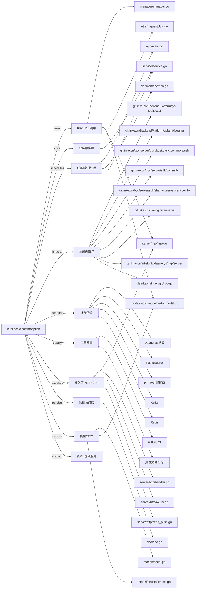

# busi.basic.commonpush 技术图谱

## 一图技术图谱


## 项目定位
- 源码路径：`/Users/dds/go/src/git.inke.cn/bpc/server/busi/busi.basic.commonpush`
- 领域判断：基础服务
- README 摘要：busi.basic.pc-p"***REDACTED***"

```text
# busi.basic.pc-p"***REDACTED***"
## 项目简介
## 配置说明
## CHANGELOG
aaaa
```

## 静态结构画像
- 文本/代码文件数：29
- Go 文件数：22
- 文件类型分布：.go(22), .md(2), .toml(2), .json(2), .yml(1)
- 顶层目录分布：app(4), server(4), utils(4), model(3), api(3), constants(2), manager(2), dao(1), docs(1), daemon(1)

## 关键目录
- `app`: 4 个文本/代码文件
- `server`: 4 个文本/代码文件
- `utils`: 4 个文本/代码文件
- `model`: 3 个文本/代码文件
- `api`: 3 个文本/代码文件
- `constants`: 2 个文本/代码文件
- `manager`: 2 个文本/代码文件
- `dao`: 1 个文本/代码文件
- `docs`: 1 个文本/代码文件
- `daemon`: 1 个文本/代码文件
- `service`: 1 个文本/代码文件
- `conf`: 1 个文本/代码文件

## 代码分层
- 接入层文件：4 个
- 服务层文件：1 个
- 数据访问文件：1 个
- 模型文件：3 个
- 任务/定时相关文件：3 个
- RPC/IDL 相关文件：4 个

## API/路由线索
- 静态扫描未提取到显式路由字符串，需结合框架注册/网关配置确认

## 核心类型与方法线索
- 导出结构体：Dao, SendType, SessionResp, Manager, Model, Atom, LiveStaticAtom, BaseResponse, SendPushResponse, Service, Config
- 导出函数/方法：GetErr, New, Ping, Close, GetRequestBody, JSON, Init, Shutdown, SendPush, SendPushOneTest, TestDingSign, CheckSession, CheckSessionRequest, CanPcPkInviteAccept, CanPcPkMatch, ReverseSidFunc, GetHeader, RSAEncrypt, RSADecrypt, DecodeQuery, StrToMd5, RsaDecrypt, GetUUID, HTTPGet, HTTPPost, DingDingEncodeSign, DecodeBody, New, Ping, Close

## 外部依赖线索
- HTTP/外部接口: 10 处信号
- Daenerys 框架: 7 处信号
- Redis: 4 处信号
- Elasticsearch: 2 处信号
- Kafka: 1 处信号

## 内部依赖线索
- `git.inke.cn/bpc/server/busi/busi.basic.commonpush`: 25
- `git.inke.cn/BackendPlatform/golang/logging`: 10
- `git.inke.cn/inkelogic/daenerys/http/server`: 4
- `git.inke.cn/inkelogic/daenerys`: 3
- `git.inke.cn/bpc/server/sdk/shanyin.server.serviceinfo`: 2
- `git.inke.cn/bpc/server/sdk/commlib`: 2
- `git.inke.cn/inkelogic/rpc-go`: 2
- `git.inke.cn/BackendPlatform/go-tools/cast`: 2
- `git.inke.cn/BackendPlatform/golang/redis`: 2
- `git.inke.cn/BackendPlatform/golang/safego`: 2
- `git.inke.cn/BackendPlatform/golang/ecode`: 2
- `git.inke.cn/inkelogic/daenerys/plugins/http`: 1

## 第三方 import 概览
- crypto(6), os(4), github.com(4), io(3), log(2), flag(1), syscall(1), testing(1), bytes(1)

## IDL/协议文件
- 未发现 proto/thrift 文件

## 工程质量与交付
- GitLab CI：有
- golangci-lint：未发现
- 测试文件：
- `utils/requestUtils_test.go`

## 阅读建议
- 先读 README 和 `server/http`、`handler`、`service` 目录，确认入口 API 与核心业务流程。
- 再沿服务层方法进入 DAO/Repo/Model，确认数据表、缓存 Key、RPC 调用和异步任务。
- 若图中只出现少量节点，通常表示该项目是配置型/胶水型服务，需结合上层共享工程和部署配置继续确认。
