# busi.basic.inout 技术图谱

## 一图技术图谱

```mermaid
flowchart LR
  naa1df2ef["Daenerys 框架"]
  n8f718eeb["GORM"]
  n7c735559["HTTP/外部接口"]
  n51be25b0["Kafka"]
  n62a004b9["MySQL"]
  n8aa21d2e["RPC/IDL 调用"]
  ne1114467["Redis"]
  nd3cffdee["app/main.go"]
  nb49fec1c["backend/cron.go"]
  n7a224e78["backend/init.go"]
  n3647b88f["backend/send_charts_to_dd.go"]
  n44e188fd["busi.basic.inout"]
  nb9b1545a["dao/dao.go"]
  n85a2481b["dao/dao_asset_transaction_record.go"]
  n913453b7["dao/dao_balance_delay.go"]
  neb1444f2["dao/dao_inout_transaction_record.go"]
  n36a03684["dao/dao_lock.go"]
  n25093ff8["dao/dao_report.go"]
  nae0f75b4["dao/dao_scene.go"]
  nbfa5311d["git.inke.cn/BackendPlatform/go-tools/cast"]
  n7d7ea8b2["git.inke.cn/BackendPlatform/golang/logging"]
  ne2260199["git.inke.cn/BackendPlatform/golang/trace"]
  nd411032d["git.inke.cn/bpc/server/busi/busi.basic.inout"]
  n7de617ec["git.inke.cn/bpc/server/sdk/commlib"]
  n0d851172["git.inke.cn/inkelogic/daenerys"]
  n0cea5f4d["git.inke.cn/inkelogic/daenerys/http/client"]
  n7bacf918["git.inke.cn/inkelogic/daenerys/http/server"]
  n8077df92["manager/manager.go"]
  n661f60ff["model/bill_coin.go"]
  n3c5e03bc["model/bill_gold.go"]
  ned12ef19["model/charts_rule.go"]
  n11885c9a["model/finance_coin.go"]
  nee0c92b9["model/gift_bag.go"]
  nfa1b8922["server/http/handler.go"]
  nf03d9c77["server/http/http.go"]
  n6dfa5257["server/http/router.go"]
  nfd7aee56["service/charts_draw.go"]
  nf9e4b3ff["service/losses_continuous_minutes.go"]
  neeade751["service/service.go"]
  n56820625["service/service_aoto_mig.go"]
  n149a61a6["service/service_asset_report.go"]
  n621a7958["service/service_balance_delay_handle.go"]
  n927e63a3["service/service_inout_upload.go"]
  n888b7733["业务服务层"]
  n8d81b440["任务/定时处理"]
  n7cc1b88f["公司内部包"]
  nb682654e["外部依赖"]
  nadeed157["工程质量"]
  n8de19b79["接入层 HTTP/API"]
  n9bfbba5f["数据访问层"]
  ne9fe3e59["模型/DTO"]
  ned98e090["测试文件 4 个"]
  n71831234["领域: 基础服务"]
  n8aa21d2e --> n8077df92
  n8aa21d2e --> nf03d9c77
  n8aa21d2e --> n149a61a6
  n44e188fd -- "uses" --> n8aa21d2e
  n44e188fd -- "core" --> n888b7733
  n44e188fd -- "schedules" --> n8d81b440
  n44e188fd -- "imports" --> n7cc1b88f
  n44e188fd -- "depends" --> nb682654e
  n44e188fd -- "quality" --> nadeed157
  n44e188fd -- "exposes" --> n8de19b79
  n44e188fd -- "persists" --> n9bfbba5f
  n44e188fd -- "defines" --> ne9fe3e59
  n44e188fd -- "domain" --> n71831234
  n888b7733 --> nfd7aee56
  n888b7733 --> nf9e4b3ff
  n888b7733 --> neeade751
  n888b7733 --> n56820625
  n888b7733 --> n149a61a6
  n888b7733 --> n621a7958
  n888b7733 --> n927e63a3
  n8d81b440 --> nd3cffdee
  n8d81b440 --> nb49fec1c
  n8d81b440 --> n7a224e78
  n8d81b440 --> n3647b88f
  n7cc1b88f --> nbfa5311d
  n7cc1b88f --> n7d7ea8b2
  n7cc1b88f --> ne2260199
  n7cc1b88f --> nd411032d
  n7cc1b88f --> n7de617ec
  n7cc1b88f --> n0d851172
  n7cc1b88f --> n0cea5f4d
  n7cc1b88f --> n7bacf918
  nb682654e --> naa1df2ef
  nb682654e --> n8f718eeb
  nb682654e --> n7c735559
  nb682654e --> n51be25b0
  nb682654e --> n62a004b9
  nb682654e --> ne1114467
  nadeed157 --> ned98e090
  n8de19b79 --> nfa1b8922
  n8de19b79 --> nf03d9c77
  n8de19b79 --> n6dfa5257
  n9bfbba5f --> nb9b1545a
  n9bfbba5f --> n85a2481b
  n9bfbba5f --> n913453b7
  n9bfbba5f --> neb1444f2
  n9bfbba5f --> n36a03684
  n9bfbba5f --> n25093ff8
  n9bfbba5f --> nae0f75b4
  ne9fe3e59 --> n661f60ff
  ne9fe3e59 --> n3c5e03bc
  ne9fe3e59 --> ned12ef19
  ne9fe3e59 --> n11885c9a
  ne9fe3e59 --> nee0c92b9
```


## 项目定位
- 源码路径：`/Users/dds/go/src/git.inke.cn/bpc/server/busi/busi.basic.inout`
- 领域判断：基础服务
- README 摘要：busi.basic.inout

```text
# busi.basic.inout
付费活跃收支服务。用来做风控
## 项目简介
wiki: https://wiki.inkept.cn/pages/viewpage.action?pageId=143171019
## 配置说明
### bj
```shell
mysql -h rm-2ze34squt0ou6xc2k.mysql.rds.aliyuncs.com -u inke_db_user -p"***REDACTED***" --default-character-set=utf8 inout
```
```shell
redis-cli -h r-2ze959c569480f64.redis.rds.aliyuncs.com -a ***REDACTED***
```
```

## 静态结构画像
- 文本/代码文件数：58
- Go 文件数：53
- 文件类型分布：.go(53), .md(2), .toml(2), .json(1)
- 顶层目录分布：service(12), model(11), backend(10), dao(8), manager(6), app(4), server(3), api(2), conf(1)

## 关键目录
- `service`: 12 个文本/代码文件
- `model`: 11 个文本/代码文件
- `backend`: 10 个文本/代码文件
- `dao`: 8 个文本/代码文件
- `manager`: 6 个文本/代码文件
- `app`: 4 个文本/代码文件
- `server`: 3 个文本/代码文件
- `api`: 2 个文本/代码文件
- `conf`: 1 个文本/代码文件

## 代码分层
- 接入层文件：3 个
- 服务层文件：12 个
- 数据访问文件：8 个
- 模型文件：11 个
- 任务/定时相关文件：4 个
- RPC/IDL 相关文件：3 个

## API/路由线索
- 静态扫描未提取到显式路由字符串，需结合框架注册/网关配置确认

## 核心类型与方法线索
- 导出结构体：Dao, KafkaManager, KafkaConsumer, Backend, Manager, DingtalkRobot, Response, Message, TextMessage, AtMessage, LinkMessage, MarkdownMessage, FinanceCoinEvent, FinanceCoinEventData, GiftBagEvent, GiftBagEventReq, GiftBagEventRes, GiftBagEventEventInfo, BillGoldEvent, SourceDescStruct, RuleExtra, RuleExtraProfitChartsRule, AlarmRuleExtra, DefaultMessageReporter, BillCoinEvent, AssetTransactionRecord, Model, InoutUploadReq, AssetReportReq, InoutTransactionRecord
- 导出函数/方法：AddReportList, AddReportListMulti, GetReportList, AssetReport, AutoCleanAssetTransactionRecord, Upload, AutoCreateTransactionRecordTable, GetRecordsListBySceneIDAndCreateTime, Lock, Unlock, GetBalanceDelayMQ, AddBalanceDelayMQ, GetSessionsByIDs, GetAllScenes, New, Ping, Close, Init, Shutdown, FinanceCoinKafkaHandler, GiftBagKafkaHandler, SendChartsToDdInit, BillGoldKafkaHandler, InitCronFunc, BillCoinKafkaHandler, AlarmToDdInit, NewKafkaManager, Run, Stop, NewKafkaConsumer

## 外部依赖线索
- Daenerys 框架: 11 处信号
- HTTP/外部接口: 10 处信号
- Kafka: 9 处信号
- GORM: 6 处信号
- Redis: 4 处信号
- MySQL: 2 处信号

## 内部依赖线索
- `git.inke.cn/bpc/server/busi/busi.basic.inout`: 53
- `git.inke.cn/BackendPlatform/golang/logging`: 21
- `git.inke.cn/bpc/server/sdk/commlib`: 7
- `git.inke.cn/inkelogic/daenerys`: 6
- `git.inke.cn/inkelogic/daenerys/http/server`: 3
- `git.inke.cn/BackendPlatform/golang/trace`: 3
- `git.inke.cn/inkelogic/daenerys/http/client`: 3
- `git.inke.cn/BackendPlatform/go-tools/cast`: 2
- `git.inke.cn/BackendPlatform/golang/kafka`: 2
- `git.inke.cn/bpc/server/sdk/options`: 2
- `git.inke.cn/BackendPlatform/golang/redis`: 2
- `git.inke.cn/BackendPlatform/golang/sql`: 2

## 第三方 import 概览
- github.com(20), golang.org(5), testing(4), image(4), os(3), crypto(2), reflect(2), flag(1), log(1), syscall(1)

## IDL/协议文件
- 未发现 proto/thrift 文件

## 工程质量与交付
- GitLab CI：未发现
- golangci-lint：未发现
- 测试文件：
- `manager/dingtalk/rebot_test.go`
- `service/service_test.go`
- `service/service_inout_upload_test.go`
- `service/service_load_scene_test.go`

## 阅读建议
- 先读 README 和 `server/http`、`handler`、`service` 目录，确认入口 API 与核心业务流程。
- 再沿服务层方法进入 DAO/Repo/Model，确认数据表、缓存 Key、RPC 调用和异步任务。
- 若图中只出现少量节点，通常表示该项目是配置型/胶水型服务，需结合上层共享工程和部署配置继续确认。
