# busi.basic.pc-proxy 技术图谱

## 一图技术图谱

```mermaid
flowchart LR
  naa1df2ef["Daenerys 框架"]
  n8f718eeb["GORM"]
  na05476e7["GitLab CI"]
  n7c735559["HTTP/外部接口"]
  n51be25b0["Kafka"]
  n8aa21d2e["RPC/IDL 调用"]
  nd3cffdee["app/main.go"]
  ne8b02741["busi.basic.pc-proxy"]
  nb9b1545a["dao/dao.go"]
  nbfa5311d["git.inke.cn/BackendPlatform/go-tools/cast"]
  n7d7ea8b2["git.inke.cn/BackendPlatform/golang/logging"]
  nb3b910d3["git.inke.cn/bpc/server/busi/busi.basic.pc-proxy"]
  n7de617ec["git.inke.cn/bpc/server/sdk/commlib"]
  n58d5ea77["git.inke.cn/bpc/server/sdk/shanyin.server.serviceinfo"]
  n0d851172["git.inke.cn/inkelogic/daenerys"]
  n7bacf918["git.inke.cn/inkelogic/daenerys/http/server"]
  n961ac33a["git.inke.cn/inkelogic/rpc-go"]
  n8077df92["manager/manager.go"]
  n739a6b7e["manager/upload.go"]
  ne7c6f541["model/commonModel.go"]
  n0b75237e["model/keepConnectionModel.go"]
  n41c5af00["model/linkModel.go"]
  nc31b8654["model/model.go"]
  n0edcd523["model/pkModel.go"]
  nd3c52831["server/http/activeHandler.go"]
  n5fb5efdd["server/http/activityConfigHandler.go"]
  nfa1b8922["server/http/handler.go"]
  nf03d9c77["server/http/http.go"]
  nc88af3b7["server/http/keepconnctionHandler.go"]
  nd750984b["server/http/pc_base_func.go"]
  neeade751["service/service.go"]
  n11b3db06["service/streamService.go"]
  n24769c3f["service/upload.go"]
  n182495e8["utils/ruquestUtils.go"]
  n888b7733["业务服务层"]
  n8d81b440["任务/定时处理"]
  n7cc1b88f["公司内部包"]
  nb682654e["外部依赖"]
  nadeed157["工程质量"]
  n8de19b79["接入层 HTTP/API"]
  n9bfbba5f["数据访问层"]
  ne9fe3e59["模型/DTO"]
  n0f632d9e["测试文件 3 个"]
  n71831234["领域: 基础服务"]
  n8aa21d2e --> n8077df92
  n8aa21d2e --> n739a6b7e
  n8aa21d2e --> nf03d9c77
  n8aa21d2e --> n11b3db06
  n8aa21d2e --> n182495e8
  ne8b02741 -- "uses" --> n8aa21d2e
  ne8b02741 -- "core" --> n888b7733
  ne8b02741 -- "schedules" --> n8d81b440
  ne8b02741 -- "imports" --> n7cc1b88f
  ne8b02741 -- "depends" --> nb682654e
  ne8b02741 -- "quality" --> nadeed157
  ne8b02741 -- "exposes" --> n8de19b79
  ne8b02741 -- "persists" --> n9bfbba5f
  ne8b02741 -- "defines" --> ne9fe3e59
  ne8b02741 -- "domain" --> n71831234
  n888b7733 --> neeade751
  n888b7733 --> n11b3db06
  n888b7733 --> n24769c3f
  n8d81b440 --> nd3cffdee
  n8d81b440 --> ne7c6f541
  n8d81b440 --> n0edcd523
  n8d81b440 --> nd750984b
  n7cc1b88f --> nbfa5311d
  n7cc1b88f --> n7d7ea8b2
  n7cc1b88f --> nb3b910d3
  n7cc1b88f --> n7de617ec
  n7cc1b88f --> n58d5ea77
  n7cc1b88f --> n0d851172
  n7cc1b88f --> n7bacf918
  n7cc1b88f --> n961ac33a
  nb682654e --> naa1df2ef
  nb682654e --> n8f718eeb
  nb682654e --> n7c735559
  nb682654e --> n51be25b0
  nadeed157 --> na05476e7
  nadeed157 --> n0f632d9e
  n8de19b79 --> nd3c52831
  n8de19b79 --> n5fb5efdd
  n8de19b79 --> nfa1b8922
  n8de19b79 --> nf03d9c77
  n8de19b79 --> nc88af3b7
  n9bfbba5f --> nb9b1545a
  ne9fe3e59 --> ne7c6f541
  ne9fe3e59 --> n0b75237e
  ne9fe3e59 --> n41c5af00
  ne9fe3e59 --> nc31b8654
  ne9fe3e59 --> n0edcd523
```


## 项目定位
- 源码路径：`/Users/dds/go/src/git.inke.cn/bpc/server/busi/busi.basic.pc-proxy`
- 领域判断：基础服务
- README 摘要：busi.basic.pc-p"***REDACTED***"

```text
# busi.basic.pc-p"***REDACTED***"
## 项目简介
## 配置说明
## CHANGELOG
```

## 静态结构画像
- 文本/代码文件数：58
- Go 文件数：44
- 文件类型分布：.go(44), .json(5), .toml(3), .conf(3), .md(2), .yml(1)
- 顶层目录分布：server(18), app(12), model(8), utils(5), api(3), service(3), tests(2), manager(2), dao(1), docs(1)

## 关键目录
- `server`: 18 个文本/代码文件
- `app`: 12 个文本/代码文件
- `model`: 8 个文本/代码文件
- `utils`: 5 个文本/代码文件
- `api`: 3 个文本/代码文件
- `service`: 3 个文本/代码文件
- `tests`: 2 个文本/代码文件
- `manager`: 2 个文本/代码文件
- `dao`: 1 个文本/代码文件
- `docs`: 1 个文本/代码文件
- `conf`: 1 个文本/代码文件

## 代码分层
- 接入层文件：20 个
- 服务层文件：3 个
- 数据访问文件：1 个
- 模型文件：8 个
- 任务/定时相关文件：4 个
- RPC/IDL 相关文件：5 个

## API/路由线索
- 静态扫描未提取到显式路由字符串，需结合框架注册/网关配置确认

## 核心类型与方法线索
- 导出结构体：PathInfo, ProxyInfo, ProxyConfig, Dao, LogInfo, SessionResp, UploadResponse, Manager, LogInfo, Atom, LiveStaticAtom, BaseResponse, PublishResponse, PhoneLoginRequest, PhoneLoginResponse, PhoneCodeRequest, PhoneCodeResponse, LogoutRequest, LogoutResponse, PullStreamAddrResponse, StartLiveRequest, StartLiveResponse, StopLiveResponse, ChatRoomResponse, ToolConfigResponse, ToolConfig, LocationInfoResponse, GpsInfo, IgnoreResIdResponse, MyActivityListResponse
- 导出函数/方法：Init, GetProxyInfoByPath, New, Ping, Close, TestSid, PKCS5Padding, PKCS5UnPadding, DesDecrypt, DesEncrypt, TestName, TestRevertsid, TestDes, UploadImage, ProxyRequest, GetRequestBody, JSON, VersionCheck, Init, Shutdown, Location, TestReverseSid, TestRs, CheckSession, CheckSessionRequest, CanPcPkInviteAccept, CanPcPkMatch, PKCS5Padding, PKCS5UnPadding, DesDecrypt

## 外部依赖线索
- HTTP/外部接口: 27 处信号
- Daenerys 框架: 24 处信号
- Kafka: 1 处信号
- GORM: 1 处信号

## 内部依赖线索
- `git.inke.cn/bpc/server/busi/busi.basic.pc-proxy`: 73
- `git.inke.cn/BackendPlatform/golang/logging`: 23
- `git.inke.cn/inkelogic/daenerys/http/server`: 18
- `git.inke.cn/BackendPlatform/go-tools/cast`: 11
- `git.inke.cn/inkelogic/daenerys`: 4
- `git.inke.cn/inkelogic/rpc-go`: 3
- `git.inke.cn/bpc/server/sdk/shanyin.server.serviceinfo`: 2
- `git.inke.cn/bpc/server/sdk/commlib`: 2
- `git.inke.cn/bpc/server/sdk/user.account.common_config`: 2
- `git.inke.cn/inkelogic/daenerys/http/client`: 2
- `git.inke.cn/inkelogic/daenerys/proxy`: 2
- `git.inke.cn/BackendPlatform/golang/ecode`: 2

## 第三方 import 概览
- crypto(14), io(6), bytes(5), os(3), testing(3), github.com(2), flag(1), log(1), syscall(1)

## IDL/协议文件
- 未发现 proto/thrift 文件

## 工程质量与交付
- GitLab CI：有
- golangci-lint：未发现
- 测试文件：
- `tests/sid_test.go`
- `tests/phone_rsa_test.go`
- `utils/utils_test.go`

## 阅读建议
- 先读 README 和 `server/http`、`handler`、`service` 目录，确认入口 API 与核心业务流程。
- 再沿服务层方法进入 DAO/Repo/Model，确认数据表、缓存 Key、RPC 调用和异步任务。
- 若图中只出现少量节点，通常表示该项目是配置型/胶水型服务，需结合上层共享工程和部署配置继续确认。
