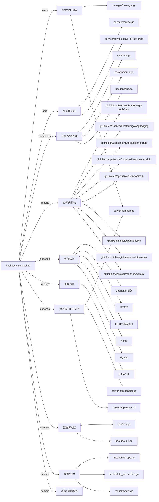

# busi.basic.serviceinfo 技术图谱

## 一图技术图谱


## 项目定位
- 源码路径：`/Users/dds/go/src/git.inke.cn/bpc/server/busi/busi.basic.serviceinfo`
- 领域判断：基础服务
- README 摘要：busi.basic.serviceinfo

```text
# busi.basic.serviceinfo
## 项目简介
## 配置说明
## CHANGELOG
```

## 静态结构画像
- 文本/代码文件数：25
- Go 文件数：19
- 文件类型分布：.go(19), .md(2), .toml(2), .yml(1), .json(1)
- 顶层目录分布：app(4), server(3), model(3), dao(2), backend(2), manager(2), api(2), service(2), conf(2), util(1)

## 关键目录
- `app`: 4 个文本/代码文件
- `server`: 3 个文本/代码文件
- `model`: 3 个文本/代码文件
- `dao`: 2 个文本/代码文件
- `backend`: 2 个文本/代码文件
- `manager`: 2 个文本/代码文件
- `api`: 2 个文本/代码文件
- `service`: 2 个文本/代码文件
- `conf`: 2 个文本/代码文件
- `util`: 1 个文本/代码文件

## 代码分层
- 接入层文件：3 个
- 服务层文件：2 个
- 数据访问文件：2 个
- 模型文件：3 个
- 任务/定时相关文件：3 个
- RPC/IDL 相关文件：2 个

## API/路由线索
- `=>`

## 核心类型与方法线索
- 导出结构体：AllServerRule, AllServerPolicy, Dao, Backend, Manager, OpsPutRequest, ServiceInfoRequest, Model, Service, Config, ServiceInfoSwitch
- 导出函数/方法：CvContainsMatch, CvVersionGtOrEqMatch, OsGenderMatch, GetOsVersion, TimeBetween, TableName, TableName, GetAllServerPolicy, OpsQuery, OpsInsertOrUpdate, MaxID, GetAllServerRule, New, Ping, Close, Init, Shutdown, InitCronFunc, New, Start, Stop, GetLogID, New, Ping, Close, AllServer, Load, LoadAllServerRule, LoadAllServer, New

## 外部依赖线索
- HTTP/外部接口: 8 处信号
- Daenerys 框架: 7 处信号
- GORM: 2 处信号
- MySQL: 1 处信号
- Kafka: 1 处信号

## 内部依赖线索
- `git.inke.cn/bpc/server/busi/busi.basic.serviceinfo`: 18
- `git.inke.cn/BackendPlatform/golang/logging`: 7
- `git.inke.cn/bpc/server/sdk/commlib`: 4
- `git.inke.cn/inkelogic/daenerys`: 3
- `git.inke.cn/inkelogic/daenerys/http/server`: 3
- `git.inke.cn/BackendPlatform/go-tools/cast`: 2
- `git.inke.cn/BackendPlatform/golang/trace`: 2
- `git.inke.cn/inkelogic/daenerys/proxy`: 1
- `git.inke.cn/inkelogic/daenerys/plugins/http`: 1
- `git.inke.cn/BackendPlatform/go-tools/cron`: 1
- `git.inke.cn/bpc/server/sdk/logid`: 1
- `git.inke.cn/BackendPlatform/golang/ecode`: 1

## 第三方 import 概览
- os(3), github.com(2), io(2), flag(1), log(1), syscall(1), regexp(1), golang.org(1), crypto(1)

## IDL/协议文件
- 未发现 proto/thrift 文件

## 工程质量与交付
- GitLab CI：有
- golangci-lint：未发现
- 测试文件：
- 未发现 `_test.go`

## 阅读建议
- 先读 README 和 `server/http`、`handler`、`service` 目录，确认入口 API 与核心业务流程。
- 再沿服务层方法进入 DAO/Repo/Model，确认数据表、缓存 Key、RPC 调用和异步任务。
- 若图中只出现少量节点，通常表示该项目是配置型/胶水型服务，需结合上层共享工程和部署配置继续确认。
