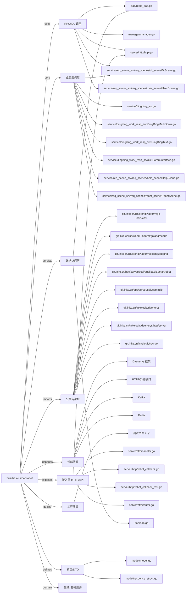

# busi.basic.smartrobot 技术图谱

## 一图技术图谱


## 项目定位
- 源码路径：`/Users/dds/go/src/git.inke.cn/bpc/server/busi/busi.basic.smartrobot`
- 领域判断：基础服务
- README 摘要：busi.basic.pc-p"***REDACTED***"

```text
# busi.basic.pc-p"***REDACTED***"
## 项目简介
## 配置说明
## CHANGELOG
```

## 静态结构画像
- 文本/代码文件数：57
- Go 文件数：50
- 文件类型分布：.go(50), .toml(3), .md(2), .json(2)
- 顶层目录分布：internal(12), service(11), server(7), app(6), utils(5), api(3), constants(2), dao(2), tests(2), model(2)

## 关键目录
- `internal`: 12 个文本/代码文件
- `service`: 11 个文本/代码文件
- `server`: 7 个文本/代码文件
- `app`: 6 个文本/代码文件
- `utils`: 5 个文本/代码文件
- `api`: 3 个文本/代码文件
- `constants`: 2 个文本/代码文件
- `dao`: 2 个文本/代码文件
- `tests`: 2 个文本/代码文件
- `model`: 2 个文本/代码文件
- `monitor`: 1 个文本/代码文件
- `docs`: 1 个文本/代码文件

## 代码分层
- 接入层文件：7 个
- 服务层文件：11 个
- 数据访问文件：2 个
- 模型文件：2 个
- 任务/定时相关文件：0 个
- RPC/IDL 相关文件：6 个

## API/路由线索
- 静态扫描未提取到显式路由字符串，需结合框架注册/网关配置确认

## 核心类型与方法线索
- 导出结构体：ReporterImpl, PathInfo, ProxyInfo, ProxyConfig, Dao, LogInfo, SessionManager, MessageHandler, CustomerService, Storage, SQLProxyFactory, SQLProxyForHTTP, SQLProxyForRedis, Session, Atom, SessionResp, Manager, Model, DingDingCallback, ReqActionInfo, RespActionDesc, RespSceneInfo, ApiIndexReq, BaseResponse, UserRoleInfo, UserLimitInfo, DeviceList, Service, DingDingMarkDownMsg, DingDingTextMsg
- 导出函数/方法：Report, Init, GetProxyInfoByPath, GetErr, RedisInit, GetRedis, RedisSetNxEx, RedisSetTabKey, RedisExists, New, Ping, Close, TestSid, PKCS5Padding, PKCS5UnPadding, DesDecrypt, DesEncrypt, TestName, TestRevertsid, TestDes, NewSessionManager, StartSession, GetCurrentSessionID, UpdateSessionTime, DeleteSession, NewMessageHandler, HandleMessage, InitializeCustomerService, InitializeCustomerService, NewCustomerService

## 外部依赖线索
- HTTP/外部接口: 18 处信号
- Daenerys 框架: 13 处信号
- Redis: 5 处信号
- Kafka: 1 处信号

## 内部依赖线索
- `git.inke.cn/bpc/server/busi/busi.basic.smartrobot`: 59
- `git.inke.cn/BackendPlatform/golang/logging`: 12
- `git.inke.cn/inkelogic/daenerys/http/server`: 7
- `git.inke.cn/inkelogic/daenerys`: 4
- `git.inke.cn/inkelogic/rpc-go`: 4
- `git.inke.cn/BackendPlatform/go-tools/cast`: 3
- `git.inke.cn/bpc/server/sdk/commlib`: 2
- `git.inke.cn/BackendPlatform/golang/ecode`: 2
- `git.inke.cn/inkelogic/daenerys/http/client`: 2
- `git.inke.cn/BackendPlatform/golang/trace`: 1
- `git.inke.cn/bpc/server/sdk/dingtoken`: 1
- `git.inke.cn/BackendPlatform/golang/redis`: 1

## 第三方 import 概览
- crypto(12), io(6), github.com(6), bytes(4), testing(4), os(3), mosn.io(1), flag(1), log(1), syscall(1)

## IDL/协议文件
- 未发现 proto/thrift 文件

## 工程质量与交付
- GitLab CI：未发现
- golangci-lint：未发现
- 测试文件：
- `tests/sid_test.go`
- `tests/phone_rsa_test.go`
- `server/http/robot_callback_test.go`
- `utils/requestUtils_test.go`

## 阅读建议
- 先读 README 和 `server/http`、`handler`、`service` 目录，确认入口 API 与核心业务流程。
- 再沿服务层方法进入 DAO/Repo/Model，确认数据表、缓存 Key、RPC 调用和异步任务。
- 若图中只出现少量节点，通常表示该项目是配置型/胶水型服务，需结合上层共享工程和部署配置继续确认。
