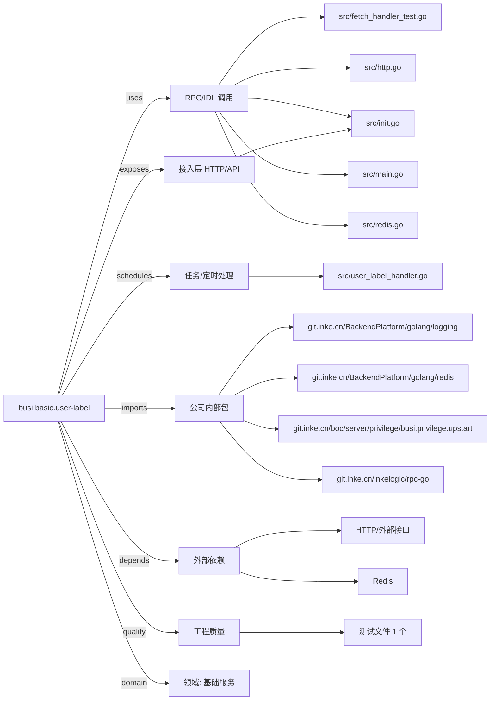

# busi.basic.user-label 技术图谱

## 一图技术图谱


## 项目定位
- 源码路径：`/Users/dds/go/src/git.inke.cn/bpc/server/busi/busi.basic.user-label`
- 领域判断：基础服务
- README 摘要：无标题

```text
未发现 README 或 README 内容为空
```

## 静态结构画像
- 文本/代码文件数：17
- Go 文件数：11
- 文件类型分布：.go(11), .toml(3), .ini(2), .json(1)
- 顶层目录分布：src(12), etc(5)

## 关键目录
- `src`: 12 个文本/代码文件
- `etc`: 5 个文本/代码文件

## 代码分层
- 接入层文件：1 个
- 服务层文件：0 个
- 数据访问文件：0 个
- 模型文件：0 个
- 任务/定时相关文件：1 个
- RPC/IDL 相关文件：5 个

## API/路由线索
- `=`

## 核心类型与方法线索
- 导出结构体：Config, Ret, Params, UserLabelHandler, Task, RedisClient
- 导出函数/方法：InitServerConfig, NewRet, UpdateRet, Set, Serve, Init, TestGetUserContribution, AddLabelCache, InitRedisHandle, RedisHMGet, RedisHGet, RedisExpire, RedisIncrby, RedisHlen, RedisHset, RedisHdel, RedisHgetAll, RedisDel, RedisGet, RedisSetex, InitServer, InitServerRedis

## 外部依赖线索
- Redis: 6 处信号
- HTTP/外部接口: 6 处信号

## 内部依赖线索
- `git.inke.cn/BackendPlatform/golang/logging`: 7
- `git.inke.cn/inkelogic/rpc-go`: 5
- `git.inke.cn/BackendPlatform/golang/redis`: 2
- `git.inke.cn/boc/server/privilege/busi.privilege.upstart`: 1

## 第三方 import 概览
- golang.org(4), flag(2), os(2), testing(1), bytes(1), github.com(1)

## IDL/协议文件
- 未发现 proto/thrift 文件

## 工程质量与交付
- GitLab CI：未发现
- golangci-lint：未发现
- 测试文件：
- `src/fetch_handler_test.go`

## 阅读建议
- 先读 README 和 `server/http`、`handler`、`service` 目录，确认入口 API 与核心业务流程。
- 再沿服务层方法进入 DAO/Repo/Model，确认数据表、缓存 Key、RPC 调用和异步任务。
- 若图中只出现少量节点，通常表示该项目是配置型/胶水型服务，需结合上层共享工程和部署配置继续确认。
