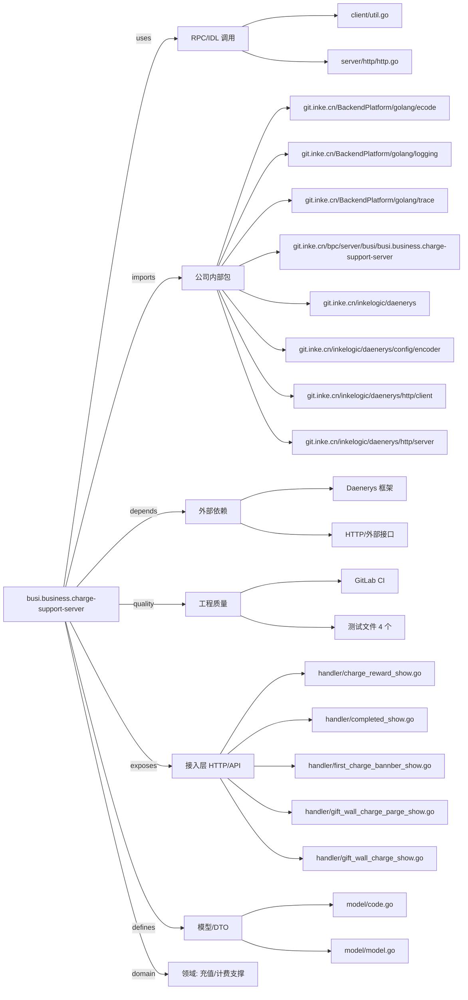

# busi.business.charge-support-server 技术图谱

## 一图技术图谱


## 项目定位
- 源码路径：`/Users/dds/go/src/git.inke.cn/bpc/server/busi/busi.business.charge-support-server`
- 领域判断：充值/计费支撑
- README 摘要：busi.business.charge-support-server

```text
# busi.business.charge-support-server
## 项目简介
## 配置说明
## CHANGELOG
```

## 静态结构画像
- 文本/代码文件数：28
- Go 文件数：22
- 文件类型分布：.go(22), .toml(3), .md(1), .yml(1), .json(1)
- 顶层目录分布：handler(8), client(8), app(5), server(2), model(2), conf(1)

## 关键目录
- `handler`: 8 个文本/代码文件
- `client`: 8 个文本/代码文件
- `app`: 5 个文本/代码文件
- `server`: 2 个文本/代码文件
- `model`: 2 个文本/代码文件
- `conf`: 1 个文本/代码文件

## 代码分层
- 接入层文件：11 个
- 服务层文件：0 个
- 数据访问文件：0 个
- 模型文件：2 个
- 任务/定时相关文件：0 个
- RPC/IDL 相关文件：2 个

## API/路由线索
- 静态扫描未提取到显式路由字符串，需结合框架注册/网关配置确认

## 核心类型与方法线索
- 导出结构体：ChargeRewardShowResp, GiftWallChargePageShowResp, CompletedShowReq, CompletedShowResp, FirstChargeBannerShowResp, PaymentMoreShowResp, PaymentMoreShowReq, PaymentShowResp, GiftWallChargeShowResp, Context, Config, Account, BaseRes, BannerConfQueryResp, IncomeSwitchResp, FirstChargeCheckResp, FirstChargeRewardResp, ChargeReward, ChargePageShowResp
- 导出函数/方法：ChargeRewardShow, GiftWallChargePageShow, CompletedShow, FirstChargeBannerShow, PaymentMoreShow, PaymentShow, GiftWallChargeShow, Init, Shutdown, NewContext, Init, TestClientFirstChargeCheck, TestClientFirstChargeReward, TestClientChargePageShow, TestClientGetUserStatisticInfo, GetUserStatisticInfo, TestClientqueryToMap, HTTPGet, HTTPPost, BannerConfQuery, IncomeSwitchQuery, FirstChargeCheck, FirstChargeReward, ChargePageShow, TestClientIncomeSwitchQuery

## 外部依赖线索
- HTTP/外部接口: 19 处信号
- Daenerys 框架: 18 处信号

## 内部依赖线索
- `git.inke.cn/bpc/server/busi/busi.business.charge-support-server`: 23
- `git.inke.cn/inkelogic/daenerys/http/server`: 13
- `git.inke.cn/inkelogic/daenerys`: 6
- `git.inke.cn/BackendPlatform/golang/logging`: 4
- `git.inke.cn/BackendPlatform/golang/trace`: 3
- `git.inke.cn/BackendPlatform/golang/ecode`: 2
- `git.inke.cn/inkelogic/daenerys/http/client`: 2
- `git.inke.cn/inkelogic/daenerys/config/encoder`: 1
- `git.inke.cn/bpc/server/sdk/commconst`: 1

## 第三方 import 概览
- github.com(7), testing(4), os(2), io(1), flag(1), log(1), syscall(1), bytes(1), runtime(1)

## IDL/协议文件
- 未发现 proto/thrift 文件

## 工程质量与交付
- GitLab CI：有
- golangci-lint：未发现
- 测试文件：
- `client/charge_server_test.go`
- `client/live_user_statistic_test.go`
- `client/util_test.go`
- `client/banner_query_test.go`

## 阅读建议
- 先读 README 和 `server/http`、`handler`、`service` 目录，确认入口 API 与核心业务流程。
- 再沿服务层方法进入 DAO/Repo/Model，确认数据表、缓存 Key、RPC 调用和异步任务。
- 若图中只出现少量节点，通常表示该项目是配置型/胶水型服务，需结合上层共享工程和部署配置继续确认。
