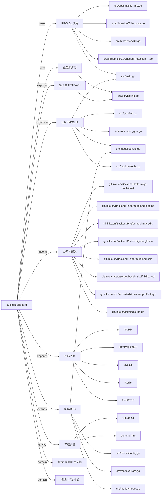

# busi.gift.billboard 技术图谱

## 一图技术图谱


## 项目定位
- 源码路径：`/Users/dds/go/src/git.inke.cn/bpc/server/busi/busi.gift.billboard`
- 领域判断：礼物/打赏, 充值/计费支撑
- README 摘要：无标题

```text
未发现 README 或 README 内容为空
```

## 静态结构画像
- 文本/代码文件数：64
- Go 文件数：57
- 文件类型分布：.go(57), .toml(3), .yml(2), .json(1), .thrift(1)
- 顶层目录分布：src(59), conf(3)

## 关键目录
- `src`: 59 个文本/代码文件
- `conf`: 3 个文本/代码文件

## 代码分层
- 接入层文件：1 个
- 服务层文件：1 个
- 数据访问文件：0 个
- 模型文件：4 个
- 任务/定时相关文件：5 个
- RPC/IDL 相关文件：18 个

## API/路由线索
- 静态扫描未提取到显式路由字符串，需结合框架注册/网关配置确认

## 核心类型与方法线索
- 导出结构体：AllContribution, HideBillBoardAdd, BaseDayBillBoard, MonthBillBoard, ContributorNumDayBillBoard, MysteryHideGet, AllBillBoard, BaseMonthBillBoard, InoutDayBillBoard, HideBillBoardDelete, BaseAllBillBoard, ContributionInfo, BaseLatestBillboardResp, InoutWeekBillBoard, BaseWeekBillBoard, DayContribution, MyThrift, WeekBillBoard, HideBillBoardGet, HideBillBoardGetResp, DayBillBoard, RedisPrefixProxy, PipelineProxy, BillThriftException, BillContent, GiftContent, SilverContent, SeqResult_, BillResult_, BalanceContent
- 导出函数/方法：Init, ProcessType, Process, IsPyramidAnchor, Init, ProcessType, Process, Init, ProcessType, Process, Init, ProcessType, Process, InitLocalCache, LocalCacheGetLiveIDByUID, LocalCacheSetLiveID, Init, ProcessType, Process, Init, ProcessType, Process, AddMedal, Init, ProcessType, Process, Init, ProcessType, Process, Init

## 外部依赖线索
- HTTP/外部接口: 25 处信号
- Redis: 12 处信号
- Thrift/RPC: 7 处信号
- GORM: 2 处信号
- MySQL: 1 处信号

## 内部依赖线索
- `git.inke.cn/bpc/server/busi/busi.gift.billboard`: 80
- `git.inke.cn/BackendPlatform/golang/logging`: 39
- `git.inke.cn/inkelogic/rpc-go`: 12
- `git.inke.cn/BackendPlatform/golang/redis`: 10
- `git.inke.cn/BackendPlatform/golang/utils`: 6
- `git.inke.cn/BackendPlatform/go-tools/cast`: 5
- `git.inke.cn/BackendPlatform/golang/trace`: 4
- `git.inke.cn/bpc/server/sdk/user.subprofile.logic`: 2
- `git.inke.cn/bpc/server/sdk/commconst`: 2
- `git.inke.cn/bpc/server/sdk/commlib`: 2
- `git.inke.cn/bpc/server/sdk/user.account.common_config`: 2
- `git.inke.cn/BackendPlatform/go-tools/req`: 2

## 第三方 import 概览
- golang.org(37), github.com(7), go.uber.org(4), bytes(3), reflect(2), git.apache.org(2), flag(1), os(1), io(1), database(1)

## IDL/协议文件
- `src/billservice/BillService.thrift`

## 工程质量与交付
- GitLab CI：有
- golangci-lint：有
- 测试文件：
- 未发现 `_test.go`

## 阅读建议
- 先读 README 和 `server/http`、`handler`、`service` 目录，确认入口 API 与核心业务流程。
- 再沿服务层方法进入 DAO/Repo/Model，确认数据表、缓存 Key、RPC 调用和异步任务。
- 若图中只出现少量节点，通常表示该项目是配置型/胶水型服务，需结合上层共享工程和部署配置继续确认。
