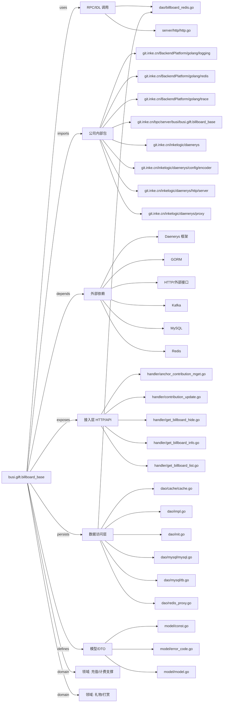

# busi.gift.billboard_base 技术图谱

## 一图技术图谱


## 项目定位
- 源码路径：`/Users/dds/go/src/git.inke.cn/bpc/server/busi/busi.gift.billboard_base`
- 领域判断：礼物/打赏, 充值/计费支撑
- README 摘要：busi.gift.billboard_base

```text
# busi.gift.billboard_base
榜单基础服务, 解决环调问题
```

## 静态结构画像
- 文本/代码文件数：34
- Go 文件数：30
- 文件类型分布：.go(30), .toml(2), .md(1), .json(1)
- 顶层目录分布：handler(12), dao(8), app(4), model(3), server(2), backend(2), util(1), conf(1)

## 关键目录
- `handler`: 12 个文本/代码文件
- `dao`: 8 个文本/代码文件
- `app`: 4 个文本/代码文件
- `model`: 3 个文本/代码文件
- `server`: 2 个文本/代码文件
- `backend`: 2 个文本/代码文件
- `util`: 1 个文本/代码文件
- `conf`: 1 个文本/代码文件

## 代码分层
- 接入层文件：12 个
- 服务层文件：0 个
- 数据访问文件：8 个
- 模型文件：3 个
- 任务/定时相关文件：0 个
- RPC/IDL 相关文件：2 个

## API/路由线索
- 静态扫描未提取到显式路由字符串，需结合框架注册/网关配置确认

## 核心类型与方法线索
- 导出结构体：AnchorContributionMGetReq, AnchorContributionMGetResp, Manager, ContributionUpdateReq, UserContributionMGetReq, UserContributionMGetResp, RedisPrefixProxy, PipelineProxy, UserContribution, AllBillboard, AllBillboardRecord, Mysql, Kafka, UpdateCacheTrigger, Context, BillboardList, ContributionInfo, LatestBillboard, BillboardRank, LatestBillboardPage, SendPropsKafkaMsg, RoomChatKafkaMsg, SendGiftKafkaMsg, Atom, Config
- 导出函数/方法：AnchorContributionMGet, GetLatestBillboardListTop, Check, GetBillboardListInfo, Work, UpdateBillboardInfo, ContributionUpdate, GetBillboardList, Check, UserContributionMGet, GetBillboardInfo, GetHideAll, GetLatestBillboardList, Check, Init, GetBillboardHide, SpanFromContext, GetLatestTimeUnit, GetLatestTimeUnitForRedis, GetLatestTimeUnitForMysql, GetHides, InitBillboardRds, GetBillboardList, GetHideAll, GetRank, IncrRank, IncrRankIncome, GetContribution, GetLatestBillboardTop, SetLatestBillboardTop

## 外部依赖线索
- Daenerys 框架: 18 处信号
- HTTP/外部接口: 16 处信号
- MySQL: 7 处信号
- Redis: 6 处信号
- GORM: 3 处信号
- Kafka: 3 处信号

## 内部依赖线索
- `git.inke.cn/bpc/server/busi/busi.gift.billboard_base`: 44
- `git.inke.cn/BackendPlatform/golang/logging`: 18
- `git.inke.cn/inkelogic/daenerys/http/server`: 14
- `git.inke.cn/inkelogic/daenerys`: 3
- `git.inke.cn/BackendPlatform/golang/redis`: 3
- `git.inke.cn/inkelogic/daenerys/proxy`: 3
- `git.inke.cn/BackendPlatform/golang/trace`: 3
- `git.inke.cn/inkelogic/daenerys/config/encoder`: 1
- `git.inke.cn/BackendPlatform/golang/safego`: 1
- `git.inke.cn/inkelogic/rpc-go`: 1
- `git.inke.cn/BackendPlatform/go-tools/cast`: 1
- `git.inke.cn/bpc/server/sdk/commlib`: 1

## 第三方 import 概览
- github.com(7), os(2), golang.org(1), flag(1), log(1), syscall(1), go.uber.org(1), reflect(1), io(1)

## IDL/协议文件
- 未发现 proto/thrift 文件

## 工程质量与交付
- GitLab CI：未发现
- golangci-lint：未发现
- 测试文件：
- 未发现 `_test.go`

## 阅读建议
- 先读 README 和 `server/http`、`handler`、`service` 目录，确认入口 API 与核心业务流程。
- 再沿服务层方法进入 DAO/Repo/Model，确认数据表、缓存 Key、RPC 调用和异步任务。
- 若图中只出现少量节点，通常表示该项目是配置型/胶水型服务，需结合上层共享工程和部署配置继续确认。
